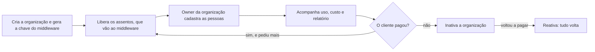

# Administração da instância

> **Em uma frase:** o painel de quem opera o Horus: criar as organizações, liberar os assentos, acompanhar o uso
> e o custo de cada uma e avisar todas as pessoas antes de uma parada.

## 🧭 O que é

Uma instalação do Horus, a **instância**, serve várias **organizações**: cada setor de uma empresa, ou cada
cliente, é uma. Na v2.0, o Horus é um serviço (SaaS) com uma instância só, a da Maind. Quem a opera é o
**administrador da instância**, um funcionário da Maind ("owner da instância" é o nome comercial do papel): ele vê
todas as organizações em números, sem ver os dados delas. O **owner da organização** é outro papel, de um
funcionário do cliente, que configura a organização dele. Os dois entram sempre com usuário e senha.

Hoje a administração guarda a marca do produto, os administradores e o envio de e-mail. Na v2.0, ela passa a criar
as organizações e ganha o **painel dos assentos**. Um assento é uma vaga de uso contratada, de um tipo: owner,
gestor, membro ouro (pergunta e cria boards e relatórios para si), membro prata (pergunta e recebe alertas e PDFs,
sem criar nada) ou membro bronze (só vê os painéis já compartilhados). A prata pergunta no app, na Pergunta rápida
(MF-110) e no WhatsApp e, quando chegar, usa a Investigação guiada (MF-119), da v2.1, mas não cria boards,
relatórios, agendamentos nem agentes, os trabalhos automáticos de IA: o bronze vê, a prata pergunta, o ouro cria.
No painel, a Maind libera as vagas, acompanha o uso e o custo e corta quem não paga. Ganha também um aviso a todas
as pessoas, para as paradas da instância.

Na v2.0, cada organização tem o seu **middleware**, a peça do Middleware da organização (MF-121) que fica entre o
Horus e os bancos da organização: ela guarda quem são as pessoas, os bancos e a IA dela e responde pelo caminho até
eles. A Maind o hospeda, ou o cliente o hospeda na casa dele. Criar a organização gera um certificado digital e uma chave
de instalação, que a ligam ao middleware dela, e os assentos que a Maind libera vão para lá, onde o owner da
organização cadastra as pessoas. A IA saiu do painel: é sempre da organização e se configura no **front do
middleware**, o aplicativo de configuração do middleware, separado do Horus.

> 📌 **Exemplo:** a Maind cria a organização da área comercial de uma rede de lojas, que nasce com o assento de
> owner do Marcos e já ligada ao middleware dela, e libera 30 assentos de membro ouro e 100 de membro bronze, que
> vão para lá. No fim do mês, vê as 1.200 perguntas de análise respondidas, sem ler nenhuma conversa, e baixa o
> relatório para conferir a cobrança.

## ✨ Características

- **Quem usa:** só os administradores da instância, todos com os mesmos poderes, inclusive promover e remover
  outro; a instância nunca fica sem administrador. Entram sempre com usuário e senha.
- **As organizações:** só a administração as cria. Cada uma nasce **em configuração**, sem bloquear ninguém, e
  fica **ativa** quando o administrador a dá por pronta. A criação gera o certificado digital e a chave de
  instalação do middleware da organização: cada uma tem o seu, e nenhum é dividido entre organizações.
- **A IA, fora do painel:** não há mais IA no nível da instância, nem o passo de dar uma IA à organização ao
  criá-la. A IA é sempre da organização e se configura no front do middleware: pela própria organização, com o
  middleware na casa dela, ou pelo time da Maind, como suporte técnico antes e depois da venda, com o middleware
  hospedado pela Maind. A Maind pode dar à organização uma chave de um provedor de IA, e quem a paga é a Maind; o
  owner da organização vê o consumo e o custo de toda a IA dela, também dessa chave. O resto é da IA sob controle
  da organização (MF-105).
- **A marca e o e-mail:** a marca é a da Maind, e o nome, os logos e o rodapé valem para todas as organizações.
  Convites, recuperação de senha e avisos da conta saem pelo e-mail da instância, num ritmo que a administração
  ajusta, como ajusta por quanto tempo o produto reaproveita as instruções repetidas que manda à IA.
- **Liberar e cortar:** os assentos se liberam só aqui, tipo a tipo, sem validade e sem reduzir abaixo do ocupado,
  e vão ao middleware da organização, onde o owner dela cadastra as pessoas. Cortar é inativar a organização: o
  acesso, os agendamentos, os alertas e os agentes param, nada se apaga, e reativar devolve tudo.
- **O uso e o custo:** por organização e por dia, guardados enquanto ela existir: as perguntas de análise
  respondidas, as execuções dos agentes (os trabalhos automáticos de IA), o custo de IA e de WhatsApp e o número de
  e-mails. A Maind é avisada quando uma organização passa de um limite de custo que a própria Maind ajusta caso a
  caso; nada se corta sozinho.
- **O relatório e a história:** a qualquer momento, a administração vê e baixa, em planilha e em PDF, o uso, o
  custo e a história de cada assento, com o nome de quem o ocupou e quando. Também pergunta ao próprio Horus, em
  português, como a instância estava numa data. Excluir a organização apaga junto o uso e essa história. O owner da
  organização não vê nada disso: a visão de cobrança dele mostra só a contagem dos assentos de cada tipo.
- **Quando um serviço para:** se o número de WhatsApp compartilhado da Maind é bloqueado ou se o servidor recusa o
  e-mail da instância, quem é avisado é o administrador, e não o owner da organização. Quando o que para é da
  organização (a fonte de dados, o WhatsApp próprio), o aviso vai ao owner dela. Quando a IA da organização para
  (chave recusada, falta de crédito), o owner é sempre avisado e, se a chave é a que a Maind dá, o time da Maind
  também, para repor o crédito.
- **O aviso da instância:** o administrador escreve o texto, a data e a hora, com hora de fim opcional, e pode
  retirá-lo a qualquer momento. Ele aparece, sem e-mail, na Faixa de avisos e números (MF-120), a faixa no alto de
  toda tela, de quem não a escondeu: cada pessoa pode esconder a faixa, e quem a esconde deixa de ver os avisos.
  Durante a parada, quem abre o app vê, no lugar dele, uma página de manutenção com o motivo e a hora de volta.
- **Só números:** a administração vê quem ocupa cada assento, mas não lê conversas, boards, rastro nem dados de
  organização nenhuma.

## 📈 O valor que gera

- **Para quem usa:** a Maind cuida do acesso de cada cliente num lugar só, liga cada organização ao middleware dela
  ao criá-la, vê o custo antes da fatura e sabe quem ocupava cada assento em qualquer mês.
- **Para a empresa que contrata o Horus:** recebe os assentos do contrato e fica sabendo de uma parada pelo próprio
  app, sem achar que o Horus quebrou.
- **Para o Horus como produto:** a cobrança por assento funciona desde o primeiro cliente, com o custo de cada
  organização à vista.

**Como vamos saber que funcionou:** a Maind cria uma organização, libera os assentos e, no fim do mês, confere no
relatório o uso, o custo e quem ocupou cada assento.

## 🚶 Como se usa no Horus

1. O administrador da instância entra com usuário e senha e cria a organização, que nasce com o assento do primeiro
   owner; a criação gera o certificado e a chave de instalação que a ligam ao middleware dela.
2. Combina os assentos com o cliente, fora do produto, e os libera no painel, tipo a tipo; eles vão ao middleware
   da organização.
3. Marca a organização como ativa; o owner dela cadastra as pessoas no front do middleware, dentro do limite.
4. Acompanha o uso e o custo, baixa o relatório quando precisa e recebe o aviso quando um serviço da instância para.
5. Antes de uma parada, publica o aviso da instância.
6. Se o cliente deixa de pagar, inativa a organização; reativar devolve tudo.

## 🧩 Grau de complexidade: alta

A marca, os administradores, o envio de e-mail e as telas de administração vêm da v1 quase como estão. Novos são o
painel dos assentos, com cada assento como um registro, o painel do uso, que junta os números de organizações com
bancos separados, o relatório, o aviso e a ligação de cada organização ao middleware dela, pela chave gerada na
criação. A história fica num banco próprio, que o Horus consulta como uma fonte, e isso mexe na base de dados e em
vários módulos; de fora, depende só do serviço de e-mail de hoje e, dentro do Horus, do Middleware da organização
(MF-121).

> ⚠️ É a leitura do PO a partir dos documentos de arquitetura. A estimativa de esforço é do arquiteto.

## 🔗 Macro funcionalidades relacionadas

| mf | Como se relaciona |
| --- | --- |
| Organizações, pessoas e papéis (MF-102) | **depende de**: as pessoas e os papéis vêm de lá; a administração cria a organização e cuida da instância, e o owner da organização cuida das pessoas, no front do middleware, e das preferências dela. |
| Licenças e planos (MF-103) | **depende de, e é a base de**: os assentos e as regras dos cinco tipos de assento são de lá; o painel onde a Maind libera e corta os assentos é daqui. |
| IA sob controle da organização (MF-105) | **complementa**: a IA é sempre da organização e se configura no front do middleware, e não aqui; a Maind pode dar à organização uma chave de provedor, que ela paga, e o time da Maind é avisado quando essa IA para; o aviso de custo à Maind fica aqui. |
| Segurança dos dados por pessoa (MF-106) | **complementa**: o interruptor geral da segurança, que a administração tem hoje, passa a ser de lá, na v2.1; na v2.0, a organização é a fronteira dos dados. |
| Conectores de Saída (MF-113) | **é a base de**: o conector de e-mail usa o mesmo servidor de e-mail da instância; quando ele ou o número de WhatsApp compartilhado da Maind param, quem é avisado é o administrador da instância. |
| Auditoria (MF-116) | **complementa**: o rastro de quem abriu e entregou o quê é de lá, só do owner de cada organização; a história guardada aqui é a da instância, sem conteúdo das organizações. |
| Faixa de avisos e números (MF-120) | **depende de, e é a base de**: o aviso da instância aparece na faixa, que é de lá; o aviso e os cards prontos com os números da instância se escrevem e se configuram aqui. |
| Middleware da organização (MF-121) | **complementa**: criar a organização aqui gera o certificado e a chave de instalação do middleware dela, e os assentos liberados aqui vão para lá, onde o owner cadastra as pessoas. |

## 🚧 O que ela não faz

- **Cobrar:** o preço, a fatura e o pagamento ficam com o comercial da Maind; há um plano só.
- **Ligar a segurança dos dados por pessoa:** o interruptor geral vai com a Segurança dos dados por pessoa
  (MF-106), na v2.1.
- **Mostrar a marca do cliente:** o logo, o nome, o e-mail e as cores do cliente no produto estão sem versão.
- **Configurar os bancos, a IA e as pessoas da organização:** isso se faz no front do middleware. As pessoas, com
  o owner da organização; os bancos e a IA, com a organização ou, na hospedagem da Maind, com o time da Maind, como
  suporte técnico. Instalar o Horus inteiro no cliente está sem versão.
- **Mostrar ao público se o Horus está de pé:** uma página aberta com o estado da instância não entra na v2.0.

## ⏳ Ainda a decidir

- **No setup de cada organização,** o cliente deve consultar o jurídico dele sobre a Maind ver o nome de quem ocupa
  cada assento; o produto parte de mostrar os nomes.
- 🔎 a confirmar com o dono: com as pessoas guardadas no middleware, fora do Horus, de onde o relatório tira o nome
  de quem ocupou cada assento.
- 🔎 a confirmar com o dono: sem a IA da instância, que custo de IA o painel do uso e o aviso de custo ainda mostram.

## 📚 Para saber mais

- `docs/raw/produto/04-macro-funcionalidades-de-hoje.md`: o mapa (o que a v1.xx entrega) e a tabela de conversão (a
  camada 🧱 Plataforma).
- `docs/raw/produto/05-v2.0-consolidada.md`: §1 (mf a mf), §3.2 (a base herdada), §4 (o passo 1), §5.12 (as regras
  da administração), §5.17 (o middleware de cada organização) e as leituras **D-067.1**, **D-068.1** e **D-128.3**.
- `docs/raw/produto/06-versoes.md`: a MF-101 inteira na v2.0 (**D-197**), o interruptor na MF-106 (**D-199**) e a
  marca do contratante sem versão (**D-200**).
- `docs/raw/produto/07-mapa-de-objetivos-e-funcionalidades.md`: o painel dos assentos na v2.0 (O7).
- `docs/raw/produto/03-inventario-de-lacunas.md`: as linhas 11 (os dois owners), 12 (várias organizações) e 13 (a
  marca branca).
- `docs/raw/produto/backlog-estrategico.md`:
  - a definição macro: **D-202** (o que a mf é, o que não inclui e de que depende: as pessoas e os papéis, os
    assentos e a faixa onde o aviso aparece);
  - a instância e quem a opera: **D-008** (várias organizações), **D-013** (os dois níveis de owner), **D-021** (a
    base herdada), **D-147** (um papel só de administrador), **D-192** e **D-193** (o SaaS é uma instância só, da
    Maind; a **D-193** foi substituída em parte pelas **D-258** e **D-265**), **D-258** (o administrador e o owner
    da organização entram sempre por usuário e senha);
  - o middleware de cada organização: **D-258** (toda organização usa um middleware desde a v2.0; criar a
    organização gera o certificado digital e a chave de instalação dele, e os assentos liberados vão para lá, onde o
    owner cadastra as pessoas), **D-259** (um middleware por organização, também na hospedagem da Maind), **D-260**
    (a MF-121 inteira na v2.0), **D-261** (as pessoas ficam no middleware, fora do SaaS) e **D-270** (o nome
    "Middleware da organização");
  - as organizações e os assentos: **D-146** (só a administração cria organizações), **D-148** (as três situações
    e o corte), **D-123** e **D-156** (o assento de owner da criação), **D-194** (os cinco tipos de assento),
    **D-203** (o que a prata faz: pergunta, investiga e recebe alertas e PDFs, sem criar nada), **D-067**,
    **D-068**, **D-076** e **D-077** (o painel e quem libera), **D-080** e **D-117** (o painel sem seletor de plano);
  - o uso, o custo e o relatório: **D-149**, **D-150**, **D-153**, **D-157**, **D-158** e **D-166**; **D-234** (sem
    teto automático de custo: fica o aviso de custo); **D-214** (a visão de cobrança do owner da organização mostra
    só a contagem de assentos); **D-159** e **D-160** (quem paga a IA e o WhatsApp; a **D-159** foi substituída em
    parte pela **D-216**, e esta, pela **D-266**);
  - a IA, que saiu do painel: **D-266** (não há mais conexão de IA da instância: some o cadastro de IA do painel e o
    passo de disponibilizar uma conexão ao criar a organização; substitui em parte a **D-216** e a **D-217**),
    **D-265** (os bancos e a IA se configuram no front do middleware, pela organização ou, na hospedagem da Maind,
    pelo time da Maind), **D-264** e **D-267** (a Maind pode dar uma chave de provedor, que ela paga, e o owner da
    organização vê o consumo e o custo de toda a IA; a **D-267** substitui em parte a **D-241**);
  - os serviços que param: **D-268** (a IA da organização: o owner é sempre avisado e, se a chave é a da Maind, o
    time da Maind também; substitui em parte a **D-218**) e **D-240** (o número de WhatsApp da Maind e o e-mail da
    instância avisam o administrador; a fonte de dados e o WhatsApp próprio, o owner da organização);
  - o aviso e a parada: **D-151**, **D-154** e **D-165**; **D-168** (quem esconde a faixa deixa de ver os avisos);
    **D-152**, **D-172** e **D-174** (a faixa é a MF-120, e os cards da instância se configuram na administração);
    **D-204** (a MF-120 sai da lista de cortes: o aviso da instância só chega às pessoas pela faixa);
  - a marca e o e-mail: **D-011**, **D-128**, **D-155** e **D-200** (a marca é a da Maind; substitui a **D-121** e
    a **D-183** neste ponto);
  - o que saiu: **D-091** (o rastro é do owner da organização), **D-145** e **D-199** (a segurança por pessoa e o
    interruptor na MF-106), **D-195** (o middleware é da organização; substituída em parte pela **D-258**), **D-188**
    (a instalação no cliente sem versão);
  - **P-032**: como a chave de IA que a Maind dá chega à configuração da organização (do arquiteto); **P-048**: o
    desenho do middleware, o que o SaaS guarda de cada pessoa e como mostra o nome dela (do arquiteto).
- `docs/raw/arquitetura/README.md`, seção "O modelo de dados (MER)", e o modelo de dados da MF-101, no repositório
  do backend da v2 (`src/backend/docs/modelo-de-dados/mf-101-gestao-da-instancia.md`): o estado de hoje, o banco de
  log e os cinco diagramas.
- `docs/raw/arquitetura/01-estrategia-da-solucao.md`: §4 (a linha da MF-101) e §6 (o marco M1).
- `docs/raw/arquitetura/02-registro-de-decisoes.md`: **ARQ-017** e **ARQ-084** (o uso e o custo no painel e o aviso à
  Maind), **ARQ-046** (o e-mail da instância), **ARQ-010** e **ARQ-088** (um banco por organização; a instância no
  banco mestre), **ARQ-090** (a segurança por pessoa na v2.1), **ARQ-097** (a história num banco de log, que o
  Horus consulta).
- `docs/raw/arquitetura/04-software.md`: §3.2, os componentes Instância, Painel dos assentos e Envio de e-mail.
- `docs/raw/arquitetura/06-dados.md` (o que é da instância) e `docs/raw/arquitetura/07-seguranca.md` §3.1 (o administrador
  não lê dado de organização).
- `docs/raw/arquitetura/14-conferencia-do-produto.md`: §3 (o que se reaproveita) e §4 (**A-02**, **A-21** e **A-29**).
