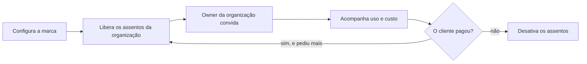

# Administração da instância

> **Em uma frase:** o painel de quem opera o Horus: a marca, os administradores, o e-mail do produto e os
> assentos, o uso e o custo de cada organização.

## 🧭 O que é

Uma instalação do Horus, a **instância**, serve várias **organizações**: cada setor de uma empresa, ou cada
cliente, é uma organização. Quem responde pela instância inteira é o **owner da instância**, com os
**administradores da instância**. No Horus contratado como serviço (SaaS), que roda na estrutura da Maind, esse
papel é da Maind. Ele não se confunde com o **owner da organização**, que cuida das pessoas e dos dados de um setor.

Hoje a administração guarda o nome e os logos do produto, o rodapé, os administradores e o envio de e-mail. Na
v2.0, ganha o **painel dos assentos**. Um assento é uma vaga de uso contratada, de um tipo: owner, gestor, membro
full ou membro leitor. No painel, a Maind libera as vagas de cada organização, acompanha o uso e o custo dela e
corta o acesso de quem não paga. Na v2.1, a marca do contratante chega a todo o produto.

> 📌 **Exemplo:** uma rede de lojas contrata o Horus para a área comercial, a organização do owner Marcos. No
> painel, a Maind libera o assento de owner grátis dele, 30 de membro full e 100 de membro leitor. No fim do mês, vê
> que a área respondeu 1.200 perguntas de análise e quanto gastou de IA, sem ler nenhuma conversa.

## ✨ Características

- **Quem usa:** só o owner da instância e os administradores dele; o owner da organização cuida da dele nas
  Organizações, pessoas e papéis (MF-102).
- **A marca:** o nome, os logos (claro e escuro) e o rodapé valem para todas as organizações. Na v2.1, o logo, o
  nome e o e-mail do contratante aparecem em todo o produto, inclusive no remetente.
- **O e-mail do produto:** os convites, a recuperação de senha e os avisos da conta saem pelo e-mail da instância,
  e não pelos conectores que o owner da organização liga.
- **O painel dos assentos:** mostra, por organização, quantos assentos de cada tipo estão liberados e ocupados. As
  regras dos assentos são das Licenças e planos (MF-103).
- **Liberar e cortar:** só daqui se liberam e se desativam os assentos de uma organização, sem reduzir abaixo do
  ocupado e sem data de validade.
- **O uso e o custo:** por organização, as perguntas respondidas, as execuções dos agentes (os trabalhos
  automáticos de IA) e o custo do mês, separado em IA, WhatsApp e número de e-mails.
- **O aviso de custo:** a Maind é avisada quando uma organização passa de um limite que ela ajusta caso a caso.
  Nada se corta sozinho.
- **Só números:** a administração não lê as conversas, os boards nem o rastro de organização nenhuma.
- **Sem escolha de plano:** há um plano só, e o painel libera apenas assentos.

## 📈 O valor que gera

- **Para quem usa:** a Maind cuida do acesso de cada cliente num lugar só e vê o custo antes da fatura de IA.
- **Para a empresa que contrata o Horus:** recebe os assentos do contrato e, na v2.1, a própria marca no produto.
- **Para o Horus como produto:** a cobrança por assento funciona desde o primeiro cliente, com o custo à vista.

**Como vamos saber que funcionou:** a Maind libera os assentos de uma organização nova e, no fim do mês, confere o
uso e o custo dela no mesmo painel.

## 🚶 Como se usa no Horus

1. O owner da instância configura o nome, os logos e o rodapé.
2. Combina os assentos com o cliente, fora do produto, e os libera no painel, tipo a tipo.
3. O owner da organização convida pessoas dentro desse limite.
4. Se a organização pede mais, libera; para reduzir, espera que ela desocupe os assentos.
5. Acompanha o uso e o custo do mês e recebe o aviso de custo.
6. Se o cliente deixa de pagar, desativa os assentos: tudo para, e as configurações ficam guardadas.

## 🧩 Grau de complexidade: média

A identidade da instância, os administradores, o envio de e-mail e as telas de administração vêm da v1 quase como
estão. Novos são o painel dos assentos e o painel do uso, que junta os números de todas as organizações, porque
cada uma passa a guardar os dados num banco próprio. De fora, depende só do serviço de e-mail que já se usa hoje.

> ⚠️ É a leitura do PO a partir dos documentos de arquitetura. A estimativa de esforço é do arquiteto.

## 🔗 Macro funcionalidades relacionadas

| mf | Como se relaciona |
| --- | --- |
| Organizações, pessoas e papéis (MF-102) | **complementa**: a administração cuida da instância e da marca; o owner da organização cuida das pessoas e das preferências dela. |
| Licenças e planos (MF-103) | **é a base de**: o painel onde a Maind libera e corta os assentos é daqui; as regras deles são de lá. |
| Conectores de Saída (MF-113) | **complementa**: o conector de e-mail usa o mesmo servidor de e-mail da instância; no modo "tudo dentro", da v2.1, é a instância que libera cada tipo de conector. |

## 🚧 O que ela não faz

- **Cobrar:** o preço, a fatura e o pagamento ficam com o comercial da Maind.
- **Consultar o rastro:** o registro de quem abriu e entregou o quê é da Auditoria (MF-116), só do owner de cada
  organização.
- **Ligar a segurança dos dados por pessoa:** ela volta na v2.1, com a Segurança dos dados por pessoa (MF-106), e
  o interruptor geral que a instância tem hoje vai junto.
- **Ativar assentos numa instalação na casa do cliente (on-premises):** fica para a v2.1.

## ⏳ Ainda a decidir

- Se o painel do uso e do custo fica nesta mf ou vira uma mf própria.
- Quem cria as organizações no SaaS: hoje, qualquer pessoa com login cria uma e vira owner dela.
- Se a administração publica um aviso a todas as pessoas, numa faixa no topo do app, antes de uma parada.

## 📚 Para saber mais

- `docs/raw/produto/04-macro-funcionalidades-de-hoje.md`: o mapa (o que a v1.xx entrega) e a tabela de conversão (a
  camada 🧱 Plataforma).
- `docs/raw/produto/05-v2.0-consolidada.md`: §1 (mf a mf), §3.2 (a base herdada), §4 (o passo 1) e as leituras
  **D-067.1**, **D-068.1** e **D-128.3**.
- `docs/raw/produto/06-versoes.md` e `docs/raw/produto/07-mapa-de-objetivos-e-funcionalidades.md`: o painel dos assentos
  na v2.0 (O7) e a marca completa na v2.1 (candidata nº 6, O8).
- `docs/raw/produto/03-inventario-de-lacunas.md`: as linhas 11 (os dois owners), 12 (várias organizações) e 13 (a
  marca branca).
- `docs/raw/produto/backlog-estrategico.md`: **D-011** (a marca: logo, e-mail e nome), **D-013** (os dois níveis de
  owner), **D-008** (várias organizações), **D-021** (a base herdada), **D-067**, **D-068**, **D-076** e **D-077**
  (o painel e quem libera), **D-080** e **D-117** (o painel sem seletor de plano), **D-091** (o rastro é do owner
  da organização), **D-121** (a marca completa na v2.1), **D-128** (o e-mail dos avisos).
- `docs/raw/arquitetura/01-estrategia-da-solucao.md`: §4 (a linha da MF-101) e §6 (os marcos M1 e M9).
- `docs/raw/arquitetura/02-registro-de-decisoes.md`: **ARQ-017** e **ARQ-084** (o uso e o custo no painel e o aviso à
  Maind), **ARQ-046** (o e-mail da instância), **ARQ-010** e **ARQ-088** (um banco por organização; a instância no
  banco mestre), **ARQ-090** (a segurança por pessoa na v2.1).
- `docs/raw/arquitetura/04-software.md`: §3.2, os componentes Instância, Painel dos assentos e Envio de e-mail.
- `docs/raw/arquitetura/06-dados.md` (o que é da instância) e `docs/raw/arquitetura/07-seguranca.md` §3.1 (o administrador
  não lê dado de organização).
- `docs/raw/arquitetura/14-conferencia-do-produto.md`: §3 (o que se reaproveita) e §4 (**A-02**, **A-21** e **A-29**).
