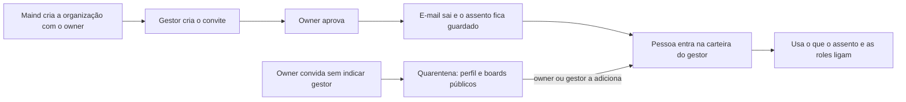

# Organizações, pessoas e papéis

> **Em uma frase:** a equipe entra no Horus organizada como na empresa: quem gere quem e o que cada um usa, sem o
> owner da organização fazer tudo sozinho.

## 🧭 O que é

Cada setor ou cliente que usa o Horus é uma **organização**, e quem responde por ela é o **owner da organização**
(nesta página, só "owner"), um funcionário do cliente que a configura e acompanha a cobrança dela. Ele não se
confunde com o owner da instância, a Maind, que cuida da instalação na Administração da instância (MF-101) sem ver
os dados das organizações. Hoje qualquer pessoa com conta cria uma organização, os papéis são fixos e só o owner
convida.

Na v2.0, só o owner da instância cria organizações. O **gestor** gere a sua **carteira** de pessoas e cria os
convites delas, que o owner aprova. Os membros vêm em três faixas: o **ouro** pergunta e cria boards (os painéis de
acompanhamento) e relatórios para si, sem compartilhar; o **prata** pergunta no app, na Pergunta rápida (MF-110) e
no WhatsApp, usa a Investigação guiada (MF-119) quando ela chegar, na v2.1, e recebe alertas e PDFs, mas não cria
boards, relatórios, agendamentos nem agentes (os trabalhos automáticos de IA); o **bronze** só vê os boards já
compartilhados e recebe alertas e PDFs. Cada faixa soma uma coisa: o bronze vê, o prata pergunta, o ouro cria. Quem
chega sem gestor espera na **quarentena**. E o owner monta **roles**, pacotes que ligam ou desligam botões da conversa.

> 📌 **Exemplo:** o Marcos, owner da área comercial, convida a Carla como gestora. Ela convida a equipe, o Marcos
> aprova, e a Ana entra na carteira da Carla como membro prata e já pergunta. O Marcos copia a role padrão, desliga
> ver o SQL e baixar e dá essa role ao estagiário Léo, que pergunta, mas não baixa.

## ✨ Características

- **Os papéis:** owner, gestor e membro, nas faixas ouro, prata e bronze. O owner não é gestor, mas vê todos os
  membros e pode ser gestor também. O ouro e o bronze seguem as regras do antigo membro full e do antigo leitor.
- **Um gestor por membro:** só o owner muda uma pessoa de gestor; se um gestor sai, a equipe vai para quem o owner
  indicar, ou para a quarentena.
- **Quem sai:** quem é **excluído** (sai ou é retirado da organização) perde em definitivo o que criou e os
  registros dele: boards, conversas, agendamentos, agentes, o rastro na Auditoria (MF-116) e os reportes de resposta
  errada que o owner ainda não analisou. Nada passa a outra pessoa, e o espaço da organização, onde ficam os boards
  que o owner cria, edita e publica, não recebe o que ele deixa. Um board público some junto com o owner que o
  publicou.
- **Quem é rebaixado:** quem passa de ouro a prata ou a bronze continua na organização e mantém o que criou
  vinculado a si, mas **desabilitado**: não se abre nem roda, e a única ação é excluir. Se voltar a ser ouro,
  reativa cada item, um a um; nada volta sozinho.
- **O convite:** o gestor convida um a um e escolhe o tipo de assento; o owner aprova ou deixa a aprovação
  automática. O assento, a vaga de uso das Licenças e planos (MF-103), fica guardado por um prazo.
- **A planilha de convites em lote:** é só do owner. Cada linha traz o tipo de assento e o gestor da pessoa; o lote
  reserva os assentos como o convite individual, e a linha sem vaga do tipo fica de fora.
- **A quarentena:** quem entra sem gestor vê só o perfil e os boards públicos, até o owner ou um gestor o pôr numa
  carteira.
- **Os grupos:** os do gestor têm só quem ele gere; os da organização, do owner, qualquer pessoa. Servem para
  publicar boards e escolher quem recebe relatórios e alertas. O grupo que se atualiza sozinho segue o tipo de
  assento da pessoa: owner, gestor, ouro, prata ou bronze.
- **Os nove botões da role:** os modos da conversa (dados e conversa) e a pesquisa na web, o nível máximo de
  inferência (quanto a resposta interpreta além dos números), a Análise avançada, o modelo de IA, ver o SQL (a
  consulta montada), baixar, a Pergunta rápida (MF-110), o WhatsApp e os conectores de saída. O nível máximo da
  role só baixa, para a pessoa, o teto que cada fonte de dados já tem, nunca o sobe: vale sempre o menor.
- **A soma:** só o owner cria e atribui roles, e quem tem duas usa o que qualquer uma liga. Quem não tem nenhuma
  usa a role padrão, que nasce com tudo ligado, inclusive o que mais custa e o WhatsApp, que só funciona depois que
  o owner liga o canal. O owner não depende de roles.
- **Tudo nasce liberado:** a organização chega com os interruptores abertos, e o owner restringe o que quiser: a
  role padrão com tudo ligado, o gestor podendo publicar boards e a aprovação automática dos contatos para os
  conectores de saída.
- **O assento vem antes:** a role só libera o que o tipo de assento permite: o bronze não pergunta, e o prata não
  cria boards, relatórios, agendamentos nem agentes. Fixar uma resposta num board não é botão de role: só o dono do
  board, o autor dele, fixa, e o prata e o bronze, que não têm board, nem veem o controle.
- **Os dados:** a role decide o que a pessoa usa, e não o que vê: a organização é a fronteira dos dados, e toda
  pergunta usa os dados dela inteira.
- **As conversas:** o owner lê as conversas de todas as pessoas da organização, como na v1, e nada de especial
  avisa a pessoa disso.
- **O perfil:** a pessoa entra por convite, com e-mail e senha ou Google; no perfil ficam a foto, o número de
  WhatsApp, os contatos e a escolha de receber os avisos por e-mail.

## 📈 O valor que gera

- **Para quem usa:** o owner deixa de ser o gargalo sem perder o controle; o membro pergunta no primeiro dia.
- **Para a empresa que contrata o Horus:** abre a análise a todos, com um botão para cada risco: exportação, custo
  e resposta especulativa.
- **Para o Horus como produto:** organizações maiores e mais assentos.

**Como vamos saber que funcionou:** o mesmo grupo abre um board e recebe relatórios e alertas, e o estagiário com
role restrita pergunta sem baixar nada.

## 🚶 Como se usa no Horus

**O owner:**

1. Recebe a organização, criada pela Maind, já com o seu assento.
2. Convida os gestores e, se quiser, a organização inteira de uma vez, pela planilha de convites em lote.
3. Restringe o que nasce liberado, ajusta a role padrão, cria as outras roles e as atribui.
4. Aprova os convites, ou deixa a aprovação automática.
5. Tira pessoas da quarentena e monta os grupos da organização.

**O gestor:**

1. Cria os convites, um a um, e escolhe o tipo de assento: membro ouro, prata ou bronze.
2. Aprovado o convite, a pessoa aceita e entra na carteira dele.
3. Monta grupos com a equipe.

## 🧩 Grau de complexidade: alta

As organizações, o login, os convites, a foto e a planilha vêm da v1. A tabela fixa de permissões vira um porteiro
único, a quem toda tela, canal e trabalho automático pergunta "esta pessoa pode isto?", e a carteira, a quarentena,
os grupos, as roles e a área de avisos são novos. Não depende de ninguém de fora, mas quase todas as mfs novas
dependem dela.

> ⚠️ É a leitura do PO a partir dos documentos de arquitetura. A estimativa de esforço é do arquiteto.

## 🔗 Macro funcionalidades relacionadas

| mf | Como se relaciona |
| --- | --- |
| Administração da instância (MF-101) | **é a base de**: lá a Maind cria as organizações e cuida da instância e da marca; aqui, o owner cuida das pessoas de cada organização. |
| Licenças e planos (MF-103) | **é a base de**: a cobrança por assento usa os papéis, o convite e a quarentena; em troca, o tipo de assento é o teto do que a role libera. |
| Segurança dos dados por pessoa (MF-106) | **complementa**, na v2.1: a role decide o que a pessoa usa, e a segurança decidirá o que ela vê; é dela que vêm os grupos pelas características da pessoa (a região, a loja), as colunas dessas características na planilha de convites e as roles que chegam pelo login da empresa. |
| Boards e Relatórios (MF-112) | **é a base de**: publicar para um grupo ou para "Pessoas geridas por mim" e os boards públicos da quarentena saem daqui. |
| Chat pelo WhatsApp (MF-111) | **é a base de**: o botão de conversar pelo WhatsApp mora nas roles, e o número ligado fica no perfil. |
| Módulo de Agendamentos de Agentes (MF-114) | **é a base de**: os grupos são o destino dos PDFs e alertas agendados. |
| IA sob controle da organização (MF-105) | **é a base de**: o botão de escolher o modelo na conversa mora nas roles. |
| Perguntar aos dados em português (MF-107) | **é a base de**: as roles limitam os botões da conversa, e a área de avisos recebe o reporte e o "recebido". |
| A web como fonte (MF-109) | **é a base de**: a pesquisa na web se libera pelo primeiro botão da role, junto com os modos da conversa. |
| Pergunta rápida (MF-110) | **é a base de**: as roles do owner ligam o botão e os controles do popup. |
| Conectores de Saída (MF-113) | **é a base de**: o contato fica no perfil, e o papel de owner e o botão das roles de enviar pelos conectores vêm daqui. |
| Auditoria (MF-116) | **é a base de**: o owner, o gestor e as preferências da organização vêm daqui. |
| Home da organização (MF-117) | **é a base de**: a divisão por gestor vem da equipe de cada um. |
| Bases de demonstração (MF-118) | **é a base de**: os membros de exemplo chegam com papel, tipo de assento, gestor e roles. |
| Faixa de avisos e números (MF-120) | **é a base de**: o owner da organização, que monta os Organization Cards nas preferências da organização, é daqui. |
| Middleware na casa do contratante (MF-121) | **complementa**, na v2.1: quem conecta o middleware e decide o que mais pode sair da casa do cliente é o owner da organização, e não a Maind. |

## 🚧 O que ela não faz

- **Criar organizações:** é do owner da instância, na Administração da instância (MF-101).
- **O login corporativo**, as roles que chegam por ele e os grupos pelas características da pessoa: são da
  Segurança dos dados por pessoa (MF-106), na v2.1.
- **Gestor de gestor:** a hierarquia tem um nível só.
- **Role que tira** o que outra deu, prioridade entre roles ou gestor que cria roles.
- **Limite por perguntas ou por custo.**

## ⏳ Ainda a decidir

- **No setup de cada organização,** o cliente deve consultar o jurídico dele sobre o owner ler as conversas de todos,
  sem aviso especial à pessoa, e sobre apagar tudo de quem sai; o produto parte das duas regras como estão.
- Falta o arquiteto conferir se apagar tudo de quem é excluído convive com a guarda técnica do registro de acesso e
  as cópias de segurança.

## 📚 Para saber mais

- `docs/raw/produto/backlog-estrategico.md`
  - **D-056**: a definição macro da gestão de pessoas, dos grupos e das roles (reúne D-046 a D-052 e D-055),
    refinada pela **D-071** (o gestor cria o convite, o owner aprova).
  - **D-114**: a definição macro das funcionalidades por role (reúne D-110 a D-113), com o oitavo e o nono botão
    (D-119, D-122).
  - **D-108** (a MF-102 inteira na v2.0), **D-197** (uma mf numa versão só) e **D-199** (os grupos por claims e as
    colunas de claims da planilha passam à MF-106; a MF-102 fica sem nada na v2.1).
  - **D-145** (a organização é a fronteira dos dados na v2.0; a segurança por pessoa inteira na v2.1): os grupos
    dinâmicos só por papel e a planilha só para os convites em lote. **D-235** (o grupo dinâmico aceita o tipo de
    assento como regra) e **D-236** (a planilha de convites em lote é só do owner; cada linha traz o tipo de assento
    e o gestor, o lote reserva os assentos, a linha sem vaga fica de fora, e o gestor convida um a um).
  - **D-118** (o login corporativo fora da v2.0) e **D-184** (o login corporativo da MF-106 só por OpenID Connect).
  - **D-146** (só o administrador da instância cria organizações), **D-147** ("owner da instância" é o nome
    comercial do administrador) e **D-193** (o SaaS é uma instância só, da Maind; o owner da organização é
    funcionário do cliente e a configura).
  - **D-194** (os cinco tipos de assento: owner, gestor e os membros ouro, prata e bronze; substitui em parte a
    D-069), com a leitura **D-194.1** do documento da v2.0 (o ouro é o antigo membro full, e o bronze, o antigo
    membro leitor), confirmada pelo dono em 05/11/2026.
  - **D-203** (o que a prata faz: pergunta no app, na Pergunta rápida e no WhatsApp, usa a Investigação guiada
    quando chegar e recebe alertas e PDFs, sem criar board, relatório, agendamento nem agente; o bronze vê, a prata
    pergunta, o ouro cria).
  - **D-019**, **D-029**, **D-032**, **D-049** e **D-055**: os grupos e os seus usos.
  - **D-069**, **D-072**, **D-074** e **D-078**: os tipos de assento, a troca, quem acumula owner e gestor, a
    reserva.
  - **D-195** (a conexão do middleware e as permissões de saída são da organização).
  - **D-128** (a área de avisos e a preferência de e-mail), **D-013** (os dois níveis de owner), **D-048** (a
    quarentena e os boards públicos), **D-044** e **D-045** (remover uma pessoa; a parte que mandava o que ela
    criou para a área da organização foi substituída pela **D-206**).
  - **D-206** a **D-209** (não há transferência: quem é excluído perde em definitivo o que criou; quem é rebaixado
    o mantém vinculado e desabilitado, só para excluir, e o reativa um a um se voltar a ser ouro; o board público
    some com o owner que o publicou) e **D-210** (os registros de quem é excluído saem com ele).
  - **D-215** (os modos são dados e conversa, e a pesquisa na web é um interruptor, no primeiro dos nove botões),
    **D-220** (o teto de inferência é o de cada fonte, e a role só o baixa) e **D-221** (só o dono do board fixa
    uma resposta nele; não é um botão das roles).
  - **D-223** (o owner lê as conversas de todos, sem aviso especial à pessoa) e **D-228** (a organização nasce com
    os interruptores liberados, e a role padrão com tudo ligado, inclusive o WhatsApp).
  - **P-008**, letras j, k, l, m, t, u e z: as hipóteses técnicas desta mf. **D-247** (o cliente consulta o
    jurídico dele no setup, sobre a leitura das conversas e o apagar de quem sai) e **P-044** (apagar tudo de quem é
    excluído diante da guarda técnica do registro de acesso, do arquiteto).
- `docs/raw/produto/04-macro-funcionalidades-de-hoje.md`: o que a v1.xx entrega e a direção do dono.
- `docs/raw/produto/05-v2.0-consolidada.md`: §1, §4 (o passo 2), §5.1 e §5.2 (as regras), §7 e §8 (os riscos).
- `docs/raw/produto/06-versoes.md` (a candidata nº 9), `docs/raw/produto/07-mapa-de-objetivos-e-funcionalidades.md` (o
  objetivo O7) e `docs/raw/produto/03-inventario-de-lacunas.md` (a candidata 9).
- `docs/raw/arquitetura/01-estrategia-da-solucao.md`: §4 (a linha da MF-102) e §6 (o marco M1, Plataforma).
- `docs/raw/arquitetura/04-software.md`: §3.2, o módulo Plataforma.
- `docs/raw/arquitetura/02-registro-de-decisoes.md`: **ARQ-008** e **ARQ-039** (o avaliador de permissões), **ARQ-038**
  e **ARQ-053** (o login e a sessão), **ARQ-050** (o número de WhatsApp) e **ARQ-090** (a segurança por pessoa na
  v2.1: toda consulta com os dados da organização inteira, os grupos dinâmicos só por papel e a planilha só para os
  convites em lote).
- `docs/raw/arquitetura/07-seguranca.md`: §3.1 (o login e a sessão) e §3.2 (o avaliador por dentro).
- `docs/raw/arquitetura/14-conferencia-do-produto.md`: §1 (as letras da P-008), §3 (o que se reaproveita) e §4
  (**A-02**, **A-13**, **A-16**, **A-24** e **A-28**).
