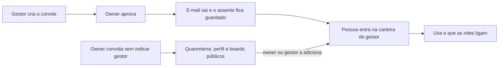

# Organizações, pessoas e papéis

> **Em uma frase:** a equipe entra no Horus organizada como na empresa: quem gere quem e o que cada um usa, sem o
> owner da organização fazer tudo sozinho.

## 🧭 O que é

Cada setor ou cliente que usa o Horus é uma **organização**, e quem responde por ela é o **owner da organização**
(nesta página, só "owner"), diferente do owner da instância, que cuida da instalação na Administração da instância
(MF-101). Hoje já existem várias organizações e convites por e-mail, link e QR, mas os papéis são fixos e só o
owner convida.

Na v2.0, o **gestor** gere a sua **carteira** de pessoas e cria os convites delas, que o owner aprova. O **membro
full** pergunta e cria os próprios boards (os painéis de acompanhamento) e alertas; o **membro leitor** só vê boards
de outras pessoas e recebe alertas e PDFs. Quem chega sem gestor espera na **quarentena**. E o owner monta
**roles**, pacotes que ligam ou desligam botões da conversa.

> 📌 **Exemplo:** o Marcos, owner da área comercial, convida a Carla como gestora. Ela convida a equipe, o Marcos
> aprova, e a Ana entra na carteira da Carla e já pergunta. O Marcos copia a role padrão, desliga ver o SQL e baixar
> e dá essa role ao estagiário Léo, que pergunta, mas não baixa.

## ✨ Características

- **Os papéis:** owner, gestor e membro. O owner não é gestor, mas vê todos os membros e pode ser gestor também.
- **Um gestor por membro:** só o owner transfere pessoas entre gestores; se um gestor sai, a equipe vai para quem o
  owner indicar, ou para a quarentena.
- **O convite:** o gestor cria e escolhe membro full ou leitor; o owner aprova ou deixa a aprovação automática. O
  assento, a vaga de uso das Licenças e planos (MF-103), fica guardado por um prazo; a planilha convida em lote.
- **A quarentena:** quem entra sem gestor vê só o perfil e os boards públicos, até o owner ou um gestor o pôr numa
  carteira.
- **Os grupos:** os do gestor têm só quem ele gere; os da organização, do owner, qualquer pessoa. Servem para
  publicar boards e escolher quem recebe relatórios e alertas. Na v2.0, o grupo que se atualiza sozinho segue só o
  papel.
- **Os nove botões da role:** os três modos da conversa, o nível máximo de inferência (quanto a resposta interpreta
  além dos números), a Análise avançada, o modelo de IA, ver o SQL (a consulta montada), baixar, a Pergunta rápida
  (MF-110), o WhatsApp e os conectores de saída.
- **A soma:** só o owner cria e atribui roles, e quem tem duas usa o que qualquer uma liga. Quem não tem nenhuma
  usa a role padrão, que nasce com tudo ligado, inclusive o que mais custa. O owner não depende de roles.
- **O assento vem antes:** a role só libera o que o tipo de assento permite; o membro leitor não pergunta.
- **Os dados, na v2.0:** a role decide o que a pessoa usa, e não o que vê; até a v2.1, toda pergunta usa os dados
  da organização inteira.
- **O perfil:** a pessoa entra por convite, com e-mail e senha ou Google; no perfil ficam a foto, o número de
  WhatsApp, os contatos e a escolha de receber os avisos por e-mail.

## 📈 O valor que gera

- **Para quem usa:** o owner deixa de ser o gargalo sem perder o controle; o membro pergunta no primeiro dia.
- **Para a empresa que contrata o Horus:** abre a análise a todos, com um botão para cada risco: exportação, custo
  e resposta especulativa.
- **Para o Horus como produto:** organizações maiores e mais assentos.

**Como vamos saber que funcionou:** o mesmo grupo abre um board e recebe relatórios e alertas, e o estagiário com
role restrita pergunta sem baixar nada.

## 🚶 Como se usa no Horus

**O owner:**

1. Convida os gestores.
2. Ajusta a role padrão, cria as outras e as atribui.
3. Aprova os convites, ou deixa a aprovação automática.
4. Tira pessoas da quarentena e monta os grupos da organização.

**O gestor:**

1. Cria o convite e escolhe membro full ou leitor.
2. Aprovado o convite, a pessoa aceita e entra na carteira dele.
3. Monta grupos com a equipe.

## 🧩 Grau de complexidade: alta

As organizações, o login, os convites, a foto e a planilha vêm da v1. A tabela fixa de permissões vira um porteiro
único, a quem toda tela, canal e trabalho automático pergunta "esta pessoa pode isto?", e a carteira, a quarentena,
os grupos, as roles e a área de avisos são novos. Não depende de ninguém de fora, mas quase todas as mfs novas
dependem dela.

> ⚠️ É a leitura do PO a partir dos documentos de arquitetura. A estimativa de esforço é do arquiteto.

## 🔗 Macro funcionalidades relacionadas

| mf | Como se relaciona |
| --- | --- |
| Administração da instância (MF-101) | **complementa**: lá se cuida da instância e da marca; aqui, das pessoas de cada organização. |
| Licenças e planos (MF-103) | **é a base de**: a cobrança por assento usa os papéis, o convite e a quarentena; em troca, o tipo de assento é o teto do que a role libera. |
| Segurança dos dados por pessoa (MF-106) | **complementa**, na v2.1: a role decide o que a pessoa usa, e a segurança decidirá o que ela vê; com ela chegam os grupos pelas características da pessoa (a região, a loja) e as roles vindas do login corporativo. |
| Boards e Relatórios (MF-112) | **é a base de**: publicar para um grupo ou para "Pessoas geridas por mim" e os boards públicos da quarentena saem daqui. |
| Chat pelo WhatsApp (MF-111) | **é a base de**: o botão de conversar pelo WhatsApp mora nas roles, e o número ligado fica no perfil. |
| Módulo de Agendamentos de Agentes (MF-114) | **é a base de**: os grupos são o destino dos PDFs e alertas agendados. |

## 🚧 O que ela não faz

- **O login corporativo** e as roles que chegam por ele: v2.1.
- **Gestor de gestor:** a hierarquia tem um nível só.
- **Role que tira** o que outra deu, prioridade entre roles ou gestor que cria roles.
- **Limite por perguntas ou por custo.**

## ⏳ Ainda a decidir

- Se fixar a resposta num board vira um botão da role, ou segue o tipo de assento.
- Se o owner continua lendo as conversas de todos, como na v1, e se a pessoa sabe disso.
- O teto da organização nos níveis de inferência: o das fontes dela ou uma configuração própria.

## 📚 Para saber mais

- `docs/raw/produto/backlog-estrategico.md`
  - **D-056**: a definição macro da gestão de pessoas, dos grupos e das roles (reúne D-046 a D-052 e D-055),
    refinada pela **D-071** (o gestor cria o convite, o owner aprova).
  - **D-114**: a definição macro das funcionalidades por role (reúne D-110 a D-113), com o oitavo e o nono botão
    (D-119, D-122).
  - **D-108** (a MF-102 inteira na v2.0) e **D-118** (o login corporativo fora da v2.0).
  - **D-145** (a organização é a fronteira dos dados na v2.0; a segurança por pessoa inteira na v2.1): os grupos dinâmicos só por papel e a planilha só para os convites em lote.
  - **D-019**, **D-029**, **D-032**, **D-049** e **D-055**: os grupos e os seus usos.
  - **D-069**, **D-072**, **D-074** e **D-078**: os tipos de assento, a troca, quem acumula owner e gestor, a
    reserva.
  - **D-128** (a área de avisos e a preferência de e-mail), **D-013** (os dois níveis de owner), **D-048** (a
    quarentena e os boards públicos), **D-044** e **D-045** (remover uma pessoa).
  - **P-008**, letras j, k, l, m, t, u e z: as hipóteses técnicas desta mf.
- `docs/raw/produto/04-macro-funcionalidades-de-hoje.md`: o que a v1.xx entrega e a direção do dono.
- `docs/raw/produto/05-v2.0-consolidada.md`: §1, §4 (o passo 2), §5.1 e §5.2 (as regras), §7 e §8 (os riscos).
- `docs/raw/produto/06-versoes.md` (a candidata nº 9), `docs/raw/produto/07-mapa-de-objetivos-e-funcionalidades.md` (o
  objetivo O7) e `docs/raw/produto/03-inventario-de-lacunas.md` (a candidata 9).
- `docs/raw/arquitetura/01-estrategia-da-solucao.md`: §4 (a linha da MF-102) e §6 (o marco M1, Plataforma).
- `docs/raw/arquitetura/04-software.md`: §3.2, o módulo Plataforma.
- `docs/raw/arquitetura/02-registro-de-decisoes.md`: **ARQ-008** e **ARQ-039** (o avaliador de permissões), **ARQ-038**
  e **ARQ-053** (o login e a sessão), **ARQ-050** (o número de WhatsApp) e **ARQ-090** (a segurança por pessoa na
  v2.1: toda consulta com os dados da organização inteira, os grupos dinâmicos só por papel e a planilha só para os
  convites em lote).
- `docs/raw/arquitetura/07-seguranca.md`: §3.1 (o login e a sessão) e §3.2 (o avaliador por dentro).
- `docs/raw/arquitetura/14-conferencia-do-produto.md`: §1 (as letras da P-008), §3 (o que se reaproveita) e §4
  (**A-02**, **A-13**, **A-16**, **A-24** e **A-28**).
