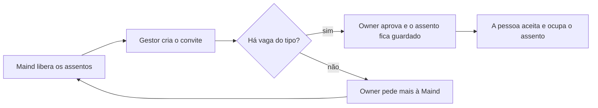

# Licenças e planos

> **Em uma frase:** a empresa paga pelas pessoas que usam o Horus, por tipo de pessoa, e quem usa nunca passa do
> que foi contratado.

## 🧭 O que é

Hoje o Horus não controla licenças: qualquer número de pessoas entra numa organização. Na v2.0, cada organização
passa a ter **assentos**: as vagas de uso que a empresa contratou, de quatro tipos, cada pessoa ocupando uma.

Quem libera e corta os assentos é o **owner da instância**, que no Horus contratado como serviço (SaaS) é a Maind,
no painel da Administração da instância (MF-101). O **owner da organização** decide quem ocupa cada um. A v2.0
tem um plano só, com tudo o que ela oferece, e o preço é combinado em contrato, fora do produto.

> 📌 **Exemplo:** a Maind libera para a organização do Marcos o assento de owner grátis, 30 de membro full e 100 de
> membro leitor. A gestora Carla convida um analista como membro full; o Marcos aprova, o e-mail sai e o assento
> fica guardado. Quando os 30 acabam, o Marcos pede mais à Maind. Se a empresa deixa de pagar, a Maind desativa os
> assentos, e nada mais roda.

## ✨ Características

- **Os quatro tipos:** owner da organização, gestor (quem gere uma equipe), membro full (pergunta e cria os
  próprios boards, os painéis de acompanhamento, e alertas) e membro leitor (só vê boards de outras pessoas e
  recebe alertas e PDFs por e-mail e WhatsApp; não pergunta em canal nenhum).
- **O owner grátis:** só o primeiro owner de cada organização não paga. Quem é owner e gestor ao mesmo tempo ocupa
  um assento só, o de owner.
- **Sem vaga, não entra:** sem assento livre do tipo, ninguém entra nele. O owner da organização pede mais à Maind,
  fora do produto, e o convite pendente mostra que falta vaga.
- **A reserva:** aprovado o convite, o assento fica guardado pelo prazo que o owner da organização define; depois,
  o convite expira e a vaga volta. Quem espera na quarentena, por ter entrado sem gestor,
  já ocupa o assento.
- **A troca de tipo:** o gestor pede, o owner da organização aprova, e precisa haver vaga do tipo novo; a antiga se
  libera na hora. Quem passa de full a leitor deixa o que criou na área da organização, o
  espaço de boards dela.
- **A contagem à vista:** o owner da organização vê, de cada tipo, quantos assentos tem, quantos usa e quantos
  estão livres.
- **Reduzir:** não dá para reduzir abaixo do ocupado, e os reservados contam como ocupados; o owner da organização
  desocupa antes.
- **O corte:** com os assentos desativados, as pessoas perdem o acesso, e os agendamentos, os alertas e os agentes
  (os trabalhos automáticos de IA) param. Os dados, os boards e as conversas ficam guardados; ao reativar, os
  agendamentos seguem do próximo horário.
- **Sem data de validade:** renovação, carência e corte são decisão comercial da Maind.
- **Um plano só:** controla só os assentos. O que cada pessoa usa fica com as roles, os pacotes de botões das
  Organizações, pessoas e papéis (MF-102).

## 📈 O valor que gera

- **Para quem usa:** o owner da organização sabe quanto tem e quanto sobra, e ninguém perde o acesso de surpresa
  numa redução.
- **Para a empresa que contrata o Horus:** paga por quem usa, por tipo, sem escolher entre planos para começar.
- **Para o Horus como produto:** receita por assento desde o primeiro cliente, e o corte de quem não paga.

**Como vamos saber que funcionou:** o primeiro cliente fecha contrato só com a conta de assentos, e o que ele pedir
a mais mostra onde caberia um segundo plano.

## 🚶 Como se usa no Horus

**A Maind, owner da instância:**

1. Combina os assentos com o cliente, fora do produto.
2. Libera no painel a quantidade de cada tipo.
3. Libera mais quando o owner da organização pede, ou reduz depois que ele desocupa os assentos.
4. Desativa os assentos se o cliente deixa de pagar, e os reativa depois.

**O owner da organização:**

1. Acompanha quantos assentos tem, usa e tem livres.
2. Aprova os convites e as trocas de tipo que os gestores pedem, quando há vaga.
3. Ajusta o prazo da reserva nas preferências da organização.

## 🧩 Grau de complexidade: alta

Nada disso existe na v1: os tipos de assento, a reserva, a troca, a contagem e o corte são novos. O tipo de assento
passa a ser a primeira coisa que o porteiro único das permissões confere, e o corte atravessa o produto, parando
agendamentos, agentes e envios. Na v2.0, não depende de ninguém de fora; a instalação na casa do cliente fica para
a v2.1.

> ⚠️ É a leitura do PO a partir dos documentos de arquitetura. A estimativa de esforço é do arquiteto.

## 🔗 Macro funcionalidades relacionadas

| mf | Como se relaciona |
| --- | --- |
| Administração da instância (MF-101) | **depende de**: o painel onde a Maind libera e corta os assentos fica lá. |
| Organizações, pessoas e papéis (MF-102) | **depende de**: o convite, a aprovação, a quarentena e os papéis vêm de lá; em troca, o tipo de assento é o teto do que as roles liberam. |
| Boards e Relatórios (MF-112) | **depende de**: o que a pessoa criou vai para a área da organização quando ela passa a leitor. |
| Módulo de Agendamentos de Agentes (MF-114) e Agentes ativos (MF-115) | **depende de**: param no corte e voltam do próximo horário quando os assentos voltam. |
| Conectores de Saída (MF-113) | **depende de**: é por eles que o membro leitor recebe alertas e PDFs. |

## 🚧 O que ela não faz

- **Cobrar e receber:** o preço em reais, a fatura e o pagamento ficam com o comercial da Maind.
- **Vários planos:** nomes, seletor e limite de funcionalidades por plano ficam para quando houver mais de um.
- **Cobrar pelo uso do mês:** a conta é por assento, e não por perguntas ou consumo.
- **Licenciar uma instalação na casa do cliente (on-premises):** v2.1; até lá, só no SaaS.

## ⏳ Ainda a decidir

- Como ativar os assentos numa instalação na casa do cliente, na v2.1.
- Quem cria as organizações no SaaS, já que cada uma nasce com um owner grátis.

## 📚 Para saber mais

- `docs/raw/produto/backlog-estrategico.md`
  - **D-080**: a definição macro da MF-103 (reúne D-066 a D-079).
  - **D-117**: a definição macro dos planos da v2.0 (reúne D-115 e D-116).
  - **D-069** e **D-123** (os quatro tipos e o owner grátis por organização), **D-070** e **D-077** (sem vaga, não
    entra; o pedido fora do produto), **D-071**, **D-072** e **D-078** (o convite, a troca e a reserva), **D-073**
    (de full a leitor), **D-074** (owner e gestor num assento só), **D-075** e **D-076** (o corte e a redução),
    **D-079** (o leitor recebe), **D-067** e **D-068** (o painel, só no SaaS, sem data de validade).
  - **D-107** (a MF-103 inteira na v2.0) e **D-121** (o on-premises na v2.1).
  - **P-016** (a ativação no on-premises), **P-022** (o preço em reais) e **P-008**, letras s, t e u.
- `docs/raw/produto/04-macro-funcionalidades-de-hoje.md`: a direção do dono e a tabela de conversão.
- `docs/raw/produto/05-v2.0-consolidada.md`: §1, §4 (os passos 1 e 12), §5.3 (as regras), §8 (os riscos) e as leituras
  **D-069.1**, **D-070.2**, **D-071.3** a **D-071.5**, **D-072.1**, **D-073.1**, **D-075.2**, **D-075.3**,
  **D-076.1**, **D-077.1** e **D-078.1**.
- `docs/raw/produto/06-versoes.md` e `docs/raw/produto/07-mapa-de-objetivos-e-funcionalidades.md`: a candidata nº 15 na
  v2.0 (O7) e a ativação no on-premises na v2.1 (parte da nº 5, O8).
- `docs/raw/produto/03-inventario-de-lacunas.md`: a candidata 15.
- `docs/raw/arquitetura/01-estrategia-da-solucao.md`: §4 (a linha da MF-103) e §6 (os marcos M1 e M10).
- `docs/raw/arquitetura/04-software.md`: §3.2, os componentes Assentos, Painel dos assentos e Avaliador de permissões.
- `docs/raw/arquitetura/02-registro-de-decisoes.md`: **ARQ-008** e **ARQ-039** (o tipo de assento como primeira leitura
  do avaliador; o corte como estado da organização), **ARQ-005** (o corte pausa o que roda sozinho), **ARQ-060**
  (o on-premises, v2.1).
- `docs/raw/arquitetura/07-seguranca.md`: §3.2 (a ordem do avaliador).
- `docs/raw/arquitetura/14-conferencia-do-produto.md`: §1 (as letras s, t e u), §3 (tudo é novo) e §4 (**A-02**).
