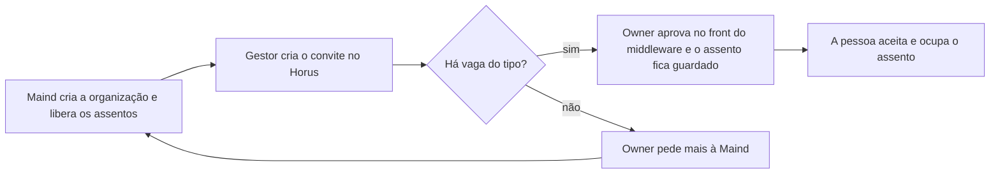

# Licenças e planos

> **Em uma frase:** a empresa paga pelas pessoas que usam o Horus, por tipo de pessoa, e quem usa nunca passa do
> que foi contratado.

## 🧭 O que é

Hoje o Horus não controla licenças: qualquer número de pessoas entra numa organização. Na v2.0, cada organização
passa a ter **assentos**: as vagas de uso que a empresa contratou, de cinco tipos, cada pessoa ocupando uma.

O Horus contratado como serviço (SaaS) é uma instância só, da Maind. Quem cria as organizações e libera e corta os
assentos é o **owner da instância**, a Maind, no painel da Administração da instância (MF-101). O **owner da
organização**, um funcionário do cliente, decide quem ocupa cada um e acompanha a cobrança. Os assentos que a Maind
libera vão ao **middleware** da organização, a peça do Middleware da organização (MF-121) que fica entre o Horus e os
bancos dela e guarda quem são as pessoas, os bancos e a IA. É lá, no **front do middleware**, um aplicativo de
configuração separado do Horus, que o owner cadastra as pessoas.

A v2.0 tem um plano só, com tudo o que ela oferece, e o preço é combinado em contrato, fora do produto. A IA é
sempre da organização: com a chave própria, de um provedor de IA, a organização paga o consumo; a Maind pode lhe dar
uma chave de provedor, e essa a Maind paga. Se a IA dada pela Maind entra no preço do assento ainda está em aberto.

> 📌 **Exemplo:** a Maind cria a organização do Marcos e libera o assento de owner grátis, 10 de membro ouro, 30 de
> prata e 100 de bronze, que vão ao middleware da organização. A gestora Carla convida pelo Horus um analista como
> membro ouro; o Marcos aprova no front do middleware, o e-mail sai e o assento fica guardado. Quando os 10 acabam,
> o Marcos pede mais à Maind. Se a empresa deixa de pagar, a Maind corta a organização, e nada mais roda.

## ✨ Características

- **Os cinco tipos:** owner da organização; gestor (quem gere uma equipe); membro ouro (pergunta e cria boards, os
  painéis de acompanhamento, e relatórios para si, sem compartilhar); membro prata (pergunta e recebe alertas e
  PDFs, sem criar nada); e membro bronze (só vê os boards já criados e compartilhados e recebe alertas e PDFs por
  e-mail e WhatsApp; não pergunta em canal nenhum). A prata pergunta no app, na Pergunta rápida (MF-110) e no
  WhatsApp e, quando chegar, usa a Investigação guiada (MF-119), da v2.1, mas não cria boards, relatórios,
  agendamentos nem agentes, os trabalhos automáticos de IA. Cada faixa soma uma coisa: o bronze vê, a prata
  pergunta, o ouro cria. O ouro e o bronze seguem as regras do antigo membro full e do antigo leitor.
- **O owner grátis:** só o primeiro owner de cada organização não paga. Além dele, a organização pode ter no máximo
  mais dois owners, e cada um ocupa um assento de owner contratado, contado e cobrado como qualquer outro; os owners
  ligados ao login da empresa chegam na v2.1. Quem é owner e gestor ao mesmo tempo ocupa um assento só, o de owner.
- **Sem vaga, não entra:** sem assento livre do tipo, ninguém entra nele. O owner da organização pede mais à Maind,
  fora do produto, e o convite pendente mostra que falta vaga.
- **A reserva:** aprovado o convite, o assento fica guardado pelo prazo que o owner da organização define; depois,
  o convite expira e a vaga volta. Quem espera na quarentena, por ter entrado sem gestor, já ocupa o assento.
- **A troca de tipo:** o gestor pede pelo Horus, o owner da organização aprova no front do middleware, e precisa
  haver vaga do tipo novo; a antiga se
  libera na hora. Quem é **rebaixado**, de ouro a prata ou a bronze, continua na organização e mantém o que criou
  (boards, relatórios, agendamentos e agentes) vinculado a si, mas **desabilitado**: nada se abre nem roda, e a
  única ação é excluir. Se voltar a ser ouro, reativa cada item, um a um; nada volta sozinho. Já quem é
  **excluído**, porque sai ou é retirado da organização, perde em definitivo o que criou: nada passa a outra pessoa.
- **A visão de cobrança:** o owner da organização vê só a contagem dos assentos: de cada tipo, quantos tem, quantos
  usa e quantos estão livres. O custo, o relatório e a história dos assentos ficam com a Maind, em números e sem o
  nome de quem ocupou cada assento, e o uso do Horus aparece na Home da organização (MF-117).
- **Reduzir:** não dá para reduzir abaixo do ocupado, e os reservados contam como ocupados; o owner da organização
  desocupa antes.
- **O corte:** cortar é inativar a organização inteira: as pessoas perdem o acesso, e os agendamentos, os alertas e
  os agentes (os trabalhos automáticos de IA) param. Os dados, os boards e as conversas ficam guardados; ao
  reativar, os agendamentos seguem do próximo horário. Não há data de validade: renovação, carência e corte são
  decisão comercial da Maind.
- **O que o assento inclui:** a IA é sempre da organização. Com a chave própria, do provedor que quiser, a
  organização paga o consumo. Com a chave de provedor que a Maind pode lhe dar, quem paga é a Maind, e se essa IA
  entra no preço do assento ainda está em aberto. À parte, fora do produto, só as mensagens de quem usa o número de
  WhatsApp da Maind.
- **Um plano só:** controla só os assentos. O que cada pessoa usa fica com as roles, os pacotes de botões das
  Organizações, pessoas e papéis (MF-102).

## 📈 O valor que gera

- **Para quem usa:** o owner da organização sabe quanto tem e quanto sobra, e ninguém perde o acesso de surpresa
  numa redução.
- **Para a empresa que contrata o Horus:** paga por quem usa, por tipo, sem escolher entre planos, e quem já tem
  contrato com um provedor de IA pode usá-lo.
- **Para o Horus como produto:** receita por assento desde o primeiro cliente, inclusive pelos owners além do
  primeiro, e o corte de quem não paga.
- ⚠️ **O cuidado:** a Maind paga o consumo da chave de IA que ela dá a uma organização; se essa IA entra no preço do
  assento ainda está em aberto.

**Como vamos saber que funcionou:** o primeiro cliente fecha contrato só com a conta de assentos, e o que ele pedir
a mais mostra onde caberia um segundo plano.

## 🚶 Como se usa no Horus

**A Maind, owner da instância:**

1. Combina os assentos com o cliente, fora do produto.
2. Cria a organização e libera no painel a quantidade de cada tipo, que vai ao middleware da organização.
3. Libera mais quando o owner da organização pede, ou reduz depois que ele desocupa os assentos.
4. Corta a organização se o cliente deixa de pagar, e a reativa depois.

**O owner da organização:**

1. Acompanha, na visão de cobrança, quantos assentos tem, usa e tem livres.
2. Aprova, no front do middleware, os convites e as trocas de tipo que os gestores pedem pelo Horus, quando há vaga.
3. Se quiser, cadastra até dois outros owners, cada um num assento de owner contratado.
4. Ajusta o prazo da reserva nas preferências da organização.

## 🧩 Grau de complexidade: alta

Nada disso existe na v1: os cinco tipos de assento, a reserva, a troca, a contagem, o corte e o estado desabilitado
do que o rebaixado criou são novos. O tipo de assento passa a ser a primeira coisa que o porteiro único das
permissões confere, e o corte atravessa o produto, parando agendamentos, agentes e envios. Não depende de ninguém
de fora, e os assentos liberados vão ao Middleware da organização (MF-121), onde o owner cadastra as pessoas.

> ⚠️ É a leitura do PO a partir dos documentos de arquitetura. A estimativa de esforço é do arquiteto.

## 🔗 Macro funcionalidades relacionadas

| mf | Como se relaciona |
| --- | --- |
| Administração da instância (MF-101) | **depende de**: o painel onde a Maind cria as organizações e libera e corta os assentos fica lá. |
| Organizações, pessoas e papéis (MF-102) | **depende de**: o convite, a aprovação, a quarentena e os papéis vêm de lá; em troca, o tipo de assento é o teto do que as roles liberam. |
| IA sob controle da organização (MF-105) | **complementa**: a IA é sempre da organização; a chave própria, a organização paga, e a chave de provedor que a Maind dá, a Maind paga; se essa IA entra no preço do assento ainda está em aberto. |
| Boards e Relatórios (MF-112) | **depende de**: o que a pessoa criou fica com ela, desabilitado e só para excluir, quando ela é rebaixada a prata ou a bronze, e só volta a funcionar quando ela, de novo ouro, reativa cada item. |
| Módulo de Agendamentos de Agentes (MF-114) e Agentes ativos (MF-115) | **depende de**: param no corte e voltam do próximo horário quando a organização volta; os de quem é rebaixado deixam de rodar até ele, de novo ouro, reativá-los. |
| Conectores de Saída (MF-113) | **depende de**: é por eles que o membro bronze recebe alertas e PDFs; as mensagens pelo número de WhatsApp da Maind se pagam à parte. |
| Pergunta rápida (MF-110) | **é a base de**: o tipo de assento vem antes da role, e o membro bronze não ganha o botão. |
| Chat pelo WhatsApp (MF-111) | **é a base de**: o tipo de assento decide quem pode perguntar, e o membro bronze não conversa. |
| Home da organização (MF-117) | **depende de**: a adoção medida lá sustenta a renovação e a compra de mais assentos. |
| Middleware da organização (MF-121) | **depende de**: os assentos que a Maind libera vão ao middleware da organização, onde o owner cadastra as pessoas e aprova os convites e as trocas de tipo. |

## 🚧 O que ela não faz

- **Cobrar e receber:** o preço em reais, a fatura, o pagamento e o repasse do WhatsApp ficam com o comercial da
  Maind.
- **Vários planos:** nomes, seletor e limite de funcionalidades por plano ficam para quando houver mais de um.
- **Cobrar pelo uso do mês:** a conta da Maind é por assento, e não por perguntas ou consumo; a organização que
  usa a própria chave de IA paga o consumo dela, e a chave que a Maind dá, a Maind paga.
- **A instalação completa do Horus na casa do cliente (on-premises)**, com os assentos ativados por um arquivo de
  licença: fica sem versão, e só volta se um cliente exigir que nada saia de casa, nem a pergunta. Quem precisa dos
  dados em casa hospeda lá o middleware da organização, já na v2.0.

## ⏳ Ainda a decidir

- O preço do membro prata, que é novo: se a Maind o cobra diferente do ouro e do bronze.
- Se a IA da chave que a Maind dá à organização, e paga, entra no preço do assento.

## 📚 Para saber mais

- `docs/raw/produto/backlog-estrategico.md`
  - **D-080**: a definição macro da MF-103 (reúne D-066 a D-079).
  - **D-117**: a definição macro dos planos da v2.0 (reúne D-115 e D-116).
  - **D-194** (os cinco tipos de assento: owner, gestor e os membros ouro, prata e bronze; a prata precisa de um
    preço), que substitui em parte a **D-069**, com a leitura **D-194.1** do documento da v2.0 (o ouro é o antigo
    membro full, e o bronze, o antigo membro leitor), confirmada pelo dono em 05/11/2026.
  - **D-203** (o que a prata faz: pergunta, investiga e recebe alertas e PDFs, sem criar board, relatório,
    agendamento nem agente), que estende a **D-073**; a segunda parte dela, que mandava o que o rebaixado criou para
    a área da organização, foi substituída pela **D-207**.
  - **D-206** a **D-209** (não há transferência: quem é excluído perde em definitivo o que criou; quem é rebaixado
    o mantém vinculado e desabilitado, só para excluir, e o reativa um a um se voltar a ser ouro).
  - **D-214** (a visão de cobrança do owner da organização mostra só a contagem de assentos por tipo: quantos tem,
    usa e estão livres) e **D-274** (o relatório da organização, com a Maind, mostra a história dos assentos em
    números, mês a mês, sem o nome de quem os ocupou; substitui em parte a **D-157**).
  - **D-123** (o owner grátis por organização), **D-070** e **D-077** (sem vaga, não entra; o pedido fora do
    produto), **D-071**, **D-072** e **D-078** (o convite, a troca e a reserva), **D-073** (de full, hoje ouro, a
    leitor, hoje bronze), **D-074** (owner e gestor num assento só), **D-075** e **D-076** (o corte e a redução),
    **D-079** (o leitor, hoje bronze, recebe), **D-067** e **D-068** (o painel, só no SaaS, sem data de validade).
  - **D-146** (só o administrador da instância cria organizações), **D-148** (cortar é inativar a organização
    inteira) e **D-193** (o SaaS é uma instância só, da Maind; o owner da organização, funcionário do cliente, tem a
    visão da cobrança).
  - **D-159** (a Maind paga a IA e a embute no assento) e **D-160** (quem usa o número de WhatsApp da Maind paga
    as mensagens que gerar). A **D-159** foi substituída em parte pela **D-216** (a Maind pagava só a conexão de IA
    da instância), e esta, pela **D-266**: não há mais conexão da instância, e a IA é sempre da organização.
  - **D-264** e **D-267** (a Maind pode dar à organização uma chave de provedor de IA, e quem a paga é a Maind; o
    owner vê o consumo e o custo de toda a IA da organização).
  - **D-269** (no máximo mais dois owners além do primeiro, cada um num assento de owner contratado, contado e
    cobrado como qualquer assento; só o primeiro é grátis; os ligados ao login da empresa, na v2.1), que completa a
    **D-069**, a **D-123** e a **D-194**.
  - **D-258** (os assentos liberados vão ao middleware da organização, onde o owner cadastra as pessoas) e **D-262**
    (o gestor pede a troca do tipo de assento pelo Horus, e o owner aprova no front do middleware).
  - **D-107** (a MF-103 inteira na v2.0) e **D-197** (uma mf numa versão só).
  - **D-175** e **D-176** (o arquivo de licença com chave e o teto por tipo para a instância inteira, que fecharam a
    **P-016**), sem versão desde a **D-188** (a instalação completa é a porta de volta); a **D-121** (o on-premises
    na v2.1) fica substituída nesse ponto.
  - **P-022** (o preço em reais, inclusive o da prata, e se a IA da chave que a Maind dá entra no preço do assento)
    e **P-008**, letras s, t e u.
- `docs/raw/produto/04-macro-funcionalidades-de-hoje.md`: a direção do dono e a tabela de conversão.
- `docs/raw/produto/05-v2.0-consolidada.md`: §1, §4 (os passos 1 e 12), §5.3 (as regras), §5.17 (o middleware de
  cada organização), §8 (os riscos) e as leituras
  **D-069.1**, **D-070.2**, **D-071.3** a **D-071.5**, **D-072.1**, **D-073.1**, **D-075.2**, **D-075.3**,
  **D-076.1**, **D-077.1**, **D-078.1**, **D-194.1** e **D-198.1**.
- `docs/raw/produto/06-versoes.md`: a candidata nº 15 na v2.0 e a instalação completa, sem versão.
- `docs/raw/produto/07-mapa-de-objetivos-e-funcionalidades.md`: a candidata nº 15 (O7). A ativação dos assentos por
  arquivo de licença no on-premises (parte da nº 5, O8) está sem versão: é a porta de volta da instalação completa
  e, se voltar, volta como mf própria (**D-188** e **D-198**, com a leitura **D-198.1**; ver também o `05` e o
  `06`).
- `docs/raw/produto/03-inventario-de-lacunas.md`: a candidata 15.
- `docs/raw/arquitetura/01-estrategia-da-solucao.md`: §4 (a linha da MF-103) e §6 (os marcos M1 e M10).
- `docs/raw/arquitetura/04-software.md`: §3.2, os componentes Assentos, Painel dos assentos e Avaliador de permissões.
- `docs/raw/arquitetura/02-registro-de-decisoes.md`: **ARQ-008** e **ARQ-039** (o tipo de assento como primeira leitura
  do avaliador; o corte como estado da organização), **ARQ-005** (o corte pausa o que roda sozinho), **ARQ-060**
  (o on-premises, hoje sem versão).
- `docs/raw/arquitetura/07-seguranca.md`: §3.2 (a ordem do avaliador).
- `docs/raw/arquitetura/14-conferencia-do-produto.md`: §1 (as letras s, t e u), §3 (tudo é novo) e §4 (**A-02**).
