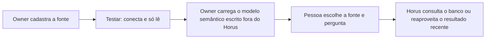

# Conectar as fontes vivas

> **Em uma frase:** ligar o Horus aos bancos de dados da empresa, só para ler, para que cada resposta traga o número
> de agora, e não o de uma planilha de ontem.

## 🧭 O que é

Uma **fonte de dados** é um banco da empresa ligado ao Horus: o de vendas, o de estoque, o financeiro. Ela é **viva**
porque o Horus consulta o próprio banco na hora da pergunta de análise, e não uma cópia exportada.

O Horus de hoje já faz isso, e a v2.0 traz esta macro funcionalidade (mf) inteira, quase como está. Cada fonte tem o
seu **modelo semântico**, o documento que explica ao Horus o que cada tabela e cada palavra querem dizer na empresa
("faturamento", "loja ativa"). O **owner da organização**, que cuida das pessoas e dos dados de um setor ou de um
cliente, cadastra as fontes e carrega o modelo semântico de cada uma. Quem escreve o modelo é o **time de dados**, do
cliente ou da Maind, fora do Horus: ele entrega o arquivo, e ninguém de fora entra na organização para isso.

Na v2.0, cada organização guarda as suas fontes num espaço só dela. Na v2.1, o Middleware na casa do contratante
(MF-121), uma peça da Maind que o cliente instala na própria infraestrutura, vai se apoiar nestas fontes: por ele,
elas alcançam o banco que não pode sair de casa, e o Horus continua na nuvem da Maind.

> 💡 A credencial só de leitura é como o acesso de "só consulta" que o banco dá ao contador: ele vê o extrato, mas
> não faz transferência. Onde a comparação falha: o Horus não confia na palavra de quem cadastra e confere com o
> próprio banco.

> 📌 **Exemplo** (personagens ilustrativos): o Marcos, owner da área comercial de uma rede de lojas, cadastra o banco
> de vendas, que a TI não expõe na internet. Escolhe o túnel, informa a credencial só de leitura e clica em
> "Testar": a conexão responde. O time de dados entrega o arquivo do modelo semântico, que o Marcos carrega, e a
> gestora Carla pergunta quanto cada loja vendeu na semana: o número sai do banco na hora.

## ✨ Características

- **Cinco tecnologias:** SQL Server, PostgreSQL, Oracle, MongoDB e BigQuery. O AWS Athena, que hoje não responde,
  chega terminado na v2.1, numa mf própria, a Fonte AWS Athena (MF-123).
- **Só lê:** o Horus nunca altera um dado; toda consulta passa por uma porta única que recusa escrita e traz até 500
  linhas em até 30 segundos.
- **Dois caminhos até o banco:** o endereço público, que a TI do cliente libera no firewall, ou o túnel SSH, uma
  passagem segura pela máquina de entrada da rede dele.
- **Credencial no cofre:** cifrada, nunca volta à tela; o botão "Testar" confere a conexão sem gastar IA.
- **Longe dos olhos da Maind:** o funcionário da Maind que administra a instalação vê todas as organizações, mas não
  os dados das fontes delas.
- **Um modelo semântico por fonte:** escrito fora do Horus e carregado pelo owner; o Horus o lê a cada pergunta, e
  melhorá-lo é do time de dados.
- **Um teto de inferência por fonte:** até onde o Horus pode interpretar além do número. A **role** da pessoa, o
  pacote de botões que o owner monta, pode baixá-lo, nunca subir; vale sempre o menor, inclusive com várias fontes na
  conversa. Não há um teto único da organização.
- **Idade mínima do dado:** dentro de um intervalo que a fonte define, a mesma consulta reaproveita o resultado já
  buscado, em vez de perguntar de novo ao banco.
- **Longe da rede interna:** a fonte nunca alcança a rede interna da máquina onde o Horus roda.
- **Os dados da organização inteira:** na v2.0, quem pergunta vê tudo o que a fonte tem; o papel e as roles decidem
  quem pergunta, e o recorte por pessoa vem com a Segurança dos dados por pessoa (MF-106), na v2.1. Um setor que
  precise de dados à parte ganha a sua própria organização.

## 📈 O valor que gera

- **Para quem usa:** o número sai do banco de verdade, na hora, sem pedir exportação a ninguém.
- **Para a empresa que contrata o Horus:** os bancos ficam intocados, e a TI decide por onde o Horus entra.
- **Para o Horus como produto:** é a base da conversa, dos boards, dos agentes e, na v2.1, do middleware na casa do
  contratante.

**Como vamos saber que funcionou:** as fontes de cada organização respondem com o número do banco, e nenhuma
enxerga a de outra.

## 🚶 Como se usa no Horus

**O owner da organização:**

1. Cadastra a fonte: a tecnologia, o caminho e a credencial só de leitura.
2. Clica em "Testar": o Horus confere que conecta e que a credencial só lê.
3. Ajusta o teto de inferência e a idade mínima do dado.
4. Carrega o modelo semântico que o time de dados escreveu fora do Horus.

**Quem pergunta** (o owner, o **gestor** e os membros **ouro** e **prata**, os tipos de assento de membro que podem
perguntar; o membro **bronze** só exibe os dashboards já criados e compartilhados) escolhe as fontes na conversa e
pergunta.

## 🧩 Grau de complexidade: baixa

🟢 Quase tudo vem pronto da v1: os conectores, o túnel, a barreira contra a rede interna, o cofre, o reaproveitamento
das consultas e o modelo semântico. Na v2.0, só o acesso muda, para respeitar o espaço de cada organização, e nada
externo é novo. Depende da separação entre organizações, que é da plataforma; o Athena, que ainda não responde,
foi para uma mf própria.

> ⚠️ É a leitura do PO a partir dos documentos de arquitetura. A estimativa de esforço é do arquiteto.

## 🔗 Macro funcionalidades relacionadas

| mf | Como se relaciona |
| --- | --- |
| Perguntar aos dados em português (MF-107) | **é a base de**: a conversa transforma a pergunta numa consulta a estas fontes, guiada pelo modelo semântico |
| IA sob controle da organização (MF-105) | **complementa**: a IA escreve a consulta e o texto, e os números saem da fonte; na v2.1, as duas são a base do middleware na casa do contratante |
| Segurança dos dados por pessoa (MF-106) | **complementa**: na v2.1, recorta o que cada pessoa vê de cada fonte; até lá, vale a organização inteira |
| A web como fonte (MF-109) | **complementa**: os bancos dão o número da empresa, e a web, o contexto de fora; ela entra pela pesquisa do modelo, e não como fonte cadastrada aqui |
| Respostas visuais (MF-108) | **é a base de**: os números de todo bloco vêm das fontes |
| Boards e Relatórios (MF-112) | **é a base de**: os cartões consultam as mesmas fontes e reaproveitam o resultado dentro da idade mínima do dado |
| Bases de demonstração (MF-118) | **é a base de**: as bases entram nas organizações de exemplo como fontes comuns, pelos mesmos conectores dos clientes |
| Faixa de avisos e números (MF-120) | **é a base de**: os números do negócio que a faixa mostra saem das fontes da organização |
| Middleware na casa do contratante (MF-121) | **é a base de**: na v2.1, as fontes alcançam por ele o banco que não pode sair da casa do cliente |
| Fonte AWS Athena (MF-123) | **é a base de**: o Athena chega terminado na v2.1 sobre a base de fontes desta mf |
| Agentes ativos (MF-115) | **é a base de**: o agente extrai os dados das fontes desta mf. |

## 🚧 O que ela não faz

- **Escrever nos bancos** ou agir nos sistemas da empresa.
- **Montar o modelo semântico sozinha:** é do time de dados, que o escreve fora do Horus; ninguém de fora entra na
  organização nem ganha assento para isso.
- **Conectar por VPN ou pela rede privada de uma nuvem:** fica fora da v2.0.
- **Recortar os dados por pessoa:** é da Segurança dos dados por pessoa, na v2.1.
- **Alcançar a rede interna do contratante:** só com o Horus instalado inteiro na casa dele, o que está sem versão e
  só volta se um cliente exigir que nada, nem a pergunta, saia de casa, e então como uma mf própria.

## ⏳ Ainda a decidir

- **A fonte de páginas da web:** o cadastro de páginas fica fora da v2.0, porque a web entra pela pesquisa do modelo;
  falta o arquiteto conferir o que fazer com o tipo de fonte que o Horus de hoje tem.

## 📚 Para saber mais

- `docs/raw/produto/04-macro-funcionalidades-de-hoje.md`: o mapa (o que a mf entrega hoje), a tabela de conversão
  (camada 🔌 Dados e IA) e "Previsto e ainda não construído" (o Athena, as redes privadas, o assistente de modelagem).
- `docs/raw/produto/backlog-estrategico.md`: **D-021** (base herdada); **D-001** e **D-022** (o Horus só lê);
  **D-197** e **D-198** (a mf inteira na v2.0, sem o Athena, que virou a `MF-123`); **D-161** (o Athena terminado na
  v2.1) e **D-201** (a definição da `MF-123`); **D-162** (a web como fonte é o modelo
  sair à web; o cadastro de páginas fica de fora); **D-186**, **D-187** e **D-188** (a rede interna do contratante,
  só na instalação completa, sem versão); **D-196** (o middleware da v2.1 depende das fontes); **D-193** (o
  funcionário da Maind não vê os dados das conexões); **D-194** (os tipos de assento ouro, prata e bronze); **D-083**
  (o modelo semântico com o time de dados); **D-219** (o time de dados escreve o modelo fora do Horus, e o owner da
  organização o carrega); **D-013** (o owner da organização); **D-138** e **D-139** (MVP da v1.xx: o Athena e as
  páginas web fora da tela); **D-110** (os botões da role); **D-220** (o teto de inferência é o de cada fonte, e a role
  só o baixa); **D-145** (a organização é a fronteira dos dados na v2.0; a segurança por pessoa inteira na v2.1).
  Pendências do arquiteto: **P-033** (o Athena) e **P-034** (a fonte de páginas web).
- `docs/raw/produto/05-v2.0-consolidada.md` (§1, §3.2, §5.4 e §6), `06-versoes.md` (a `MF-104` inteira na v2.0, a
  `MF-121` e a `MF-123` na v2.1 e a instalação completa sem versão), `07-mapa-de-objetivos-e-funcionalidades.md`
  (O1) e `03-inventario-de-lacunas.md` (linha 15 e candidata nº 5).
- `docs/raw/arquitetura/01-estrategia-da-solucao.md`: §1 ("O que continua valendo"), §4 (a linha da MF-104) e §6 (os
  marcos M2 e M10).
- `docs/raw/arquitetura/02-registro-de-decisoes.md`: **ARQ-052** (as cinco tecnologias e os dois caminhos),
  **ARQ-010** e **ARQ-034** (a fonte de uma organização só), **ARQ-077** (as travas do banco e do driver),
  **ARQ-090** (o que fica na v2.0 sem a segurança por pessoa) e **ARQ-060** (o on-premises, que ficou sem versão).
- `docs/raw/arquitetura/04-software.md` (§3.2 e §3.6: o catálogo de fontes, os conectores, o histórico de execuções e o
  ponto único de execução), `05-motor-de-analise-e-ia.md` (§3.4: o modelo semântico e o teto por fonte),
  `06-dados.md` (§3.2: o isolamento entre organizações), `07-seguranca.md` (§3.7: o cofre e a guarda de rede) e
  `08-integracoes.md` (§3.5: as fontes dos clientes e os tetos por consulta).
- `docs/raw/arquitetura/14-conferencia-do-produto.md`: §3 (o que se reaproveita) e §4: **A-04** (o Athena e as páginas
  web, fechado pelas **D-161** e **D-162**), **A-13** (o teto de inferência, fechado pela **D-220**) e **A-24**
  (escolher as fontes não está entre os botões da role).
- O sentido da "idade mínima do dado", que o mapa só nomeia, vem do código da v1.xx:
  `horus@318db52b:apps/server/Horus.Core/Data/Connections/ConnectionCatalog.cs` (`IdadeMinimaPadraoMinutos`).
