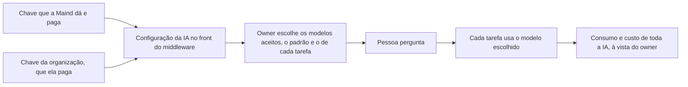

# IA sob controle da organização

> **Em uma frase:** a organização escolhe qual modelo de IA faz cada tarefa do Horus, com a chave de provedor que ela
> mesma paga ou com a que a Maind lhe dá e paga, e vê o consumo e o custo de toda a IA dela.

## 🧭 O que é

O **modelo de IA** é o programa que entende a pergunta de análise, escreve a consulta ao banco e redige o texto da
resposta; os números saem sempre da **fonte de dados**, o banco da empresa ligado ao Horus. Esta macro funcionalidade
(mf) põe a escolha do modelo nas mãos da organização.

No Horus de hoje, cada organização liga a sua **conexão de IA**, a própria conta num provedor de modelos: o
OpenRouter, que reúne vários fabricantes, ou o Amazon Bedrock. Na v2.0, a IA é **sempre da organização**: cada
organização tem a sua configuração de IA no **front do middleware**, o aplicativo da organização que fica fora do
Horus, junto do Middleware da organização (MF-121), a peça que fica entre o Horus e os bancos e a IA dela. Não há mais
uma conexão de IA da Maind para várias organizações. Quem configura depende de onde o middleware fica:

- **Na casa do cliente:** a própria organização, pelo **owner da organização**, que cuida das pessoas e dos dados de
  um setor ou de um cliente.
- **Na hospedagem da Maind:** o **time da Maind**, como suporte técnico antes e depois da venda.

A chave do provedor pode ter dois donos. A organização pode usar a **chave própria**, de um provedor com que tenha
contrato, e então **paga o consumo**. Ou a **Maind pode lhe dar uma chave de provedor**, e quem **paga é a Maind**. Nos
dois casos, o owner da organização **vê o consumo e o custo de toda a IA** dela.

O owner da organização escolhe os modelos aceitos, entre os da conexão que a organização tem, e o de cada tarefa. A
v2.0 acrescenta o modelo dos agentes e o custo de cada organização. O ciclo da análise, com o modelo de IA e as
consultas, roda dentro do middleware.

> 💡 É como um carro alugado: quem aluga escolhe o carro de cada trajeto e abastece com o próprio cartão, ou recebe
> o carro com o combustível pago pela locadora, quando ela o oferece. Nos dois casos, o painel mostra o consumo a quem
> dirige. Onde a comparação falha: aqui o consumo se mede por chamada, em centavos, e a locadora decide, cliente a
> cliente, a quem oferece o combustível.

> 📌 **Exemplo** (personagens ilustrativos): a área comercial de uma rede de lojas hospeda o middleware na casa da
> empresa. No front do middleware, o Marcos, owner da área, configura a IA com a chave do provedor com que a empresa
> tem contrato; aceita três modelos e deixa o mais econômico como padrão; para montar a consulta ao banco, escolhe um
> mais forte. A gestora Carla, cuja role permite, troca o modelo numa pergunta difícil, e a organização paga o
> consumo. Já a área financeira, outra organização da mesma rede, tem o middleware hospedado pela Maind, que lhe dá uma
> chave de provedor e a paga; o time da Maind a configura. No fim do mês, a owner da área financeira vê quanto a área
> consumiu e quanto custou, mesmo sendo a Maind quem paga.

## ✨ Características

- **A IA é sempre da organização:** configurada no front do middleware, pelo owner, com o middleware na casa do
  cliente, ou pelo time da Maind, na hospedagem da Maind. Não há conexão de IA da instância.
- **Dois donos da chave:** a da organização, que ela paga; e a que a Maind lhe dá, que a Maind paga. Ao criar a
  organização, a Maind já não escolhe se lhe disponibiliza uma IA: esse passo deixou de existir.
- **Curadoria:** o owner escolhe os modelos que a organização aceita, entre os da conexão que ela tem, e, no
  OpenRouter, a empresa preferida para rodar cada um.
- **Modelo padrão obrigatório:** a conversa nasce com ele, e ele vale onde ninguém escolheu.
- **Um modelo por tarefa:** montar a consulta, consertar a que falhou, a Análise avançada, a pesquisa na web; cada
  função pode ter o seu modelo e, sem escolha, usa o da conversa.
- **Na conversa, conforme a role:** se a role da pessoa (o pacote de botões que o owner monta) liga a escolha do
  modelo, ela troca o modelo, dentro da curadoria.
- **O modelo dos agentes:** o owner o escolhe para os Agentes ativos (MF-115); sem escolha, vale o padrão.
- **A pesquisa na web segue o provedor:** só aparece se o provedor pesquisa por conta própria (o OpenRouter pesquisa;
  o Bedrock, não), e só a pergunta vai à busca, nunca os dados do banco.
- **Nunca troca em silêncio:** numa falha passageira do provedor, o Horus tenta de novo uma vez, antes do primeiro
  texto, e nunca com outro modelo.
- **O consumo de cada chamada:** só números, sem conteúdo; quando o provedor não informa o custo, o Horus o estima
  pelo preço público e marca a estimativa.
- **O que o owner da organização vê:** o consumo e o custo de toda a IA da organização, da chave que ela paga e da que
  a Maind dá.
- **Sem teto automático:** fora os tetos técnicos de cada execução, não há teto automático de custo, nem por agente nem
  por organização: nada se corta sozinho. A Maind segue com o aviso de custo da Administração da instância (MF-101).
- **Quando a IA para,** por chave recusada ou falta de crédito, o owner da organização é sempre avisado; se a chave é a
  que a Maind dá, o time da Maind também é avisado, para repor o crédito.

## 📈 O valor que gera

- **Para quem usa:** a resposta vem do modelo em que a organização confia, sem troca escondida.
- **Para a empresa que contrata o Horus:** usa o provedor com que já tem contrato, pagando o consumo, ou a chave que a
  Maind lhe dá e paga; escolhe, tarefa a tarefa, o modelo de que precisa; e vê o consumo e o custo de toda a IA dela.
- **Para o Horus como produto:** a IA é quase todo o custo variável; a Maind decide a quem dá uma chave, e medir a IA
  por organização mostra quanto custa atender cada uma.

**Como vamos saber que funcionou:** o time da Maind configura, no front do middleware, a IA de uma organização nova
com a chave que a Maind dá, e o owner faz a primeira pergunta de análise; outra organização, com a chave própria,
pergunta e paga o consumo; e o owner de cada uma vê o consumo e o custo do mês, medido ou estimado.

## 🚶 Como se usa no Horus

**Quem configura a IA**, no front do middleware (o owner da organização, com o middleware na casa do cliente; o time
da Maind, na hospedagem da Maind):

1. Configura a conexão com o provedor, com a chave da organização ou com a que a Maind dá.

**O owner da organização:**

1. Escolhe os modelos aceitos, entre os da conexão que a organização tem, e, no OpenRouter, a empresa preferida de
   cada um.
2. Define o modelo padrão.
3. Dá, se quiser, um modelo próprio a cada tarefa, inclusive a dos agentes.
4. Acompanha o consumo e o custo de toda a IA da organização.

**Quem pergunta** (o owner, o **gestor** e os membros **ouro** e **prata**, os tipos de assento de membro que podem
perguntar) usa o modelo padrão, ou troca na conversa, se a role deixar.

## 🧩 Grau de complexidade: média

🟡 A v1 traz quase tudo: as conexões, a curadoria, o modelo por tarefa e o consumo. São novos as tarefas do agente e
da pesquisa na web, a estimativa de custo, o custo por organização e a configuração da IA no front do middleware, que
é do Middleware da organização (MF-121) e ainda não tem desenho. Depende do OpenRouter e da Amazon, já integrados.

> ⚠️ É a leitura do PO a partir dos documentos de arquitetura. A estimativa de esforço é do arquiteto.

## 🔗 Macro funcionalidades relacionadas

| mf | Como se relaciona |
| --- | --- |
| Perguntar aos dados em português (MF-107) | **é a base de**: cada etapa da resposta usa o modelo que a organização escolheu |
| Conectar as fontes vivas (MF-104) | **complementa**: a IA escreve a consulta, e a fonte dá os números; as duas se configuram no front do middleware |
| A web como fonte (MF-109) | **é a base de**: a pesquisa na web só existe quando o provedor da IA pesquisa por conta própria |
| Agentes ativos (MF-115) | **é a base de**: o modelo que segue as instruções do agente é escolha do owner, e o consumo dele entra no custo da organização |
| Organizações, pessoas e papéis (MF-102) | **depende de**: o botão de escolher o modelo na conversa mora nas roles |
| Administração da instância (MF-101) | **complementa**: a Maind cria a organização sem o passo de disponibilizar uma IA, segue com o aviso de custo e, quando a IA com a chave dela para, é avisada |
| Licenças e planos (MF-103) | **complementa**: a chave da organização, ela paga; a que a Maind dá, a Maind paga |
| Segurança dos dados por pessoa (MF-106) | **é a base de**: na v2.1, a IA que transforma a regra de acesso em consulta protegida e a confere é a da organização |
| Middleware da organização (MF-121) | **é a base de**: a IA da organização é configurada no front do middleware, e o modelo trabalha no ciclo da análise, dentro dele |

## 🚧 O que ela não faz

- **Tirar o número do modelo:** os números vêm sempre do banco.
- **Cortar o gasto sozinha:** há o aviso de custo à Maind e os tetos técnicos de cada execução, mas nenhum teto
  automático de custo.
- **Ter uma IA da instância:** não há mais uma conexão de IA da Maind para várias organizações; cada organização tem a
  sua configuração.
- **Ligar direto à Anthropic, à OpenAI ou ao Google:** os modelos deles chegam pelo OpenRouter.
- **Garantir que o dado não saia do país:** a região de São Paulo do Bedrock não basta para os modelos Claude.
- **O modo "tudo dentro",** em que nada sai da casa do contratante, nem a pergunta: fica sem versão e só volta se um
  cliente exigir o Horus instalado inteiro na casa dele, e então como uma mf própria.

## ⏳ Ainda a decidir

- **Onde o owner faz as escolhas e vê o custo:** se a curadoria, o modelo padrão e o de cada tarefa ficam no Horus ou
  no front do middleware, e quem os escolhe na hospedagem da Maind (🔎 a confirmar com o dono); a tela do consumo é do
  arquiteto.
- **O aviso de custo da Maind:** que custo de IA ele ainda alcança, agora que a chave pode ser da organização. 🔎 a
  confirmar com o dono
- **O preço do assento:** se a IA que a Maind dá entra nele; é do comercial da Maind.

## 📚 Para saber mais

- `docs/raw/produto/04-macro-funcionalidades-de-hoje.md`: o mapa (conexões, modelo por função, modelo padrão
  obrigatório, curadoria, consumo e custo), a tabela de conversão (camada 🔌 Dados e IA) e "Previsto e ainda não
  construído" (outros provedores).
- `docs/raw/produto/backlog-estrategico.md`: **D-021** (base herdada); **D-264** (com o middleware fora da Maind, a
  organização configura a IA, e a Maind pode lhe dar uma chave de provedor); **D-265** (os bancos e a IA configurados
  no front do middleware, pela organização ou, na hospedagem da Maind, pelo time da Maind); **D-266** (a conexão da
  instância deixa de existir, e some o passo de disponibilizar uma conexão ao criar a organização); **D-267** (a chave
  que a Maind dá, a Maind paga, e o owner vê o consumo e o custo de toda a IA; onde fica essa tela é do arquiteto);
  **D-268** (quando a IA para, o owner é sempre avisado, e o time da Maind também, se a chave é dela); **D-246** (a
  definição macro da `MF-105`, em parte substituída pelas **D-264** a **D-268**); **D-216** (as duas origens da
  conexão de IA, em parte substituída pela **D-266**: sobra a da organização); **D-217** (a organização nasce sem IA,
  em parte substituída pela **D-266**); **D-241** (o owner via só o consumo da conexão que a organização paga, em parte
  substituída pela **D-267**); **D-218** (quando a IA para, é avisado o dono da conexão, em parte substituída pela
  **D-268**); **D-159** (a Maind pagava a IA de todas as organizações; em parte substituída pela **D-216**);
  **D-234** (sem teto automático de custo; ficam os tetos por execução e o aviso de custo); **D-153** (o custo de IA
  do mês e o aviso de custo na `MF-101`; que custo ele alcança sem a conexão da instância está em aberto 🔎);
  **D-258** (o ciclo da análise, com o modelo, roda dentro do middleware); **D-193** (o funcionário da Maind na
  instância, sem ver os dados, e o owner da organização, com a visão de billing); **D-214** (a visão de cobrança do
  owner mostra só a contagem de assentos); **D-194** (os tipos de assento ouro, prata e bronze); **D-197** (a mf
  inteira numa versão só); **D-010** (os modos "com serviços externos autorizados" e "tudo dentro"); **D-185** e
  **D-188** (o "tudo dentro", com o modelo do contratante, só na instalação completa, sem versão); **D-190** e
  **D-196** (o middleware chega à IA do cliente e depende desta mf); **D-061** e **D-063** (o owner escolhe o modelo
  dos agentes, e todo agente usa IA); **D-110** (o botão da escolha do modelo de IA na role); **D-013** (os dois
  níveis de owner); **D-139** (MVP da v1.xx: os três provedores "em breve" fora da tela). Pendências: **P-022** (o
  preço, com o comercial: a IA que a Maind dá entra ou não no assento), **P-032** (como a chave da Maind chega às
  organizações) e **P-048** (o desenho do middleware, inclusive a tela do consumo e o aviso ao time da Maind).
- `docs/raw/produto/05-v2.0-consolidada.md` (§1, §3.2, §5.12, §5.14 e §6), `06-versoes.md` (a `MF-105` inteira na
  v2.0, sem o "tudo dentro", com o que mudou em 07/11/2026), `07-mapa-de-objetivos-e-funcionalidades.md` (O1) e
  `03-inventario-de-lacunas.md` (linha 16 e candidata nº 5).
- `docs/raw/arquitetura/01-estrategia-da-solucao.md`: §1 ("O que continua valendo": os números vêm do banco), §4 (a
  linha da MF-105) e §6 (os marcos M2 e M10).
- `docs/raw/arquitetura/02-registro-de-decisoes.md`: **ARQ-031** (o roteamento por função e as funções novas),
  **ARQ-051** (os provedores da v2.0 e a nova tentativa antes do primeiro texto), **ARQ-027** (a pesquisa na web pela
  busca nativa do provedor), **ARQ-083** (o custo informado ou estimado), **ARQ-017** e **ARQ-084** (o custo por
  organização e o aviso à Maind, sem corte), **ARQ-090** (as funções de IA da segurança saem da v2.0) e **ARQ-060**
  (o on-premises, que ficou sem versão).
- `docs/raw/arquitetura/04-software.md` (§3.2 e §3.6: as conexões de IA e o roteador), `05-motor-de-analise-e-ia.md`
  (§3.10: as funções e o contrato do provedor) e `08-integracoes.md` (§3.4: os provedores, o dado no país e a IA de
  dentro de casa).
- `docs/raw/arquitetura/14-conferencia-do-produto.md`: §3 (o que se reaproveita) e §4: **A-03** (de quem é cada custo no
  SaaS, fechado pela **D-159**, revisto pela **D-216** e de novo pela **D-266**), **A-16** (o dado no país), **A-22**
  (quem fica sabendo quando um serviço da organização para; para a IA, a **D-268**) e **A-29** (o painel do owner da
  instância com o uso, fechado pela **D-153**).
- A regra da curadoria, do modelo padrão e da troca que nunca é silenciosa está no repositório da v1.xx:
  `horus@318db52b:.claude/rules/llm/conexoes-e-roteamento.md`.
