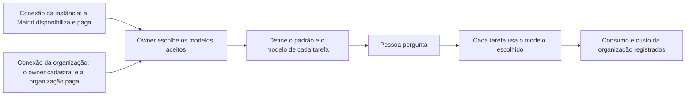

# IA sob controle da organização

> **Em uma frase:** a organização escolhe qual modelo de IA faz cada tarefa do Horus, seja na conexão de IA que ela
> mesma cadastra e paga, seja na que a Maind lhe disponibiliza e paga.

## 🧭 O que é

O **modelo de IA** é o programa que entende a pergunta de análise, escreve a consulta ao banco e redige o texto da
resposta; os números saem sempre da **fonte de dados**, o banco da empresa ligado ao Horus. Esta macro funcionalidade
(mf) põe a escolha do modelo nas mãos da organização.

No Horus de hoje, cada organização liga a sua **conexão de IA**, a própria conta num provedor de modelos: o
OpenRouter, que reúne vários fabricantes, ou o Amazon Bedrock. Na v2.0, a conexão tem duas origens:

- **A da organização:** o **owner da organização**, que cuida das pessoas e dos dados de um setor ou de um cliente, a
  cadastra com o provedor que quiser, e quem paga o consumo é a organização.
- **A da instância:** o **owner da instância**, o funcionário da Maind que administra a instalação e vê todas as
  organizações sem ver os dados delas, a cadastra no nível da instância e a disponibiliza, ou não, a uma ou mais
  organizações. Quem paga é a Maind, e a organização a usa como veio, sem poder editá-la.

A organização nasce sem IA: no passo em que a cria e libera os assentos, o owner da instância escolhe se lhe
disponibiliza uma conexão da instância. O preço do **assento**, a licença de cada pessoa, depende de a organização
usar ou não essa conexão.

O owner da organização escolhe os modelos aceitos, entre os das conexões que a organização tem, e o de cada tarefa.
A v2.0 acrescenta o modelo dos agentes e o custo de cada organização. Na v2.1, o Middleware na casa do contratante
(MF-121), uma peça da Maind que o cliente instala na própria infraestrutura, vai levar o Horus também à IA do próprio
cliente.

> 💡 É como um carro alugado: quem aluga escolhe o carro de cada trajeto e abastece com o próprio cartão, ou recebe
> o carro com o combustível pago pela locadora, quando ela o oferece. Onde a comparação falha: aqui o consumo se mede
> por chamada, em centavos, e a locadora decide, cliente a cliente, a quem oferece o combustível.

> 📌 **Exemplo** (personagens ilustrativos): ao criar a organização da área comercial de uma rede de lojas, a Maind
> lhe disponibiliza a conexão da instância. O Marcos, owner da área, aceita três modelos e deixa o mais econômico como
> padrão; para montar a consulta ao banco, escolhe um mais forte. A gestora Carla, cuja role permite, troca o modelo
> numa pergunta difícil. No fim do mês, a Maind, que paga essa conexão, vê quanto a área consumiu. Já a área
> financeira, outra organização da mesma rede, cadastra a própria conexão, num provedor com que a empresa tem
> contrato, e paga o consumo.

## ✨ Características

- **Duas origens de conexão:** a da organização, que o owner cadastra com o provedor que quiser e que a organização
  paga; e a da instância, que a Maind cadastra, disponibiliza a uma ou mais organizações e paga. A da instância não
  se edita na organização.
- **A organização nasce sem IA:** o owner da instância escolhe, ao criá-la, se lhe disponibiliza a conexão da
  instância; sem nenhuma conexão, a primeira pergunta de análise espera que ele a disponibilize ou que o owner da
  organização cadastre a própria.
- **Curadoria:** o owner escolhe os modelos que a organização aceita, entre os das conexões que ela tem (as dela e as
  que a instância lhe disponibiliza), e, no OpenRouter, a empresa preferida para rodar cada um.
- **Modelo padrão obrigatório:** a conversa nasce com ele, e ele vale onde ninguém escolheu.
- **Um modelo por tarefa:** montar a consulta, consertar a que falhou, a Análise avançada, a pesquisa na web; cada
  função pode ter o seu modelo e, sem escolha, usa o da conversa.
- **Na conversa, conforme a role:** se a role da pessoa (o pacote de botões que o owner monta) liga a escolha do
  modelo, ela troca o modelo, dentro da curadoria.
- **O modelo dos agentes:** o owner o escolhe para os Agentes ativos (MF-115); sem escolha, vale o padrão.
- **A pesquisa na web segue o provedor:** só aparece se o provedor pesquisa por conta própria (o OpenRouter pesquisa;
  o Bedrock, não), e só a pergunta vai à busca, nunca os dados do banco.
- **Nunca troca em silêncio:** numa falha passageira do provedor, o Horus tenta de novo uma vez, antes do primeiro
  texto, e nunca com outro modelo.
- **O consumo de cada chamada:** só números, sem conteúdo; quando o provedor não informa o custo, o Horus o estima
  pelo preço público e marca a estimativa.
- **O custo por organização:** o owner da instância acompanha o custo de IA do mês de cada uma na Administração da
  instância (MF-101) e é avisado acima de um limite que ajusta caso a caso. Fora os tetos técnicos de cada execução,
  não há teto automático de custo, nem por agente nem por organização: nada se corta sozinho.
- **O que o owner da organização vê do consumo:** o consumo e o custo da conexão da organização, a própria, que
  ela paga; da conexão da instância não vê nada de IA.
- **Quando a IA para,** por chave recusada ou falta de crédito, é avisado o dono da conexão: o owner da organização,
  se a conexão é dela; o owner da instância, se é da instância. O owner de uma organização que usa a conexão da
  instância não recebe esse aviso.

## 📈 O valor que gera

- **Para quem usa:** a resposta vem do modelo em que a organização confia, sem troca escondida.
- **Para a empresa que contrata o Horus:** começa com a conexão que a Maind lhe disponibiliza, sem abrir conta em
  provedor nem comprar crédito, ou usa o provedor com que já tem contrato, pagando o consumo; e escolhe, tarefa a
  tarefa, o modelo de que precisa.
- **Para o Horus como produto:** a IA é quase todo o custo variável; a Maind decide, organização a organização, a
  quem paga a IA, e medi-la por organização mostra se o preço do assento cobre o consumo.

**Como vamos saber que funcionou:** uma organização que recebe a conexão da instância faz a primeira pergunta de
análise no primeiro dia, sem abrir conta em provedor de IA; outra, com a conexão própria, pergunta e paga o consumo;
e toda organização aparece com o custo do mês, medido ou estimado.

## 🚶 Como se usa no Horus

**O owner da instância:**

1. Cadastra a conexão de IA da instância.
2. Ao criar uma organização e liberar os assentos, escolhe se lhe disponibiliza essa conexão.

**O owner da organização:**

1. Usa a conexão que a instância lhe disponibilizou, como veio, ou cadastra a da organização, com o provedor que
   quiser.
2. Escolhe os modelos aceitos, entre os das conexões que a organização tem, e, no OpenRouter, a empresa preferida de
   cada um.
3. Define o modelo padrão.
4. Dá, se quiser, um modelo próprio a cada tarefa, inclusive a dos agentes.

**Quem pergunta** (o owner, o **gestor** e os membros **ouro** e **prata**, os tipos de assento de membro que podem
perguntar) usa o modelo padrão, ou troca na conversa, se a role deixar.

## 🧩 Grau de complexidade: média

🟡 A v1 traz quase tudo: as conexões, a curadoria, o modelo por tarefa e o consumo. São novos as tarefas do agente e
da pesquisa na web, a estimativa de custo, o custo por organização e a conexão da instância, cadastrada na instância
e disponibilizada a uma ou mais organizações, que ainda não tem desenho. Depende do OpenRouter e da Amazon, já
integrados.

> ⚠️ É a leitura do PO a partir dos documentos de arquitetura. A estimativa de esforço é do arquiteto.

## 🔗 Macro funcionalidades relacionadas

| mf | Como se relaciona |
| --- | --- |
| Perguntar aos dados em português (MF-107) | **é a base de**: cada etapa da resposta usa o modelo que a organização escolheu |
| Conectar as fontes vivas (MF-104) | **complementa**: a IA escreve a consulta, e a fonte dá os números; na v2.1, as duas são a base do middleware na casa do contratante |
| A web como fonte (MF-109) | **é a base de**: a pesquisa na web só existe quando o provedor da IA pesquisa por conta própria |
| Agentes ativos (MF-115) | **é a base de**: o modelo que segue as instruções do agente é escolha do owner, e o consumo dele entra no custo da organização |
| Organizações, pessoas e papéis (MF-102) | **depende de**: o botão de escolher o modelo na conversa mora nas roles |
| Administração da instância (MF-101) | **complementa**: é onde a Maind cadastra a conexão da instância, a disponibiliza ao criar cada organização, vê o custo de IA de cada uma e recebe o aviso de custo |
| Licenças e planos (MF-103) | **complementa**: nas organizações que usam a conexão da instância, a Maind paga a IA e a embute no preço do assento; a que usa a conexão própria paga o consumo |
| Segurança dos dados por pessoa (MF-106) | **é a base de**: na v2.1, a IA que transforma a regra de acesso em consulta protegida e a confere é a da organização |
| Middleware na casa do contratante (MF-121) | **é a base de**: na v2.1, o middleware leva o Horus também ao modelo de IA do próprio cliente |

## 🚧 O que ela não faz

- **Tirar o número do modelo:** os números vêm sempre do banco.
- **Cortar o gasto sozinha:** há o aviso de custo à Maind e os tetos técnicos de cada execução, mas nenhum teto
  automático de custo.
- **Editar a conexão da instância na organização:** ela chega como a Maind a cadastrou.
- **Ligar direto à Anthropic, à OpenAI ou ao Google:** os modelos deles chegam pelo OpenRouter.
- **Garantir que o dado não saia do país:** a região de São Paulo do Bedrock não basta para os modelos Claude.
- **O modo "tudo dentro",** em que nada sai da casa do contratante, nem a pergunta: fica sem versão e só volta se um cliente exigir o Horus instalado inteiro na casa dele, e então como uma mf própria.

## ⏳ Ainda a decidir

- **Como a conexão da instância chega às organizações**, já que o Horus de hoje tem uma conexão por organização:
  é desenho do arquiteto.

## 📚 Para saber mais

- `docs/raw/produto/04-macro-funcionalidades-de-hoje.md`: o mapa (conexões, modelo por função, modelo padrão
  obrigatório, curadoria, consumo e custo), a tabela de conversão (camada 🔌 Dados e IA) e "Previsto e ainda não
  construído" (outros provedores).
- `docs/raw/produto/backlog-estrategico.md`: **D-021** (base herdada); **D-159** (a Maind paga a IA de todas as
  organizações e a embute no assento; em parte substituída pela **D-216**); **D-216** (as duas origens da conexão de
  IA: a da organização, que ela paga, e a da instância, que a Maind paga e disponibiliza por organização, sem edição
  na organização); **D-217** (a organização nasce sem IA, e o administrador da instância lhe disponibiliza a conexão
  ao criá-la); **D-246** (a definição macro da `MF-105`); **D-241** (o owner vê consumo e custo só da conexão que a organização
  paga); **D-218** (quando a IA para, é avisado o dono da conexão); **D-234** (sem teto automático de custo;
  ficam os tetos por execução e o aviso de custo); **D-153** (o custo de IA do mês e o aviso de custo na `MF-101`);
  **D-193** (o funcionário da Maind na instância, sem ver os dados, e o owner da organização, com a visão de
  billing); **D-214** (a visão de cobrança do owner mostra só a contagem de assentos); **D-194** (os tipos de assento
  ouro, prata e bronze); **D-197** (a mf inteira numa versão só); **D-010** (os modos "com serviços externos
  autorizados" e "tudo dentro"); **D-185** e **D-188** (o "tudo dentro", com o modelo do contratante, só na
  instalação completa, sem versão); **D-190** e **D-196** (o middleware da v2.1 chega à IA do cliente e depende desta
  mf); **D-061** e **D-063** (o owner escolhe o modelo dos agentes, e todo agente usa IA); **D-110** (o botão da
  escolha do modelo de IA na role); **D-013** (os dois níveis de owner); **D-139** (MVP da v1.xx: os três provedores
  "em breve" fora da tela). Pendência do arquiteto: **P-032** (como a conexão da instância chega às organizações).
- `docs/raw/produto/05-v2.0-consolidada.md` (§1, §3.2 e §6), `06-versoes.md` (a `MF-105` inteira na v2.0, sem o
  "tudo dentro"), `07-mapa-de-objetivos-e-funcionalidades.md` (O1) e `03-inventario-de-lacunas.md` (linha 16 e
  candidata nº 5).
- `docs/raw/arquitetura/01-estrategia-da-solucao.md`: §1 ("O que continua valendo": os números vêm do banco), §4 (a
  linha da MF-105) e §6 (os marcos M2 e M10).
- `docs/raw/arquitetura/02-registro-de-decisoes.md`: **ARQ-031** (o roteamento por função e as funções novas),
  **ARQ-051** (os provedores da v2.0 e a nova tentativa antes do primeiro texto), **ARQ-027** (a pesquisa na web pela
  busca nativa do provedor), **ARQ-083** (o custo informado ou estimado), **ARQ-017** e **ARQ-084** (o custo por
  organização e o aviso à Maind, sem corte), **ARQ-090** (as funções de IA da segurança saem da v2.0) e **ARQ-060**
  (o on-premises, que ficou sem versão).
- `docs/raw/arquitetura/04-software.md` (§3.2 e §3.6: as conexões de IA e o roteador), `05-motor-de-analise-e-ia.md`
  (§3.10: as funções e o contrato do provedor) e `08-integracoes.md` (§3.4: os provedores, o dado no país e a IA de
  dentro de casa).
- `docs/raw/arquitetura/14-conferencia-do-produto.md`: §3 (o que se reaproveita) e §4: **A-03** (de quem é cada custo no
  SaaS, fechado pela **D-159** e revisto pela **D-216**), **A-16** (o dado no país), **A-22** (quem fica sabendo
  quando um serviço da organização para; para a IA, a **D-218**) e **A-29** (o painel do owner da instância com o
  uso, fechado pela **D-153**).
- A regra da curadoria, do modelo padrão e da troca que nunca é silenciosa está no repositório da v1.xx:
  `horus@318db52b:.claude/rules/llm/conexoes-e-roteamento.md`.
