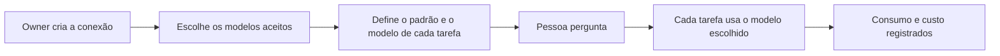

# IA sob controle da organização

> **Em uma frase:** a organização escolhe com que IA o Horus trabalha e qual modelo faz cada tarefa, e sabe quanto
> isso custa.

## 🧭 O que é

O **modelo de IA** é o programa que entende a pergunta de análise, escreve a consulta ao banco e redige o texto da
resposta; os números saem sempre da **fonte de dados**, o banco da empresa ligado ao Horus. Esta macro funcionalidade
(mf) põe a escolha do modelo nas mãos da organização.

Tudo começa pela **conexão de IA**, a conta da organização num provedor de modelos: o OpenRouter, que reúne vários
fabricantes, ou o Amazon Bedrock. Quem a cria é o **owner da organização**, que cuida das pessoas e dos dados de um
setor ou de um cliente. O Horus de hoje já faz isso; a v2.0 acrescenta o modelo dos agentes e o custo de cada
organização, e a v2.1, o modo "tudo dentro", com a IA rodando na casa do contratante.

> 💡 É como a frota de uma empresa: a conta nas locadoras (as conexões), os carros aceitos (a curadoria), um carro
> para cada trajeto (o modelo por tarefa) e a conta de cada viagem. Onde a comparação falha: aqui a conta chega por
> chamada, em centavos.

> 📌 **Exemplo** (personagens ilustrativos): o Marcos, owner da área comercial de uma rede de lojas, liga a conta da
> área no OpenRouter, aceita três modelos e deixa o mais econômico como padrão; para montar a consulta ao banco,
> escolhe um mais forte. A gestora Carla, cuja role permite, troca o modelo numa pergunta difícil. No fim do mês, a
> Maind vê quanto a área gastou.

## ✨ Características

- **Conexões da organização:** uma ou mais, no OpenRouter ou no Bedrock; a chave fica cifrada e só aparece
  mascarada.
- **Curadoria:** o owner escolhe os modelos que a organização aceita e, no OpenRouter, a empresa preferida para rodar
  cada um.
- **Modelo padrão obrigatório:** a conversa nasce com ele, e ele vale onde ninguém escolheu.
- **Um modelo por tarefa:** montar a consulta, consertar a que falhou, a Análise avançada, a pesquisa na web; cada
  função pode ter o seu modelo e, sem escolha, usa o da conversa.
- **Na conversa, conforme a role:** se a role da pessoa (o pacote de botões que o owner monta) liga a escolha do
  modelo, ela troca o modelo, dentro da curadoria.
- **O modelo dos agentes:** o owner o escolhe para os Agentes ativos (MF-115); sem escolha, vale o padrão.
- **A pesquisa na web segue a conexão:** só aparece se o provedor pesquisa por conta própria (o OpenRouter pesquisa;
  o Bedrock, não), e só a pergunta vai à busca, nunca os dados do banco.
- **Nunca troca em silêncio:** numa falha passageira do provedor, o Horus tenta de novo uma vez, antes do primeiro
  texto, e nunca com outro modelo.
- **O consumo de cada chamada:** só números, sem conteúdo; quando o provedor não informa o custo, o Horus o estima
  pelo preço público e marca a estimativa.
- **O custo por organização:** o **owner da instância**, que cuida da instalação inteira (no SaaS, a Maind), vê o
  custo do mês de cada organização e é avisado acima de um limite; nada se corta sozinho.

## 📈 O valor que gera

- **Para quem usa:** a resposta vem do modelo em que a organização confia, sem troca escondida.
- **Para a empresa que contrata o Horus:** equilibra custo e qualidade tarefa a tarefa e sabe quanto gasta.
- **Para o Horus como produto:** a IA é quase todo o custo variável; medi-la por organização mostra o custo antes da
  fatura.

**Como vamos saber que funcionou:** toda organização aparece com o custo do mês, medido ou estimado, mesmo com um
provedor que não o informa.

## 🚶 Como se usa no Horus

**O owner da organização:**

1. Cria a conexão: o provedor, um nome e a chave.
2. Escolhe os modelos aceitos e, no OpenRouter, a empresa preferida de cada um.
3. Define o modelo padrão.
4. Dá, se quiser, um modelo próprio a cada tarefa, inclusive a dos agentes.
5. Acompanha o consumo da organização.

**Quem pergunta** (o owner, o **gestor** e o **membro full**) usa o modelo padrão, ou troca na conversa, se a role
deixar.

## 🧩 Grau de complexidade: média

🟡 A v1 traz quase tudo: as conexões, a curadoria, o modelo por tarefa e o consumo. São novos as tarefas do agente e
da pesquisa na web, a estimativa de custo, o custo por organização e, na v2.1, um provedor dentro da casa do
contratante. Depende do OpenRouter e da Amazon, já integrados, e do fornecedor da IA de dentro de casa, que o dono
escolhe com o contratante.

> ⚠️ É a leitura do PO a partir dos documentos de arquitetura. A estimativa de esforço é do arquiteto.

## 🔗 Macro funcionalidades relacionadas

| mf | Como se relaciona |
| --- | --- |
| Perguntar aos dados em português (MF-107) | **é a base de**: cada etapa da resposta usa o modelo que a organização escolheu |
| Conectar as fontes vivas (MF-104) | **complementa**: a IA escreve a consulta, e a fonte dá os números; na v2.1, as duas entram juntas na casa do contratante |
| A web como fonte (MF-109) | **é a base de**: a pesquisa na web só existe quando a conexão da conversa pesquisa por conta própria |
| Agentes ativos (MF-115) | **é a base de**: o modelo que segue as instruções do agente é escolha do owner, e o consumo dele entra no custo da organização |
| Organizações, pessoas e papéis (MF-102) | **depende de**: o botão de escolher o modelo na conversa mora nas roles |
| Segurança dos dados por pessoa (MF-106) | **é a base de**: na v2.1, a IA que transforma a regra de acesso em consulta protegida e a confere roda pelas conexões da organização |

## 🚧 O que ela não faz

- **Tirar o número do modelo:** os números vêm sempre do banco.
- **Cortar o gasto sozinha:** a Maind é avisada, mas não há limite automático de custo.
- **Ligar direto à Anthropic, à OpenAI ou ao Google:** os modelos deles chegam pelo OpenRouter.
- **Garantir que o dado não saia do país:** a região de São Paulo do Bedrock não basta para os modelos Claude.
- **O "tudo dentro" na v2.0:** ele chega na v2.1, só na instalação dentro da casa do contratante.

## ⏳ Ainda a decidir

- **De quem é a conta do provedor de IA no SaaS:** do cliente ou da Maind.
- **Quem é avisado quando a chave de IA é recusada** ou fica sem crédito.
- **Onde o owner da instância vê o uso e o custo de cada organização:** na Administração da instância (MF-101) ou numa
  mf nova.

## 📚 Para saber mais

- `docs/raw/produto/04-macro-funcionalidades-de-hoje.md`: o mapa (conexões, modelo por função, modelo padrão
  obrigatório, curadoria, consumo e custo), a tabela de conversão (camada 🔌 Dados e IA) e "Previsto e ainda não
  construído" (outros provedores).
- `docs/raw/produto/backlog-estrategico.md`: **D-021** (base herdada); **D-010** (os modos "com serviços externos
  autorizados" e "tudo dentro"); **D-016**, **D-017** e **D-121** (o "tudo dentro" na v2.1); **D-061** e **D-063**
  (o owner escolhe o modelo dos agentes, e todo agente usa IA); **D-110** (o botão da escolha do modelo de IA na
  role); **D-013** (os dois níveis de owner); **D-139** (os três provedores "em breve" fora da tela).
- `docs/raw/produto/05-v2.0-consolidada.md` (§1, §3.2 e §6), `06-versoes.md`, `07-mapa-de-objetivos-e-funcionalidades.md`
  (O1 e O8) e `03-inventario-de-lacunas.md` (linha 16 e candidata nº 5).
- `docs/raw/arquitetura/01-estrategia-da-solucao.md`: §1 ("O que continua valendo": os números vêm do banco), §4 (a
  linha da MF-105) e §6 (os marcos M2 e M10).
- `docs/raw/arquitetura/02-registro-de-decisoes.md`: **ARQ-031** (o roteamento por função e as funções novas),
  **ARQ-051** (os provedores da v2.0 e a nova tentativa antes do primeiro texto), **ARQ-027** (a pesquisa na web pela
  busca nativa do provedor), **ARQ-083** (o custo informado ou estimado), **ARQ-017** e **ARQ-084** (o custo por
  organização e o aviso à Maind, sem corte), **ARQ-090** (as funções de IA da segurança saem da v2.0) e **ARQ-060**
  (o on-premises da v2.1).
- `docs/raw/arquitetura/04-software.md` (§3.2 e §3.6: as conexões de IA e o roteador), `05-motor-de-analise-e-ia.md`
  (§3.10: as funções e o contrato do provedor) e `08-integracoes.md` (§3.4: os provedores, o dado no país e a IA de
  dentro de casa).
- `docs/raw/arquitetura/14-conferencia-do-produto.md`: §3 (o que se reaproveita) e §4: **A-03** (de quem é cada custo no
  SaaS), **A-16** (o dado no país), **A-22** (quem fica sabendo quando um serviço da organização para) e **A-29** (o
  painel do owner da instância com o uso).
- A regra da curadoria, do modelo padrão e da troca que nunca é silenciosa está no repositório da v1.xx:
  `horus@318db52b:.claude/rules/llm/conexoes-e-roteamento.md`.
