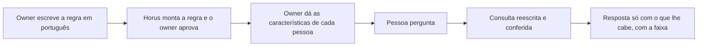

# Segurança dos dados por pessoa

> **Em uma frase:** cada pessoa vê, nos dados da empresa, só o que lhe cabe, pela regra escrita no Horus ou pelas
> regras que a empresa já tem.

## 🧭 O que é

Esta macro funcionalidade (mf) é inteira da v2.1, a versão que vem depois da v2.0. **Até lá, a organização é a
fronteira dos dados:** quem pode perguntar alcança tudo o que as **fontes de dados** dela têm (os bancos da empresa
ligados ao Horus). A barreira contra a rede interna e a porta única até o banco ficam na v2.0, em Conectar as fontes
vivas (MF-104).

Desde a v2.0, cada organização chega aos bancos pelo seu **middleware**, o Middleware da organização (MF-121): a peça
que fica entre o Horus e os bancos da organização, que guarda quem são as pessoas, os bancos e a IA e responde pelo
caminho até eles. Na v2.0, ele já confere quem entra, guarda as pessoas e dá o acesso aos bancos. Esta mf roda dentro
dele e acrescenta o que faltava: quem vê o quê dentro de cada banco.

A mf reúne tudo o que só vale com essa proteção: o interruptor geral, as regras, as características das pessoas e
os grupos por elas, a liberação do gestor no board, o registro dela no rastro e a demonstração. E vem em duas
etapas. Na primeira, o **owner da organização**, que cuida das pessoas e dos dados de um setor ou de um cliente,
escreve em português quem vê o quê, num documento por base, ao lado do **modelo semântico**, o texto que explica ao
Horus o que cada tabela quer dizer. Na segunda, o Horus soma o login e os controles de acesso que a empresa já tem.
A regra se apoia nas **claims**, as características que dizem o que cada pessoa pode ver (a região, a loja).

> 💡 É como o crachá de um prédio: o mesmo elevador leva todos, mas cada crachá só abre os andares da pessoa. Onde
> a comparação falha: no Horus, o andar fechado nem aparece, e uma faixa avisa que a resposta foi limitada.

> 📌 **Exemplo** (personagens ilustrativos): o Marcos, owner da área comercial de uma rede de lojas, escreve na base
> de vendas "cada gestor vê só as lojas da própria região", aprova a regra e dá à gestora Carla a característica
> "região = Sul". A Carla pergunta a venda da semana por loja e recebe só as do Sul.

## ✨ Características

- **A regra em português:** a IA a transforma em regra, que só vale com a aprovação do owner; depois, ele vê o
  Horus como outra pessoa o veria e revisa a consulta que o Horus não protegeu sozinho.
- **O interruptor geral:** o owner da instância, a Maind, permite a proteção, e cada owner da organização a liga na
  sua.
- **As características de cada pessoa:** o owner as dá uma a uma ou pelas colunas da planilha de convites; na
  segunda etapa, elas e as roles (os pacotes de permissões) chegam pelo login da empresa.
- **Os grupos pelas características:** o grupo que se atualiza sozinho pode seguir a região ou a loja da pessoa,
  para publicar boards e enviar relatórios e alertas.
- **Conferida, e fechada na dúvida:** a consulta de quem tem restrição é reescrita com a regra e conferida por um
  segundo modelo de IA antes de ir ao banco; se algo falha, a resposta não sai. A resposta limitada traz a faixa
  "Resposta limitada aos dados que você pode ver".
- **Em todo canal:** a conversa, a Pergunta rápida, o WhatsApp, os boards, os agentes e os números da Faixa de
  avisos e números (MF-120) passam pela mesma proteção.
- **Cada um com o próprio acesso:** o board do espaço da organização e os números da faixa usam o acesso de quem
  os vê, e o número fora do alcance some da faixa; o board público usa o do owner que o publicou. Na v2.0 essas
  regras já valem, mas todos da organização veem os mesmos dados.
- **O login da empresa, por organização:** na segunda etapa, cada owner liga o da sua organização, só pelo padrão
  OpenID Connect, e essa configuração fica no middleware, como toda configuração de entrada. As regras da empresa e
  as do Horus valem juntas, e vale a mais restritiva: o Horus nunca dá mais do que a empresa deu. O login só
  autentica: só entra quem foi convidado. O owner da organização continua entrando sempre por usuário e senha; os
  outros owners que ele cadastra, no máximo mais dois, cada um num assento de owner contratado, ficam ligados ao
  login da empresa. Quando a role do cadastro e a do login discordam, vale a do login, e quem chega sem valor
  mapeado cai na role padrão. A sessão se confirma com a empresa a cada 8 horas, e quem ela desliga precisa entrar de
  novo e não consegue. Com o login ligado, o aviso de resposta limitada diz qual regra do Horus limitou e que as
  regras da empresa também valem; e a fonte cuja tecnologia não aceita a identidade da pessoa fica só com a regra do
  Horus, com o owner avisado ao ligar o login.
- **A liberação do gestor no board:** no board que o **gestor** publica, quem abre vê o que ele vê, mesmo acima das
  travas da empresa, e a responsabilidade é dele; cada liberação fica no rastro da Auditoria (MF-116), com o recorte
  de acesso de quem liberou. Fora do board, cada um fica no que pode ver.
- **A demonstração:** as organizações de exemplo das Bases de demonstração (MF-118) ganham as regras e as
  características dos membros de exemplo, e a Maind volta a mostrar o "cada um vê só o que pode".

## 📈 O valor que gera

- **Para quem usa:** o gestor e o executivo perguntam sem receio de ver ou mostrar o que não podem.
- **Para a empresa que contrata o Horus:** abre o Horus a mais gente, inclusive às áreas de finanças e de pessoas, e
  a TI não recria o que já tem.
- **Para o Horus como produto:** a confiança destrava a venda a empresas com regras de acesso.
- ⚠️ **O cuidado:** até a v2.1, ninguém tem dado restrito por pessoa, nem nas demonstrações.

**Como vamos saber que funcionou:** fora do board liberado pelo gestor, ninguém vê no Horus um dado que a empresa já
lhe esconde.

## 🚶 Como se usa no Horus

**O owner da organização:**

1. Liga a segurança por pessoa, onde o owner da instância a permite.
2. Escreve, para cada base, quem vê o quê, e aprova a regra.
3. Dá a cada pessoa as suas características, uma a uma ou pela planilha de convites, e monta os grupos por elas.
4. Confere o que outra pessoa vê e responde à revisão.
5. Na segunda etapa, liga o login da empresa e diz de onde vêm as roles.

**O gestor** libera, no board que publica, o que ele mesmo vê, e a liberação fica no rastro.

**Quem pergunta** (o owner, o gestor e os membros **ouro** e **prata**) recebe só o que lhe cabe.

## 🧩 Grau de complexidade: alta

🔴 A primeira etapa existe inteira na v1 e volta do código de hoje. O peso está em transplantá-la de uma vez sobre
um Horus que mudou, agora dentro do middleware de cada organização, com canais novos que precisam todos passar por
ela: um canal que escape vaza dado de uma pessoa para outra. A segunda etapa é nova e depende de terceiros que o Horus não controla: o login de cada empresa e cada
tecnologia de banco aceitar a identidade da pessoa.

> ⚠️ É a leitura do PO a partir dos documentos de arquitetura. A estimativa de esforço é do arquiteto.

## 🔗 Macro funcionalidades relacionadas

| mf | Como se relaciona |
| --- | --- |
| Administração da instância (MF-101) | **complementa**: o owner da instância, que cuida da instalação ali, é quem permite esta proteção pelo interruptor geral |
| Organizações, pessoas e papéis (MF-102) | **complementa**: a role decide o que a pessoa usa, e esta mf, o que ela vê; os grupos ganham as características da pessoa, a planilha de convites ganha as colunas delas, e as roles podem chegar pelo login da empresa |
| Conectar as fontes vivas (MF-104) | **depende de**: a regra vale sobre cada fonte, e a consulta protegida passa pela mesma porta única até o banco |
| IA sob controle da organização (MF-105) | **depende de**: a IA que transforma o texto em regra e confere as consultas é a IA da organização, configurada no middleware dela |
| Boards e Relatórios (MF-112) | **complementa**: os boards passam a mostrar números diferentes a pessoas diferentes, e a liberação do gestor vale dentro do board publicado e no PDF que ele envia |
| Auditoria (MF-116) | **complementa**: o rastro passa a guardar cada liberação do gestor, com o recorte de acesso de quem liberou |
| Bases de demonstração (MF-118) | **complementa**: as organizações de exemplo ganham as regras e as características que mostram esta proteção |
| Faixa de avisos e números (MF-120) | **complementa**: os números da faixa passam a ser os de cada pessoa, e o que ela não pode ver some |
| Middleware da organização (MF-121) | **depende de**: a proteção roda no middleware de cada organização, que chega na v2.0 e já guarda as pessoas e dá o caminho até os bancos |
| Fonte AWS Athena (MF-123) | **é a base de**: a fonte nova depende desta proteção, que hoje só cobre o SQL Server |

## 🚧 O que ela não faz

- **Criar ou mudar regras no banco ou no login da empresa**, nem criar usuários lá.
- **Substituir a segurança do banco:** o Horus se soma a ela.
- **Decidir o que a pessoa usa:** os botões da conversa são da role, em Organizações, pessoas e papéis (MF-102).
- **Aceitar o login da empresa pelo padrão SAML**, o dos sistemas antigos: só com uma decisão nova, quando um
  cliente o exigir.

## ⏳ Ainda a decidir

- **Os bancos que a proteção cobre além do SQL Server**, a começar pelo AWS Athena.
- **Onde o owner escreve as regras e dá as características:** no Horus ou no front do middleware, o aplicativo em
  que ele já gere as pessoas. 🔎 a confirmar com o dono.

## 📚 Para saber mais

- `docs/raw/arquitetura/02-registro-de-decisoes.md`: **ARQ-090** (a mf inteira na v2.1, o código fora da v2.0, e o que
  fica: a guarda de rede, o ponto único de execução e o cofre); **ARQ-032** (a segurança no motor), **ARQ-008** e
  **ARQ-039** (a terceira camada do avaliador), **ARQ-040** (uma chave só por organização, com o interruptor geral
  da instância, adiada para a v2.1), **ARQ-041** e **ARQ-042** (em nome de quem cada coisa roda e a liberação do
  gestor), **ARQ-038** e **ARQ-054** (o login corporativo da v2.1) e **ARQ-089** (o semeador, que traz as regras e as
  claims de exemplo na v2.1).
- `docs/raw/produto/backlog-estrategico.md`:
  - **D-028** (a definição macro, que fechou a **P-004**), **D-025** (as duas etapas), **D-026** (vale a mais
    restritiva), **D-027** (o login ligado por organização), **D-052** (as roles pelo login), **D-114** (a role
    decide o que se usa) e **D-118** (o login corporativo fora da v2.0).
  - **D-145** (a mf inteira na v2.1; na v2.0, a organização é a fronteira dos dados), **D-121** e **D-181** (a v2.1
    e a sua primeira onda) e **D-197** (uma mf numa versão só).
  - **D-199** (o interruptor geral, os grupos por claims e as colunas de claims da planilha, a liberação do gestor no
    board, o registro dessas liberações e a demonstração passam a esta mf), com as definições de origem: **D-019**
    (os grupos dinâmicos), **D-051**, **D-053** e **D-054** (a liberação do gestor), **D-059** (o artefato enviado),
    **D-090** e **D-093** (o rastro).
  - **D-184** (o login corporativo só por OpenID Connect; o SAML só com decisão nova).
  - **D-253** a **D-257** (o login só autentica e só entra quem tem convite; vale a role do login; a sessão se
    confirma a cada 8 horas; o aviso de resposta limitada diz a regra do Horus e que a da empresa também vale; a
    fonte que não aceita a identidade da pessoa fica só com a regra do Horus), que fecham o **A-20** e o **A-25**.
  - **D-163**, **D-164**, **D-167** e **D-169** (o board da organização e a faixa com o acesso de quem abre ou vê; o
    board público com o acesso do owner que o publicou), com a leitura **D-163.2** do documento da v2.0, confirmada
    pelo dono em 05/11/2026.
  - **D-194** (os tipos de assento: ouro, prata e bronze).
  - **D-263** (esta mf continua na v2.1, roda no middleware, e a dependência se inverte: ela passa a depender da
    MF-121, que subiu inteira para a v2.0 pela **D-260**; a **D-196** fazia a MF-121 depender desta mf), **D-198** e
    **D-201** (a MF-123 depende desta mf).
  - **D-258** (o middleware em toda organização desde a v2.0; as configurações de entrada ficam nele; o owner da
    organização e o administrador da instância entram sempre por usuário e senha; os outros owners, ligados ao login
    da empresa, na v2.1), **D-261** (as pessoas ficam no middleware, e o owner as gere pelo front dele), **D-266** (a
    IA é sempre da organização, configurada no middleware) e **D-269** (no máximo mais dois owners, cada um num
    assento de owner contratado). Onde o owner escreve as regras e dá as características não está decidido
    (🔎 a confirmar com o dono; o que o SaaS guarda de cada pessoa é a **P-048**, do arquiteto).
  - **P-033** (a proteção no AWS Athena, que hoje só cobre o SQL Server) e **P-008**, letras c e d.
- `docs/raw/produto/05-v2.0-consolidada.md` (§3.1, §5.2, §5.4, §5.17, §6 e as dependências), `06-versoes.md` (a
  onda 1 da v2.1, que tem as quatro mfs da v2.1), `04-macro-funcionalidades-de-hoje.md` (o mapa e o que o dono disse), `03-inventario-de-lacunas.md`
  (candidatas nº 10 e 11) e `07-mapa-de-objetivos-e-funcionalidades.md` (O2 e O8). ⚠️ O 03, o 04 e o 07 ainda não
  listam as peças que a D-199 trouxe a esta mf.
- `docs/raw/arquitetura/01-estrategia-da-solucao.md` (§3, §4 e o marco M8), `04-software.md` (§3.2 e §3.6),
  `05-motor-de-analise-e-ia.md` (§3.10 e §3.11), `07-seguranca.md` (§3.2 a §3.5) e `08-integracoes.md` (§3.7).
- `docs/raw/arquitetura/14-conferencia-do-produto.md`: §1 (letras c e d da P-008), §3 (o que se reaproveita) e §4:
  **A-20** (a entrada pelo login da empresa), **A-25** (o que a pessoa lê quando a empresa esconde um dado) e **A-28**
  (a mf inteira na v2.1).
