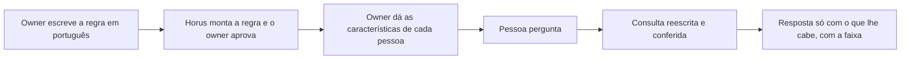

# Segurança dos dados por pessoa

> **Em uma frase:** cada pessoa vê, nos dados da empresa, só o que lhe cabe, pela regra escrita no Horus ou pelas
> regras que a empresa já tem.

## 🧭 O que é

**Na v2.0, esta macro funcionalidade (mf) não existe:** toda consulta usa os dados da organização inteira, e quem
pergunta a uma **fonte de dados** (um banco da empresa ligado ao Horus) vê tudo o que ela tem. Ela volta inteira na
v2.1, refeita a partir do código do Horus de hoje. Ficam na v2.0 a barreira contra a rede interna, a porta única até
o banco e o cofre das credenciais, que são de Conectar as fontes vivas (MF-104).

Na v2.1, ela vem em duas etapas. Na primeira, o **owner da organização**, que cuida das pessoas e dos dados de um
setor ou de um cliente, escreve em português quem vê o quê, num documento por base, ao lado do **modelo semântico**,
o texto que explica ao Horus o que cada tabela quer dizer. Na segunda, o Horus soma o login e os controles de acesso
que a empresa já tem. A regra se apoia nas **claims**, as características que dizem o que cada pessoa pode ver (a
região, a loja).

> 💡 É como o crachá de um prédio: o mesmo elevador leva todos, mas cada crachá só abre os andares da pessoa. Onde
> a comparação falha: no Horus, o andar fechado nem aparece, e uma faixa avisa que a resposta foi limitada.

> 📌 **Exemplo** (personagens ilustrativos): o Marcos, owner da área comercial de uma rede de lojas, escreve na base
> de vendas "cada gestor vê só as lojas da própria região", aprova a regra e dá à gestora Carla a característica
> "região = Sul". A Carla pergunta a venda da semana por loja e recebe só as do Sul.

## ✨ Características

- **A regra em português:** a IA a transforma em regra, que só vale com a aprovação do owner.
- **As características de cada pessoa:** o owner as dá uma a uma ou por planilha; na segunda etapa, elas e as roles
  (os pacotes de permissões) chegam pelo login da empresa.
- **Conferida, e fechada na dúvida:** a consulta de quem tem restrição é reescrita com a regra e conferida por um
  segundo modelo de IA antes de ir ao banco; se algo falha, a resposta não sai.
- **Em todo canal:** a conversa, a Pergunta rápida, o WhatsApp, os boards e os agentes passam pela mesma proteção.
- **Avisa quem pergunta:** a resposta limitada traz a faixa "Resposta limitada aos dados que você pode ver".
- **O owner confere:** vê o Horus como outra pessoa o veria e revisa a consulta que o Horus não protegeu sozinho.
- **Vale a mais restritiva:** na segunda etapa, as regras da empresa e as do Horus valem juntas, e o Horus nunca dá
  mais do que a empresa deu.
- **O login da empresa, por organização:** cada owner da organização liga o seu.
- **A exceção do board:** no board que o **gestor** publica, quem abre vê o que ele vê, mesmo acima das travas da
  empresa, e a responsabilidade é dele; fora do board, cada um fica no que pode ver.

## 📈 O valor que gera

- **Para quem usa:** o gestor e o executivo perguntam sem receio de ver ou mostrar o que não podem.
- **Para a empresa que contrata o Horus:** abre o Horus a mais gente, inclusive às áreas de finanças e de pessoas, e
  a TI não recria o que já tem.
- **Para o Horus como produto:** a confiança destrava a venda a empresas com regras de acesso.
- ⚠️ **O cuidado:** até a v2.1, ninguém tem dado restrito por pessoa, nem nas demonstrações.

**Como vamos saber que funcionou:** fora do board liberado pelo gestor, ninguém vê no Horus um dado que a empresa já
lhe esconde.

## 🚶 Como se usa no Horus

**O owner da organização:**

1. Liga a segurança por pessoa, onde o owner da instância a permite.
2. Escreve, para cada base, quem vê o quê, e aprova a regra.
3. Dá a cada pessoa as suas características.
4. Confere o que outra pessoa vê e responde à revisão.
5. Na segunda etapa, liga o login da empresa e diz de onde vêm as roles.

**Quem pergunta** (o owner, o gestor e o **membro full**) recebe só o que lhe cabe.

## 🧩 Grau de complexidade: alta

🔴 A primeira etapa existe inteira na v1 e volta do código de hoje. O peso está
em transplantá-la de uma vez sobre um Horus que mudou, com canais novos que precisam todos passar por ela: um canal
que escape vaza dado de uma pessoa para outra. A segunda etapa é nova e depende de terceiros que o Horus não
controla: o login de cada empresa e cada tecnologia de banco aceitar a identidade da pessoa.

> ⚠️ É a leitura do PO a partir dos documentos de arquitetura. A estimativa de esforço é do arquiteto.

## 🔗 Macro funcionalidades relacionadas

| mf | Como se relaciona |
| --- | --- |
| Organizações, pessoas e papéis (MF-102) | **complementa**: a role decide o que a pessoa usa, e esta mf, o que ela vê; os grupos que se montam pelas características da pessoa chegam com ela |
| Conectar as fontes vivas (MF-104) | **depende de**: a regra vale sobre cada fonte, e a consulta protegida passa pela mesma porta única até o banco |
| IA sob controle da organização (MF-105) | **depende de**: a IA que transforma o texto em regra e confere as consultas roda pelas conexões de IA da organização |
| Boards e Relatórios (MF-112) | **complementa**: a liberação do gestor vale dentro do board publicado e no PDF que ele envia |
| Auditoria (MF-116) | **complementa**: cada liberação do gestor fica no rastro, com o recorte de acesso de quem liberou |

## 🚧 O que ela não faz

- **Criar ou mudar regras no banco ou no login da empresa**, nem criar usuários lá.
- **Substituir a segurança do banco:** o Horus se soma a ela.
- **Decidir o que a pessoa usa:** os botões da conversa são da role, em Organizações, pessoas e papéis (MF-102).

## ⏳ Ainda a decidir

- **O que a pessoa lê quando a regra da empresa esconde um dado**, já que o banco não diz por quê.
- **A entrada pelo login da empresa:** quem chega sem convite, qual role vale e a sessão de quem sai.
- **Os logins corporativos aceitos:** a proposta é só o padrão OpenID Connect, sem o SAML dos sistemas antigos.

## 📚 Para saber mais

- `docs/raw/arquitetura/02-registro-de-decisoes.md`: **ARQ-090** (a mf inteira na v2.1, o código fora da v2.0, e o que
  fica: a guarda de rede, o ponto único de execução e o cofre); **ARQ-032** (a segurança no motor), **ARQ-008** e
  **ARQ-039** (a terceira camada do avaliador), **ARQ-040** (uma chave só por organização, adiada para a v2.1),
  **ARQ-041** e **ARQ-042** (em nome de quem cada coisa roda e a liberação do gestor), **ARQ-038** e **ARQ-054** (o
  login corporativo da v2.1).
- `docs/raw/produto/backlog-estrategico.md`: **D-028** (a definição macro, que fechou a **P-004**), **D-025** (as duas
  etapas), **D-026** (vale a mais restritiva), **D-027** (o login ligado por organização), **D-052** (as roles pelo
  login), **D-053** e **D-054** (a liberação do gestor no board), **D-059** (o artefato enviado), **D-114** (a role
  decide o que se usa), **D-118** (o login corporativo fora da v2.0) e **D-121** (a etapa 2 na v2.1); **P-008**,
  letras c e d.
- `docs/raw/produto/04-macro-funcionalidades-de-hoje.md` (o mapa e o que o dono disse), `03-inventario-de-lacunas.md`
  (candidatas nº 10 e 11), `05-v2.0-consolidada.md` (§3.1, §5.2, §5.4 e §6), `06-versoes.md` e
  `07-mapa-de-objetivos-e-funcionalidades.md` (O2 e O8). ⚠️ Esses documentos ainda põem a etapa 1 na v2.0: a página
  segue a ARQ-090.
- `docs/raw/arquitetura/01-estrategia-da-solucao.md` (§3, §4 e o marco M8), `04-software.md` (§3.2 e §3.6),
  `05-motor-de-analise-e-ia.md` (§3.10 e §3.11), `07-seguranca.md` (§3.2 a §3.5) e `08-integracoes.md` (§3.7).
- `docs/raw/arquitetura/14-conferencia-do-produto.md`: §1 (letras c e d da P-008), §3 (o que se reaproveita) e §4:
  **A-20** (a entrada pelo login da empresa), **A-25** (o que a pessoa lê quando a empresa esconde um dado) e **A-28**
  (a mf inteira na v2.1, a registrar no backlog e no mapa).
