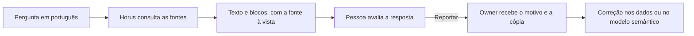

# Perguntar aos dados em português

> **Em uma frase:** fazer a pergunta de negócio do jeito que se fala, ter o número na hora, com a origem à vista,
> e avisar quando a resposta parece errada.

## 🧭 O que é

É a **conversa de análise**: a tela em que a pessoa escreve uma pergunta de negócio em português e o Horus responde
com os números dos bancos da empresa. Ela já existe; a v2.0 acrescenta o retorno sobre cada resposta e a contagem
das perguntas respondidas.

O Horus consulta as **fontes de dados**, os bancos ligados a ele, que ele só lê, e entende a pergunta pelo **modelo
semântico** de cada fonte, o documento que diz o que a empresa chama de receita ou de margem. A resposta "em
segundos" é uma comparação com o pedido ao time de dados, que às vezes leva dias, e não um cronômetro.

> 📌 **Exemplo:** na reunião, a gestora Carla pergunta "e se tirarmos as lojas do Sul, como fica a margem?" e
> recebe o gráfico na hora. Semanas depois, um número lhe parece velho, e ela o reporta. O Marcos, owner da
> organização, quem cuida das pessoas e dos dados dela, acha a carga atrasada e a corrige.

## ✨ Características

- **Onde aparece:** na conversa de análise, que também abre na Pergunta rápida (MF-110), no Chat pelo WhatsApp
  (MF-111), dentro dos boards e nos agentes.
- **Quem pergunta:** o owner da organização, o gestor, que gere uma equipe, e os membros ouro, que pergunta e cria
  boards para si, e prata, que pergunta sem criar boards; o membro bronze só vê boards de outras pessoas e não pergunta.
- **Dois modos e a web ao lado:** **dados**, que pergunta aos bancos, e **conversa**, sem fonte nenhuma. A web não é
  um modo: é o interruptor **pesquisar na web**, que a pessoa liga na conversa e que roda ao lado dos dados (ou da
  conversa) quando a instalação e a **role** da pessoa, o pacote de permissões que o owner lhe dá, autorizam (ver A
  web como fonte, MF-109).
- **Os números vêm do banco:** o modelo de IA escreve a consulta e o texto, mas os números são os do resultado; sem
  dado, o Horus diz que não consegue.
- **Nível de inferência:** cinco degraus de quanto a resposta pode ir além do número, do 1, que só descreve, ao 5,
  que especula com rótulo; o padrão é o 2, que explica. O teto é o de cada fonte de dados, e a role da pessoa pode
  baixá-lo, nunca subir: vale sempre o menor.
- **Análise avançada e ferramentas:** uma segunda leitura feita com o resultado na mão, sugestões de próxima
  pergunta, a consulta ao banco (o SQL) à vista e o download em CSV, imagem ou PDF.
- **Retorno em cada resposta:** 👍🏻 Gostei, 👎🏻 Não gostei e 🚫 Reportar, na conversa, na Pergunta rápida e no
  WhatsApp; vale o último sinal.
- **O reporte vai ao owner:** com o motivo e uma cópia da resposta, que fica guardada mesmo se a conversa for apagada.
- **O que conta como respondida:** só a resposta que trouxe dado da empresa ou fato da web, com resultado; a consulta
  que volta vazia, a falha e a conversa sem dado nem web não contam. Vale na conversa, na Pergunta rápida e no
  WhatsApp.
- **Fixar num board:** só o dono do board, quem o criou, guarda nele o gráfico ou a tabela de uma resposta; não é um
  botão da role, e o membro prata, que não cria boards, não vê o controle.
- **O owner lê as conversas:** o owner da organização lê as conversas de todas as pessoas dela, como no Horus de
  hoje, sem aviso especial à pessoa.
- **Quem configura:** o owner liga e desliga cada botão da conversa nas roles, e quem tem várias roles soma o que
  elas liberam.

## 📈 O valor que gera

- **Para quem usa:** decide na própria reunião, com o número na mão, e tem como apontar o erro.
- **Para a empresa que contrata o Horus:** menos pedidos repetidos ao time de dados, a economia que o comprador paga,
  e as falhas dos dados achadas antes de uma reunião.
- **Para o Horus como produto:** resolve o primeiro problema do produto e mede a qualidade das respostas, não só a
  quantidade.

**Como vamos saber que funcionou:** a Home da organização mostra quantas perguntas de análise o Horus respondeu com
dado da empresa ou fato da web, goste a pessoa ou não, e a proporção de 👍🏻, 👎🏻 e 🚫.

## 🚶 Como se usa no Horus

**Quem pergunta:**

1. Abre a conversa, escolhe as fontes e escreve a pergunta.
2. Se a role permitir, escolhe o modo (dados ou conversa), liga a pesquisa na web e ajusta o nível, a Análise
   avançada e o modelo de IA.
3. Recebe o texto e até dois blocos visuais, com a fonte à vista.
4. Avalia; ao reportar, escolhe "Os dados parecem errados ou desatualizados", "O Horus entendeu ou calculou errado"
   ou "Outro motivo", e vê o aviso de "recebido" no Horus e, se o perfil permitir, no e-mail.

**O owner da organização:**

1. Define nas roles os botões que cada pessoa usa.
2. Recebe o reporte separado pelo motivo, com a cópia da resposta.
3. Corrige a carga de dados; ajustar o modelo semântico é com o time de dados.

## 🧩 Grau de complexidade: média

Quase tudo o que responde vem pronto da v1: a consulta, os números nos blocos, os níveis e a Análise avançada. São
novos o retorno, o reporte e a contagem, e o motor se reorganiza para servir a todos os canais. Depende das roles e
da área de avisos de Organizações, pessoas e papéis (MF-102); não é alta porque não mexe na segurança dos dados nem
depende de terceiros.

> ⚠️ É a leitura do PO a partir dos documentos de arquitetura. A estimativa de esforço é do arquiteto.

## 🔗 Macro funcionalidades relacionadas

| mf | Como se relaciona |
| --- | --- |
| Conectar as fontes vivas (MF-104) | **depende de**: sem fonte ligada e sem modelo semântico, não há o que perguntar |
| IA sob controle da organização (MF-105) | **depende de**: o modelo de IA que escreve a consulta e o texto é o que a organização escolhe |
| Organizações, pessoas e papéis (MF-102) | **depende de**: as roles limitam os botões, e a área de avisos recebe o reporte e o "recebido" |
| Respostas visuais (MF-108) | **é a base de**: dá forma à resposta, com gráficos, tabelas e indicadores |
| A web como fonte (MF-109) | **é a base de**: traz para a mesma resposta os fatos de fora, com link e data |
| Pergunta rápida (MF-110) e Chat pelo WhatsApp (MF-111) | **é a base de**: os dois abrem esta mesma conversa, com o mesmo retorno |
| Boards e Relatórios (MF-112) | **é a base de**: cada cartão nasce de uma pergunta de análise e se recalcula pelo mesmo motor da conversa |
| Agentes ativos (MF-115) | **é a base de**: o agente pergunta ao mesmo motor da conversa de análise |
| Home da organização (MF-117) | **é a base de**: a contagem das respondidas e a proporção de 👍🏻, 👎🏻 e 🚫 nascem aqui e aparecem lá |

## 🚧 O que ela não faz

- **Prometer um tempo** em segundos ou em contrato, nem acelerar o banco do cliente.
- **Contar como respondida** a falha, a consulta que volta vazia ou a conversa sem dado nem web.
- **Responder a quem reportou:** o aviso é só de "recebido".
- **Investigar o porquê passo a passo:** é a Investigação guiada (MF-119), na v2.1.
- **Limitar os dados por pessoa:** na v2.0, toda pergunta vê os dados da organização inteira; o limite por pessoa é a
  Segurança dos dados por pessoa (MF-106), na v2.1.

## ⏳ Ainda a decidir

Nada a decidir.

## 📚 Para saber mais

| Trecho do inventário | O que traz |
| --- | --- |
| `docs/raw/produto/04-macro-funcionalidades-de-hoje.md`, o mapa e a tabela de conversão | O que a mf entrega hoje e a camada dela |
| `docs/raw/produto/02-norte-do-produto.md`, problemas, medidas e limites | A pergunta na hora, a pergunta respondida e o "só lê" |
| `docs/raw/produto/05-v2.0-consolidada.md`, §1, §3, §4 e §5.4 | A mf na v2.0 (base herdada e candidatas nº 1 e nº 2), a prova de valor e as regras da conversa |
| `docs/raw/produto/backlog-estrategico.md` | A resposta em segundos (`D-125`, `D-126`); o retorno do usuário (`D-005`, `D-014`, `D-127`, `D-128`, `D-129`); a proporção de 👍🏻, 👎🏻 e 🚫 na medida de autonomia (`D-133`); a pergunta respondida (`D-004`) e o que conta como respondida, só a que trouxe dado ou fato da web (`D-222`); os botões por role e a soma (`D-110`, `D-111`); os dois modos, dados e conversa, e a pesquisa na web como interruptor ao lado (`D-215`); o teto de cada fonte, que a role só baixa (`D-220`); só o dono do board fixa uma resposta nele (`D-221`); o owner lê as conversas, sem aviso especial (`D-223`); o "só lê" (`D-022`); o modelo semântico com o time de dados (`D-083`); a base herdada (`D-021`) |
| `docs/raw/produto/03-inventario-de-lacunas.md`, linhas 1 a 9 | O que existe e o que falta no problema nº 1 |
| `docs/raw/produto/06-versoes.md` e `07-mapa-de-objetivos-e-funcionalidades.md` | A mf na v2.0, no objetivo O1 |
| `docs/raw/arquitetura/05-motor-de-analise-e-ia.md`, §3 e §4 | O caminho da pergunta, o motor único (`ARQ-006`, `ARQ-023`, `ARQ-024`), os níveis (`ARQ-025`), o retorno e o reporte (`ARQ-028`) e a contagem (`ARQ-029`) |
| `docs/raw/arquitetura/01-estrategia-da-solucao.md`, §4, e `04-software.md` | A estratégia da mf e as peças que a entregam |
| `docs/raw/arquitetura/06-dados.md` e `02-registro-de-decisoes.md`, `ARQ-035` | A guarda da cópia da resposta reportada |
| `docs/raw/arquitetura/02-registro-de-decisoes.md`, `ARQ-090` | A segurança dos dados por pessoa inteira na v2.1; na v2.0, os dados da organização inteira |
| `docs/raw/arquitetura/14-conferencia-do-produto.md`, §2 a §4 | O tempo ainda sem medida (`P-002`), o que se reaproveita (`P-003`) e os itens devolvidos ao PO: o que conta como respondida (A-08, fechado pela `D-222`), o teto dos níveis (A-13, pela `D-220`), a privacidade (A-16, pela `D-223`), os botões fora da lista (A-24; fixar, pela `D-221`) e a `MF-106` na v2.1 (A-28) |
