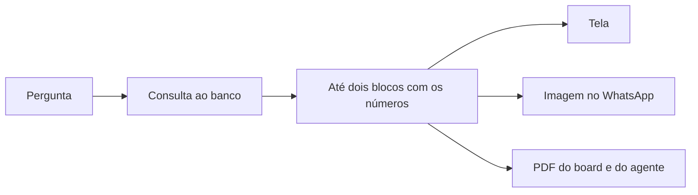

# Respostas visuais

> **Em uma frase:** ver a resposta em gráfico, tabela, indicador ou mapa de calor, com os números do banco da
> empresa, igual na tela, no celular e no PDF.

## 🧭 O que é

É a forma da resposta. Junto com o texto, cada resposta do Horus traz até dois **blocos visuais**: um gráfico, uma
tabela, um indicador, um mapa de calor, um chaveamento ou um fluxo. O visual não é enfeite: é o que deixa a pessoa
entender o resultado sem esforço, e por isso faz parte da promessa do Horus.

Os blocos já existem na **conversa de análise** de Perguntar aos dados em português (MF-107), a tela em que a pessoa
pergunta e o Horus responde, e vêm inteiros para a v2.0. O que muda é o alcance: o mesmo desenho passa a sair como
imagem no WhatsApp e como PDF nos boards e nos agentes, sem refazer nada.

> 📌 **Exemplo:** a gestora Carla pergunta como foi a margem por região nos últimos 12 meses. Recebe um indicador
> com a margem do mês, um gráfico com os 12 meses por região e um texto curto. No carro, pergunta pelo WhatsApp e
> recebe o mesmo gráfico como imagem, com o link para abrir a resposta no app.

## ✨ Características

- **Seis tipos de bloco:** o gráfico, em quinze variantes; a tabela; o KPI, um número em destaque; o mapa de calor,
  uma grade em que a cor mostra a intensidade; o chaveamento, a chave de confrontos de um campeonato; e o fluxo, o
  desenho de um processo.
- **Até dois por resposta:** cada resposta traz no máximo dois blocos, ao lado do texto.
- **Os números vêm do banco:** o modelo de IA escreve a consulta e escolhe a forma, mas quem põe os números no bloco
  é o Horus, com o resultado.
- **Sem dado, sem desenho:** quando a consulta não tem o que mostrar, o Horus diz isso numa frase, em vez de
  desenhar um gráfico vazio.
- **Nunca quebra a tela:** um bloco com defeito é descartado, e a resposta segue com o texto.
- **O fluxo nasce do modelo semântico:** só aparece para um processo que o modelo semântico da fonte descreve, o
  documento que diz o que cada termo significa na empresa, com os números do banco em cada etapa.
- **Um desenho só, em todo lugar:** a conversa, a Pergunta rápida (MF-110), os boards, a imagem do WhatsApp e os PDFs
  usam o mesmo desenho, fotografado ou impresso pelo servidor.
- **Tema da organização:** cada organização mantém o tema dos seus gráficos, a paleta que ela escolhe, como no Horus
  de hoje, ajustado pelo owner da organização, quem cuida das pessoas, dos dados e das preferências dela. A interface
  e a marca seguem as da Maind.
- **Quem vê:** toda pessoa que recebe uma resposta, inclusive o membro bronze, que não pergunta mas vê os blocos nos
  boards de outras pessoas.
- **Baixar:** a resposta sai em CSV, imagem ou PDF, se a role da pessoa, o pacote de permissões que o owner dá,
  permitir.

## 📈 O valor que gera

- **Para quem usa:** entende o resultado de relance e leva a mesma figura para a reunião, para o celular e para o
  papel.
- **Para a empresa que contrata o Horus:** o número que circula na reunião, no WhatsApp e no PDF é o mesmo, e vem do
  banco, não de um palpite.
- **Para o Horus como produto:** é o valor central da promessa, e a mesma peça serve à conversa, aos boards, ao
  WhatsApp e aos agentes: todo canal novo já nasce com visual.

**Como vamos saber que funcionou:** o mesmo bloco, com os mesmos números, aparece igual na tela, na imagem do
WhatsApp e no PDF; a qualidade percebida aparece no retorno 👍🏻, 👎🏻 e 🚫 de cada resposta.

## 🚶 Como se usa no Horus

**Quem pergunta:**

1. Faz a pergunta de análise, na conversa, na Pergunta rápida ou no WhatsApp.
2. O Horus consulta a fonte e escolhe a forma: até dois blocos, ao lado do texto.
3. A tela desenha os blocos com os números do resultado.
4. No WhatsApp, cada bloco chega como imagem, com o link para abrir a resposta no app.
5. A pessoa baixa a resposta; quem tem board, o dono dele, pode fixá-la nele, onde ela vira um cartão.

**O owner da organização:** ajusta o tema dos gráficos nas preferências da organização e decide, nas roles, quem pode baixar.

## 🧩 Grau de complexidade: baixa

Os seis tipos e as quinze variantes vêm prontos da v1 e não se editam. O novo é o servidor fotografar ou imprimir a
mesma montagem da tela, para a imagem do WhatsApp e para o PDF, com o navegador sem tela que a v1 já usa nos
relatórios. Depende do motor de Perguntar aos dados em português, que calcula os números, e de nada externo novo; o
cuidado é o peso desse desenho no horário de pico, que o servidor controla numa fila.

> ⚠️ É a leitura do PO a partir dos documentos de arquitetura. A estimativa de esforço é do arquiteto.

## 🔗 Macro funcionalidades relacionadas

| mf | Como se relaciona |
| --- | --- |
| Perguntar aos dados em português (MF-107) | **depende de**: é a conversa que consulta o banco e entrega os números que o bloco desenha |
| Conectar as fontes vivas (MF-104) | **depende de**: os números de todo bloco vêm das fontes |
| A web como fonte (MF-109) | **complementa**: o bloco mostra o número da empresa, e o fato de fora vem à parte, com link e data |
| Pergunta rápida (MF-110) | **é a base de**: a resposta da Pergunta rápida traz os mesmos gráficos, tabelas e indicadores da conversa |
| Chat pelo WhatsApp (MF-111) | **é a base de**: cada bloco chega ao WhatsApp como imagem |
| Boards e Relatórios (MF-112) | **é a base de**: os cartões dos boards são blocos, e o PDF sai da mesma montagem |
| Agentes ativos (MF-115) | **é a base de**: o PDF do agente leva os blocos que o motor calculou |

## 🚧 O que ela não faz

- **Mais de dois blocos por resposta,** nem um tipo fora dos seis: um tipo novo é uma capacidade nova, decidida à
  parte.
- **Número que não veio do banco:** hipótese e especulação ficam no texto, com rótulo.
- **Bloco da Análise avançada:** essa segunda leitura fica em texto, e nada dela vira gráfico.
- **Montar painéis com muitos blocos:** isso é dos Boards e Relatórios (MF-112).

## ⏳ Ainda a decidir

Nada a decidir.

## 📚 Para saber mais

| Trecho do inventário | O que traz |
| --- | --- |
| `docs/raw/produto/04-macro-funcionalidades-de-hoje.md`, o mapa e a tabela de conversão | O que a mf entrega hoje, a camada e o "valor central da promessa" |
| `docs/raw/produto/02-norte-do-produto.md`, a promessa | O visual como parte da promessa |
| `docs/raw/produto/05-v2.0-consolidada.md`, §3.2 e §4 | A mf na base herdada e o passo 5 da prova de valor |
| `docs/raw/produto/backlog-estrategico.md` | A base herdada (`D-021`); o visual como valor central (`D-001`); a imagem fiel ao chat no WhatsApp (`D-096`); o papel da mf na ordem de construção (`D-139`, a tabela de conversão); o tema dos gráficos por organização, como hoje, numa interface com a marca da Maind (`D-237`); só o dono do board fixa uma resposta nele (`D-221`) |
| `docs/raw/produto/03-inventario-de-lacunas.md`, linhas 2 e 11 | Os blocos de hoje e a área da organização, com os gráficos |
| `docs/raw/produto/06-versoes.md` e `07-mapa-de-objetivos-e-funcionalidades.md` | A mf na v2.0, no objetivo O1 |
| `docs/raw/arquitetura/02-registro-de-decisoes.md`, `ARQ-007` | Um desenho só, em tela, imagem e PDF |
| `docs/raw/arquitetura/01-estrategia-da-solucao.md`, §1 e §4, e `04-software.md` | Os invariantes da resposta (números do banco, leitura tolerante, dois blocos) e as peças da mf |
| `docs/raw/arquitetura/05-motor-de-analise-e-ia.md`, §3.3, §3.7 e §4 | O materializador, o fluxo pelo modelo semântico e a Análise avançada fora dos blocos |
| `docs/raw/arquitetura/08-integracoes.md`, o WhatsApp | Os blocos como imagem na mensagem |
| `docs/raw/arquitetura/14-conferencia-do-produto.md`, §2 e §3 | Os seis tipos e as quinze variantes; o que se reaproveita (`P-003`); a correção do inventário (A-26) |
