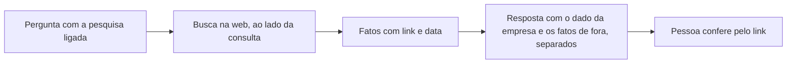

# A web como fonte

> **Em uma frase:** cruzar o número da empresa com o que acontece lá fora, como a inflação ou a concorrência, sem
> sair da conversa e sabendo de onde veio e de quando é cada fato.

## 🧭 O que é

A web é a segunda fonte viva do Horus, ao lado dos bancos da empresa: complementa os números com o contexto de
mercado, responde sozinha à pergunta sobre algo de fora e serve de régua. Na v2.0, ela é o **modelo de IA sair à web
para pesquisar, quando autorizado**. Não é um modo de perguntar: é o interruptor **pesquisar na web**, que a pessoa
liga na conversa e que roda ao lado da consulta aos dados (ou da conversa sem fonte), e só a pergunta vai à busca.
Hoje o Horus já pesquisa na web, mas cita a fonte no meio do texto, sem data.

Na v2.0, todo fato da web traz o **link da fonte** e a **data de publicação**, separado do dado da empresa. O fato
entra em qualquer **nível de inferência**, a régua de 1 a 5 de quanto a resposta pode ir além do número; a causa
vinda de fora, só a partir do nível 4.

> 📌 **Exemplo:** no nível padrão, a gestora Carla liga a pesquisa e pergunta "as vendas de outubro acompanharam a
> inflação?". Recebe o gráfico das vendas e "inflação de outubro: 0,4%", com o link do IBGE e a data de publicação.
> Se pergunta por que as vendas caíram, a resposta não culpa a inflação, a não ser que ela suba para o nível 4.

## ✨ Características

- **Um interruptor, não um modo:** a pessoa liga "pesquisar na web" na conversa de análise, a tela de Perguntar aos
  dados em português (MF-107), cujos modos são dois, dados e conversa; a pesquisa roda ao lado deles, e só se a
  instalação do Horus permite sair a serviços de fora, como a nuvem da Maind permite, e se a role da pessoa tem a
  pesquisa na web ligada.
- **Link e data em todo fato:** a data é lida na própria página, e sem ela aparece o aviso de data não identificada.
- **No cartão do board:** o cartão guarda os fatos da web que a resposta trouxe, com o link e a data à vista, e não
  pesquisa de novo a cada atualização; só os números da empresa se recalculam.
- **Sem fato nenhum:** se a pesquisa não traz fato, a resposta sai com os dados da empresa e um aviso curto de que a
  pesquisa na web não trouxe fatos.

- **O fato em qualquer nível:** até no nível 1, que só descreve, o fato entra; a causa vinda de fora, só do nível 4
  em diante, rotulada como hipótese.
- **Separado do dado da empresa:** os fatos aparecem à parte do texto, e um link que a pesquisa não trouxe sai da
  resposta.
- **Em todo canal:** na conversa, inclusive quando a pergunta é só sobre algo de fora, na Pergunta rápida (MF-110), no
  Chat pelo WhatsApp (MF-111), com o link e a data no texto, nos boards e nos agentes.
- **Quem usa:** o owner da organização, que cuida das pessoas e dos dados dela, o gestor, que gere uma equipe, e os
  membros ouro e prata, os tipos de assento de membro que podem perguntar, se a role da pessoa (o pacote de
  permissões que o owner dá) tiver a pesquisa na web ligada. O membro bronze só exibe os dashboards já
  compartilhados.
- **Segue o provedor de IA:** a busca é a do provedor de IA que a organização usa, e quando ele não pesquisa, como o
  Amazon Bedrock, a opção não aparece.
- **Pelo middleware:** toda organização chega à IA pelo seu **middleware**, a peça que fica entre o Horus e os bancos
  da organização, que guarda quem são as pessoas, os bancos e a IA e responde pelo caminho até eles; a saída para a
  internet também passa por ele.
- **Só a pergunta sai:** à busca vai só o texto da pergunta, nunca dados do banco nem o modelo semântico, o
  dicionário de termos da empresa.
- **Corre ao lado da consulta:** se a busca não volta a tempo, a resposta sai sem ela.

## 📈 O valor que gera

- **Para quem usa:** explica um resultado com o contexto de fora antes de mostrá-lo ao CEO, sabendo de onde veio
  cada fato.
- **Para a empresa que contrata o Horus:** menos pedidos ao time de dados para buscar um índice de fora.
- **Para o Horus como produto:** respostas mais completas sem perder a confiança, que é a prova do produto.

**Como vamos saber que funcionou:** nenhuma informação da web aparece sem o link, e nenhuma aparece sem a data ou
sem o aviso de que ela não foi identificada.

## 🚶 Como se usa no Horus

**Quem pergunta:**

1. Liga o interruptor "pesquisar na web" na conversa, ao lado dos dados.
2. Faz a pergunta de análise, no nível que quiser.
3. Recebe o número da empresa e, à parte, os fatos de fora, cada um com link e data.
4. Abre o link para conferir o fato antes de levá-lo adiante.
5. Sobe para o nível 4 quando quer que a resposta arrisque uma causa de fora.

**O owner da organização** liga a pesquisa na web, no botão da role que libera os modos da conversa, para quem pode
usá-la. A pesquisa só aparece se o provedor de IA que a organização usa pesquisa por conta própria.

## 🧩 Grau de complexidade: média

Vêm da v1 a busca do provedor de IA e o leitor de páginas do servidor. É nova a etapa própria da web, que devolve
os fatos com link e data e tira do texto o link que não veio da busca. Depende da busca do provedor de IA e de o
modelo respeitar a regra da causa abaixo do nível 4, o que só a medição mostra; não é alta porque não mexe na base
nem traz parceiro novo.

> ⚠️ É a leitura do PO a partir dos documentos de arquitetura. A estimativa de esforço é do arquiteto.

## 🔗 Macro funcionalidades relacionadas

| mf | Como se relaciona |
| --- | --- |
| Perguntar aos dados em português (MF-107) | **depende de**: a web entra na mesma conversa e obedece aos mesmos níveis de inferência |
| IA sob controle da organização (MF-105) | **depende de**: a busca é a do provedor de IA que a organização usa, configurado no middleware dela |
| Organizações, pessoas e papéis (MF-102) | **depende de**: a pesquisa na web faz parte do botão da role que libera os modos da conversa |
| Conectar as fontes vivas (MF-104) | **complementa**: os bancos dão o número da empresa, e a web, o contexto de fora; a web não é cadastrada como fonte ali |
| Respostas visuais (MF-108) | **complementa**: o bloco mostra o número da empresa, e o fato de fora vem à parte, com link e data |
| Chat pelo WhatsApp (MF-111), Boards e Relatórios (MF-112) e Agentes ativos (MF-115) | **é a base de**: o fato com link e data vale também na mensagem, no cartão e no que o agente entrega |
| Middleware da organização (MF-121) | **é a base de**: desde a v2.0, toda organização tem o seu middleware, hospedado pela Maind ou na casa do cliente, e a saída para a internet passa por ele |

## 🚧 O que ela não faz

- **Escolher as fontes da web:** nem selos de confiança, nem lista de fontes aprovadas pela organização, nem páginas
  cadastradas como fonte; a web entra só pela pesquisa.
- **Causa vinda da web abaixo do nível 4.**
- **Guardar cópias das páginas** consultadas.
- **Buscar em sites que pedem login.**
- **Pesquisar por outro caminho:** sem a busca do provedor de IA, nenhum outro serviço pesquisa no lugar dela.

## ⏳ Ainda a decidir

- **A fonte de páginas cadastradas:** o cadastro de páginas fica fora da v2.0, porque a web entra pela pesquisa do
  modelo; falta o arquiteto conferir o que fazer com o tipo de fonte que o Horus de hoje tem.

## 📚 Para saber mais

| Trecho do inventário | O que traz |
| --- | --- |
| `docs/raw/produto/02-norte-do-produto.md`, as fontes | A web como fonte viva, ao lado dos bancos, e os usos dela |
| `docs/raw/produto/04-macro-funcionalidades-de-hoje.md`, o mapa e a tabela de conversão | O que a mf entrega hoje e a camada dela |
| `docs/raw/produto/05-v2.0-consolidada.md`, §3.1, §3.2, §4, §5.4 e §7 | A candidata nº 3, a base herdada, o passo 5 da prova de valor, a regra da web e o middleware, que depende desta mf para a saída à internet |
| `docs/raw/produto/backlog-estrategico.md` | A web como fonte na v2.0 é o modelo sair à web quando a instância e a role autorizam, e o cadastro de páginas fica de fora (`D-162`; a fonte de páginas é a pendência `P-034`, do arquiteto); a definição macro da web como fonte viva completa (`D-131`); o link e a data (`D-006`); `D-242` e `D-243` (o cartão guarda os fatos, e a resposta sem fatos leva um aviso); o fato em qualquer nível (`D-130`, leituras `D-130.1` e `D-130.2`); o modo web nas roles (`D-110`), que vira a pesquisa na web, um interruptor ao lado dos dados, no botão dos modos da conversa (`D-215`); os modos da instância (`D-010`); a IA da organização (`D-159` e `D-216`, substituídas em parte pelas `D-264` a `D-266`: a IA é sempre da organização, configurada no front do middleware, e a conexão da instância deixou de existir); os tipos de assento ouro, prata e bronze (`D-194`); o middleware, que depende da web para sair à internet (`D-190`, `D-196`) e que, pelas `D-258` a `D-260`, está em toda organização desde a v2.0, um por organização (o nome é a `D-270`); a base herdada (`D-021`) |
| `docs/raw/produto/03-inventario-de-lacunas.md`, linhas 5 e 6 | A lacuna da web em todos os usos e da data |
| `docs/raw/produto/06-versoes.md` e `07-mapa-de-objetivos-e-funcionalidades.md` | A mf na v2.0, com o modelo saindo à web quando autorizado, no objetivo O1 |
| `docs/raw/arquitetura/02-registro-de-decisoes.md`, `ARQ-025` a `ARQ-027` | O nível em toda etapa que escreve texto, a web como etapa própria e a busca nativa da conexão de IA, escolhida pelo dono |
| `docs/raw/arquitetura/05-motor-de-analise-e-ia.md`, §3.5, §3.6, §3.10 e §5 | Os níveis, a lista de fatos, o Bedrock sem busca e os riscos da web |
| `docs/raw/arquitetura/01-estrategia-da-solucao.md`, §4, `04-software.md` e `08-integracoes.md` | A estratégia da mf, as peças e a integração com os provedores |
| `docs/raw/arquitetura/14-conferencia-do-produto.md`, §1 a §4 | A separação do fato e da causa (`P-008`, letra aa), o que se reaproveita (`P-003`) e os itens devolvidos ao PO: a fonte de páginas web (A-04, fechado pela `D-162`), o cartão do board (A-09) e a correção do inventário sobre a web (A-12, A-26) |
