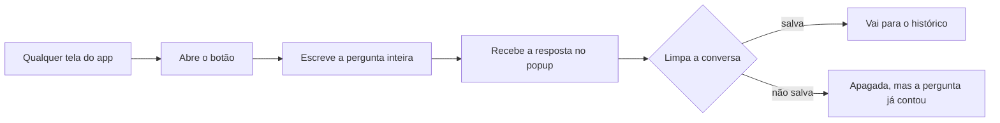

# Pergunta rápida

> **Em uma frase:** tirar uma dúvida sobre os números da empresa de qualquer tela, sem largar o que você está
> fazendo.

## 🧭 O que é

Hoje, para fazer uma **pergunta de análise**, uma pergunta sobre os números da empresa, a pessoa vai à **conversa de
análise**, a tela principal do Horus, onde escreve em português e recebe a resposta em texto, gráfico ou tabela.
Quem está num board ou na Home precisa sair dali.

A Pergunta rápida põe um **botão flutuante** nas telas do app. Ele abre um **popup**, uma janela pequena sobre a
tela, com a mesma conversa de análise.

No dia a dia, a dúvida se resolve quando aparece: a pessoa pergunta, lê, fecha o popup e continua o que fazia. Só
vai para o histórico o que ela escolher salvar.

> 📌 **Exemplo:** no board de vendas, a gestora Carla vê a filial Centro 12% abaixo da semana anterior. Abre o botão,
> escreve "por que a filial Centro caiu?" e recebe a resposta com o gráfico, sem sair do board. Limpa a conversa sem
> salvar, e a pergunta conta assim mesmo.

## ✨ Características

- **Onde aparece:** em todas as telas do app, menos na própria conversa de análise.
- **Quem usa:** o **owner da organização** (quem administra a organização, um setor da empresa ou um cliente), o
  **gestor** (quem responde por uma equipe) e o **membro full** (quem pergunta e cria os próprios boards); o
  **membro leitor**, que só vê boards de outras pessoas, não tem o botão.
- **Quem configura:** o owner, nas **roles**, os perfis que ligam ou desligam o que cada pessoa usa; a role padrão,
  com que a organização nasce, traz a Pergunta rápida ligada.
- **O que oferece:** tudo o que a conversa oferece, dentro da role: os modos (dados, web e conversa), os níveis de
  inferência (até onde a resposta vai além dos dados, de 1 a 5), a Análise avançada (uma segunda leitura, mais
  demorada) e a escolha do modelo de IA.
- **Não sabe o que está na tela:** o popup não vê o que está atrás dele, então a pessoa escreve a pergunta inteira,
  com a filial, o produto ou o período.
- **A conversa fica:** ela continua no popup até ser limpa, mesmo que a pessoa o feche ou troque de tela; fechar não
  corta a resposta que está chegando.
- **Limpar e salvar:** ao limpar, a pessoa escolhe salvar a conversa no histórico, onde ela continua, ou apagá-la de
  vez.
- **Conta na medida:** toda pergunta respondida, salva ou não, conta na **medida de autonomia** (a contagem, na Home
  da organização, das perguntas de análise respondidas) e pode receber 👍🏻, 👎🏻 ou 🚫.
- **O reporte fica guardado:** a resposta reportada com 🚫 chega ao owner, mesmo que a conversa seja apagada.
- **Os dados que usa:** toda consulta usa os dados da organização inteira: quem pode perguntar alcança todas
  as fontes dela.

## 📈 O valor que gera

- **Para quem usa:** o gestor de área e o executivo tiram a dúvida na hora em que ela surge, sem trocar de tela.
- **Para a empresa que contrata o Horus:** mais perguntas de análise resolvidas sem pedido ao time de dados.
- **Para o Horus como produto:** mais perguntas por pessoa, que movem a medida de autonomia e o *saving*, a economia
  com a área de dados, que a Maind calcula com cada cliente.

**Como vamos saber que funcionou:** as pessoas perguntam mais, e com mais frequência, quando a pergunta está a um
clique da tela em que já estão.

## 🚶 Como se usa no Horus

**Quem pergunta:**

1. Numa tela qualquer, como um board ou a Home, a pessoa abre o botão.
2. Escreve a pergunta de análise inteira.
3. Recebe a resposta no popup, com a fonte à vista, e dá 👍🏻, 👎🏻 ou 🚫, se quiser.
4. Fecha o popup e segue; a conversa espera por ela.
5. Ao terminar, limpa a conversa e escolhe salvá-la ou apagá-la.

**Quem configura:** o owner mantém a Pergunta rápida ligada na role padrão, ou a liga nas roles que monta, com os
controles que cada uma libera.

## 🧩 Grau de complexidade: média

Da v1 se reaproveitam o motor que já responde com os números do banco, a caixa da pergunta e o cartão da resposta,
que viram uma peça só da tela de análise e do popup. São novos o botão, o popup e a conversa do popup, guardada fora
do histórico até ser salva ou limpa. Depende do motor de análise, que na v2.0 serve a todos os canais, e das roles,
sem nada de fora do Horus.

> ⚠️ É a leitura do PO a partir dos documentos de arquitetura. A estimativa de esforço é do arquiteto.

## 🔗 Macro funcionalidades relacionadas

| mf | Como se relaciona |
| --- | --- |
| Perguntar aos dados em português (MF-107) | **depende de**: o popup é a conversa de análise dela, com o mesmo motor, os mesmos controles e o mesmo retorno 👍🏻 👎🏻 🚫. |
| Respostas visuais (MF-108) | **depende de**: a resposta no popup traz os mesmos gráficos, tabelas e indicadores da conversa. |
| Organizações, pessoas e papéis (MF-102) | **depende de**: as roles do owner ligam o botão e os controles do popup. |
| Licenças e planos (MF-103) | **depende de**: o tipo de assento vem antes da role, e o membro leitor não ganha o botão. |
| Chat pelo WhatsApp (MF-111) | **complementa**: é o outro canal novo da mesma conversa; lá tudo entra no histórico, e aqui a pessoa escolhe salvar. |
| Home da organização (MF-117) | **é a base de**, em parte: a medida de autonomia da Home conta as perguntas respondidas no popup, salvas ou não. |

## 🚧 O que ela não faz

- **Não aponta para a tela:** não dá para marcar um gráfico e perguntar "por que esta caiu?" sem escrever o contexto.
- **Não abre duas conversas ao mesmo tempo** no popup.
- **Não aparece para o membro leitor**, que não faz perguntas de análise.
- **Não investiga o porquê passo a passo:** isso é a Investigação guiada (MF-119), que chega na v2.1.

## ⏳ Ainda a decidir

- **Fixar a resposta num board:** se esse controle da conversa, que o popup herda, vira um botão nas roles.
- **O que conta como respondida:** se a consulta que volta vazia ou que falha entra na medida de autonomia.

## 📚 Para saber mais

- [Backlog estratégico](../../raw/produto/backlog-estrategico.md): `D-145`, a organização como fronteira dos dados na v2.0; `D-089`, a definição macro, que fechou a `P-013` e reúne
  a `D-065` e as `D-085` a `D-088`; as leituras `D-086.1` a `D-086.4` (a conversa no popup, limpar e salvar) e
  `D-087.1` (o reporte guardado, confirmado na `D-129`); `D-110`, `D-112` e `D-114` (o botão nas roles, a role
  padrão, o assento antes da role); `D-069` e a leitura `D-107.4` (o membro leitor sem o botão); `D-132` e `D-133` (o
  saving e a medida de autonomia); `D-105` (a nota 67 e o papel "acelera").
- [A v2.0 consolidada](../../raw/produto/05-v2.0-consolidada.md): §3.1 (a candidata nº 14), §4, §5.5, §7 e o anexo A;
  [mapa das mfs](../../raw/produto/04-macro-funcionalidades-de-hoje.md); [versões](../../raw/produto/06-versoes.md);
  [objetivos](../../raw/produto/07-mapa-de-objetivos-e-funcionalidades.md) (O1);
  [lacunas](../../raw/produto/03-inventario-de-lacunas.md) (a candidata nº 14).
- Arquitetura: [estratégia](../../raw/arquitetura/01-estrategia-da-solucao.md), §4 e o marco M4 · Canais;
  [software](../../raw/arquitetura/04-software.md), a "Conversa do popup" e §3.6;
  [motor](../../raw/arquitetura/05-motor-de-analise-e-ia.md), §3.8 e §3.12;
  [registro de decisões](../../raw/arquitetura/02-registro-de-decisoes.md): `ARQ-006`, `ARQ-020`, `ARQ-024`, `ARQ-029` e
  `ARQ-090` (a `MF-106` inteira na v2.1: na v2.0, os dados da organização inteira);
  [conferência](../../raw/arquitetura/14-conferencia-do-produto.md): as letras (r) e (y) da `P-008`, §3 e os itens A-08
  (o que conta como respondida) e A-24 (fixar e escolher as fontes).
