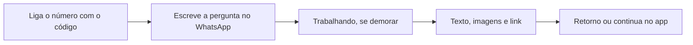

# Chat pelo WhatsApp

> **Em uma frase:** perguntar sobre os números da empresa pelo WhatsApp que você já usa e receber ali mesmo o texto
> e os gráficos da resposta.

## 🧭 O que é

Hoje, a **pergunta de análise**, uma pergunta sobre os números da empresa, só se faz no app do Horus. Longe do
computador, ela fica para depois ou vira pedido à área de dados.

Com o Chat pelo WhatsApp, a pessoa conversa com o Horus a sós e recebe ali o texto e os gráficos da resposta. É a
mesma **conversa de análise** do app, a tela principal em que se pergunta.

No dia a dia, o gestor pergunta entre um compromisso e outro e entra na reunião com o número na mão.

> 📌 **Exemplo:** no carro, o gestor Pedro manda pelo WhatsApp "como foram as vendas de ontem por região?". Em
> segundos, recebe o resumo e o gráfico em imagem e toca no link para ver a série no app.

## ✨ Características

- **Onde funciona:** só na conversa individual; num grupo, a resposta chegaria a quem o Horus não identificou.
- **Quem conversa:** quem pode perguntar, ou seja, o **owner da organização** (quem administra a organização, um
  setor da empresa ou um cliente), o **gestor** (quem responde por uma equipe), o **membro ouro** (quem pergunta e
  cria boards e relatórios para si) e o **membro prata** (quem pergunta, mas não cria
  boards); o **membro bronze**, que só exibe os boards já criados e compartilhados, não conversa.
- **Como a pessoa se identifica:** liga o próprio número ao perfil e o confirma com um código recebido no WhatsApp;
  um número, uma pessoa. É o mesmo número que recebe os avisos dos Conectores de Saída (MF-113).
- **Uma organização por vez:** o telefone fica ligado a uma organização só; ligá-lo em outra move a ligação, com
  aviso à pessoa, e assim o Horus sempre sabe qual organização responde.
- **O que a resposta traz:** o texto, até duas imagens fiéis ao app e um link para a resposta viva, que pede o login
  e não carrega dado nenhum; se a resposta demorar, o Horus avisa que está trabalhando.
- **A mesma conversa do app:** tudo entra no histórico, com a marca do WhatsApp, conta na **medida de autonomia** (a contagem, na Home da organização, das perguntas de análise respondidas que
  trouxeram dado ou fato da web) e recebe 👍🏻, 👎🏻 ou 🚫.
- **Os mesmos controles:** os modos (dados e conversa, com a pesquisa na web como interruptor ao lado), os níveis de inferência (até onde a
  resposta vai além dos dados, de 1 a 5), a Análise avançada (uma segunda leitura, mais demorada) e a escolha do
  modelo de IA, dentro do que a **role** libera (o perfil que liga ou desliga o que cada pessoa usa).
- **De quem é o número e quem paga:** o padrão é o da organização, por privacidade, e ela paga a Meta diretamente; o
  owner pode autorizar o da Maind, a empresa que faz o Horus: as mensagens passam então pela conta da Maind, que
  repassa à organização o custo das mensagens geradas, numa cobrança fora do Horus.
- **Quando a conta para:** se a conta de WhatsApp da organização é bloqueada ou tem a nota de qualidade rebaixada,
  é avisado o owner da organização; se é o número da Maind, o administrador da instância.
- **Quem configura:** só o owner da organização liga o canal, que abre quando a Meta, dona do WhatsApp, aprova as
  mensagens-padrão do Horus. A role padrão, com que a organização nasce, já traz o botão do WhatsApp ligado, que só
  funciona depois que o owner liga o canal; ele o desliga nas roles que quiser.
- **Quem não pode conversar:** quem escreve sem o número ligado, sem o botão do WhatsApp na role ou como membro
  bronze recebe uma resposta fixa, sem dado nenhum, que aponta para o app: ligar o número ou pedir acesso ao owner.
- **Os dados que usa:** toda consulta usa os dados da organização inteira: quem pode conversar alcança todas
  as fontes dela.

## 📈 O valor que gera

- **Para quem usa:** decidir antes da reunião ou da visita à loja, sem abrir o computador.
- **Para a empresa que contrata o Horus:** mais perguntas de análise resolvidas sem chamado à área de dados.
- **Para o Horus como produto:** mais perguntas por pessoa, que movem a medida de autonomia; cada mensagem tem um
  custo, cobrado pela Meta e pago pela organização.

**Como vamos saber que funcionou:** o gestor pergunta mais, e em mais lugares, e a maioria das organizações liga o
canal sem ajuda para abrir a conta na Meta.

## 🚶 Como se usa no Horus

**Quem configura:**

1. O owner liga o canal e escolhe o número: o da organização ou o da Maind.
2. Espera a Meta aprovar as mensagens-padrão.
3. Desliga, nas roles, o botão do WhatsApp de quem não deve conversar; a role padrão já o traz ligado.

**Quem pergunta:**

1. Liga o número no perfil, com o código que chega pelo WhatsApp.
2. Escreve a pergunta de análise.
3. Recebe o texto, as imagens e o link; se demorar, antes vem o aviso de que o Horus está trabalhando.
4. Dá o retorno ou continua no app.

## 🧩 Grau de complexidade: alta

Da v1 se reaproveitam o motor de análise, agora único para todos os canais, e a peça que imprime o PDF da resposta,
de onde saem as imagens. É novo tudo o que liga o Horus ao WhatsApp: a porta da Meta, a ligação do número e a conta
de cada organização. E depende de quem o Horus não controla: a Meta aprova a Maind e cada mensagem-padrão, cobra por
mensagem e só deixa responder livremente até 24 horas após a última mensagem da pessoa.

> ⚠️ É a leitura do PO a partir dos documentos de arquitetura. A estimativa de esforço é do arquiteto.

## 🔗 Macro funcionalidades relacionadas

| mf | Como se relaciona |
| --- | --- |
| Perguntar aos dados em português (MF-107) | **depende de**: é a conversa e o motor que respondem; o WhatsApp é mais uma porta de entrada. |
| Respostas visuais (MF-108) | **depende de**: são os gráficos, tabelas e indicadores que viram imagem. |
| A web como fonte (MF-109) | **depende de**: o fato que vem da web chega à mensagem com o link e a data. |
| Organizações, pessoas e papéis (MF-102) | **depende de**: guarda o número no perfil e as roles, que ganham o botão do WhatsApp. |
| Licenças e planos (MF-103) | **depende de**: o tipo de assento decide quem pode perguntar, e o membro bronze não conversa. |
| Pergunta rápida (MF-110) | **complementa**: é o outro canal novo da mesma conversa; no popup a pessoa escolhe salvar, e aqui tudo entra no histórico. |
| Conectores de Saída (MF-113) | **é a base de**: o conector de WhatsApp, que entrega avisos e PDFs, usa a mesma conta que o chat liga e chega ao mesmo número que a pessoa ligou. |
| Home da organização (MF-117) | **é a base de**, em parte: a medida de autonomia da Home conta as perguntas respondidas pelo WhatsApp. |
| Auditoria (MF-116) | **depende de**: é o rastro da organização; se o que a pessoa vê pelo WhatsApp entra nele, fica para o desenho do arquiteto. |
| Bases de demonstração (MF-118) | **complementa**, para a demonstração: as organizações de exemplo ganham cenários do WhatsApp para as provas de valor da v2.0. |

## 🚧 O que ela não faz

- **Não chega a outros mensageiros:** conversar pelo Teams ou pelo Google Chat fica para depois, sem versão; na
  v2.1, os dois chegam só para entregar avisos, nos Conectores de chat corporativo (MF-122).
- **Não recebe áudio nem arquivos:** a pergunta é em texto.
- **Não substitui o app:** boards, relatórios, agentes, agendamentos e a configuração da organização continuam lá.
- **Não funciona no modo "tudo dentro"**, em que nada sai da infraestrutura da empresa, um modo que não está em
  nenhuma versão.
- **Não investiga o porquê passo a passo:** isso é a Investigação guiada (MF-119), que chega na v2.1.

## ⏳ Ainda a decidir

- **Controles num texto:** como dar o retorno e trocar de modo ou de modelo pelo WhatsApp.

## 📚 Para saber mais

- [Backlog estratégico](../../raw/produto/backlog-estrategico.md): `D-145`, a organização como fronteira dos dados na v2.0; `D-099`, a definição macro, que fechou a `P-020` e reúne
  a `D-084` e as `D-094` a `D-098`; `D-119` (a entrada na v2.0); `D-124` (a mesma conta no conector de WhatsApp);
  `D-131` (o link e a data da web no texto da mensagem); `D-133` (a medida de autonomia); `D-160` (a organização
  paga as mensagens que gerar no número da Maind, fechou a segunda parte do `I-016`); `D-193` e `D-194` (os cinco
  tipos de assento; o ouro é o antigo membro full e o bronze, o antigo membro leitor; a prata conversa, porque
  pergunta, `D-203`); `D-198` (o Teams e o Google Chat, como conectores de saída, viram a `MF-122`, da
  v2.1); `D-188` (o "tudo dentro" sem versão, com a instalação completa no cliente); `D-240` (quem é avisado quando a conta de WhatsApp para); `D-224` (o telefone numa
  organização por vez, e um número só para a conversa e os avisos); `D-225` (a resposta fixa, sem dado, que aponta
  o app a quem não pode conversar); `D-228` (a role padrão nasce com o botão do WhatsApp ligado, que só funciona
  com o canal ligado); a letra (x) da `P-008`.
- [A v2.0 consolidada](../../raw/produto/05-v2.0-consolidada.md): §5.7, §7 (as dependências, com a Auditoria) e o
  anexo B, com as leituras `D-084.1` a `D-098.3` (o membro leitor, hoje o bronze, fora, o "tudo dentro", um
  número por pessoa, a marca de origem no histórico, o link sem dado, o número da Maind, o "trabalhando") e `D-119.1` (o botão nas roles); [mapa das
  mfs](../../raw/produto/04-macro-funcionalidades-de-hoje.md); [versões](../../raw/produto/06-versoes.md);
  [objetivos](../../raw/produto/07-mapa-de-objetivos-e-funcionalidades.md) (O1);
  [lacunas](../../raw/produto/03-inventario-de-lacunas.md) (a candidata nº 18).
- Arquitetura: [integrações](../../raw/arquitetura/08-integracoes.md), §3.3, com a `ARQ-047` (o caminho até a Meta, em
  estudo pelo dono) e as `ARQ-048` a `ARQ-050` (a porta da Meta, a janela de 24 horas e as mensagens-padrão, as
  contas e a ligação do número); [registro de decisões](../../raw/arquitetura/02-registro-de-decisoes.md): `ARQ-006`,
  `ARQ-007`, `ARQ-024`, `ARQ-029` e `ARQ-090` (a `MF-106` inteira na v2.1: na v2.0, os dados da organização
  inteira); [motor](../../raw/arquitetura/05-motor-de-analise-e-ia.md), §3.12;
  [custo de operação](../../raw/arquitetura/13-custo-de-operacao.md), §3.3 (o preço da Meta);
  [estratégia](../../raw/arquitetura/01-estrategia-da-solucao.md), §4 e o marco M4 · Canais;
  [conferência](../../raw/arquitetura/14-conferencia-do-produto.md): a letra (x) da `P-008`, §3 e os itens A-03 (quem paga
  as mensagens no número da Maind, respondido pela `D-160`), A-17 (um número, dois usos, respondido pela `D-224`) e
  A-18 (quem não pode conversar, respondido pela `D-225`).
