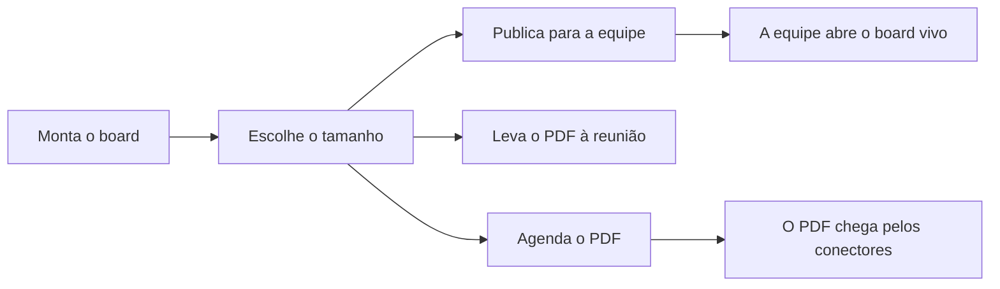

# Boards e Relatórios

> **Em uma frase:** montar uma vez o painel que acompanha o negócio e tê-lo vivo na tela e em PDF, com a empresa no
> controle de quem o publica e de quem o vê.

## 🧭 O que é

**Como é hoje.** O Horus tem duas coisas separadas para acompanhar o negócio: o **board**, um painel de gráficos e
indicadores que se atualizam sozinhos, e o **relatório em PDF**, feito noutro editor, com agenda e envio por e-mail.

**O que passa a existir.** Esta macro funcionalidade (mf) junta os dois num **editor só**: todo board é vivo na tela
e se imprime em PDF, de qualquer tamanho. Junto chegam regras claras de quem cria, abre, publica, edita e desabilita.

**Como fica o dia a dia.** O **gestor**, quem responde por uma equipe, monta o board uma vez, publica-o para a equipe
e leva a mesma montagem em PDF para a reunião. O PDF também pode chegar sozinho, pelo Módulo de Agendamentos de
Agentes (MF-114) e pelos Conectores de Saída (MF-113).

> 📌 **Exemplo** *(personagem ilustrativo)*: a gestora Carla monta o board de vendas e o publica para "Pessoas
> geridas por mim". Na reunião, leva o mesmo board em PDF, sem refazer nada, e todo mês um agendamento o manda à
> diretoria.

## ✨ Características

- **Um editor só:** a mesma montagem é o board vivo e o PDF, sem refazer.
- **O que herda:** grade livre, páginas, cartões que se recalculam sozinhos, filtros, temas e a apresentação que
  passa as páginas sozinha numa tela.
- **Quem cria:** o **owner da organização** (quem administra a organização no Horus), o gestor e o **membro full**
  (quem pergunta e cria os próprios boards); o **membro leitor**, que só vê boards de outras pessoas, não cria.
- **Quem abre:** o autor, quem está na visibilidade publicada, o gestor, nos boards de quem ele gere, e o owner, nos
  de todos.
- **Quem publica:** o owner e, se ele permitir, o gestor, para Todos, Grupos, Pessoas geridas por mim ou Pessoas
  específicas.
- **Quem edita e quem desabilita:** só o autor edita; o owner e o gestor podem tirar o board do ar sem apagá-lo, e no
  lugar dele aparece um aviso.
- **O espaço da organização:** guarda os boards da organização, que o owner edita, e recebe, com o mesmo status, os
  de quem sai ou passa a membro leitor.
- **Os boards públicos:** o owner escolhe os que quem está na quarentena (quem entrou e ainda não tem gestor) pode
  ver.
- **A fronteira do board:** quem abre o board de um gestor o vê como o gestor, só dentro dele; fora dele (a consulta,
  a planilha, o chat), vale o que a pessoa pode, e na v2.0 todo board usa os dados da organização inteira.
- **Fica registrado:** quem publicou, para quem e quando, e quem abriu; o aviso disso fica num documento da
  organização, em PDF.

## 📈 O valor que gera

- **Para quem usa:** acompanha o negócio num painel vivo, sem pedir relatório à área de dados, e leva o mesmo
  conteúdo impresso a quem não abre o Horus.
- **Para a empresa que contrata o Horus:** o owner decide quem publica, e o que se publica e se abre fica registrado.
- **Para o Horus como produto:** entrega o acompanhamento recorrente com a parte mais construída do produto de hoje.

**Como vamos saber que funcionou:** a mesma montagem sai como tela viva e como PDF, sem refazer, e o PDF chega todo
mês à diretoria por um agendamento.

## 🚶 Como se usa no Horus

**Quem configura:** o owner decide se os gestores publicam, escolhe os boards públicos e cuida do espaço da
organização.

**Quem monta:**

1. Monta o board, com cartões que nascem de perguntas de análise.
2. Escolhe o tamanho; o mesmo board serve à tela e ao PDF.
3. Se é gestor ou owner, publica para uma das quatro visibilidades.
4. Quem está na visibilidade abre o board vivo, sem editá-lo.
5. O autor leva o PDF à reunião ou agenda o envio.

## 🧩 Grau de complexidade: média

Quase tudo se reaproveita da v1: os cartões que se recalculam, a apresentação, o editor de relatórios e a impressão
em PDF. O novo é fundir os dois editores, criar o espaço da organização e as regras de publicar e de desabilitar.
Depende das pessoas que cada gestor gere e dos grupos de Organizações, pessoas e papéis (MF-102), e de ninguém de
fora do Horus.

> ⚠️ É a leitura do PO a partir dos documentos de arquitetura. A estimativa de esforço é do arquiteto.

## 🔗 Macro funcionalidades relacionadas

As quatro macro funcionalidades de acompanhar e avisar formam uma corrente: o agente trabalha, o agendamento diz
quando, o conector entrega e o board mostra.

| mf | Como se relaciona |
| --- | --- |
| Organizações, pessoas e papéis (MF-102) | **depende de**: os papéis, a carteira do gestor, os grupos e a quarentena decidem quem cria, abre e publica. |
| Perguntar aos dados em português (MF-107) | **depende de**: cada cartão nasce de uma pergunta de análise e se recalcula pelo mesmo motor da conversa. |
| Respostas visuais (MF-108) | **depende de**: os cartões são os mesmos gráficos, tabelas e indicadores da conversa. |
| Módulo de Agendamentos de Agentes (MF-114) | **depende de**, para o PDF automático: o agendamento diz quando o PDF do board sai. |
| Conectores de Saída (MF-113) | **depende de**, para o PDF automático: o conector entrega o PDF por e-mail ou pelo WhatsApp. |
| Agentes ativos (MF-115) | **complementa**: o agente trabalha ao lado do PDF do board no agendamento e segue as mesmas regras de quem edita e desabilita. |
| Auditoria (MF-116) | **complementa**: registra quem publicou cada board e quem o abriu. |
| Segurança dos dados por pessoa (MF-106) | **complementa**, na v2.1: com ela volta o dado restrito por pessoa, e o board do gestor passa a levar a quem o abre o que só o gestor vê. |

## 🚧 O que ela não faz

- **Agendar nem enviar:** isso é do agendamento e dos conectores.
- **Ter mais de um autor:** só quem criou edita.
- **Alterar o board de outra pessoa:** o owner e o gestor só desabilitam; o owner edita só os do espaço da
  organização.
- **Outros formatos:** só a tela viva e o PDF, por ora.
- **Board do membro leitor:** ele não cria; abre os de outras pessoas e recebe PDFs.

## ⏳ Ainda a decidir

- Como um board maior que a folha vira PDF: uma folha por página ou reduzido para caber.
- Como o autor aprova o cartão que descreve em texto, como as regiões do relatório de hoje.
- Onde fica o documento do aviso de abertura e se o primeiro acesso pede ciência dele.

## 📚 Para saber mais

- [Backlog estratégico](../../raw/produto/backlog-estrategico.md): a `D-058`, a definição macro (fechou a `P-005`); a
  `D-018` e a `D-057` (o editor único e o tamanho como propriedade); as `D-042` a `D-048` (quem cria, abre, publica,
  edita e desabilita, o espaço da organização e a quarentena); as `D-051`, `D-053`, `D-054` e `D-059` (a liberação do
  gestor e a fronteira do board); a `D-069` e a `D-073` (o membro leitor e a passagem de full a leitor); a `D-119`
  (entra na v2.0, fechou o `I-012`); a `D-122` (o PDF automático, fechou o `I-014`); as letras (a), (h), (i), (n) e
  (o) da `P-008`.
- [A v2.0 consolidada](../../raw/produto/05-v2.0-consolidada.md): §1, §2, §3.1 (candidata nº 8), §4 (passo 8), §5.6 e §7.
  [Mapa das mfs](../../raw/produto/04-macro-funcionalidades-de-hoje.md): a `MF-006` e a `MF-008`, substituídas, e "O que
  o dono já disse". [Versões](../../raw/produto/06-versoes.md), [objetivos](../../raw/produto/07-mapa-de-objetivos-e-funcionalidades.md)
  (O3) e [lacunas](../../raw/produto/03-inventario-de-lacunas.md) (candidata nº 8).
- Arquitetura: [estratégia](../../raw/arquitetura/01-estrategia-da-solucao.md) (§3, O3; §4; o marco M5);
  [software](../../raw/arquitetura/04-software.md) ("Boards e relatórios" e "Desenho fora da tela");
  [registro](../../raw/arquitetura/02-registro-de-decisoes.md): `ARQ-006`, `ARQ-007`, `ARQ-022`, `ARQ-023`, `ARQ-041` e
  `ARQ-042` (com as notas de 03/11/2026), `ARQ-043` ✅ (o documento da organização, em PDF) e `ARQ-090` ✅ (a
  `MF-106` inteira na v2.1: na v2.0, todo board roda com os dados da organização inteira);
  [conferência](../../raw/arquitetura/14-conferencia-do-produto.md): §3, o reaproveitamento; §4, `A-05`, `A-09`, `A-11`,
  `A-14`, `A-15`, `A-23`, `A-28` e `A-30`.
