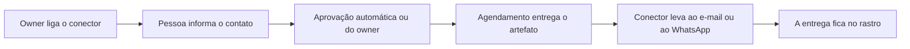

# Conectores de Saída

> **Em uma frase:** levar o que o Horus produz, como o PDF de um board ou o alerta de um agente, ao e-mail ou ao
> WhatsApp de quem precisa, sem a pessoa abrir o app.

## 🧭 O que é

**Como é hoje.** A única saída do Horus é o e-mail do relatório em PDF agendado; o resto só chega a quem abre o app.

**O que passa a existir.** Esta macro funcionalidade (mf) cria os **conectores de saída**, os canais por onde o Horus
entrega o que produz: o **e-mail** e o **WhatsApp**. O conector só transporta o **artefato**, a peça pronta
que outra parte gerou, como o PDF de um board (o painel de gráficos) ou o alerta de um agente de IA, e só entrega a
usuários do Horus.

> 💡 **Analogia:** é o carteiro, que leva a carta fechada ao endereço cadastrado sem abri-la. **Onde a analogia
> para:** este carteiro só entrega a quem mora no prédio, as pessoas da organização no Horus.

**Como fica o dia a dia.** O **owner da organização**, quem administra a organização no Horus, liga os conectores
uma vez. Cada pessoa informa o seu contato e passa a receber no canal em que já olha.

> 📌 **Exemplo** *(personagem ilustrativo)*: toda segunda, o PDF da semana chega por e-mail ao grupo "Vendas Sul";
> quando as vendas do Sul caem 10%, o alerta do agente chega ao WhatsApp da gestora Carla.

## ✨ Características

- **Só transporta:** leva o que lhe entregam pronto, sem mudar nada.
- **Os canais:** o e-mail e o WhatsApp; o Teams e o Google Chat chegam na v2.1, nos Conectores de chat corporativo
  (MF-122), e outros, como o Slack, não têm versão.
- **Só para usuários do Horus:** todo destinatário é uma pessoa da organização, por nome ou por grupo, inclusive os
  membros **prata** (que pergunta, mas não cria) e **bronze** (que só exibe os boards já criados e compartilhados;
  é o antigo membro leitor), que recebem, mas não criam envios.
- **Quem liga:** só o owner da organização; o **gestor** (quem responde por uma equipe) e o **membro ouro** (quem
  pergunta e cria boards e relatórios para si; é o antigo membro full) usam os que estão ligados.
- **O contato de cada um:** cada pessoa informa o próprio contato em cada conector. A aprovação nasce automática
  quando a organização é criada, e o owner pode passar a aprovar um a um.
- **Quem envia:** quem tem, nas **roles** (os pacotes de permissões que o owner monta), o botão de enviar pelos
  conectores; a role padrão nasce com ele ligado.
- **O e-mail:** sai pelo mesmo serviço de e-mail dos convites do Horus, com o nome da organização no assunto e o PDF
  anexo.
- **O WhatsApp:** usa a conta da organização que o Chat pelo WhatsApp (MF-111) liga, o número próprio ou o da Maind,
  e cada envio é uma mensagem-padrão aprovada pela Meta, a dona do WhatsApp, paga por mensagem. A organização paga
  as mensagens que gerar: com o número próprio, direto à Meta; com o da Maind, a Maind lhe repassa o custo, numa
  cobrança fora do Horus.
- **Um número por pessoa:** a pessoa tem um número de WhatsApp só, o mesmo da conversa com o Horus e dos envios, e
  ele fica ligado a uma organização por vez; ligá-lo numa organização o desliga das outras, e a pessoa é avisada.
- **O que não cabe no canal:** se o artefato passa do limite do canal, como um PDF maior que o anexo do e-mail ou
  um alerta maior que a mensagem do WhatsApp, o Horus não o entrega naquele canal, não o corta e avisa o autor.
- **Quando um canal para:** é avisado o dono do serviço. O owner, se é o WhatsApp próprio da organização; o
  **administrador da instância** (o funcionário da Maind que administra o Horus em nuvem), se é o número de WhatsApp
  da Maind ou o serviço de e-mail, que é da instância.
- **Fica registrado:** cada entrega, por qual conector e a quem, vai para o rastro da Auditoria (MF-116).

## 📈 O valor que gera

- **Para quem usa:** recebe o resultado onde já olha, sem ir buscá-lo.
- **Para a empresa que contrata o Horus:** decide por onde a informação sai; nada sai por um canal que o owner não
  ligou.
- **Para o Horus como produto:** o aviso chega sem ninguém perguntar, e o contratante exigente aceita o produto
  porque controla o que sai.

**Como vamos saber que funcionou:** o owner liga o conector uma vez, um agendamento envia o PDF de um board, e a
pessoa o recebe no canal dela.

## 🚶 Como se usa no Horus

**O owner da organização configura:**

1. Liga o conector de e-mail e, se quiser, o de WhatsApp.
2. Mantém a aprovação automática dos contatos, que vem ligada, ou passa a aprovar cada um.
3. Nas roles, mantém ou desliga o botão de enviar pelos conectores, que a role padrão traz ligado.

**Quem recebe:**

1. Informa no perfil o próprio contato em cada conector.
2. Se o owner passou a aprovar cada contato, espera o sim dele.
3. Recebe o PDF ou o alerta que um agendamento lhe manda.

## 🧩 Grau de complexidade: alta

Da v1 se reaproveitam o envio de e-mail e o seu ritmo, e o relatório agendado vira o primeiro caso de conector. São
novos o conector de WhatsApp e o contato aprovado de cada pessoa em cada canal. O que a faz alta é a Meta, que o Horus
não controla: ela aprova cada mensagem-padrão, cobra por mensagem e decide a categoria de cada envio, que muda o preço.

> ⚠️ É a leitura do PO a partir dos documentos de arquitetura. A estimativa de esforço é do arquiteto.

## 🔗 Macro funcionalidades relacionadas

As quatro macro funcionalidades de acompanhar e avisar formam uma corrente: o agente trabalha, o agendamento diz
quando, o conector entrega e o board mostra.

| mf | Como se relaciona |
| --- | --- |
| Módulo de Agendamentos de Agentes (MF-114) | **depende de**: é o agendamento que diz quando e chama o conector com o artefato pronto. |
| Agentes ativos (MF-115) | **depende de**: é o agente que produz boa parte do que o conector leva, o PDF com gráficos e o alerta. |
| Boards e Relatórios (MF-112) | **é a base de**: o PDF automático do board chega a quem o recebe pelo conector. |
| Chat pelo WhatsApp (MF-111) | **depende de**: o conector de WhatsApp usa a mesma conta da organização que o chat liga. |
| Organizações, pessoas e papéis (MF-102) | **depende de**: guarda o contato no perfil, o papel de owner e o botão das roles de enviar pelos conectores. |
| Licenças e planos (MF-103) | **é a base de**: é por aqui que o membro bronze recebe alertas e PDFs; as mensagens pelo número de WhatsApp da Maind se pagam à parte. |
| Administração da instância (MF-101) | **depende de**: o e-mail sai pelo serviço de e-mail da instância, e é lá que a Maind mede, por organização, o custo do WhatsApp que repassa. |
| Auditoria (MF-116) | **é a base de**: registra cada entrega, por qual conector e a quem. |
| Conectores de chat corporativo (MF-122) | **é a base de**: na v2.1, o Teams e o Google Chat entram como canais novos deste mesmo carteiro. |

## 🚧 O que ela não faz

- **Criar o conteúdo:** o PDF é do board, e o alerta, do agente.
- **Cortar ou reduzir o artefato** para caber no canal: o que não cabe não sai por ali.
- **Decidir quando enviar:** isso é do Módulo de Agendamentos de Agentes (MF-114).
- **Entregar a quem não é usuário do Horus,** como um cliente da empresa.
- **Mandar os e-mails da conta,** como o convite e a recuperação de senha: saem pelo e-mail do próprio Horus.
- **Entregar pelo Teams ou pelo Google Chat:** isso fica com os Conectores de chat corporativo, na v2.1.
- **Funcionar no modo "tudo dentro":** esse modo, em que nada sai da casa da empresa, não está em nenhuma versão; se
  voltar, volta como uma mf própria.

## ⏳ Ainda a decidir

Nada a decidir.

## 📚 Para saber mais

- [Backlog estratégico](../../raw/produto/backlog-estrategico.md): a `D-041`, a definição macro (fechou a `P-010`); as
  `D-033` a `D-035` (a mf, o "só transporta" e o "só a usuários do Horus"); as `D-038` a `D-040` (o contato, a
  aprovação por tipo e o "tudo dentro"); a `D-079` (o membro leitor recebe); a `D-122` (entra na v2.0, com a leitura
  `D-122.1`, o nono botão das roles); a `D-124` (o e-mail e o WhatsApp, fechou a `P-024`, com a leitura da mesma
  conta); a `D-121` e a `D-182` (o Teams e o Google Chat na v2.1; outros, como o Slack, adiados); a
  `D-197` e a `D-198` (uma mf numa versão só: o Teams e o Google Chat viram a `MF-122`, e esta mf fica inteira na
  v2.0); a `D-201`, a definição da `MF-122`; a `D-160` (quem usa o número da Maind paga as mensagens que
  gerar); a `D-193` e a `D-194` (os cinco tipos de assento; o ouro é o antigo membro full e o bronze, o antigo
  membro leitor); a `D-188` (o "tudo dentro" sem versão, com a instalação completa no cliente), com a leitura
  `D-198.1` (se voltar, volta como mf própria); a leitura `D-128.3`
  (o aviso de "recebido" sai pelo e-mail da instância); a `D-224` (um número só por pessoa, o da conversa e dos
  envios, ligado a uma organização por vez); a `D-227` (o artefato que não cabe no canal não sai por ele, e o autor é
  avisado); a `D-228` (a aprovação dos contatos e o botão da role padrão nascem liberados); a `D-240` (quando um canal
  para, é avisado o dono do serviço); as letras (f) e (x) da `P-008`.
- [A v2.0 consolidada](../../raw/produto/05-v2.0-consolidada.md): §5.2 (o nono botão), §5.11, §7 e §10.
  [Mapa das mfs](../../raw/produto/04-macro-funcionalidades-de-hoje.md) ("O que o dono já disse"),
  [versões](../../raw/produto/06-versoes.md) (a v2.0 e a `MF-122`, na v2.1), [objetivos](../../raw/produto/07-mapa-de-objetivos-e-funcionalidades.md)
  (O4) e [lacunas](../../raw/produto/03-inventario-de-lacunas.md) (candidata nº 12).
- Arquitetura: [estratégia](../../raw/arquitetura/01-estrategia-da-solucao.md) (§3, O4; §4; os marcos M6 e M12);
  [software](../../raw/arquitetura/04-software.md) ("Conectores de saída", "Envio de e-mail" e "Porta da Meta");
  [integrações](../../raw/arquitetura/08-integracoes.md) (§3.2 e §3.3); [custo](../../raw/arquitetura/13-custo-de-operacao.md)
  (as mensagens da Meta); [registro](../../raw/arquitetura/02-registro-de-decisoes.md): `ARQ-022`, `ARQ-042`, `ARQ-046` ✅,
  `ARQ-047` 🟡 (o caminho até a Meta, com o dono) e `ARQ-048` a `ARQ-050`;
  [conferência](../../raw/arquitetura/14-conferencia-do-produto.md): §3, o reaproveitamento; §4, `A-03` (respondido pela
  `D-160`), `A-17`, `A-19` e `A-22`.
