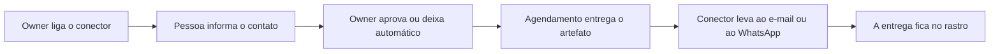

# Conectores de Saída

> **Em uma frase:** levar o que o Horus produz, como o PDF de um board ou o alerta de um agente, ao e-mail ou ao
> WhatsApp de quem precisa, sem a pessoa abrir o app.

## 🧭 O que é

**Como é hoje.** A única saída do Horus é o e-mail do relatório em PDF agendado; o resto só chega a quem abre o app.

**O que passa a existir.** Esta macro funcionalidade (mf) cria os **conectores de saída**, os canais por onde o Horus
entrega o que produz: na v2.0, o **e-mail** e o **WhatsApp**. O conector só transporta o **artefato**, a peça pronta
que outra parte gerou, como o PDF de um board (o painel de gráficos) ou o alerta de um agente de IA, e só entrega a
usuários do Horus.

> 💡 **Analogia:** é o carteiro, que leva a carta fechada ao endereço cadastrado sem abri-la. **Onde a analogia
> para:** este carteiro só entrega a quem mora no prédio, as pessoas da organização no Horus.

**Como fica o dia a dia.** O **owner da organização**, quem administra a organização no Horus, liga os conectores
uma vez. Cada pessoa informa o seu contato e passa a receber no canal em que já olha.

> 📌 **Exemplo** *(personagem ilustrativo)*: toda segunda, o PDF da semana chega por e-mail ao grupo "Vendas Sul";
> quando as vendas do Sul caem 10%, o alerta do agente chega ao WhatsApp da gestora Carla.

## ✨ Características

- **Só transporta:** leva o que lhe entregam pronto, sem mudar nada.
- **Os canais da v2.0:** o e-mail e o WhatsApp; Teams, Google Chat e outros ficam para a v2.1.
- **Só para usuários do Horus:** todo destinatário é uma pessoa da organização, por nome ou por grupo, inclusive o
  **membro leitor**, que só vê boards de outras pessoas.
- **Quem liga:** só o owner da organização; o **gestor** (quem responde por uma equipe) e o **membro full** (quem
  pergunta e cria os próprios boards) usam os que estão ligados.
- **O contato de cada um:** cada pessoa informa o próprio contato em cada conector, e o owner aprova um a um ou deixa
  a aprovação automática.
- **Quem envia:** quem tem, nas **roles** (os pacotes de permissões que o owner monta), o botão de enviar pelos
  conectores.
- **O e-mail:** sai pelo mesmo serviço de e-mail dos convites do Horus, com o nome da organização no assunto e o PDF
  anexo.
- **O WhatsApp:** usa a conta da organização que o Chat pelo WhatsApp (MF-111) liga, o número próprio ou o da Maind,
  e cada envio é uma mensagem-padrão aprovada pela Meta, a dona do WhatsApp, paga por mensagem.
- **Fica registrado:** cada entrega, por qual conector e a quem, vai para o rastro da Auditoria (MF-116).
- **No modo "tudo dentro":** nesse modo da v2.1, em que nada sai da casa da empresa, os conectores ficam bloqueados
  até o owner da instância (quem administra a instalação inteira) liberar cada tipo.

## 📈 O valor que gera

- **Para quem usa:** recebe o resultado onde já olha, sem ir buscá-lo.
- **Para a empresa que contrata o Horus:** decide por onde a informação sai; nada sai por um canal que o owner não
  ligou.
- **Para o Horus como produto:** o aviso chega sem ninguém perguntar, e o contratante exigente aceita o produto
  porque controla o que sai.

**Como vamos saber que funcionou:** o owner liga o conector uma vez, um agendamento envia o PDF de um board, e a
pessoa o recebe no canal dela.

## 🚶 Como se usa no Horus

**O owner da organização configura:**

1. Liga o conector de e-mail e, se quiser, o de WhatsApp.
2. Escolhe se aprova cada contato ou deixa a aprovação automática.
3. Nas roles, liga o botão de enviar pelos conectores para quem pode.

**Quem recebe:**

1. Informa no perfil o próprio contato em cada conector.
2. Espera o sim do owner, se ele o exigir.
3. Recebe o PDF ou o alerta que um agendamento lhe manda.

## 🧩 Grau de complexidade: alta

Da v1 se reaproveitam o envio de e-mail e o seu ritmo, e o relatório agendado vira o primeiro caso de conector. São
novos o conector de WhatsApp e o contato aprovado de cada pessoa em cada canal. O que a faz alta é a Meta, que o Horus
não controla: ela aprova cada mensagem-padrão, cobra por mensagem e decide a categoria de cada envio, que muda o preço.

> ⚠️ É a leitura do PO a partir dos documentos de arquitetura. A estimativa de esforço é do arquiteto.

## 🔗 Macro funcionalidades relacionadas

As quatro macro funcionalidades de acompanhar e avisar formam uma corrente: o agente trabalha, o agendamento diz
quando, o conector entrega e o board mostra.

| mf | Como se relaciona |
| --- | --- |
| Módulo de Agendamentos de Agentes (MF-114) | **depende de**: é o agendamento que diz quando e chama o conector com o artefato pronto. |
| Agentes ativos (MF-115) | **depende de**: é o agente que produz boa parte do que o conector leva, o PDF com gráficos e o alerta. |
| Boards e Relatórios (MF-112) | **é a base de**: o PDF automático do board chega a quem o recebe pelo conector. |
| Chat pelo WhatsApp (MF-111) | **depende de**: o conector de WhatsApp usa a mesma conta da organização que o chat liga. |
| Organizações, pessoas e papéis (MF-102) | **depende de**: guarda o contato no perfil, o papel de owner e o botão das roles de enviar pelos conectores. |
| Administração da instância (MF-101) | **depende de**: o e-mail sai pelo serviço de e-mail da instância, e é lá que se liberam os conectores no modo "tudo dentro". |
| Auditoria (MF-116) | **complementa**: registra cada entrega, por qual conector e a quem. |

## 🚧 O que ela não faz

- **Criar o conteúdo:** o PDF é do board, e o alerta, do agente.
- **Decidir quando enviar:** isso é do Módulo de Agendamentos de Agentes (MF-114).
- **Entregar a quem não é usuário do Horus,** como um cliente da empresa.
- **Mandar os e-mails da conta,** como o convite e a recuperação de senha: saem pelo e-mail do próprio Horus.
- **Teams e Google Chat na v2.0:** entram na v2.1.

## ⏳ Ainda a decidir

- Se o número de WhatsApp dos envios é o mesmo da conversa com o Horus.
- O que acontece quando o artefato não cabe no canal, como um PDF maior que o anexo do e-mail.
- Quem paga as mensagens do WhatsApp quando a organização usa o número da Maind.

## 📚 Para saber mais

- [Backlog estratégico](../../raw/produto/backlog-estrategico.md): a `D-041`, a definição macro (fechou a `P-010`); as
  `D-033` a `D-035` (a mf, o "só transporta" e o "só a usuários do Horus"); as `D-038` a `D-040` (o contato, a
  aprovação por tipo e o "tudo dentro"); a `D-079` (o membro leitor recebe); a `D-122` (entra na v2.0, com a leitura
  `D-122.1`, o nono botão das roles); a `D-124` (o e-mail e o WhatsApp, fechou a `P-024`, com a leitura da mesma
  conta); a `D-121` (os outros conectores na v2.1); a leitura `D-128.3` (o aviso de "recebido" sai pelo e-mail da
  instância); as letras (f) e (x) da `P-008`.
- [A v2.0 consolidada](../../raw/produto/05-v2.0-consolidada.md): §5.2 (o nono botão), §5.11, §7 e §10.
  [Mapa das mfs](../../raw/produto/04-macro-funcionalidades-de-hoje.md) ("O que o dono já disse"),
  [versões](../../raw/produto/06-versoes.md) (v2.0 e v2.1), [objetivos](../../raw/produto/07-mapa-de-objetivos-e-funcionalidades.md)
  (O4) e [lacunas](../../raw/produto/03-inventario-de-lacunas.md) (candidata nº 12).
- Arquitetura: [estratégia](../../raw/arquitetura/01-estrategia-da-solucao.md) (§3, O4; §4; os marcos M6 e M12);
  [software](../../raw/arquitetura/04-software.md) ("Conectores de saída", "Envio de e-mail" e "Porta da Meta");
  [integrações](../../raw/arquitetura/08-integracoes.md) (§3.2 e §3.3); [custo](../../raw/arquitetura/13-custo-de-operacao.md)
  (as mensagens da Meta); [registro](../../raw/arquitetura/02-registro-de-decisoes.md): `ARQ-022`, `ARQ-042`, `ARQ-046` ✅,
  `ARQ-047` 🟡 (o caminho até a Meta, com o dono) e `ARQ-048` a `ARQ-050`;
  [conferência](../../raw/arquitetura/14-conferencia-do-produto.md): §3, o reaproveitamento; §4, `A-03`, `A-17`, `A-19` e
  `A-22`.
