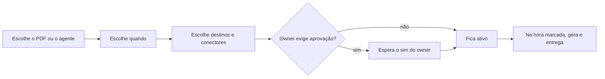

# Módulo de Agendamentos de Agentes

> **Em uma frase:** programar uma vez quando o Horus gera o PDF de um board ou roda um agente, e para quem entrega o
> resultado, sem depender de alguém lembrar.

## 🧭 O que é

**Como é hoje.** Só o relatório em PDF tem agenda: sai na hora marcada e chega por e-mail, o único envio que o Horus
faz sem alguém pedir.

**O que passa a existir.** Esta macro funcionalidade (mf) é o **agendador único**, o relógio do Horus. Ele decide
quando roda uma de duas coisas, no mesmo nível: o **PDF de um board** (o painel de gráficos) ou um **agente**, o
trabalhador de IA que analisa os dados e avisa. O resultado, o **artefato**, segue pelos conectores aos destinos
escolhidos.

> 💡 **Analogia:** é o débito automático: programado uma vez, a conta sai todo mês sem ninguém lembrar. **Onde a
> analogia para:** aqui só o **gestor** (quem responde por uma equipe) e o **owner da organização** (quem a administra
> no Horus) programam envios para outras pessoas; os demais, só para si.

**Como fica o dia a dia.** O gestor programa o PDF do board e o agente da semana; na hora marcada, o Horus gera e
entrega sozinho.

> 📌 **Exemplo** *(personagem ilustrativo)*: a gestora Carla agenda o PDF do board de vendas para o grupo "Vendas
> Sul", todo dia 1º, e o João, do grupo, o recebe no WhatsApp. A Maria, **membro full** (quem pergunta e cria os
> próprios boards), tenta agendar o mesmo envio ao João, e o Horus não deixa.

## ✨ Características

- **Um agendador só:** todo envio automático do Horus passa por ele.
- **Mais de um item:** um agendamento pode rodar vários PDFs e agentes e sair por mais de um conector.
- **Para quem cada um agenda:** cada pessoa agenda para si; para outras, só o gestor, para quem ele gere, e o owner,
  para qualquer pessoa.
- **Os destinos:** pessoas e grupos do Horus, pelo contato que cada um informou em cada conector; o gestor usa os
  grupos dele, e o owner, também os da organização.
- **Quem não agenda:** o **membro leitor**, que só vê boards de outras pessoas, não agenda nada, mas recebe.
- **A aprovação:** o owner liga ou desliga a aprovação automática; desligada, o agendamento só roda depois do sim
  dele.
- **Com que permissão roda:** com a de quem o criou, lida na hora de cada rodada; na v2.0, os números são sempre os
  da organização inteira.
- **O board desabilitado:** o agendamento continua, com um aviso de board desativado no lugar dele.
- **Quem sai da organização:** os agendamentos dele ficam pausados no espaço da organização, onde fica o que é dela
  e não de uma pessoa, até o owner transferi-los ou excluí-los; o mesmo vale para quem passa a membro leitor.
- **O corte:** se a organização tem os assentos (as licenças das pessoas) desativados, nada roda; na volta, segue
  do próximo horário, sem refazer o que perdeu.

## 📈 O valor que gera

- **Para quem usa:** a informação certa chega na hora certa, sem alguém lembrar de gerar e mandar.
- **Para a empresa que contrata o Horus:** o gestor leva o PDF ou o alerta à equipe, e o owner controla quem agenda.
- **Para o Horus como produto:** o único envio automático de hoje vira geral, e o acompanhamento e o aviso chegam sem
  trabalho manual.

**Como vamos saber que funcionou:** o PDF da Carla chega todo dia 1º ao grupo, e o envio que a Maria tenta para o
João é barrado.

## 🚶 Como se usa no Horus

1. A pessoa escolhe o que rodar: o PDF de um board, um agente ou mais de um item.
2. Escolhe quando, por exemplo toda segunda de manhã ou todo dia 1º.
3. Escolhe os destinos e os conectores, dentro do que o papel dela permite.
4. Se o owner exige aprovação, o agendamento espera o sim dele.
5. Na hora marcada, o Horus gera o artefato e o passa aos conectores.
6. Cada entrega fica registrada no rastro da auditoria.

## 🧩 Grau de complexidade: média

A agenda dos relatórios em PDF da v1 serve de molde, e o jeito de reservar cada rodada para não rodá-la duas vezes se
reaproveita. O novo é o agente como coisa agendada e a pausa no corte, sobre uma fila de trabalhos que não se perde
quando o Horus é atualizado. Depende dos Agentes ativos (MF-115), dos Boards e Relatórios (MF-112) e dos Conectores
de Saída (MF-113), e de ninguém de fora do Horus.

> ⚠️ É a leitura do PO a partir dos documentos de arquitetura. A estimativa de esforço é do arquiteto.

## 🔗 Macro funcionalidades relacionadas

As quatro macro funcionalidades de acompanhar e avisar formam uma corrente: o agente trabalha, o agendamento diz
quando, o conector entrega e o board mostra.

| mf | Como se relaciona |
| --- | --- |
| Agentes ativos (MF-115) | **depende de**: o agente é uma das duas coisas que o agendamento roda, e só roda quando o agendamento o chama. |
| Boards e Relatórios (MF-112) | **depende de**: o PDF do board é a outra coisa que o agendamento roda. |
| Conectores de Saída (MF-113) | **depende de**: o agendamento não entrega nada sozinho; passa o artefato ao conector, que o leva ao e-mail ou ao WhatsApp. |
| Organizações, pessoas e papéis (MF-102) | **depende de**: a carteira do gestor e os grupos dizem para quem cada um pode agendar. |
| Licenças e planos (MF-103) | **complementa**: no corte dos assentos, todo agendamento da organização para. |
| Auditoria (MF-116) | **complementa**: registra o que cada rodada enviou, por qual conector e a quem. |

## 🚧 O que ela não faz

- **Decidir o que o agente faz** nem o que ele avalia: isso é dos Agentes ativos.
- **Escolher o formato do que sai,** que é do board ou do agente, nem o canal, que é dos conectores.
- **Enviar a quem não é usuário do Horus.**
- **Deixar o membro full agendar para colegas:** só o gestor e o owner entregam a outras pessoas.
- **Refazer as rodadas perdidas** durante um corte.

## ⏳ Ainda a decidir

- O que recebem os destinatários e o autor quando uma rodada falha.
- O padrão do interruptor de aprovação quando a organização nasce.
- O que a pessoa vê enquanto o agendamento espera a aprovação do owner.

## 📚 Para saber mais

- [Backlog estratégico](../../raw/produto/backlog-estrategico.md): a `D-060`, a definição macro (fechou a `P-011`); a
  `D-036` (o agendador único, fechou o `I-005`) e a `D-037` (o nome); a `D-064` (o PDF de um board ou um agente, no
  mesmo nível, fechou o `I-007`, com a leitura de mais de um item); a `D-059` (só o gestor e o owner entregam a
  outras pessoas); as `D-038` e `D-039` (a aprovação por tipo); as `D-044` e `D-045` (o board desabilitado); a `D-073`
  (de full a leitor); a `D-075` (o corte, sem refazer rodadas); a `D-079` (o membro leitor recebe); a `D-122` (entra
  na v2.0, fechou o `I-014`); as letras (g) e (o) da `P-008`.
- [A v2.0 consolidada](../../raw/produto/05-v2.0-consolidada.md): §4 (passo 9), §5.10 e §7.
  [Mapa das mfs](../../raw/produto/04-macro-funcionalidades-de-hoje.md) ("O que o dono já disse"),
  [versões](../../raw/produto/06-versoes.md), [objetivos](../../raw/produto/07-mapa-de-objetivos-e-funcionalidades.md) (O4) e
  [lacunas](../../raw/produto/03-inventario-de-lacunas.md) (candidata nº 13).
- Arquitetura: [estratégia](../../raw/arquitetura/01-estrategia-da-solucao.md) (§3, O4; §4; o marco M6);
  [software](../../raw/arquitetura/04-software.md) ("Agendador" e "Fila durável e caixa de saída");
  [motor](../../raw/arquitetura/05-motor-de-analise-e-ia.md) (§3.9); [registro](../../raw/arquitetura/02-registro-de-decisoes.md):
  `ARQ-004`, `ARQ-005`, `ARQ-022`, `ARQ-030`, `ARQ-041` (com a nota de 03/11/2026) e `ARQ-090` ✅ (a `MF-106` inteira
  na v2.1: na v2.0, o escopo é o da organização inteira);
  [conferência](../../raw/arquitetura/14-conferencia-do-produto.md): §3, o reaproveitamento; §4, `A-10`, `A-11`, `A-15` e
  `A-28`.
