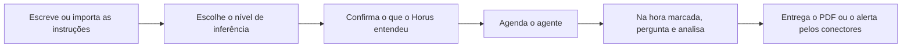

# Agentes ativos

> **Em uma frase:** descrever em texto o que você quer acompanhar e receber, na hora marcada, a análise pronta e um
> alerta quando algo muda, sem precisar perguntar.

## 🧭 O que é

**Como é hoje.** Nada no Horus avisa sem alguém perguntar; o relatório agendado por e-mail chega perto, mas não avisa
quando algo muda.

**O que passa a existir.** Esta macro funcionalidade (mf) cria o **agente**: um trabalhador de IA que consulta os
dados, analisa e entrega o resultado, num PDF com gráficos ou num **alerta** curto. Ele nasce de instruções em texto,
digitadas, coladas ou importadas de um arquivo .md, um arquivo de texto simples.

> 💡 **Analogia:** é um analista com um roteiro: toda segunda ele abre os números, faz as mesmas perguntas, monta o
> resumo e só liga se algo saiu do normal. **Onde a analogia para:** o agente não decide nem mexe em nada; só lê, e
> cada número que cita foi calculado pelo Horus no banco da empresa.

**Como fica o dia a dia.** O **gestor**, quem responde por uma equipe, descreve uma vez o que quer acompanhar; o
resto chega sozinho.

> 📌 **Exemplo** *(personagem ilustrativo)*: a gestora Carla importa um .md com as perguntas da semana. Toda segunda,
> o agente consulta, analisa e entrega ao grupo "Vendas Sul" um PDF com gráficos. Quando as vendas caem mais de 10%,
> ele avisa a Carla no WhatsApp, com o rótulo do nível de inferência usado, o quanto ele afirma além dos dados.

## ✨ Características

- **Todo agente usa IA:** é ela que transforma as instruções nas consultas a fazer.
- **Antes de ligar:** o Horus mostra as perguntas que vai fazer e a condição para avisar, e o autor confirma.
- **Como trabalha:** pergunta ao mesmo motor da conversa de análise quantas vezes precisar, dentro de um teto de
  perguntas e de tempo, e só cita números que o Horus calculou.
- **O nível de inferência:** o autor o escolhe livremente, do descritivo ao especulativo, e todo alerta chega
  rotulado com o nível usado.
- **Só lê:** nunca altera dados nem age nos sistemas da empresa.
- **Quando e para quem:** roda só pelo Módulo de Agendamentos de Agentes (MF-114), com a permissão de quem o criou
  (na v2.0, os dados da organização inteira), e entrega pelos Conectores de Saída (MF-113), só a usuários do Horus.
- **Quem cria:** o **owner da organização** (o funcionário da empresa cliente que administra a organização no
  Horus), o gestor e o **membro ouro** (quem pergunta e cria boards e relatórios para si, sem compartilhar); os
  membros **prata** (que pergunta, mas não cria) e **bronze** (que só exibe os dashboards já criados e compartilhados)
  só recebem.
- **Quem edita e quem desabilita:** valem as regras dos boards: só o autor edita, e o owner e o gestor podem
  desabilitar.
- **Quando a execução falha:** se dá erro ou passa do teto, os destinatários não recebem nada naquela rodada e só o
  autor é avisado; a próxima rodada segue no horário normal.
- **O que não cabe no canal:** o alerta maior que a mensagem do WhatsApp, ou o PDF maior que o anexo do e-mail, não
  é entregue naquele canal nem cortado, e o autor é avisado.
- **Quem é excluído da organização** (sai ou é retirado dela): perde em definitivo os agentes que criou. Não há
  transferência, e ninguém os recebe.
- **Quem é rebaixado** (passa de ouro a prata ou a bronze e continua na organização): os agentes que criou continuam
  vinculados a ele, mas **desabilitados**: não rodam, e a única ação é excluí-los, porque a prata e o bronze não
  criam agentes. Se voltar a ser ouro, reativa um a um; nada volta sozinho.
- **O custo:** cada execução consome IA, às vezes mais que uma conversa. Paga quem é dono da conexão de IA: a
  organização, se a conexão é dela; a Maind, se é uma conexão da instância que a Maind disponibiliza à organização e
  embute no preço do assento. O owner escolhe o modelo de IA dos agentes entre os das conexões que a organização tem.
- **Sem teto automático de custo:** nenhum agente nem organização é cortado sozinho por gastar demais. Valem os
  tetos de cada execução e o aviso de custo da Administração da instância (MF-101), que avisa a Maind e não
  corta nada sozinho.

## 📈 O valor que gera

- **Para quem usa:** o gestor e o executivo são avisados quando algo muda e recebem a análise pronta, sem lembrar de
  perguntar.
- **Para a empresa que contrata o Horus:** a área de dados deixa de ser acionada para o que se repete toda semana.
- **Para o Horus como produto:** preenche o aviso, um dos três problemas que o Horus se propõe a resolver, hoje
  vazio.

**Como vamos saber que funcionou:** a cena da Carla acontece de verdade e, nas organizações que usam a conexão de IA
da instância, o custo de IA dos agentes cabe no preço do assento.

## 🚶 Como se usa no Horus

**O owner da organização configura:** escolhe o modelo de IA que os agentes usam e decide se a criação de agentes
espera a aprovação dele; quando a organização nasce, a aprovação é automática. Enquanto espera, o agente aparece
marcado "aguardando aprovação do owner", sem rodar, e depois "ativo" ou "recusado".

**Quem cria o agente:**

1. Escreve as instruções, cola um texto ou importa um .md.
2. Escolhe o nível de inferência.
3. Confere o que o Horus entendeu e confirma.
4. Agenda o agente, com os destinos e os conectores.
5. Na hora marcada, o agente pergunta, analisa e entrega o PDF, o alerta ou os dois.

## 🧩 Grau de complexidade: alta

Nada disso existe na v1; o agente reaproveita o motor que já responde com os números do banco e a impressão em PDF. O
novo é a leitura das instruções, o ciclo em que o modelo de IA pergunta ao motor até terminar e o alerta rotulado,
sem ninguém na tela. Atravessa o motor, a IA, o desenho dos gráficos, a fila de trabalhos e os conectores, e cada
execução custa IA, às vezes mais que a conversa.

> ⚠️ É a leitura do PO a partir dos documentos de arquitetura. A estimativa de esforço é do arquiteto.

## 🔗 Macro funcionalidades relacionadas

As quatro macro funcionalidades de acompanhar e avisar formam uma corrente: o agente trabalha, o agendamento diz
quando, o conector entrega e o board mostra.

| mf | Como se relaciona |
| --- | --- |
| Módulo de Agendamentos de Agentes (MF-114) | **depende de**: o agente só roda quando um agendamento o chama. |
| Conectores de Saída (MF-113) | **depende de**: o PDF e o alerta do agente chegam às pessoas pelo e-mail ou pelo WhatsApp. |
| Boards e Relatórios (MF-112) | **complementa**: o PDF do board é a outra coisa que o agendamento roda, e o agente segue as mesmas regras de quem edita e desabilita. |
| Perguntar aos dados em português (MF-107) | **depende de**: o agente pergunta ao mesmo motor da conversa de análise. |
| Respostas visuais (MF-108) | **depende de**: os gráficos do PDF do agente são os mesmos da conversa. |
| A web como fonte (MF-109) | **depende de**: o fato que vem da web, com o link e a data, vale também no que o agente entrega. |
| IA sob controle da organização (MF-105) | **depende de**: é ali que a organização tem as conexões de IA, a dela ou a que a instância lhe disponibiliza, e que o owner escolhe o modelo dos agentes; o consumo é pago pelo dono da conexão. |
| Auditoria (MF-116) | **é a base de**: registra o que o agente enviou, por qual conector e a quem. |
| Licenças e planos (MF-103) | **é a base de**: no corte, quando os assentos da organização são desativados, os agentes param e voltam do próximo horário quando ela volta; quando a pessoa passa a prata ou a bronze, os agentes dela ficam desabilitados. |
| Bases de demonstração (MF-118) | **complementa**: as organizações de exemplo ganham cenários próprios para mostrar o agente nas provas de valor da v2.0. |
| Conectar as fontes vivas (MF-104) | **depende de**: o agente extrai os dados das mesmas fontes da organização. |

## 🚧 O que ela não faz

- **Agir nos sistemas da empresa:** o agente só lê.
- **Decidir quando roda** nem por onde entrega: isso é do agendamento e dos conectores.
- **Entregar a quem não é usuário do Horus.**
- **Nascer de um formulário sem IA:** fica para depois, se o mercado pedir.
- **Transferir o agente** de quem sai ou é rebaixado a outra pessoa.
- **Parar sozinho por custo:** não há teto automático de custo, por agente nem por organização.

## ⏳ Ainda a decidir

Nada a decidir.

## 📚 Para saber mais

- [Backlog estratégico](../../raw/produto/backlog-estrategico.md): a `D-062`, a definição macro (fechou a `P-007`); a
  `D-020` (a mf); a `D-022` (o "só lê" vale para as fontes, fechou o `I-003`); a `D-023` e a `D-024` (a interpretação
  e o nível livre, fechou o `I-004`); a `D-061` (como se cria e como roda); a `D-063` (todo agente usa IA); a `D-064`
  (o agente ao lado do PDF do board no agendamento); a `D-073` (de full a leitor, substituída em parte pela `D-207`);
  a `D-122` (entra na v2.0); a `D-145` (na v2.0, a organização é a fronteira dos dados); a `D-159` (a Maind paga a IA
  e a embute no assento, hoje só na conexão da instância) e a `D-216` (as duas origens da conexão de IA: a da
  organização, que ela paga, e a da instância, que a Maind paga); a `D-163`, cuja leitura sobre o agente pausado e
  transferido ficou sem efeito pelas `D-206` a `D-209`; a `D-193` (o owner da organização é funcionário do cliente);
  a `D-194` (os cinco tipos de assento; que o ouro é o antigo membro full e o bronze, o antigo membro leitor, é
  leitura confirmada pelo dono em 05/11/2026); a `D-203` (a prata e o bronze não criam agentes; a parte do espaço da
  organização foi substituída pela `D-207`); as `D-206` a `D-209` (sem transferência: quem é excluído perde os
  agentes, quem é rebaixado os mantém desabilitados e os reativa um a um); a `D-226` (na falha ou no teto, só o autor
  é avisado); a `D-227` (o que não cabe no canal não é entregue nele); a `D-244` (o que aguarda o sim do owner aparece marcado "aguardando aprovação"); a `D-228` (a aprovação nasce automática); a
  `D-234` (sem teto automático de custo; ficam os tetos por execução e o aviso de custo); a `D-197` (a mf inteira
  numa versão só, a v2.0); as letras (p) e (q) da `P-008`.
- [A v2.0 consolidada](../../raw/produto/05-v2.0-consolidada.md): §4 (passo 9), §5.9, §7 e §8 (o risco do custo).
  [Mapa das mfs](../../raw/produto/04-macro-funcionalidades-de-hoje.md) ("O que o dono já disse" e o problema nº 3),
  [versões](../../raw/produto/06-versoes.md), [objetivos](../../raw/produto/07-mapa-de-objetivos-e-funcionalidades.md) (O4) e
  [lacunas](../../raw/produto/03-inventario-de-lacunas.md) (candidata nº 7).
- Arquitetura: [estratégia](../../raw/arquitetura/01-estrategia-da-solucao.md) (§3, O4; §4; o marco M6);
  [software](../../raw/arquitetura/04-software.md) ("Agentes", "Desenho fora da tela" e "Fila durável e caixa de saída");
  [motor](../../raw/arquitetura/05-motor-de-analise-e-ia.md) (§3.9, o agente, e §3.10, as funções novas);
  [custo](../../raw/arquitetura/13-custo-de-operacao.md) (o custo de uma execução);
  [registro](../../raw/arquitetura/02-registro-de-decisoes.md): `ARQ-006`, `ARQ-007`, `ARQ-022`, `ARQ-024`, `ARQ-025`,
  `ARQ-030`, `ARQ-031`, `ARQ-041` e `ARQ-090` ✅ (a `MF-106` inteira na v2.1);
  [conferência](../../raw/arquitetura/14-conferencia-do-produto.md): §3 ("tudo é novo"); §4, `A-03`, `A-10` e `A-19`.
