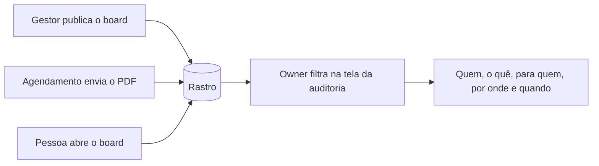

# Auditoria

> **Em uma frase:** saber, com prova, quem entregou o quê a quem no Horus e quem abriu, sem guardar o conteúdo.

## 🧭 O que é

**Como é hoje.** O Horus anota que alguém abriu um board (o painel de gráficos), mas só para contar o uso. Ninguém
consegue provar quem recebeu um relatório, quando e por onde.

**O que passa a existir.** Na v2.0, o **gestor**, quem responde por uma equipe, publica boards, e os agendamentos e
os agentes, os trabalhadores de IA, enviam PDFs e alertas por e-mail e WhatsApp. A Auditoria é o **rastro** disso:
cada entrega e cada abertura vira um registro de **quem fez, o quê, para quem, por onde e quando**. Só o **owner da
organização**, quem administra a organização no Horus (as pessoas, as preferências e os dados), o consulta.

**Como fica o dia a dia.** Ninguém preenche nada: o registro nasce com a entrega, e o owner o consulta quando
precisa.

> 💡 **Analogia:** é o livro de protocolo da recepção, que anota quem levou qual envelope a quem, e quando, sem abrir
> o envelope. **Onde a analogia para:** ninguém assina nada, e nem o owner rasura uma linha.

> 📌 **Exemplo (personagens ilustrativos):** o owner Marcos quer saber quem recebeu o board de vendas de outubro. A
> tela mostra que o gestor Pedro o publicou em 03/10 para o grupo "Vendas Sul", que duas pessoas o abriram em 04/10
> e que um agendamento enviou o PDF dele, por e-mail, a doze pessoas em 05/10.

## ✨ Características

- **O que registra:** os boards e relatórios publicados; o que cada agendamento ou agente enviou, por qual conector
  (o canal de saída: e-mail ou WhatsApp) e a quem; quem abriu cada board e relatório, e quando; e quem exportou uma
  conversa em PDF ou HTML, e quando.
- **O que não registra:** o conteúdo. As perguntas de análise, as respostas e os números entregues ficam de fora, e
  também o que havia na conversa exportada. O download de CSV, imagem ou PDF de uma resposta não entra.
- **Quem consulta:** só o owner da organização, que vê o rastro da organização inteira. Nem o gestor nem o **owner
  da instância**, o funcionário da Maind que administra o Horus em nuvem e vê todas as organizações por cima, o veem.
- **Como se consulta:** numa tela da organização, por pessoa, por board ou relatório, por conector e por período.
- **Não se altera:** nenhum registro se edita nem se apaga à mão, nem pelo owner; sem isso, o rastro não provaria
  nada. Só somem os que passam do prazo e os de quem é excluído da organização.
- **Nada escapa:** o registro é gravado no mesmo instante da entrega. Se ela aconteceu, o registro existe.
- **Quanto tempo fica:** o owner define, nas preferências da organização, entre 180 dias e cinco anos; o padrão é
  de 365 dias, e o que passa do prazo some de vez.
- **Anota as mudanças de prazo:** quem encurtou um prazo de guarda, e de quanto para quanto.
- **Cada organização guarda o seu.**
- **Quem é excluído** (sai ou é retirado da organização) leva os registros junto: o rastro do que entregou e do que
  abriu, os reportes de resposta errada que fez e o owner ainda não analisou, e a parte dela na contagem de perguntas
  respondidas são apagados com a pessoa. A Auditoria perde o que ela entregou e abriu; o total de perguntas
  respondidas da organização, na Home da organização (MF-117), não muda e fica sem ligação com ela.
- **As pessoas sabem:** o aviso de que a abertura é registrada vai num documento da organização, em PDF, sempre
  disponível para baixar. O Horus traz um texto padrão, já publicado, que o owner pode trocar pelo da empresa; a
  pessoa o encontra por um link, e o primeiro acesso não pede ciência, sem tela de "li e aceito".

## 📈 O valor que gera

- **Para quem usa:** o owner responde "quem recebeu o quê" sem pedir ajuda; o gestor consegue comprovar o que
  entregou, e a quem.
- **Para a empresa que contrata o Horus:** pode deixar os gestores publicarem e os agentes enviarem por canais de
  fora, porque confere depois. O **comprador**, quem aprova e paga a contratação, ganha prova para a conformidade e
  a LGPD, a lei de proteção de dados pessoais.
- **Para o Horus como produto:** fica vendável a empresas com exigência de conformidade.

**Como vamos saber que funcionou:** o owner descobre sozinho quem recebeu um board ou um alerta, e os compradores
corporativos pedem o rastro antes de liberar envios para fora.

## 🚶 Como se usa no Horus

**O owner da organização:**

1. Se quiser, troca o texto padrão do aviso de que a abertura é registrada pelo da empresa.
2. Define, nas preferências, por quantos dias o rastro fica guardado.
3. Quando surge a dúvida, abre a tela da auditoria.
4. Filtra por pessoa, board ou relatório, conector e período.
5. Lê quem fez, o quê, para quem, por onde e quando.

**O resto da organização** publica, recebe e abre como sempre; o rastro anota sozinho.

## 🧩 Grau de complexidade: média

Da v1 vem só um molde: a trilha que hoje registra os eventos de segurança. O registro e a tela do owner são novos,
sem ninguém de fora do Horus no caminho. Não mexe em permissões, mas as quatro macro funcionalidades (mfs) que
entregam gravam nele, e por isso ele nasce antes delas.

> ⚠️ É a leitura do PO a partir dos documentos de arquitetura. A estimativa de esforço é do arquiteto.

## 🔗 Macro funcionalidades relacionadas

| mf | Como se relaciona |
| --- | --- |
| Boards e Relatórios (MF-112) | **depende de**: publicar e abrir boards e relatórios é o que mais se registra. |
| Módulo de Agendamentos de Agentes (MF-114) e Agentes ativos (MF-115) | **depende de**: o que sai sozinho, e para quem, vem deles. |
| Conectores de Saída (MF-113) | **depende de**: dizem por onde cada entrega saiu, o e-mail ou o WhatsApp, com um registro por destinatário. |
| Organizações, pessoas e papéis (MF-102) | **depende de**: o owner, o gestor e as preferências da organização vêm daqui. |
| Chat pelo WhatsApp (MF-111) | **é a base de**: o chat pelo WhatsApp conta com o rastro; se o que a pessoa vê por lá entra nele é questão do desenho do arquiteto. |
| Administração da instância (MF-101) | **complementa**: o rastro de quem abriu e entregou o quê é daqui, só do owner de cada organização; a história que a administração da instância guarda é a da instância, sem conteúdo das organizações. |
| Segurança dos dados por pessoa (MF-106) | **complementa**: é uma mf da v2.1, e é ela que traz ao rastro o registro das liberações de dados do gestor, com o recorte do que ele vê. |
| Home da organização (MF-117) | **complementa**: a Home conta quanto o Horus é usado; a auditoria registra quem recebeu o quê. |
| Bases de demonstração (MF-118) | **complementa**: as organizações de exemplo ganham cenários para mostrar o rastro numa demonstração. |

## 🚧 O que ela não faz

- **Guardar o conteúdo** das perguntas de análise, das respostas e do que foi entregue.
- **Guardar o rastro de quem é excluído:** ele sai junto com a pessoa.
- **Abrir o rastro ao gestor ou ao owner da instância.**
- **Avisar de um comportamento suspeito** nem **exportar** o rastro para sistemas de fora.
- **Bloquear ou desfazer uma entrega:** ela só registra.
- **Registrar a liberação de dados do gestor:** na v2.0, todo board mostra os dados da organização inteira, e esse
  registro é da Segurança dos dados por pessoa (MF-106), na v2.1.

## ⏳ Ainda a decidir

- **A exclusão de quem sai:** se apagar o rastro dele convive com a guarda técnica do registro de acesso e as cópias
  de segurança (do arquiteto). No setup de cada organização, o cliente deve consultar o jurídico dele sobre isso.

## 📚 Para saber mais

- [Backlog estratégico](../../raw/produto/backlog-estrategico.md): `D-093`, a definição macro (fechou a `P-019`); a `P-044` (apagar o que é de quem sai e a guarda técnica do registro de acesso) e a `D-247` (o cliente consulta o jurídico dele no setup);
  `D-082`, a necessidade; `D-090`, o que se registra, com as leituras `D-090.1` e `D-090.2`; `D-091`, só o owner
  consulta, com a leitura `D-091.1`; `D-092`, o prazo, com as leituras `D-092.1` e `D-092.2`; `D-119`, a entrada na
  v2.0 (nota 41, acima do corte por decisão do dono); `D-122`, os agentes, os agendamentos e os conectores na v2.0;
  `D-054` e `D-059`, a responsabilidade do gestor; `D-064`, o agendamento do PDF ou do agente; `D-145`, a
  organização como fronteira dos dados na v2.0; `D-199`, o registro das liberações do gestor no rastro passa à
  `MF-106`, e esta mf fica inteira na v2.0 (`D-197`); `D-164`, o board público e o owner que o publicou; `D-193`, o
  usuário da instância é um funcionário da Maind, sem ver os dados das conexões; `D-099`, o Chat pelo WhatsApp
  depende da auditoria; `D-210`, quem é excluído leva o rastro, os reportes pendentes e a contagem dele (substitui a
  proposta de manter o rastro de quem pede a exclusão da conta); `D-211`, o total da organização segue como número
  sem dono; `D-231`, o texto padrão do aviso de abertura, que o owner pode trocar, sem ciência no primeiro acesso;
  `P-008`, letra (w).
- [A v2.0 consolidada](../../raw/produto/05-v2.0-consolidada.md): §2, §3.1 (candidata nº 17), §4 (passo 10), §5.8 (as
  regras), §7 (as dependências), §8 (o risco da LGPD) e §10, parte B (as leituras da Auditoria).
  [Mapa das mfs](../../raw/produto/04-macro-funcionalidades-de-hoje.md): a tabela de conversão e "O que o dono já
  disse". [Versões](../../raw/produto/06-versoes.md), [objetivos](../../raw/produto/07-mapa-de-objetivos-e-funcionalidades.md)
  (O2) e [lacunas](../../raw/produto/03-inventario-de-lacunas.md) (candidata 17).
- Arquitetura: [estratégia](../../raw/arquitetura/01-estrategia-da-solucao.md) (§3, O2; §4; §6, os marcos M1 e M7);
  [software](../../raw/arquitetura/04-software.md) (o registro do rastro na Plataforma, a consulta em Prova e controle,
  o contrato do registro); [dados](../../raw/arquitetura/06-dados.md) (§3.3, os prazos; §3.4, a saída de uma pessoa);
  [segurança](../../raw/arquitetura/07-seguranca.md) (§3.5, a liberação do gestor, que é da `MF-106`, na v2.1; §3.6, a
  LGPD);
  [registro](../../raw/arquitetura/02-registro-de-decisoes.md): `ARQ-009` (o registro só de acréscimo), `ARQ-012` (o
  registro antecipado), `ARQ-035` ✅ (os prazos; o do rastro, com padrão de 365 dias, de 180 a 1.825), `ARQ-042` (a liberação com o recorte, na `MF-106`), `ARQ-043` (o
  documento da organização) e `ARQ-090` (a `MF-106` inteira na v2.1);
  [conferência](../../raw/arquitetura/14-conferencia-do-produto.md): §1, letra (w) ✅; §2, a candidata 17 corrigida
  para "existe em parte"; §3, o reaproveitamento; §4, `A-05`, `A-16`, `A-27`, `A-28` e `A-30`.
