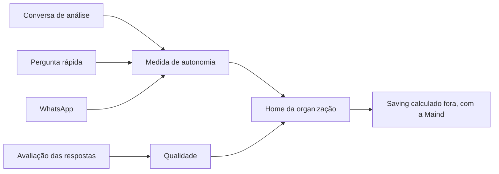

# Home da organização

> **Em uma frase:** ver, na tela de entrada da organização, quantas perguntas de análise o Horus respondeu e o que
> as pessoas acharam das respostas.

## 🧭 O que é

**Como é hoje.** A Home é a tela de entrada da organização: um painel com cerca de 60 indicadores de uso, como
consumo, erros, adoção e fontes. O **owner da organização**, quem administra a organização no Horus (as pessoas, as
preferências e os dados), monta a grade, e todos veem o que ele montou. Nenhum indicador diz de onde veio cada
resposta nem se ela foi boa.

**O que passa a existir.** A **medida de autonomia**: a contagem das **perguntas de análise** respondidas, as que as
pessoas fazem ao Horus sobre os números da empresa, ao lado da **qualidade**, a proporção de 👍🏻, 👎🏻 e 🚫 que
elas deram às respostas. Ela soma todos os lugares onde se pergunta.

**Como fica o dia a dia.** O owner vê onde o Horus é usado e onde a qualidade cai. O **saving**, a economia da área
de dados que deixa de montar relatório sob encomenda, a Maind calcula fora do produto, com cada cliente.

> 💡 **Analogia:** é o hodômetro do carro: conta os quilômetros, mas não diz quanto se economizou de táxi; essa conta
> se faz fora, com a Maind. **Onde a analogia para:** o hodômetro não sabe se a viagem foi boa, e a Home sabe.

> 📌 **Exemplo (personagens ilustrativos):** o owner Marcos abre a Home e vê que, em outubro, a organização teve
> 1.200 perguntas de análise respondidas, com 85% de 👍🏻 entre as avaliadas, e que a área do Sul pergunta pouco. Com
> a Maind, ele compara o número com os cerca de 300 pedidos por mês que o time de dados atendia antes e chega ao
> saving.

## ✨ Características

- **Onde aparece:** na Home, ao lado dos indicadores de hoje.
- **O que conta:** toda pergunta de análise respondida, com gráfico, texto ou os dois, na conversa de análise, na
  Pergunta rápida (MF-110), salva ou não, e no Chat pelo WhatsApp (MF-111).
- **O que não conta:** a pergunta de análise que o Horus disse não conseguir responder, e o que os agentes, os
  trabalhadores de IA, perguntam sozinhos.
- **Conta sem julgar:** a resposta de que a pessoa não gostou também conta; a satisfação aparece na qualidade.
- **A qualidade:** a proporção de 👍🏻 Gostei, 👎🏻 Não gostei e 🚫 Reportar entre as respostas avaliadas.
- **Quem vê o detalhe:** o owner vê o total e a divisão por **gestor**, quem responde por uma equipe, e por pessoa.
- **Sem conteúdo:** a contagem guarda o canal e o desfecho de cada resposta, nunca o texto.
- **Começa do zero:** a medida nasce com a v2.0; o uso de teste da versão de hoje não vem junto.
- **Quanto tempo fica:** 400 dias por padrão, para comparar um mês com o mesmo mês do ano anterior; o owner pode
  estender o prazo nas preferências da organização.

## 📈 O valor que gera

- **Para quem usa:** o owner decide onde expandir o uso (as áreas que perguntam pouco) e onde corrigir (onde se
  juntam os 👎🏻 e os reportes).
- **Para a empresa que contrata o Horus:** o **comprador**, quem aprova e paga a contratação, acompanha quantas
  perguntas de análise se resolvem no Horus e, com a Maind, chega ao saving.
- **Para o Horus como produto:** a adoção vira um número, e isso sustenta a renovação e a compra de mais assentos
  nas Licenças e planos (MF-103).

**Como vamos saber que funcionou:** o comprador vê a autonomia subir semana a semana e aceita ver o saving num
relatório da Maind. O sinal de alerta é a contagem subir sem cair o número de pedidos ao time de dados.

## 🚶 Como se usa no Horus

**Quem pergunta** (o owner, o gestor e o **membro full**, que pergunta e cria os próprios boards) não faz nada a
mais: a resposta e a avaliação entram sozinhas.

**O owner da organização:**

1. Monta a grade da Home com os indicadores que quer ver.
2. Escolhe o período e vê as respondidas, a qualidade e a divisão por gestor e por pessoa.
3. Decide onde expandir o uso e onde corrigir.
4. Com a Maind, compara com os pedidos de antes e chega ao saving.

## 🧩 Grau de complexidade: baixa

Quase tudo vem da v1: os registros de uso, o catálogo de indicadores e a grade do owner. O novo é a soma das
respondidas e da qualidade em todos os canais, com cada resposta passando a registrar o canal e o desfecho. Depende
de outras macro funcionalidades (mfs) prontas, como a conversa, a avaliação, a Pergunta rápida e o WhatsApp, e de
ninguém de fora do Horus.

> ⚠️ É a leitura do PO a partir dos documentos de arquitetura. A estimativa de esforço é do arquiteto.

## 🔗 Macro funcionalidades relacionadas

| mf | Como se relaciona |
| --- | --- |
| Perguntar aos dados em português (MF-107) | **depende de**: cada pergunta de análise respondida e cada 👍🏻, 👎🏻 ou 🚫 nascem na conversa de análise. |
| Pergunta rápida (MF-110) | **depende de**: as perguntas de análise do popup contam, salvas ou não. |
| Chat pelo WhatsApp (MF-111) | **depende de**: as perguntas de análise feitas pelo WhatsApp também contam. |
| Organizações, pessoas e papéis (MF-102) | **depende de**: a divisão por gestor vem da equipe de cada um. |
| Licenças e planos (MF-103) | **é a base de**: a adoção medida sustenta a renovação e a compra de mais assentos. |
| Auditoria (MF-116) | **complementa**: a Home conta quanto o Horus é usado; a auditoria registra quem recebeu o quê. |
| Bases de demonstração (MF-118) | **complementa**: é nas organizações de exemplo que a medida aparece antes de haver cliente. |

## 🚧 O que ela não faz

- **Calcular o saving** no produto, nem pedir ao owner um ponto de partida para estimá-lo.
- **Ligar-se ao sistema de chamados** do cliente.
- **Mostrar o tempo ganho** frente ao pedido ao time de dados: essa comparação também se faz com a Maind.

## ⏳ Ainda a decidir

- **O que conta como respondida** quando a consulta volta vazia, dá erro ou a conversa não usa dado nem web.
- **Quem mais vê a medida:** se o gestor vê a da própria equipe, e como o comprador a acompanha.
- **A divisão por canal:** se a Home mostra quantas vieram da conversa, do popup e do WhatsApp.

## 📚 Para saber mais

- [Backlog estratégico](../../raw/produto/backlog-estrategico.md): `D-133`, a definição macro da medida de autonomia
  (fechou a `P-023`, letra d); `D-132`, o produto mostra só o que mede e o saving se calcula fora, com a leitura
  `D-132.1` (a Maind faz a conta); `D-004`, o que é uma pergunta de análise respondida; `D-005` e `D-129`, o retorno
  do usuário; `D-087`, a Pergunta rápida conta, salva ou não; `D-095`, o WhatsApp conta; `D-125`, "em segundos" é
  comparação; `D-021`, a base herdada; `D-105`, a candidata nº 4 (nota 66, essencial); `P-008`, letras (b) e (y);
  `P-001`, dispensada.
- [A v2.0 consolidada](../../raw/produto/05-v2.0-consolidada.md): §1 ("Como saberemos"), §3.1 (candidata nº 4), §3.2 (a
  base herdada), §4 (passo 11), §7 (as dependências) e §8 (o risco do saving fora do produto).
  [Mapa das mfs](../../raw/produto/04-macro-funcionalidades-de-hoje.md): o mapa, a tabela de conversão e "O que salta
  aos olhos". [Norte](../../raw/produto/02-norte-do-produto.md) ("Como saberemos que deu certo"),
  [versões](../../raw/produto/06-versoes.md), [objetivos](../../raw/produto/07-mapa-de-objetivos-e-funcionalidades.md) (O6) e
  [lacunas](../../raw/produto/03-inventario-de-lacunas.md) (candidata 4).
- Arquitetura: [estratégia](../../raw/arquitetura/01-estrategia-da-solucao.md) (§3, O6; §4; §5, "Uso, Home e rastro";
  §6, o marco M7); [software](../../raw/arquitetura/04-software.md) (o registro de uso, o fecho do turno, a medida de
  autonomia e qualidade, a Home); [motor](../../raw/arquitetura/05-motor-de-analise-e-ia.md) (§3.8, o retorno, o reporte
  e a medida); [dados](../../raw/arquitetura/06-dados.md) (§3.3, os prazos dos fatos de uso; §3.5, o que não vem da
  v1.xx); [observabilidade](../../raw/arquitetura/11-observabilidade.md) (§3.5: a medida não é telemetria);
  [registro](../../raw/arquitetura/02-registro-de-decisoes.md): `ARQ-011` (a medida começa na v2.0), `ARQ-013` (o tempo
  medido por dentro, sem virar promessa), `ARQ-029` (a contagem no fecho do turno) e `ARQ-035` (os prazos);
  [conferência](../../raw/arquitetura/14-conferencia-do-produto.md): §1, letra (b) ⚠️; §3, o reaproveitamento; §4,
  `A-08` (os casos de borda) e `A-26`.
