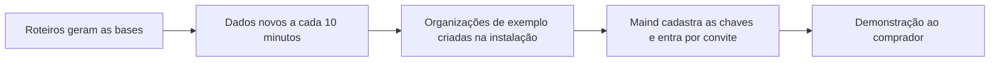

# Bases de demonstração

> **Em uma frase:** mostrar o Horus respondendo sobre os números de empresas que não existem, para vender sem tocar
> nos dados de ninguém e para testar o produto antes de cada entrega.

## 🧭 O que é

**Como é hoje.** O Horus já tem bancos de dados de empresas fictícias: uma rede de lojas, em quatro bases, uma frota
e a DRE de uma usina (o demonstrativo de receitas, custos e lucro). Os números saem de roteiros fixos, que dão sempre
o mesmo resultado, e verificadores conferem se fazem sentido. Parte deles chega a cada 10 minutos, como se as lojas
estivessem vendendo agora.

**O que passa a existir.** As bases ganham os cenários das provas de valor da v2.0: os agentes, o WhatsApp e o
rastro da Auditoria (MF-116). E as duas **organizações de exemplo**, a da rede de lojas (McDonald's) e a da frota
(Global Fleet), passam a nascer prontas em qualquer instalação do Horus, com as fontes, os modelos semânticos (o
dicionário que explica ao Horus o que cada tabela e cada termo significam), os membros de exemplo e os boards.

**Como fica o dia a dia.** A Maind, que no Horus em nuvem é o **owner da instância** (quem cuida da instalação
inteira e da marca), entra nelas por convite e demonstra o produto ao **comprador**, quem aprova e paga a
contratação.

> 💡 **Analogia:** é o apartamento decorado do estande de vendas, mobiliado para o comprador se imaginar morando ali.
> **Onde a analogia para:** aqui o apartamento funciona de verdade; as perguntas de análise rodam num banco real, e
> só os dados são inventados.

> 📌 **Exemplo (personagens ilustrativos):** numa demonstração, a Júlia, da Maind, entra na organização da rede de
> lojas e pergunta quanto cada região vendeu ontem. O gráfico chega com os pedidos de minutos atrás. Depois, ela
> mostra a Home da organização (MF-117), com a **medida de autonomia**, a contagem das perguntas de análise que o
> Horus respondeu.

## ✨ Características

- **Dados inventados, números plausíveis:** nada é de cliente; os roteiros dão sempre o mesmo resultado, e os
  verificadores de cada ramo conferem os números.
- **Dado que se move:** parte das bases recebe dados a cada 10 minutos, para haver "ontem" e "hoje".
- **Prontas em qualquer instalação:** um comando cria as organizações de exemplo do zero; rodado de novo, não
  duplica nada nem desfaz o que a Maind ajustou na tela.
- **Sem segredos:** as chaves de IA e do WhatsApp não vêm junto; cada instalação cadastra as suas.
- **Uma vitrine só:** as bases ficam num servidor da Maind e servem, só para leitura, a todas as instalações dela.
- **Só para demonstração e prova:** só as organizações de exemplo as veem; nunca viram fonte de um cliente.
- **Banco de prova:** cada etapa da construção da v2.0 só se dá por pronta quando funciona nessas bases.
- **Sem a segurança por pessoa até a v2.1:** na v2.0, toda consulta usa os dados da organização inteira, e a Maind
  não demonstra o "cada um vê só o que pode"; as regras de exemplo esperam a Segurança dos dados por pessoa (MF-106).
- **Começam limpas:** conversas, consumo, uso e rastro da versão de hoje não vêm; a medida de autonomia começa do
  zero.

## 📈 O valor que gera

- **Para quem usa:** a Maind demonstra a v2.0 sem montar nada à mão e sem pedir dado a ninguém.
- **Para a empresa que contrata o Horus:** o comprador vê o Horus responder, publicar e avisar antes de ligar os
  bancos da empresa.
- **Para o Horus como produto:** apoio à venda e, até o primeiro cliente usar a v2.0, o lugar onde o Horus aprende
  e se testa.

**Como vamos saber que funcionou:** a vitrine sai igual e completa em toda instalação, e toda prova de valor da v2.0
se demonstra nela.

## 🚶 Como se usa no Horus

**A Maind, como owner da instância:**

1. Os roteiros geram as bases, e a carga de 10 em 10 minutos as mantém em dia.
2. O comando monta as organizações de exemplo na instalação nova.
3. A Maind cadastra as chaves de IA e convida a própria equipe.
4. Na demonstração, mostra ao comprador a conversa, os boards, o WhatsApp, os agentes, a auditoria e a Home.

## 🧩 Grau de complexidade: baixa

Vem inteiro da v1: as bases, os roteiros, a carga contínua e os verificadores. São novos os cenários da v2.0 e o
comando que cria as organizações de exemplo, feito a partir de um roteiro de cópia que a Maind já usa. Ninguém de
fora entra no caminho; o cuidado é manter o comando em dia quando muda o jeito de o Horus guardar os dados.

> ⚠️ É a leitura do PO a partir dos documentos de arquitetura. A estimativa de esforço é do arquiteto.

## 🔗 Macro funcionalidades relacionadas

| mf | Como se relaciona |
| --- | --- |
| Conectar as fontes vivas (MF-104) | **depende de**: as bases entram nas organizações de exemplo como fontes comuns, pelos mesmos conectores dos clientes. |
| Organizações, pessoas e papéis (MF-102) | **depende de**: os membros de exemplo chegam com papel, tipo de assento, gestor e roles. |
| Home da organização (MF-117) | **é a base de**: é nas organizações de exemplo que a medida de autonomia aparece antes de haver cliente. |
| Auditoria (MF-116) | **é a base de**: ganha um cenário para mostrar o rastro numa demonstração. |
| Chat pelo WhatsApp (MF-111) e Agentes ativos (MF-115) | **é a base de**: ganham cenários próprios para as provas de valor da v2.0. |
| Segurança dos dados por pessoa (MF-106) | **complementa**, na v2.1: as regras de exemplo esperam guardadas para voltar com ela. |

## 🚧 O que ela não faz

- **Servir de fonte a um cliente** ou ir à instalação de um contratante, salvo pedido.
- **Demonstrar a segurança dos dados por pessoa** na v2.0: isso volta na v2.1.
- **Trazer as outras organizações de hoje**, as pessoas, as conversas e o histórico de uso.

## ⏳ Ainda a decidir

- **O que os boards de exemplo mostram:** a hipótese é ficarem no espaço da organização, publicados.
- **Os cenários da v2.0:** o inventário cita os agentes, o WhatsApp e o rastro, sem dizer o que cada um mostra.
- **A DRE de usina:** só duas organizações de exemplo chegam à v2.0, e não se diz se a usina segue na vitrine.

## 📚 Para saber mais

- [Backlog estratégico](../../raw/produto/backlog-estrategico.md): `D-021`, a base herdada; `D-109` e a leitura
  `D-109.2`, até a v2.0 completa o aprendizado vem das bases e do uso interno da Maind; `D-134`, a v1.xx como ponto
  de partida; `D-139` "Tabela de conversão das mfs…", "apoio à venda e às provas, sem que nada dependa dela".
- [A v2.0 consolidada](../../raw/produto/05-v2.0-consolidada.md): §1 (mf a mf), §3.2 (a base herdada), §8 (o primeiro
  valor só no fim) e §10, parte A (`D-109.2`). [Mapa das mfs](../../raw/produto/04-macro-funcionalidades-de-hoje.md): o
  mapa ("apoio à venda") e a tabela de conversão. [Versões](../../raw/produto/06-versoes.md) e
  [objetivos](../../raw/produto/07-mapa-de-objetivos-e-funcionalidades.md) (O6).
- Arquitetura: [estratégia](../../raw/arquitetura/01-estrategia-da-solucao.md) (§3, O6; §4; §5, a camada das bases; §6,
  as bases como prova de cada marco); [software](../../raw/arquitetura/04-software.md) (as bases fora do executável);
  [dados](../../raw/arquitetura/06-dados.md) (§3.5, o que chega à v2.0 e como se semeia);
  [infraestrutura](../../raw/arquitetura/09-infraestrutura-e-ambientes.md) (§3.7, as bases; a verificação `V-05`, a
  licença do SQL Server Developer); [qualidade](../../raw/arquitetura/12-qualidade-e-testes.md) (o banco de prova e a
  conferência do semeador); [registro](../../raw/arquitetura/02-registro-de-decisoes.md): `ARQ-011` (a instância nova,
  só com as organizações de exemplo), `ARQ-012` (os marcos provados nas bases), `ARQ-059` (uma base só, só para
  demonstração e prova), `ARQ-089` (o semeador) e `ARQ-090` (a segurança por pessoa na v2.1);
  [conferência](../../raw/arquitetura/14-conferencia-do-produto.md): §3, o reaproveitamento; §4, `A-14` (o que os
  boards de exemplo mostram) e `A-28`.
