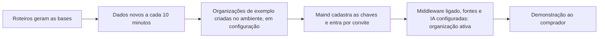

# Bases de demonstração

> **Em uma frase:** mostrar o Horus respondendo sobre os números de empresas que não existem, para vender sem tocar
> nos dados de ninguém e para testar o produto antes de cada entrega.

## 🧭 O que é

**Como é hoje.** O Horus já tem bancos de dados de empresas fictícias: uma rede de lojas, em quatro bases, uma frota
e a DRE de uma usina (o demonstrativo de receitas, custos e lucro). Os números saem de roteiros fixos, que dão sempre
o mesmo resultado, e verificadores conferem se fazem sentido. Parte deles chega a cada 10 minutos, como se as lojas
estivessem vendendo agora.

**O que passa a existir.** Cada prova de valor da v2.0 ganha um cenário nas bases, da conversa aos agentes, ao
WhatsApp e ao rastro da Auditoria (MF-116). A vitrine fica só com as duas **organizações de exemplo**, a da rede de
lojas (McDonald's) e a da frota (Global Fleet), e a DRE de usina sai dela. As duas passam a nascer prontas em todo
ambiente do Horus, do de testes ao de produção, com as fontes, os modelos semânticos (o dicionário que explica ao
Horus o que cada tabela e cada termo significam), os membros de exemplo e os boards. Como toda organização, cada uma
nasce em configuração e só passa a ativa depois de três condições: o middleware ligado, ao menos uma fonte e a IA
configuradas.

**Como fica o dia a dia.** A Maind, pelo **owner da instância** (o funcionário dela que administra o Horus em nuvem
e vê todas as organizações por cima), entra nelas por convite e demonstra o produto ao **comprador**, quem aprova e
paga a contratação.

> 💡 **Analogia:** é o apartamento decorado do estande de vendas, mobiliado para o comprador se imaginar morando ali.
> **Onde a analogia para:** aqui o apartamento funciona de verdade; as perguntas de análise rodam num banco real, e
> só os dados são inventados.

> 📌 **Exemplo (personagens ilustrativos):** numa demonstração, a Júlia, da Maind, entra na organização da rede de
> lojas e pergunta quanto cada região vendeu ontem. O gráfico chega com os pedidos de minutos atrás. Depois, ela
> mostra a Home da organização (MF-117), com a **medida de autonomia**, a contagem das perguntas de análise que o
> Horus respondeu.

## ✨ Características

- **Dados inventados, números plausíveis:** nada é de cliente; os roteiros dão sempre o mesmo resultado, e os
  verificadores de cada ramo conferem os números.
- **Dado que se move:** parte das bases recebe dados a cada 10 minutos, para haver "ontem" e "hoje".
- **Prontas em qualquer ambiente:** um comando cria as organizações de exemplo do zero; rodado de novo, não
  duplica nada nem desfaz o que a Maind ajustou na tela.
- **Sem segredos:** as chaves de IA e do WhatsApp não vêm junto; a Maind as cadastra em cada ambiente (🔎 a
  confirmar com o dono; ver "Ainda a decidir").
- **Uma vitrine só:** as bases ficam num servidor da Maind e servem, só para leitura, a todos os ambientes dela.
- **Só para demonstração e prova:** só as organizações de exemplo as veem; nunca viram fonte de um cliente.
- **Banco de prova:** cada etapa da construção da v2.0 só se dá por pronta quando funciona nessas bases.
- **Sem a segurança por pessoa:** na v2.0, toda consulta usa os dados da organização inteira, e a Maind não
  demonstra o "cada um vê só o que pode"; essa demonstração, com as regras de exemplo, é parte da Segurança dos
  dados por pessoa (MF-106), uma mf da v2.1.
- **Começam limpas:** conversas, consumo, uso e rastro da versão de hoje não vêm; a medida de autonomia começa do
  zero.
- **Um cenário por prova de valor:** cada uma das outras mfs da v2.0 ganha, nas organizações de exemplo, um cenário
  que mostra o que ela promete:

| mf | O cenário mostra |
| --- | --- |
| Administração da instância (MF-101) | a administração com os assentos, o uso e o custo de cada organização de exemplo, sem ler conversa, e um aviso da instância passando na faixa. |
| Organizações, pessoas e papéis (MF-102) | o owner da organização (o funcionário do cliente que a configura), a gestora (quem responde por uma equipe) e a equipe dela, com os convites aprovados; um grupo que abre um board e recebe relatórios e alertas; e um estagiário com role restrita (o perfil que liga ou desliga o que a pessoa usa), que pergunta sem baixar nada. |
| Licenças e planos (MF-103) | membros de exemplo em cada tipo de assento: o ouro cria boards para si, o prata pergunta sem criar nada e o bronze só abre os boards compartilhados; e a cobrança do owner, com quantos assentos de cada tipo a organização tem, usa e tem livres. |
| Conectar as fontes vivas (MF-104) | as bases como fontes comuns, com o modelo semântico: o número sai do banco na hora, e uma organização de exemplo não enxerga a fonte da outra. |
| IA sob controle da organização (MF-105) | o owner escolhe, entre os modelos que a organização tem, o padrão e um mais forte para montar a consulta, e a gestora troca o modelo numa pergunta difícil. |
| Perguntar aos dados em português (MF-107) | a pergunta em português com o gráfico na hora, o retorno 👍🏻, 👎🏻 ou 🚫 e o reporte que chega ao owner. |
| Respostas visuais (MF-108) | um indicador, um gráfico e um texto curto na mesma resposta, e o mesmo gráfico igual na tela, na imagem do WhatsApp e no PDF. |
| A web como fonte (MF-109) | com a pesquisa na web ligada, o número da empresa ao lado de um índice de fora, como a inflação do mês, com o link e a data. |
| Pergunta rápida (MF-110) | num board, o botão flutuante responde por que um número caiu, sem sair da tela, e a conversa limpa sem salvar conta assim mesmo na Home. |
| Chat pelo WhatsApp (MF-111) | a pergunta pelo WhatsApp com o resumo, o gráfico em imagem e o link para o app, e a resposta fixa que o membro bronze recebe quando escreve; depende de haver uma conta de WhatsApp de exemplo 🔎. |
| Boards e Relatórios (MF-112) | o board publicado para a equipe e a mesma montagem em PDF, sem refazer nada. |
| Conectores de Saída (MF-113) | o conector de e-mail ligado uma vez, o PDF da semana chegando ao grupo por e-mail e o alerta chegando ao WhatsApp da gestora. |
| Módulo de Agendamentos de Agentes (MF-114) | o PDF de um board agendado para um grupo todo dia 1º, e o mesmo envio barrado quando um membro ouro tenta mandá-lo a outra pessoa. |
| Agentes ativos (MF-115) | o agente que, toda segunda, entrega ao grupo um PDF com gráficos e avisa a gestora no WhatsApp quando as vendas caem mais de 10%, com o rótulo do nível de inferência (o quanto ele afirma além dos dados). |
| Auditoria (MF-116) | o rastro que mostra quem publicou um board, quem o abriu e a quem um agendamento enviou o PDF por e-mail. |
| Home da organização (MF-117) | a medida de autonomia e a qualidade das perguntas feitas nas organizações de exemplo, com a divisão por canal e por gestor. |
| Faixa de avisos e números (MF-120) | o aviso da instância, uma caixa de texto livre do owner e cards de número das métricas do modelo semântico; a pessoa pausa a faixa e abre um número para ver a origem e o período. |

## 📈 O valor que gera

- **Para quem usa:** a Maind demonstra a v2.0 sem montar nada à mão e sem pedir dado a ninguém.
- **Para a empresa que contrata o Horus:** o comprador vê o Horus responder, publicar e avisar antes de ligar os
  bancos da empresa.
- **Para o Horus como produto:** apoio à venda e, até o primeiro cliente usar a v2.0, o lugar onde o Horus aprende
  e se testa.

**Como vamos saber que funcionou:** a vitrine sai igual e completa em todo ambiente, e toda prova de valor da v2.0
se demonstra nela.

## 🚶 Como se usa no Horus

**A Maind, como owner da instância:**

1. Os roteiros geram as bases, e a carga de 10 em 10 minutos as mantém em dia.
2. O comando monta as organizações de exemplo em cada ambiente novo.
3. A Maind cadastra as chaves de IA e convida a própria equipe.
4. Com o middleware ligado, as fontes e a IA configuradas, cada organização de exemplo passa a ativa.
5. Na demonstração, percorre com o comprador os cenários: a conversa, a Pergunta rápida, os boards, o WhatsApp, os
   agentes, a auditoria, a faixa e a Home.

## 🧩 Grau de complexidade: baixa

Vem inteiro da v1: as bases, os roteiros, a carga contínua e os verificadores. São novos os cenários da v2.0 e o
comando que cria as organizações de exemplo, feito a partir de um roteiro de cópia que a Maind já usa. Ninguém de
fora entra no caminho; o cuidado é manter o comando em dia quando muda o jeito de o Horus guardar os dados.

> ⚠️ É a leitura do PO a partir dos documentos de arquitetura. A estimativa de esforço é do arquiteto.

## 🔗 Macro funcionalidades relacionadas

| mf | Como se relaciona |
| --- | --- |
| Conectar as fontes vivas (MF-104) | **depende de**: as bases entram nas organizações de exemplo como fontes comuns, pelos mesmos conectores dos clientes. |
| Organizações, pessoas e papéis (MF-102) | **depende de**: os membros de exemplo chegam com papel, tipo de assento, gestor e roles. |
| Home da organização (MF-117) | **complementa**: é nas organizações de exemplo que a medida de autonomia aparece antes de haver cliente. |
| Auditoria (MF-116) | **complementa**: ganha um cenário para mostrar o rastro numa demonstração. |
| Licenças e planos (MF-103) | **complementa**: os membros de exemplo ocupam todos os tipos de assento, inclusive a prata e o bronze, para mostrar o que cada um faz. |
| Chat pelo WhatsApp (MF-111), Agentes ativos (MF-115), Pergunta rápida (MF-110) e Faixa de avisos e números (MF-120) | **complementam**: ganham cenários próprios para as provas de valor da v2.0, como as demais mfs da versão. |
| Segurança dos dados por pessoa (MF-106) | **complementa**: é uma mf da v2.1, e a demonstração da segurança por pessoa, com as regras de exemplo, é parte dela. |

## 🚧 O que ela não faz

- **Servir de fonte a um cliente** nem ir à organização de um cliente.
- **Trazer a DRE de usina** à vitrine da v2.0: ficam só a rede de lojas e a frota.
- **Demonstrar a segurança dos dados por pessoa:** essa demonstração é parte da Segurança dos dados por pessoa
  (MF-106), da v2.1.
- **Trazer as outras organizações de hoje**, as pessoas, as conversas e o histórico de uso.

## ⏳ Ainda a decidir

- **Quem cadastra as chaves de IA nas organizações de exemplo:** em toda organização, quem configura a IA, inclusive
  a chave que a Maind dá, é o owner dela; falta dizer quem é o owner das organizações de exemplo e se é ele quem
  cadastra as chaves que esta página põe com a Maind. 🔎 a confirmar com o dono

## 📚 Para saber mais

- [Backlog estratégico](../../raw/produto/backlog-estrategico.md): `D-021`, a base herdada; `D-109` e a leitura
  `D-109.2`, até a v2.0 completa o aprendizado vem das bases e do uso interno da Maind; `D-134`, a v1.xx como ponto
  de partida; `D-139 (tabela de conversão)`, "apoio à venda e às provas, sem que nada dependa dela";
  `D-145`, a organização como fronteira dos dados na v2.0; `D-199`, a demonstração da segurança por pessoa passa à
  `MF-106`, e esta mf fica inteira na v2.0 (`D-197`); `D-193`, o SaaS como uma instância só, da Maind, cujo
  funcionário a administra; `D-232`, um cenário para cada prova de valor da v2.0, com a lista escrita nesta página,
  e os boards de exemplo publicados no espaço da organização (`D-245`); `D-233`, a vitrine da v2.0 só com a rede
  de lojas e a frota, e a DRE de usina fora; `D-277`, toda organização nasce em configuração e só passa a ativa com
  o middleware ligado, ao menos um banco e a IA configurados, e as organizações de exemplo também precisam cumprir as
  condições; `D-273`, quem configura os bancos e a IA é o owner da organização (🔎 quem é o owner das organizações
  de exemplo).
- [A v2.0 consolidada](../../raw/produto/05-v2.0-consolidada.md): §1 (mf a mf), §3.2 (a base herdada), §8 (o primeiro
  valor só no fim) e §10, parte A (`D-109.2`). [Mapa das mfs](../../raw/produto/04-macro-funcionalidades-de-hoje.md): o
  mapa ("apoio à venda") e a tabela de conversão. [Versões](../../raw/produto/06-versoes.md) e
  [objetivos](../../raw/produto/07-mapa-de-objetivos-e-funcionalidades.md) (O6).
- Arquitetura: [estratégia](../../raw/arquitetura/01-estrategia-da-solucao.md) (§3, O6; §4; §5, a camada das bases; §6,
  as bases como prova de cada marco); [software](../../raw/arquitetura/04-software.md) (as bases fora do executável);
  [dados](../../raw/arquitetura/06-dados.md) (§3.5, o que chega à v2.0 e como se semeia);
  [infraestrutura](../../raw/arquitetura/09-infraestrutura-e-ambientes.md) (§3.7, as bases; a verificação `V-05`, a
  licença do SQL Server Developer); [qualidade](../../raw/arquitetura/12-qualidade-e-testes.md) (o banco de prova e a
  conferência do semeador); [registro](../../raw/arquitetura/02-registro-de-decisoes.md): `ARQ-011` (a instância nova,
  só com as organizações de exemplo), `ARQ-012` (os marcos provados nas bases), `ARQ-059` (uma base só, só para
  demonstração e prova), `ARQ-089` (o semeador) e `ARQ-090` (a `MF-106` inteira na v2.1);
  [conferência](../../raw/arquitetura/14-conferencia-do-produto.md): §3, o reaproveitamento; §4, `A-14` (o que os
  boards de exemplo mostram; a DRE de usina, respondida pela `D-233`) e `A-28`.
