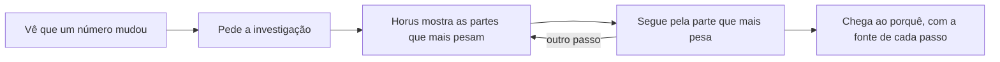

# Investigação guiada

> **Em uma frase:** ver que um número mudou e chegar ao porquê, passo a passo, com o Horus mostrando o caminho.

## 🧭 O que é

Hoje, quando uma resposta do Horus mostra que um número mudou, achar o porquê depende de a pessoa saber qual
**pergunta de análise**, uma pergunta sobre os números da empresa, fazer em seguida. Ajudam as sugestões de próxima
pergunta e a Análise avançada (uma segunda leitura, mais demorada), mas não há um caminho do "o que mudou" ao "por
quê".

A Investigação guiada cria esse caminho: a pessoa vê que algo mudou, pede a investigação, e o Horus a leva, passo a
passo, até a causa. **Esta macro funcionalidade (mf) está em definição:** a necessidade e a entrega na v2.1 estão
decididas, o desenho ainda não, e o que esta página traz além disso é proposta, marcada como tal.

No dia a dia, o gestor segue o fio na própria reunião, em vez de esperar dias pelo relatório da área de dados.

> 💡 **Analogia:** a fatura do cartão veio R$ 400 mais alta; o extrato mostra R$ 300 a mais no supermercado, e o
> supermercado, duas compras grandes. Cada passo apontou o próximo. **Onde a analogia para:** o Horus só enxerga o que
> está nas fontes; um concorrente que abriu na rua não aparece como fato.

> 📌 **Exemplo (proposta):** na reunião de resultado, a gestora Carla vê a margem do Sul cair e pede a investigação.
> Em minutos, o Horus mostra que três lojas e um produto explicam a queda, cada passo com a fonte.

## ✨ Características

- **O que a dispara:** um número que mudou, como uma margem que caiu ou uma venda acima do esperado.
- **O caminho:** um passo de cada vez, do "o que mudou" ao "por quê", sem a pessoa ter de adivinhar a próxima
  pergunta.
- **Como quebra a variação (proposta):** nas partes que mais pesam nela, como loja, produto e período.
- **Até onde enxerga:** só as partes que o **modelo semântico** de cada fonte descreve, o dicionário que explica ao
  Horus o que cada coluna significa na empresa; o que ele não descreve fica fora.
- **A fonte de cada passo:** cada passo mostra de onde veio o número, como toda resposta do Horus.
- **Fato e palpite separados:** nos níveis de inferência (até onde a resposta vai além dos dados, de 1 a 5), a causa
  vinda de fora dos dados só aparece a partir do 4, rotulada como hipótese; o fato da web entra com link e data.
- **O mesmo Horus da conversa:** é um jeito novo de o Horus responder, com as mesmas fontes e as mesmas regras de
  confiança da **conversa de análise**, a tela principal em que se pergunta.
- **Quem ganha (proposta):** o gestor de área, o gerente ou coordenador que hoje espera a área de dados montar o
  relatório.
- **Quando chega:** na v2.1, a entrega que vem depois da v2.0.

## 📈 O valor que gera

- **Para quem usa:** chegar sozinho ao porquê de uma variação, em vez de esperar dias por um chamado.
- **Para a empresa que contrata o Horus:** menos chamados à área de dados, a economia que o comprador paga.
- **Para o Horus como produto:** completa a promessa de responder na hora, explicar o porquê e avisar quando algo
  muda. A v2.0 entrega a primeira e a terceira partes; esta é a segunda.

**Como vamos saber que funcionou (proposta):** o gestor chega ao porquê de uma variação sem abrir chamado à área de
dados.

## 🚶 Como se usa no Horus

O fluxo da proposta, que pode mudar com o desenho:

1. A pessoa vê que um número mudou e pede a investigação.
2. O Horus mostra as partes que mais explicam a variação.
3. A investigação segue, um passo por vez, pela parte que mais pesa.
4. A pessoa chega ao porquê, com a fonte de cada passo à vista.

## 🧩 Grau de complexidade: média (provisória)

Da v1 se reaproveitam a conversa de análise, as sugestões de próxima pergunta e a Análise avançada, como ponto de
partida. É novo o modo de investigação, dentro do mesmo motor que responde em todos os canais, sem nada de fora do
Horus. Depende da v2.0 pronta, do desenho do produto e do modelo semântico de cada fonte, porque o Horus só quebra a
variação pelas partes que ele descreve.

> ⚠️ É a leitura do PO a partir dos documentos de arquitetura, e é provisória: a arquitetura ainda não desenhou esta
> mf. A estimativa de esforço é do arquiteto.

## 🔗 Macro funcionalidades relacionadas

| mf | Como se relaciona |
| --- | --- |
| Perguntar aos dados em português (MF-107) | **depende de**: a investigação parte da mesma conversa de análise e do mesmo motor. |
| Conectar as fontes vivas (MF-104) | **depende de**: o modelo semântico de cada fonte diz por quais partes a variação pode ser quebrada. |
| A web como fonte (MF-109) | **complementa**: o fato de fora, com link e data, ajuda a explicar a variação. |
| Agentes ativos (MF-115) | **complementa**: o agente avisa que algo mudou, e a investigação explica o porquê; começar pelo aviso é uma das opções. |
| Pergunta rápida (MF-110) e Chat pelo WhatsApp (MF-111) | **complementa**: são os canais novos da conversa; se a investigação chega a eles ainda está por decidir. |

## 🚧 O que ela não faz

- **Não entra na v2.0**, que resolve a pergunta na hora, o acompanhamento e o aviso.
- **Não age:** mostra o porquê, mas não corrige o número nem mexe nos sistemas da empresa; a decisão continua com a
  pessoa.
- **Não melhora o modelo semântico:** montar e corrigir esse dicionário continua com o time de dados.

## ⏳ Ainda a decidir

- **Por onde começa:** pelo número ou gráfico que mudou (a proposta), por uma pergunta em texto ou pelo aviso de um
  agente.
- **Como guia e o que guarda:** como o Horus leva de um passo ao outro e o que fica guardado do caminho.
- **Quem usa e onde:** quais papéis podem usá-la e se ela chega à Pergunta rápida e ao Chat pelo WhatsApp.

## 📚 Para saber mais

- [Norte do produto](../../raw/produto/02-norte-do-produto.md): o problema nº 2, a investigação, e a web que ajuda a
  investigar o porquê de uma variação (`D-001`, `D-006`).
- [Backlog estratégico](../../raw/produto/backlog-estrategico.md): `D-081` (a necessidade e a prova de valor proposta pelo
  PO); `P-018` (a definição macro adiada, com as opções de início A, B e C); `I-008` e `D-104` (a nota provisória);
  `D-105` (a pontuação: 61, a 5 pontos do corte, com premissas do PO); `D-106` e `D-122` (a v2.0 sem a investigação);
  `D-121` (a v2.1, que substitui a `D-120`); `D-083` (o modelo semântico com o time de dados); `D-089` e `D-099` (a
  Pergunta rápida e o WhatsApp sem a investigação); `D-130` (a causa de fora dos dados só a partir do nível 4).
- [Lacunas](../../raw/produto/03-inventario-de-lacunas.md) (a candidata nº 16);
  [mapa das mfs](../../raw/produto/04-macro-funcionalidades-de-hoje.md) (o problema nº 2 contra o que existe);
  [a v2.0 consolidada](../../raw/produto/05-v2.0-consolidada.md), §2, §6 e §9; [versões](../../raw/produto/06-versoes.md);
  [objetivos](../../raw/produto/07-mapa-de-objetivos-e-funcionalidades.md) (O5).
- Arquitetura: [estratégia](../../raw/arquitetura/01-estrategia-da-solucao.md), §3 (O5), §4 e o marco M11 (`ARQ-006`);
  [software](../../raw/arquitetura/04-software.md), §3.6; [motor](../../raw/arquitetura/05-motor-de-analise-e-ia.md), §3.5
  (os níveis, `ARQ-025`) e §3.12; [conferência](../../raw/arquitetura/14-conferencia-do-produto.md): a letra (v) da
  `P-008`, viável com restrição (`ARQ-006`, `ARQ-023`), e §3, o que se reaproveita. Nenhuma decisão do registro de
  arquitetura tem esta mf no alcance.
