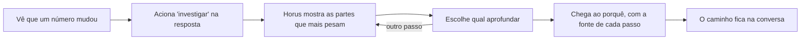

# Investigação guiada

> **Em uma frase:** ver numa resposta que um número mudou, acionar "investigar" e chegar ao porquê, passo a passo,
> com o Horus mostrando o caminho.

## 🧭 O que é

Hoje, quando uma resposta do Horus mostra que um número mudou, achar o porquê depende de a pessoa saber qual
**pergunta de análise**, uma pergunta sobre os números da empresa, fazer em seguida. Ajudam as sugestões de próxima
pergunta e a Análise avançada (uma segunda leitura, mais demorada), mas não há um caminho do "o que mudou" ao "por
quê".

A Investigação guiada cria esse caminho. Quando uma resposta mostra que um número ou um gráfico mudou, a pessoa
aciona **"investigar"** nela. O Horus mostra as partes que mais explicam a variação, como loja, produto ou período; a
pessoa escolhe qual aprofundar, e o Horus dá o passo seguinte, até a causa. O caminho fica salvo na conversa, como
qualquer resposta.

No dia a dia, o gestor segue o fio na própria reunião, em vez de esperar dias pelo relatório da área de dados.

> 💡 **Analogia:** a fatura do cartão veio R$ 400 mais alta; o extrato mostra R$ 300 a mais no supermercado, e o
> supermercado, duas compras grandes. Cada passo apontou o próximo. **Onde a analogia para:** o Horus só enxerga o que
> está nas fontes; um concorrente que abriu na rua não aparece como fato.

> 📌 **Exemplo** *(personagem ilustrativo)*: na reunião de resultado, a gestora Carla vê numa resposta a margem do
> Sul cair e aciona "investigar". Em poucos passos, escolhendo o que aprofundar, ela chega às três lojas e ao produto
> que explicam a queda, cada passo com a fonte, sem abrir chamado à área de dados.

## ✨ Características

- **Onde começa:** na resposta que mostra um número ou gráfico que mudou, pela ação "investigar".
- **O caminho:** um passo de cada vez. O Horus mostra as partes que mais pesam na variação, como loja, produto e
  período, e a pessoa escolhe qual aprofundar, sem ter de adivinhar a próxima pergunta.
- **Até onde enxerga:** só as partes que o **modelo semântico** de cada fonte descreve, o dicionário que explica ao
  Horus o que cada coluna significa na empresa; o que ele não descreve fica fora.
- **A fonte de cada passo:** cada passo mostra de onde veio o número, como toda resposta do Horus.
- **O mesmo Horus da conversa:** é um jeito novo de o Horus responder, com as fontes e as regras de confiança da
  **conversa de análise**, a tela principal em que se pergunta; o caminho fica salvo nela, e a pessoa o reabre e
  continua.
- **Fato e palpite separados:** nos níveis de inferência (até onde a resposta vai além dos dados, de 1 a 5), a causa
  vinda de fora dos dados só aparece a partir do 4, rotulada como hipótese; o fato da web entra com link e data.
- **Quem usa:** quem faz perguntas de análise, em qualquer área: o **owner da organização** (o funcionário da
  empresa cliente que a administra no Horus), o **gestor** (quem responde por uma equipe) e os membros
  **ouro** (quem pergunta e cria boards e relatórios para si) e **prata** (quem pergunta, sem criar). O **membro
  bronze**, que só exibe os dashboards já criados e compartilhados, não investiga.
- **Cada um vê só o que pode:** cada passo usa o acesso de quem investiga, pela Segurança dos dados por pessoa
  (MF-106), que também chega na v2.1.
- **Quando chega:** na v2.1, a entrega que vem depois da v2.0.

## 📈 O valor que gera

- **Para quem usa:** chegar sozinho ao porquê de uma variação, em vez de esperar dias por um chamado.
- **Para a empresa que contrata o Horus:** menos chamados à área de dados, a economia que o comprador paga.
- **Para o Horus como produto:** completa a promessa de responder na hora, explicar o porquê e avisar quando algo
  muda. A v2.0 entrega a primeira e a terceira partes; esta é a segunda, e ajuda a reter o cliente.

**Como vamos saber que funcionou:** o gestor chega ao porquê de uma variação, em poucos passos, sem abrir chamado à
área de dados.

## 🚶 Como se usa no Horus

1. A pessoa vê, numa resposta, que um número ou gráfico mudou.
2. Aciona "investigar" na própria resposta.
3. O Horus mostra as partes que mais explicam a variação, cada uma com a fonte.
4. A pessoa escolhe qual parte aprofundar, e o Horus dá o passo seguinte.
5. Repete até chegar ao porquê.
6. O caminho fica na conversa; ela o reabre e continua quando quiser.

## 🧩 Grau de complexidade: média (provisória)

Da v1 se reaproveitam a conversa de análise, que já guarda as respostas, as sugestões de próxima pergunta e a
Análise avançada, como ponto de partida. É novo o modo de investigação, dentro do mesmo motor que responde em todos
os canais, que quebra a variação nas partes que mais a explicam, sem nada de fora do Horus. Depende da v2.0 pronta,
da Segurança dos dados por pessoa, que chega na mesma versão, e do modelo semântico de cada fonte, porque o Horus só
quebra a variação pelas partes que ele descreve.

> ⚠️ É a leitura do PO a partir dos documentos de arquitetura, e é provisória: a arquitetura ainda não desenhou esta
> mf. A estimativa de esforço é do arquiteto.

## 🔗 Macro funcionalidades relacionadas

| mf | Como se relaciona |
| --- | --- |
| Perguntar aos dados em português (MF-107) | **depende de**: a investigação parte da mesma conversa de análise e do mesmo motor, e o caminho fica guardado nela. |
| Respostas visuais (MF-108) | **depende de**: a ação "investigar" fica nos blocos da resposta, no número e no gráfico que mudaram. |
| Segurança dos dados por pessoa (MF-106) | **depende de**: cada passo usa o acesso de quem investiga. |
| Conectar as fontes vivas (MF-104) | **depende de**: o modelo semântico de cada fonte diz por quais partes a variação pode ser quebrada. |
| A web como fonte (MF-109) | **complementa**: o fato de fora, com link e data, ajuda a explicar a variação. |
| Agentes ativos (MF-115) | **complementa**: o agente avisa que algo mudou, e a investigação explica o porquê; começar pelo aviso não é a porta desta primeira entrega. |
| Boards e Relatórios (MF-112) | **complementa**: o caminho não vai para um board; a conversa nunca é compartilhada, e, para mostrá-lo, a pessoa fixa as respostas uma a uma ou exporta a conversa em PDF ou HTML, recurso da MF-107 na v2.0. |
| Pergunta rápida (MF-110) e Chat pelo WhatsApp (MF-111) | **complementa**: são os canais novos da conversa, que hoje não trazem a investigação. |

## 🚧 O que ela não faz

- **Não entra na v2.0**, que resolve a pergunta na hora, o acompanhamento e o aviso.
- **Não começa por uma pergunta em texto nem pelo aviso de um agente** nesta primeira entrega; a pergunta em texto
  segue pela conversa de sempre.
- **Não entrega tudo de uma vez, nem só a conclusão:** o caminho é passo a passo.
- **Não fixa o caminho num board,** com os passos e as fontes.
- **Não age nem melhora o modelo semântico:** mostra o porquê, mas não corrige o número nem mexe nos sistemas da
  empresa; montar e corrigir esse dicionário continua com o time de dados.

## ⏳ Ainda a decidir

- **Se a investigação chega à Pergunta rápida e ao Chat pelo WhatsApp,** que hoje não a trazem.
## 📚 Para saber mais

- [Norte do produto](../../raw/produto/02-norte-do-produto.md): o problema nº 2, a investigação, e a web que ajuda a
  investigar o porquê de uma variação (`D-001`, `D-006`).
- [Backlog estratégico](../../raw/produto/backlog-estrategico.md): `D-180` (a definição macro, que fechou a `P-018`);
  `D-177` (começa pelo número ou gráfico que mudou, pela ação "investigar"); `D-178` (passo a passo, e a pessoa
  escolhe qual parte aprofundar); `D-179` (o caminho fica na conversa, sem fixar num board); `D-249` (a conversa nunca é compartilhada; para mostrar o caminho, exporta-se a conversa em PDF ou HTML); `D-181` (a `MF-119` na
  v2.1, com as outras mfs da antiga onda 1; a onda 2 ficou sem mfs quando a `MF-121` subiu para a v2.0, `D-260`); `D-194` e `D-203` (os cinco tipos de assento; a prata pergunta e investiga, e o
  bronze não); `D-197` (cada mf numa versão só);
  `D-081` (a necessidade); `I-008` e `D-104` (a nota provisória, que continua); `D-105` (a pontuação: 61, a 5 pontos
  do corte, com premissas do PO); `D-106` e `D-122` (a v2.0 sem a investigação); `D-121` (a v2.1, que substitui a
  `D-120`); `D-083` (o modelo semântico com o time de dados); `D-089` e `D-099` (a Pergunta rápida e o WhatsApp sem
  a investigação); `D-130` (a causa de fora dos dados só a partir do nível 4).
- [Lacunas](../../raw/produto/03-inventario-de-lacunas.md) (a candidata nº 16);
  [mapa das mfs](../../raw/produto/04-macro-funcionalidades-de-hoje.md) (o problema nº 2 contra o que existe);
  [a v2.0 consolidada](../../raw/produto/05-v2.0-consolidada.md), §2, §6 e §9; [versões](../../raw/produto/06-versoes.md)
  (a v2.1); [objetivos](../../raw/produto/07-mapa-de-objetivos-e-funcionalidades.md) (O5).
- Arquitetura: [estratégia](../../raw/arquitetura/01-estrategia-da-solucao.md), §3 (O5), §4 e o marco M11 (`ARQ-006`);
  [software](../../raw/arquitetura/04-software.md), §3.6; [motor](../../raw/arquitetura/05-motor-de-analise-e-ia.md), §3.5
  (os níveis, `ARQ-025`) e §3.12; [conferência](../../raw/arquitetura/14-conferencia-do-produto.md): a letra (v) da
  `P-008`, viável com restrição (`ARQ-006`, `ARQ-023`), e §3, o que se reaproveita. Os documentos de arquitetura
  ainda esperam a `P-018` para desenhar o modo de investigação; nenhuma decisão do registro de arquitetura tem esta
  mf no alcance.
