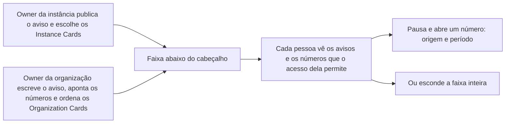

# Faixa de avisos e números

> **Em uma frase:** ver, no alto de toda tela, o aviso que importa e os números do dia, sem abrir nada nem
> perguntar.

## 🧭 O que é

**Como é hoje.** O Horus não tem como falar com todas as pessoas de uma vez: cada conta tem só a sua área de
avisos, e quem abre o app durante uma parada vê as respostas falhando e conclui que o Horus quebrou.

**O que passa a existir.** Esta macro funcionalidade (mf), de nome ainda provisório, cria uma **faixa contínua**
logo abaixo do cabeçalho do app, em toda tela. A faixa é um **contêiner de componentes**: **cards prontos**, peças
que o produto oferece e que o owner escolhe, ordena e preenche, como o texto de um aviso ou, num card de número, a
métrica do **modelo semântico** (o dicionário que explica ao Horus o que cada termo da empresa significa) e o
período. Ela passa **avisos**, como o de uma manutenção, e **números**, como as vendas de ontem. Há duas
categorias, cada uma com a sua identidade visual: os **Instance Cards**, que o **owner da instância** monta, e os
**Organization Cards**, que o **owner da organização** monta. O owner da instância é o nome comercial de quem
administra o Horus contratado como serviço (SaaS), um funcionário da Maind; o owner da organização é o funcionário do
cliente que configura a organização dele no Horus.

**Como fica o dia a dia.** Na véspera de uma manutenção, todos veem o aviso sem receber e-mail; no resto do tempo, a
faixa mostra os números que o owner escolheu para a organização.

> 📌 **Exemplo** *(personagens ilustrativos)*: na sexta, a Maind publica na faixa "Manutenção no sábado, das 22h
> às 23h", com hora de fim. Ao lado passam os cards que o owner Marcos montou para a área comercial: uma caixa de
> texto, "Lancem as despesas até sexta", e dois cards de número, que ele apontou para as métricas de vendas e de
> margem do modelo semântico, com os períodos ontem e mês. A gestora Carla pausa a faixa, abre o card da margem e vê
> de que fonte e de que período o número veio.

## ✨ Características

- **Duas categorias:** a da instância e a da organização, com visuais diferentes, para ninguém confundir o aviso da
  Maind com o do owner da organização.
- **Os avisos são de todos:** todas as pessoas que não escondem a faixa os veem, sem depender de acesso a dados. O aviso da instância pode ter
  hora de fim; sem ela, fica até o owner da instância retirá-lo à mão, o que ele pode fazer a qualquer momento.
- **Os números seguem o acesso de quem vê:** cada card de número calcula os dados com o acesso de quem olha a faixa,
  e o card a que a pessoa não tem acesso não aparece, nem o título dele.
- **O que isso dá na v2.0:** na v2.0, a organização é a fronteira dos dados, sem recorte por pessoa. Por isso,
  dentro de uma organização, todos os que têm acesso aos dados veem os mesmos números; a faixa só passa a mudar de
  uma pessoa para outra com a Segurança dos dados por pessoa (MF-106), na v2.1.
- **Os números da instância:** os assentos, as perguntas respondidas, as execuções dos agentes e os custos de cada
  organização viram Instance Cards: só números, nunca conteúdo, e só os administradores da instância os veem 🔎.
- **Para ler com calma:** a faixa pode ser pausada, e todo número abre para mostrar de onde veio e de que período é.
- **Quem monta:** cada owner escolhe quais cards passam, em que ordem e o que cada um traz, numa tela de
  configuração à parte (a administração da instância ou as preferências da organização). A faixa em si não se edita.
- **Um catálogo próprio:** os cards saem de um catálogo de componentes feito para a faixa, separado do catálogo de
  cards da Home; o owner não cria componentes próprios. Para a organização, há dois definidos, a caixa de texto livre
  e o card de número; os demais, como KPIs e ícones, ainda serão definidos, cada um com as suas regras.
- **O aviso do owner da organização:** é a caixa de texto livre, em que ele escreve o aviso para todas as pessoas da
  organização.
- **O card de número:** o owner da organização o aponta para uma métrica já definida no modelo semântico, como
  vendas ou margem, e escolhe o período: ontem, a semana ou o mês. Escolher a métrica e o período não é criar
  componente.
- **Pode ser escondida:** cada pessoa esconde a faixa inteira e a mostra de novo quando quiser, e a escolha vale nas
  sessões seguintes. Quem a esconde deixa de ver os avisos.

## 📈 O valor que gera

- **Para quem usa:** sabe o que importa sem abrir nada nem perguntar: o aviso de uma manutenção, o número do dia.
- **Para a empresa que contrata o Horus:** o owner da organização fala com todos sem mandar e-mail e escolhe os
  números que a equipe tem à vista o dia inteiro.
- **Para o Horus como produto:** a faixa lembra o Horus a cada tela e reduz o aviso por e-mail. Ela acelera a adoção
  e é indispensável à v2.0: o aviso da instância só chega às pessoas por ela.

**Como vamos saber que funcionou:** o aviso da instância aparece na faixa de quem não a escondeu, o owner
monta uma faixa com cinco cards, e poucas pessoas escondem a faixa.

## 🚶 Como se usa no Horus

**O owner da instância:**

1. Escreve o aviso, com o texto, a data e a hora, e marca a hora de fim, se houver.
2. Escolhe, na administração da instância, quais Instance Cards passam e em que ordem.

**O owner da organização,** nas preferências da organização, escolhe os componentes no catálogo da faixa: escreve o
aviso numa caixa de texto livre, aponta cada card de número para uma métrica e um período e os põe em ordem.

**Quem vê:**

1. Vê a faixa abaixo do cabeçalho, em qualquer tela.
2. Pausa para ler e abre um número para ver a origem e o período.
3. Esconde a faixa, se quiser, e a mostra de novo depois.

## 🧩 Grau de complexidade: média (provisória)

Da v1 vêm a ideia de card pronto e o motor de cards da Home, que pode servir também à faixa, a conferir com o
arquiteto. São novos a própria faixa, as duas telas de configuração, um catálogo de componentes separado do da Home e
os números calculados com o acesso de cada pessoa, sem pesar na abertura da tela. Depende da administração da instância e das fontes da organização; a Segurança dos dados por pessoa, na v2.1, só a complementa, porque é ela que faz a faixa mudar de pessoa para pessoa; nada de fora do Horus.

> ⚠️ É a leitura do PO a partir dos documentos de arquitetura, e é provisória: a arquitetura ainda não desenhou esta
> mf. A estimativa de esforço é do arquiteto.

## 🔗 Macro funcionalidades relacionadas

| mf | Como se relaciona |
| --- | --- |
| Administração da instância (MF-101) | **depende de**: é lá que se escreve o aviso da instância e se montam os Instance Cards, e é ela que produz os números de uso e de custo de cada organização. |
| Organizações, pessoas e papéis (MF-102) | **depende de**: é dela o owner da organização, que monta os Organization Cards nas preferências da organização. |
| Conectar as fontes vivas (MF-104) | **depende de**: os números do negócio saem das fontes da organização, e o card de número usa as métricas do modelo semântico dela. |
| Segurança dos dados por pessoa (MF-106) | **complementa**: na v2.1, faz cada pessoa ver só os números que o acesso dela permite; na v2.0 vale a organização inteira. |
| Boards e Relatórios (MF-112) | **complementa**: a faixa segue a regra dos boards do espaço da organização, que calculam os dados com o acesso de quem os abre. |
| Home da organização (MF-117) | **complementa**: a Home tem o seu catálogo de cards, e a faixa, outro; um card da Home não vai para a faixa. |

## 🚧 O que ela não faz

- **Mandar e-mail:** o aviso vai só pela faixa; quem não abre o app não o recebe.
- **Horário por card:** o owner define quais cards passam, em que ordem e o que cada um traz, mas não marca dias
  nem horários para cada um.
- **Edição ou prévia na própria faixa:** a montagem é feita nas telas de configuração, sem ver a faixa ao vivo.
- **Substituir a página de manutenção:** durante uma parada, uma página com o motivo e a hora de volta toma o lugar
  do app, e ela não depende da faixa.

## ⏳ Ainda a decidir

- **Os componentes do catálogo:** os demais, como KPIs e ícones, e as regras de cada um, inclusive se o aviso do
  owner da organização tem hora de fim e retirada à mão; os da instância já têm um primeiro conjunto.
- **O gesto e o visual:** como a faixa se move e como a pessoa a pausa.

## 📚 Para saber mais

- [Backlog estratégico](../../raw/produto/backlog-estrategico.md): `D-174`, a definição macro (fechou a `P-027`); `D-204`, a mf sai da lista de cortes, porque o aviso da instância depende dela;
  `D-152`, a faixa como mf nova, com as duas categorias, a origem e o período de cada número e a pausa; `D-151` e
  `D-165`, o aviso da instância só pela faixa, com hora de fim opcional e retirada à mão; `D-153`, os números de uso,
  os assentos e o aviso de custo como Instance Cards prontos, só números (fechou a `P-026`); `D-154`, a página de manutenção, que entra na v2.0, e a página pública do estado, que fica de fora; `D-167` e `D-169`, o acesso de quem vê e o card que some;
  `D-168`, esconder a faixa inteira, com a leitura de que ela nasce visível; `D-170`, os avisos públicos e os
  componentes que o produto oferece, com a leitura de que os números da instância só os administradores veem; `D-171`,
  só quais cards e em que ordem; `D-172`, as telas de configuração separadas; `D-173`, o catálogo próprio, separado do
  da Home; `D-213`, a faixa como contêiner de componentes, o aviso do owner da organização como a caixa de texto
  livre e os demais componentes (KPIs, ícones), com as regras de cada um, ainda por definir; `D-212`, no card de
  número, a métrica do modelo semântico e o período; `D-163` e `D-164`, a mesma regra nos boards; `D-145`, a
  organização como fronteira dos dados na v2.0, com a leitura `D-163.2`, confirmada pelo dono em 05/11/2026 (na
  v2.0, todas as pessoas da organização veem os mesmos dados; [A v2.0 consolidada](../../raw/produto/05-v2.0-consolidada.md), seção 10);
  `D-147` e `D-193`, o owner da instância, funcionário da Maind; `D-197`, uma mf numa versão só; `P-036`, como
  calcular os números de cada pessoa sem pesar na abertura da tela (do arquiteto); `P-028`, o que falta para a arquitetura e o portal acompanharem a mf.
- [Versões](../../raw/produto/06-versoes.md): a v2.0, com a `MF-120` (nome provisório).
- Arquitetura: [conferência](../../raw/arquitetura/14-conferencia-do-produto.md), §4, `A-21` (como a instância fala
  com todas as pessoas quando para, hoje `P-025`) e `A-29` (o painel do owner da instância, hoje `P-026`), de onde a
  faixa nasceu. Nenhum documento de arquitetura desenha esta mf ainda.
