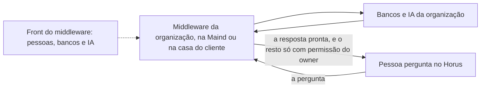

# Middleware da organização

> **Em uma frase:** dar a cada organização um lugar separado do Horus e isolado das outras organizações, onde ficam as
> pessoas, os bancos e a IA dela, hospedado pela Maind ou na casa do cliente.

## 🧭 O que é

**Como é hoje.** No Horus de hoje, tudo mora no próprio Horus: as pessoas de cada organização, as credenciais dos
bancos e as conexões de IA. O Horus roda na estrutura da Maind e chega ao banco do cliente pelo endereço público do
banco ou por um túnel seguro. A empresa que não admite os dados fora de casa fica de fora, ou precisaria do Horus
instalado inteiro dentro dela.

**O que passa a existir.** Esta macro funcionalidade (mf) cria o **middleware**: a peça que fica entre o Horus e os
bancos de dados da organização. Ele guarda quem são as pessoas, os bancos e a IA da organização, e responde pelo
caminho até eles. Desde a v2.0, **toda organização usa um**, numa infraestrutura separada do Horus. Um middleware
**atende várias organizações**, cada uma isolada das outras: o da Maind atende todas as organizações do Horus como
serviço, e o que o cliente hospeda na casa dele, instalando uma **imagem de container**, um pacote pronto que a Maind
entrega, atende as organizações desse cliente. Para o produto, o middleware é o mesmo nos dois lugares: a diferença é
só onde ele fica.

Junto dele vem o **front do middleware**, um segundo aplicativo, separado do Horus e igual nas duas hospedagens. É
nele que o **owner da organização**, o funcionário do cliente que cuida da organização, cadastra as pessoas e
configura os bancos e a IA, em qualquer hospedagem; na da Maind, ele entra com o usuário que a Maind cria para ele. O
**time da Maind** dá suporte técnico, antes e depois da venda, mas não configura pelo owner.

**A regra do que sai.** O ciclo da análise, com o modelo de IA e as consultas ao banco, roda dentro do middleware. Ao
Horus chegam só a **pergunta** e a **resposta pronta**, os blocos que a pessoa vê. O owner da organização pode
permitir mais, saída por saída. Com o middleware na casa do cliente, o funcionário da Maind não liga nem vê essas
saídas; na hospedagem da Maind, é a Maind que opera o middleware.

> 📌 **Exemplo** *(personagens ilustrativos)*: a Maind cria a organização da área comercial de uma rede de lojas, a
> liga ao middleware da Maind, cria o usuário do Marcos, owner da área, e libera os assentos. O Marcos entra no front
> do middleware, cadastra as pessoas e configura ali o banco de vendas e a IA, com o apoio do time da Maind, e a
> organização passa a ativa. A gestora Carla pergunta quanto cada loja vendeu na semana: a resposta chega, e o Horus
> não alcançou o banco direto. Um hospital que não admite os dados dos pacientes fora da rede dele faz o mesmo com o
> middleware instalado em casa, e nada além da pergunta e da resposta pronta sai de lá.

## ✨ Características

- **Para quem é:** toda organização, desde a v2.0. Para quem pergunta, nada muda.
- **Várias organizações num middleware:** o da Maind atende todas as organizações do Horus como serviço, e o do
  cliente atende as organizações dele; cada organização fica isolada das outras. ⚠️ Na hospedagem da Maind, é um ponto
  único: se esse middleware for invadido, expõe as credenciais e as regras de todas as organizações que ele atende;
  quem exige mais isolamento hospeda o middleware em casa.
- **Na Maind ou na casa do cliente:** a Maind hospeda o middleware das organizações do Horus como serviço; o cliente
  que não quer os bancos expostos o hospeda em casa, instala a imagem e a atualiza. O contrato e o front são os
  mesmos, e onde o middleware fica não muda o produto, desde que a rede o alcance.
- **Como nasce:** a Maind cria a organização no Horus, e a criação a liga ao middleware, numa troca segura que as duas
  pontas confirmam: a organização passa a existir nele, sem que um middleware novo precise subir. Na hospedagem da
  Maind, a criação também cria o usuário com que o owner entra no front do middleware. Os assentos que a Maind libera
  vão ao middleware.
- **Quando fica ativa:** a organização nasce em configuração e só passa a ativa depois de três condições: o
  middleware ligado, com a troca confirmada pelas duas pontas, ao menos um banco configurado e a IA configurada pelo
  owner.
- **As pessoas ficam nele:** isoladas, fora do Horus. Só o owner usa o front do middleware: cadastra e gere as pessoas
  e aprova os convites e as trocas de assento que o **gestor**, quem cuida de uma equipe, pede pelo Horus. O owner pode
  cadastrar até mais dois owners, cada um num assento de owner contratado.
- **Os bancos e a IA se configuram nele:** no front do middleware, e não no Horus. Quem configura é o owner da
  organização, em qualquer hospedagem; o time da Maind dá suporte técnico, antes e depois da venda, mas não configura
  por ele.
- **A entrada:** as configurações de autenticação ficam no middleware, e o owner da organização e o administrador da
  instância entram sempre por usuário e senha. O endereço de acesso de cada organização leva a pessoa ao middleware
  certo, porque o endereço do Horus é o mesmo para todas.
- **O que sai:** por padrão, só a pergunta e a resposta pronta. O owner da organização pode permitir o comando da
  consulta que o Horus gerou, os dados em planilha (CSV) e outras saídas. Sem a permissão, nada disso sai.
- **Quem governa o caminho, na casa do cliente:** a TI dele, por IP e porta, do Horus até os dados, a internet e a IA.
- **O que a Maind vê:** com o middleware na casa do cliente, o suporte da Maind não vê o que acontece lá e só vê mais se
  o owner liberar; na hospedagem da Maind, o time da Maind não configura os bancos nem a IA e deixa de conhecer as
  credenciais por rotina, mas quem opera o middleware da Maind segue podendo, tecnicamente, alcançá-las.
- **O estado à vista:** o painel da Administração da instância (MF-101) mostra, para cada organização, se o middleware
  dela está no ar ou fora e a versão dele (o da casa do cliente, enquanto o Horus o alcança). Quando ele para, é
  avisado o dono do serviço: a Maind, no middleware dela; o cliente, no dele.
- **Ao excluir a organização:** apaga-se também tudo o que há dela no middleware, as pessoas, os bancos e a IA
  configurados e a configuração; só o que é dela, porque o middleware é compartilhado.

## 📈 O valor que gera

- **Para quem usa:** pergunta aos dados da empresa como sempre; o caminho pelo middleware não muda nada na tela.
- **Para a empresa que contrata o Horus:** as pessoas, as credenciais dos bancos e a IA dela ficam fora do Horus, no
  middleware, isoladas das outras organizações, e é o owner dela quem as configura; e, se não quer os bancos expostos,
  ela hospeda o middleware em casa e usa o Horus como serviço, sem instalá-lo.
- **Para o Horus como produto:** a mesma peça serve a qualquer hospedagem, e a segurança e a separação valem desde o
  primeiro cliente; um middleware só atende as organizações do Horus como serviço, e criar uma organização não exige
  subir um middleware novo; ela abre os clientes que exigiam o Horus instalado em casa.

**Como vamos saber que funcionou:** a Maind cria uma organização, vê o middleware ligado e libera os assentos, o
owner configura o banco e a IA e a organização passa a ativa, e o owner cadastra uma pessoa que pergunta ao banco do
cliente sem o banco ser alcançado direto pelo Horus; e um cliente de cibersegurança rígida instala o middleware em
casa, faz uma pergunta de análise sobre o banco interno, e nada além da pergunta e da resposta pronta sai.

## 🚶 Como se usa no Horus

**A Maind e o cliente preparam a organização:**

1. O middleware sobe uma vez e atende várias organizações: na hospedagem da Maind, o time da Maind sobe um só, para
   todas as organizações do Horus como serviço; na casa do cliente, a TI dele instala a imagem, para as organizações
   desse cliente.
2. O administrador da instância cria a organização no Horus, e a criação a liga ao middleware; as duas pontas
   confirmam a ligação. Na hospedagem da Maind, a criação também cria o usuário do owner no front do middleware.
3. O administrador libera os assentos contratados, que vão ao middleware.
4. O owner da organização entra no front do middleware, com usuário e senha, e cadastra as pessoas.
5. O owner configura, no front do middleware, ao menos um banco e a IA, em qualquer hospedagem, com o suporte técnico
   do time da Maind se precisar.
6. Com o middleware ligado, um banco e a IA configurados, a organização deixa de estar em configuração e passa a
   ativa.
7. O owner decide, no front do middleware, se algo mais pode sair além da pergunta e da resposta.

**O gestor** cria os convites e pede a troca do tipo de assento pelo Horus, e o owner os aprova no front do middleware.

**Quem pergunta** entra pelo endereço da organização e pergunta como sempre; o ciclo da análise roda no middleware, e a
pessoa recebe a resposta pronta.

## 🧩 Grau de complexidade: alta (provisória)

Nada da v1 faz isso: hoje as pessoas, as credenciais e as conexões de IA moram no próprio Horus, que chega ao banco do
cliente só pelo endereço público ou pelo túnel. É nova a peça inteira: o middleware, o front dele, a ligação com o
Horus criada com cada organização, o isolamento entre as organizações que ele atende, as permissões de saída e o
caminho até os dados, a internet e a IA, que atravessa as fontes, a IA, a web e a gestão das pessoas. O que a faz alta
é servir a toda organização desde a v2.0, com um middleware só que a Maind opera para todas as organizações do Horus
como serviço, e, na casa do cliente, depender da infraestrutura e da TI dele, que o Horus não controla: a
disponibilidade e a velocidade do middleware ficam com elas.

> ⚠️ É a leitura do PO a partir dos documentos de arquitetura, e é provisória: a arquitetura ainda não desenhou esta
> mf. A estimativa de esforço é do arquiteto.

## 🔗 Macro funcionalidades relacionadas

| mf | Como se relaciona |
| --- | --- |
| Conectar as fontes vivas (MF-104) | **depende de**: as fontes da organização são configuradas pelo owner no front do middleware e alcançam o banco por ele. |
| IA sob controle da organização (MF-105) | **depende de**: a IA da organização é configurada pelo owner no front do middleware, e o modelo trabalha no ciclo da análise, dentro dele. |
| A web como fonte (MF-109) | **depende de**: a saída para a internet também passa pelo middleware. |
| Organizações, pessoas e papéis (MF-102) | **complementa**: as pessoas ficam no middleware, e o owner as gere pelo front dele; o gestor convida e pede a troca do tipo de assento pelo Horus. |
| Administração da instância (MF-101) | **complementa**: o administrador cria a organização, a liga ao middleware e, na hospedagem da Maind, cria o usuário do owner; libera os assentos, vê o estado e a versão do middleware de cada organização e entra sempre por usuário e senha; excluir a organização apaga também o que é dela no middleware. |
| Licenças e planos (MF-103) | **complementa**: os assentos liberados vão ao middleware, e cada owner além do primeiro, no máximo mais dois, ocupa um assento de owner contratado. |
| Segurança dos dados por pessoa (MF-106) | **é a base de**: na v2.1, o recorte do que cada pessoa vê dentro do banco roda no middleware e depende dele. |

## 🚧 O que ela não faz

- **Deixar tudo em casa:** a pergunta e a resposta pronta chegam ao Horus. Quem exige que nem a pergunta saia precisa
  da instalação completa do Horus na empresa, que está sem versão e só volta se um cliente a exigir.
- **Instalar o Horus no cliente:** a ativação dos assentos por arquivo de licença e a fonte alcançando a rede interna
  ficam com a instalação completa.
- **Dar a cada cliente uma instância própria:** o Horus como serviço é uma instância só, da Maind.
- **Dar a cada organização um middleware só dela, na hospedagem da Maind:** lá, um middleware atende todas as
  organizações do Horus como serviço, cada uma isolada das outras; quem exige mais isolamento hospeda o middleware em
  casa.
- **Configurar os bancos e a IA pela Maind:** quem configura é o owner da organização, nas duas hospedagens; o time da
  Maind dá suporte técnico, antes e depois da venda.
- **Recortar o que cada pessoa vê dentro do banco, ou ligar o login da empresa:** são da Segurança dos dados por pessoa
  (MF-106), na v2.1. Na v2.0, a organização é a fronteira dos dados, e o owner e o administrador entram por usuário e
  senha.

## ⏳ Ainda a decidir

- **A forma técnica:** como o Horus e o middleware se ligam e conversam, como o middleware se atualiza e o que a pessoa
  vê quando ele está fora do ar; é do arquiteto, junto com o resto do desenho.
- **As saídas extras:** além do comando da consulta e da planilha, quais outras saídas contam como vazamento e pedem
  permissão.
- **O que o Horus guarda de cada pessoa:** com as pessoas no middleware, o que o Horus precisa saber de cada uma para
  funcionar e como mostra o nome dela nas telas; é do arquiteto.

## 📚 Para saber mais

- [Backlog estratégico](../../raw/produto/backlog-estrategico.md): `D-270`, o nome "Middleware da organização"; `D-258`,
  toda organização usa o middleware desde a v2.0, com a base de configuração e o aplicativo de setup (o front do
  middleware), o fluxo do dono (a criação da organização com o certificado e a chave de instalação, o handshake, os
  assentos, o endereço com token, a entrada por usuário e senha) e o aviso de que "o funcionário da Maind não liga nem
  vê" só vale na casa do cliente; `D-272`, o middleware atende várias organizações em qualquer hospedagem, cada uma
  isolada pelo seu certificado (o da Maind, todas as do SaaS; o do cliente, as dele), com o risco do ponto único na
  Maind (substitui a `D-259`, um middleware por organização); `D-260`, a `MF-121` inteira na v2.0, sem mf nova;
  `D-261`, as pessoas isoladas no middleware, geridas pelo owner no front dele; `D-262`, o gestor convida e pede a
  troca de assento pelo Horus, e o owner aprova no front (o e-mail do convidado passa pelo SaaS); `D-263`, a `MF-106`
  continua na v2.1 e passa a depender da `MF-121`; `D-264` e `D-265`, os bancos e a IA configurados no front do
  middleware (a `D-265` em parte substituída pela `D-273`); `D-271`, o owner acessa o front do middleware também na
  hospedagem da Maind, que cria o usuário dele, e o front é o mesmo nas duas; `D-273`, em qualquer hospedagem quem
  configura os bancos e a IA é o owner, e o time da Maind só dá suporte (quem opera o middleware da Maind segue
  podendo, tecnicamente, alcançar as credenciais); `D-275`, o painel da instância mostra o estado e a versão do
  middleware de cada organização, e é avisado o dono do serviço (`D-240`); `D-277`, a organização nasce em
  configuração e só passa a ativa com o middleware ligado, um banco e a IA configurados (🔎 quem a marca como ativa,
  leitura do PO, fica na `MF-101`); `D-278`, excluir a organização apaga também o que é dela no middleware; `D-269`,
  os owners adicionais; `D-196`, a definição macro (em parte substituída pelas `D-258` a `D-263`, e o retorno "uma
  frota só" volta com a `D-272`); `D-195`, a imagem de
  container (em parte substituída pela `D-258`: a chave nasce do certificado, e as permissões e a conexão vão para o
  front do middleware, `D-265`); `D-193` (em parte substituída pelas `D-258` e `D-265`); `D-190`, o caminho até os
  dados, a internet e a IA, governado por IP e porta; `D-189`, só a pergunta e a resposta pronta, com a leitura de que
  cada saída extra é uma permissão separada, desligada por padrão; `D-188`, a instalação completa como porta de volta,
  sem versão (em parte substituída pela `D-260`); `D-118` e `D-184`, o login da empresa na v2.1. Pendências do
  arquiteto: `P-048` (o fluxo do dono, a atualização, o middleware fora do ar e o que o SaaS guarda de cada pessoa),
  `P-040` e `P-042` (a viabilidade e o desenho do middleware).
- [A v2.0 consolidada](../../raw/produto/05-v2.0-consolidada.md): §5.17, o middleware das organizações; §7, as
  dependências; §8, os riscos e "a Maind não vê".
  [Versões](../../raw/produto/06-versoes.md): a `MF-121` na v2.0 e "O que trava a `MF-121` na v2.0";
  [objetivos](../../raw/produto/07-mapa-de-objetivos-e-funcionalidades.md) (O8).
- Arquitetura: [registro](../../raw/arquitetura/02-registro-de-decisoes.md), `ARQ-052` (os dois caminhos de hoje até
  o banco do cliente, e a opção 3, um agente instalado no cliente, deixada de fora) e `ARQ-060` (a instalação na casa
  do contratante num Kubernetes, que o middleware dispensa). Nenhum documento de arquitetura desenha esta mf ainda.
