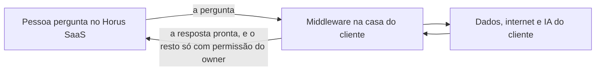

# Middleware na casa do contratante

> **Em uma frase:** usar o Horus da Maind sobre dados e IA que não podem sair da empresa, sem instalar o Horus
> dentro dela.

## 🧭 O que é

**Como é hoje.** O Horus roda na estrutura da Maind e chega ao banco do cliente pelo endereço público do banco ou
por um túnel seguro. A empresa que não admite os dados fora de casa fica de fora, ou precisaria do Horus instalado
inteiro dentro dela.

**O que passa a existir.** Esta macro funcionalidade (mf), de nome ainda provisório, cria o **middleware**: uma peça
intermediária que a Maind entrega como uma **imagem de container**, um pacote pronto para rodar, e que o cliente
instala na infraestrutura dele. O Horus continua sempre no SaaS da Maind, o Horus contratado como serviço, e passa
pelo middleware para chegar aos **dados**, à **internet** e à **IA** do cliente. O middleware tem um **endereço
público** e um **par de chaves**, cadastrado no Horus, na organização, e a TI do cliente decide, por **IP e porta**,
quem chega a ele e aonde ele chega.

**A regra do que sai.** Da casa do cliente para a Maind saem só a **pergunta** e a **resposta pronta**, os blocos que
a pessoa vê. O **owner da organização**, o funcionário do cliente que configura a organização no Horus, pode permitir
mais, saída por saída; o funcionário da Maind que administra a instância não liga nem vê essas saídas.

> 📌 **Exemplo** *(personagens ilustrativos)*: um hospital não admite que os dados dos pacientes saiam da rede dele.
> A TI instala a imagem, a owner da organização cadastra a chave no Horus, e o firewall libera só o endereço do
> Horus. A diretora pergunta quantas internações houve no mês: a resposta chega, e nada além da pergunta e da
> resposta saiu de casa.

## ✨ Características

- **Para quem é:** o cliente com exigência de privacidade e segurança, que mantém a governança pela própria
  cibersegurança e infraestrutura. Para quem pergunta, nada muda.
- **Uma imagem pronta, o Horus na Maind:** o cliente instala e atualiza a imagem; o Horus continua numa frota e numa
  versão só, sem instância própria por cliente.
- **Quem governa o caminho:** a TI do cliente, por IP e porta, do Horus até os dados, a internet e a IA.
- **A proteção:** o endereço do middleware é público e se protege pela chave cadastrada no Horus e pelo bloqueio por
  IP e porta.
- **Um por organização:** o middleware e a conexão com ele são da organização, e quem os configura é o owner dela.
- **O que sai por padrão:** só a pergunta e a resposta pronta.
- **O que mais pode sair:** o owner da organização pode permitir, nas configurações da organização no Horus, o
  comando da consulta que o Horus gerou, os dados em planilha (CSV) e outras saídas. Sem a permissão, nada disso sai.
- **O suporte da Maind:** sem as saídas extras, não vê o que acontece no cliente; só vê mais se o owner liberar.
- **Quando chega:** na onda 2 da v2.1, a da casa do contratante, depois da onda do SaaS.

## 📈 O valor que gera

- **Para quem usa:** pergunta aos dados da empresa como sempre, mesmo quando eles não podem sair de casa.
- **Para a empresa que contrata o Horus:** usa o Horus em SaaS sem abrir mão da governança: a TI dela controla o
  caminho, e o owner dela decide o que mais sai.
- **Para o Horus como produto:** abre os clientes que exigiam o Horus instalado em casa, com uma frota só e sem operar
  uma instalação por cliente.

**Como vamos saber que funcionou:** um cliente de cibersegurança rígida instala a imagem, cadastra a chave no Horus,
libera no firewall só o endereço do Horus e faz uma pergunta de análise sobre o banco interno, e nada além da
pergunta e da resposta pronta sai.

## 🚶 Como se usa no Horus

**O cliente e o owner da organização configuram:**

1. A TI do cliente instala a imagem do middleware na infraestrutura da empresa.
2. O owner da organização cadastra no Horus o par de chaves do middleware.
3. A TI libera, no firewall, só o endereço do Horus.
4. O owner decide, nas configurações da organização, se algo mais pode sair além da pergunta e da resposta.

**Quem pergunta** faz a pergunta como sempre; o Horus chega aos dados pelo middleware, e a pessoa recebe a resposta
pronta.

## 🧩 Grau de complexidade: alta (provisória)

Nada da v1 faz isso: hoje o Horus chega ao banco do cliente só pelo endereço público ou pelo túnel. É nova a peça
inteira: a imagem, a chave cadastrada na organização, as permissões de saída e o caminho até os dados, a internet e a
IA do cliente, que atravessa as fontes, a IA e a web. O que a faz alta é depender da infraestrutura e da TI de cada
cliente, que o Horus não controla: a disponibilidade e a velocidade do middleware ficam com elas.

> ⚠️ É a leitura do PO a partir dos documentos de arquitetura, e é provisória: a arquitetura ainda não desenhou esta
> mf. A estimativa de esforço é do arquiteto.

## 🔗 Macro funcionalidades relacionadas

| mf | Como se relaciona |
| --- | --- |
| Conectar as fontes vivas (MF-104) | **depende de**: as fontes da organização alcançam o banco do cliente pelo middleware. |
| IA sob controle da organização (MF-105) | **depende de**: o Horus chega ao modelo de IA do cliente pelo middleware. |
| A web como fonte (MF-109) | **depende de**: a saída para a internet também passa pelo middleware. |
| Segurança dos dados por pessoa (MF-106) | **depende de**: o recorte do que cada pessoa vê é dela, que chega antes, na onda 1 da v2.1. |
| Organizações, pessoas e papéis (MF-102) | **depende de**: o owner da organização e as configurações dela guardam a conexão do middleware e as permissões de saída. |
| Administração da instância (MF-101) | **complementa**: quem administra a instância vê todas as organizações, mas não liga nem vê as saídas do middleware nem os dados das conexões. |

## 🚧 O que ela não faz

- **Deixar tudo em casa:** a pergunta e a resposta pronta passam pela Maind. Quem exige que nem a pergunta saia
  precisa da instalação completa do Horus na empresa, que está sem versão e só volta se um cliente a exigir.
- **Instalar o Horus no cliente:** a ativação dos assentos por arquivo de licença e a fonte alcançando a rede interna
  ficam com a instalação completa.
- **Dar a cada cliente uma instância própria:** o SaaS é uma instância só, da Maind.
- **Servir a várias organizações com um middleware só:** cada middleware é de uma organização.

## ⏳ Ainda a decidir

- **O protocolo,** a "língua" em que o Horus e o middleware conversam: está em aberto (um servidor MCP, uma API REST
  ou gRPC, com preferência pelo gRPC), e a escolha é do arquiteto, junto com o resto do desenho.
- **As saídas extras:** além do comando da consulta e da planilha, quais outras saídas contam como vazamento e pedem
  permissão.
- **Quando o middleware falha ou muda:** o que o Horus faz quando o middleware do cliente está fora do ar, e como a
  imagem nova chega ao cliente.

## 📚 Para saber mais

- [Backlog estratégico](../../raw/produto/backlog-estrategico.md): `D-196`, a definição macro (nome provisório), que
  corrige a redação das `D-190` e `D-195` ("servidor MCP"): o protocolo fica em aberto; `D-195`, a imagem de container
  da Maind, o endereço público, o par de chaves, o bloqueio por IP e porta e as permissões e a conexão da organização;
  `D-193`, o SaaS como uma instância só, o funcionário da Maind sem ver os dados das conexões e o owner da organização
  que configura o middleware; `D-192`, o Horus no SaaS e o cliente sem instância própria; `D-191`, as permissões no
  Horus (a parte que as dava ao dono da instância, e o middleware por instância, foram corrigidas pelas `D-193` e
  `D-195`); `D-190`, o Horus que usa o middleware para chegar aos dados, à internet e à IA; `D-189`, só a pergunta e a
  resposta pronta, com a leitura de que cada saída extra é uma permissão separada, desligada por padrão; `D-188`, o
  middleware primeiro e a instalação completa como porta de volta; `D-181`, as duas ondas; `I-020`, fechado; `P-040` e
  `P-042`, a viabilidade e o desenho, do arquiteto.
- [Versões](../../raw/produto/06-versoes.md): a onda 2 da v2.1, a `MF-121` (parte da candidata nº 5) e "O que trava a
  v2.1"; [objetivos](../../raw/produto/07-mapa-de-objetivos-e-funcionalidades.md) (O8).
- Arquitetura: [registro](../../raw/arquitetura/02-registro-de-decisoes.md), `ARQ-052` (os dois caminhos de hoje até
  o banco do cliente, e a opção 3, um agente instalado no cliente, deixada de fora) e `ARQ-060` (a instalação na casa
  do contratante num Kubernetes, que o middleware dispensa). Nenhum documento de arquitetura desenha esta mf ainda.
