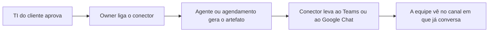

# Conectores de chat corporativo

> **Em uma frase:** receber o aviso de um agente ou o PDF de um board no chat em que a equipe já conversa, o
> Microsoft Teams ou o Google Chat.

## 🧭 O que é

**Como é hoje.** A única saída do Horus é o e-mail do relatório agendado. A v2.0 acrescenta o WhatsApp, pelos
Conectores de Saída (MF-113), mas nenhum dos dois chega ao chat da empresa.

**O que passa a existir.** Esta macro funcionalidade (mf), de nome ainda provisório, acrescenta dois **conectores de
saída** ao "carteiro" do Horus: o **Microsoft Teams** e o **Google Chat**. Um conector de saída é um canal por onde
o Horus entrega o **artefato**, a peça pronta que outra parte gerou: o aviso, o PDF ou a imagem. Com os dois
conectores novos, o agente e o agendamento entregam o artefato num canal do Teams ou num espaço do Google Chat.

> 💡 **Analogia:** é o mesmo carteiro, com duas caixas de correio novas: o mural da equipe no Teams e no Google Chat.
> **Onde a analogia para:** ele continua entregando só a quem é usuário do Horus.

> 📌 **Exemplo** *(personagem ilustrativo)*: quando as vendas do Sul caem 10%, o alerta do agente chega
> ao canal da equipe no Teams, onde a gestora Carla já conversa com o time, sem ela precisar abrir o e-mail.

## ✨ Características

- **Os canais novos:** o Microsoft Teams e o Google Chat, que saem juntos, numa mf só.
- **O que levam:** o aviso, o PDF ou a imagem que o agente ou o agendamento lhes entrega.
- **Para onde:** um canal do Teams ou um espaço do Google Chat.
- **Só transportam:** como os outros conectores, levam o que lhes entregam pronto, sem mudar nada.
- **Só para usuários do Horus:** a entrega vai a pessoas da organização no Horus, nunca a quem está fora dele.
- **Quem liga:** o **owner da organização**, o funcionário do cliente que configura a organização no Horus. Cada
  conector depende da aprovação da TI do cliente.
- **Quem ganha:** o **gestor**, quem responde por uma equipe, e os **membros**, que recebem os avisos onde a equipe
  já conversa.
- **Não é conversa:** ninguém pergunta ao Horus pelo Teams nem pelo Google Chat; conversar fora do app é o Chat pelo
  WhatsApp (MF-111).
- **Quando chega:** na v2.1; na v2.0, só há o e-mail e o WhatsApp.

## 📈 O valor que gera

- **Para quem usa:** recebe o aviso no chat da empresa, sem depender de abrir o e-mail ou o WhatsApp.
- **Para a empresa que contrata o Horus:** o aviso chega onde a equipe já está, num canal que a TI dela aprovou.
- **Para o Horus como produto:** adoção e retenção, porque o aviso chega onde a equipe trabalha. Abre as empresas que
  vivem no Teams ou no Google Workspace, como a própria Maind, o primeiro cliente, que usa o Google Workspace.

**Como vamos saber que funcionou:** o aviso de um agente chega a um canal do Teams e a um espaço do Google Chat.

## 🚶 Como se usa no Horus

O fluxo, que pode mudar com o desenho:

**O owner da organização configura:**

1. Combina com a TI da empresa a aprovação do Teams ou do Google Chat.
2. Liga o conector no Horus.

**Quem monta o aviso:**

1. Cria o agente ou o agendamento, como na v2.0.
2. Escolhe o conector do Teams ou do Google Chat como destino.

**Quem recebe:**

1. Vê o aviso, o PDF ou a imagem no canal ou no espaço da equipe.

## 🧩 Grau de complexidade: alta (provisória)

Da v1 vem pouco: a única saída de hoje é o e-mail. A base é o carteiro da v2.0, os Conectores de Saída, sobre o qual
cada conector novo só aprende a transportar o artefato pronto. O que a faz alta é depender de quem o Horus não
controla, a Microsoft, o Google e a TI de cada cliente, que aprova o conector; e são duas integrações novas de uma
vez, sem a experiência de uma primeira.

> ⚠️ É a leitura do PO a partir dos documentos de arquitetura, e é provisória: a arquitetura ainda não desenhou como
> os dois se integram. A estimativa de esforço é do arquiteto.

## 🔗 Macro funcionalidades relacionadas

| mf | Como se relaciona |
| --- | --- |
| Conectores de Saída (MF-113) | **depende de**: os dois conectores novos usam o mesmo carteiro do e-mail e do WhatsApp, com as mesmas regras. |
| Agentes ativos (MF-115) | **depende de**: é o agente que gera boa parte do que chega ao chat, como o aviso e o PDF com gráficos. |
| Módulo de Agendamentos de Agentes (MF-114) | **depende de**: é o agendamento que diz quando entregar e chama o conector. |
| Chat pelo WhatsApp (MF-111) | **complementa**: conversar com o Horus fora do app é pelo WhatsApp; o Teams e o Google Chat só recebem. |

## 🚧 O que ela não faz

- **Outros conectores,** como o Slack.
- **Entregar a quem não é usuário do Horus.**
- **Conversar com o Horus pelo chat corporativo:** isso é o Chat pelo WhatsApp (MF-111).
- **Criar o conteúdo ou decidir quando enviar:** o conteúdo é do agente e do board, e o momento, do agendamento.

## ⏳ Ainda a decidir

- **Se os dois saem juntos:** é hipótese a validar com o desenho do arquiteto; se cada um pedir tratamento diferente, a mf pode se dividir.
- **Como se integram e o que entregam:** a forma de integrar cada um, a autenticação, a aprovação da TI do cliente e
  o que cada um leva (texto, imagem e link), do arquiteto.
- **O canal e o "só a usuários do Horus":** como a entrega a um canal ou a um espaço respeita a regra de entregar só a
  pessoas da organização no Horus.

## 📚 Para saber mais

- [Backlog estratégico](../../raw/produto/backlog-estrategico.md): `D-201`, a definição macro, confirmada pelo dono (fechou a `P-043`); `D-198`, o Teams e o Google Chat viram a
  `MF-122` (nome provisório), na v2.1, com o mesmo carteiro da `MF-113`; `D-182`, os dois conectores na v2.1 (o
  dono escolheu os dois, contra a recomendação de só o Google Chat), com a prova de valor; `D-124`, o e-mail e o
  WhatsApp na v2.0 e a aprovação da TI do cliente para cada conector novo; `D-041` e `D-035`, o carteiro, que só
  transporta e só entrega a usuários do Horus; `D-099`, o Chat pelo WhatsApp; `D-197`, uma mf numa versão só; `D-181`,
  as duas ondas, das quais a segunda ficou sem mfs quando a `MF-121` subiu para a v2.0 (`D-260`); `P-038`, como os dois se integram (do arquiteto).
- [Versões](../../raw/produto/06-versoes.md): a v2.1 e "O que trava a v2.1";
  [objetivos](../../raw/produto/07-mapa-de-objetivos-e-funcionalidades.md) (O4, "os demais conectores").
- Arquitetura: [estratégia](../../raw/arquitetura/01-estrategia-da-solucao.md), §6, o marco M12 ("Os outros
  conectores"); [registro](../../raw/arquitetura/02-registro-de-decisoes.md), `ARQ-022` (toda entrega é um artefato
  pronto, e o conector só o transporta); [integrações](../../raw/arquitetura/08-integracoes.md), §5 (cada conector
  novo é mais uma peça de transporte sobre o mesmo contrato, e o fornecedor de cada um é do dono).
