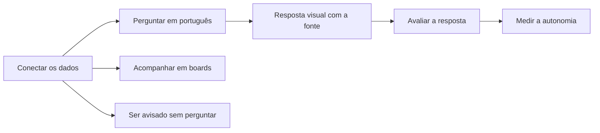

# O Horus v2

> **Em uma frase:** o Horus responde na hora, em português e com gráficos, às perguntas de negócio sobre os dados
> da empresa, mostrando de onde veio cada número, para que quem decide não precise esperar ninguém.

## 🧭 O que é o Horus

O Horus é um **chat de análise**. A pessoa escreve uma pergunta de negócio do jeito que fala, a **pergunta de
análise** ("quanto vendemos a mais que na semana passada?"), e recebe a resposta em gráfico, tabela, indicador ou
texto.

A resposta sai das **fontes vivas**, os dados que existem agora: os bancos de dados da empresa e, quando autorizada,
a pesquisa na web. Toda resposta diz de onde veio cada informação, e o que veio da web traz o link e a data de
publicação.

O propósito é a **autonomia**: o gestor e o executivo respondem às próprias perguntas de análise sem abrir chamado na
área de dados. "Na hora" quer dizer rápido em comparação com esse pedido, que às vezes leva dias. E o visual faz
parte do valor: é ele que torna o resultado fácil de entender.

> 💡 **Analogia:** é como ter ao lado um analista que conhece os sistemas da empresa, responde durante a reunião e
> mostra de onde tirou cada número. **Onde a analogia para:** o Horus só lê os dados como estão; não conserta dado
> errado nem decide por você.

> 📌 **Exemplo:** na reunião de resultado, o CEO pergunta: "e se tirarmos as lojas do Sul, como fica a margem?".
> Sem o Horus, a resposta é "abro um chamado e te retorno amanhã". Com ele, a gestora mostra o gráfico ali mesmo,
> com a fonte à vista. Diante do CEO, um número errado é pior que nenhum; por isso a origem aparece sempre.

O Horus v2 é a evolução do Horus em uso hoje, a v1.xx, e chega em duas entregas: a v2.0 e a v2.1, esta em duas
ondas.

## 👥 Para quem

O Horus é feito, primeiro, para três pessoas:

- **Gestor de área:** o gerente ou coordenador (de vendas, finanças, operações) que hoje espera a área de dados
  montar o relatório. Passa a responder sozinho.
- **Executivo:** o diretor, o CEO ou o dono. Tem o número certo na hora, sem aprender ferramenta.
- **Comprador:** quem aprova e paga a contratação. Vê a adoção subir e ganha a economia com o time que hoje monta
  painéis sob encomenda.

Dentro do produto, cada pessoa tem um **papel**. Uma **instância** é uma instalação do Horus. Em SaaS, há uma
instância só, a da Maind, e nela vivem as **organizações** de todos os clientes: cada organização é um cliente ou um
setor de um cliente.

| Papel | Quem é | O que faz no Horus |
| --- | --- | --- |
| 🏷️ **Owner da instância** | Um funcionário da Maind, que administra a instância (no produto, o administrador da instância) | Cria as organizações, libera e desativa os assentos, oferece a cada organização a conexão de IA da instância, que a Maind paga, cuida da marca da Maind e publica o aviso da instância; vê os números de todas as organizações (assentos, uso e custo), mas nunca os dados das conexões nem o conteúdo |
| 🔑 **Owner da organização** | Um funcionário do cliente, que configura a organização | Convida pessoas e aprova os convites dos gestores, define as preferências, cria as roles (os perfis de uso, logo abaixo), cuida das fontes de dados, monta a faixa de avisos e números, recebe os reportes de resposta errada, consulta a auditoria (o rastro do que foi entregue), pode cadastrar a conexão de IA da própria organização e tem a visão de billing, a da cobrança da organização, que mostra a contagem dos assentos |
| 👔 **Gestor** | Quem responde por uma equipe, a sua carteira | Faz perguntas de análise; cria os convites da equipe, que o owner aprova; monta grupos com quem gere; publica boards (painéis de gráficos) para os grupos de que é dono, se o owner permitir; agenda envios para a equipe; vê a medida de autonomia da equipe |
| 🥇 **Membro ouro** | Quem usa o Horus no dia a dia | Faz perguntas de análise e cria boards, relatórios, agendamentos e alertas só para si, sem compartilhar; entre os membros, só o ouro cria |
| 🥈 **Membro prata** | Quem pergunta, sem montar painéis | Faz perguntas de análise, no app, na Pergunta rápida e no WhatsApp, e recebe alertas e PDFs; não cria boards, relatórios, agendamentos nem agentes |
| 🥉 **Membro bronze** | Quem só acompanha | Vê os boards já criados e compartilhados com ele e recebe alertas e PDFs; não pergunta |
| 💰 **Comprador** | Quem aprova e paga | Acompanha a adoção pelo relatório da Maind, fora do produto, e, com a Maind, calcula a economia |

O owner da organização, o gestor e os membros ouro, prata e bronze são também os cinco tipos de **assento**, o lugar
de cada pessoa, pelo qual se cobra.

O membro ouro é o antigo membro full, e o bronze, o antigo membro leitor: por isso o ouro cria alertas e o bronze
recebe alertas e PDFs, como eles faziam.

Além do papel, o owner da organização monta **roles**: perfis que ligam ou desligam, recurso a recurso, o que cada
pessoa usa da conversa, como baixar os dados, ver a consulta que o Horus montou ou conversar pelo WhatsApp. A
organização nasce com uma role padrão, com tudo ligado, para ninguém ficar parado no primeiro dia, e com as outras
permissões também liberadas; o owner restringe o que quiser.

Quem é **excluído** da organização perde em definitivo o que criou (boards, conversas, agendamentos e agentes) e
também os registros dele, como o rastro da auditoria; nada passa a outra pessoa. Quem é **rebaixado**, de ouro a
prata ou a bronze, e continua na organização, mantém o que criou, mas **desabilitado**: nada se abre nem roda, e a
única ação possível é excluir. Se voltar a ser ouro, reativa item por item, quando quiser.

## 🎯 Que problemas resolve

Três problemas, nesta ordem:

1. ⚡ **A pergunta de análise na hora.** Surge uma dúvida de negócio, e a resposta sai ali, como na reunião de
   resultado.
2. 🔍 **A investigação.** A pessoa vê que algo mudou e descobre o porquê, passo a passo, até a causa.
3. 🔔 **O aviso.** O Horus avisa quando algo muda, sem ninguém perguntar.

Fora dessa ordem fica o **acompanhamento recorrente**, o mesmo relatório toda semana ou todo mês. O Horus o resolve
com os **boards**: painéis de gráficos que se atualizam sozinhos e saem em PDF.

### 📈 Como se sabe que resolveu

- **Para quem usa, a autonomia:** quantas perguntas de análise o Horus respondeu com dado da empresa ou fato da web,
  goste a pessoa ou não; a consulta que volta vazia, a falha e a conversa sem dado nem web não contam. O owner vê a
  conta pessoa a pessoa, e o gestor, a da equipe dele. A qualidade se mede à parte, pelo retorno de quem perguntou:
  👍🏻 gostei, 👎🏻 não gostei ou 🚫 reportar.
- **Para quem paga, o saving:** a economia com a área de dados, em horas ou pedidos que ela deixou de atender. O
  Horus mostra só o que mede, e o saving se calcula fora dele, com a Maind.

> 📌 **Exemplo:** em outubro, a Home de uma organização mostra 1.200 perguntas de análise respondidas, com 85% de 👍🏻
> entre as avaliadas. Antes do Horus, a área de dados atendia cerca de 300 pedidos por mês. Com os dois números, a
> Maind e o comprador calculam a economia.

## ⚙️ Como funciona, em grandes linhas

Do dado ligado ao aviso que chega sozinho, em seis passos.

1. **Conectar os dados.** O owner da organização liga ao Horus os bancos da empresa, com uma credencial que só
   permite ler. Cada fonte tem um **modelo semântico**: o dicionário que explica ao Horus o que cada coluna significa
   na empresa ("faturamento", "margem"). Quem o escreve é o time de dados, da empresa ou da Maind, fora do Horus, e o
   owner da organização o carrega. A inteligência artificial (IA) vem de uma **conexão de IA**, de uma de duas
   origens: a da própria organização, que o owner cadastra com o provedor que quiser e que a organização paga, ou a
   da instância, que a Maind cadastra, oferece à organização e paga. A organização nasce sem IA, e a Maind escolhe,
   ao criá-la, se lhe dá a conexão da instância. O owner escolhe os modelos de IA de cada tarefa.

   > 💡 É como explicar o vocabulário da casa a um funcionário novo antes do primeiro relatório. **Onde a analogia
   > para:** o Horus não aprimora o dicionário sozinho; quem o escreve e o corrige são pessoas.

2. **Perguntar.** A pessoa pergunta na **conversa de análise**, a tela principal; na Pergunta rápida (MF-110), um
   botão que abre a mesma conversa em qualquer tela; ou no WhatsApp. Vale no computador, no celular e no tablet.

3. **Receber a resposta com a origem.** A resposta traz texto e até dois blocos visuais, como um gráfico e uma
   tabela, com a fonte de cada informação. Os números vêm do banco, e não da IA. A organização define, fonte a fonte,
   até onde a resposta vai além dos dados, em cinco **níveis de inferência**, do descritivo (só o que está nos dados) ao
   especulativo, e a resposta avisa quando é hipótese. Com o 🚫, o reporte vai ao owner da organização, que procura o
   erro no modelo semântico ou nos dados.

4. **Acompanhar.** O que se olha toda semana vira um board, vivo na tela e pronto para sair em PDF. O membro ouro
   monta boards só para si; o owner e o gestor os publicam para a equipe, para grupos ou para a organização.

5. **Ser avisado.** O **agente**, um trabalhador de IA, segue instruções em texto. O **agendamento** decide quando
   ele roda, ou quando sai o PDF de um board. O **conector de saída**, o carteiro, entrega por e-mail ou WhatsApp, só
   a usuários do Horus; na v2.1, também num canal do Microsoft Teams ou num espaço do Google Chat, pelos Conectores
   de chat corporativo (MF-122). E, sem ninguém abrir nada, a **faixa de avisos e números** (MF-120), logo abaixo do
   cabeçalho, passa os avisos e os números do negócio. Ela é um contêiner de componentes: o aviso da Maind; o aviso
   do owner da organização, numa caixa de texto livre; e os cards de número, que o owner aponta para uma métrica e
   um período, como as vendas de ontem. Outros componentes, como indicadores e ícones, ainda serão definidos. É só
   por ela que o aviso da Maind chega às pessoas, e cada uma pode escondê-la.

   > 📌 **Exemplo:** a gestora Carla importa um arquivo com as perguntas de análise da semana. Toda segunda, o agente
   > consulta, analisa e entrega ao grupo "Vendas Sul" um PDF com gráficos, por e-mail. Quando as vendas caem mais de
   > 10%, chega um aviso.

6. **Medir e prestar contas.** A Home da organização mostra a medida de autonomia, dividida por canal (a conversa
   de análise, a Pergunta rápida e o WhatsApp), e a qualidade das respostas. A **auditoria** guarda quem entregou o
   quê a quem e quem abriu, sem o conteúdo; só o owner da organização a consulta, e nem ele altera um registro. Do
   lado da Maind, o owner da instância acompanha, só em números, os assentos, o uso e o custo de cada organização.

## 🧱 As macro funcionalidades

O Horus v2 se divide em 23 **macro funcionalidades (mf)**: cada uma é um pedaço do produto que entrega um valor
inteiro a alguém, e cada uma pertence a uma entrega só. Elas se agrupam em camadas, da base que sustenta tudo às
partes que a pessoa vê. Cada nome leva à página da mf; os nomes das mfs 120 a 123 ainda são provisórios.

| Camada | Macro funcionalidade | O que faz | Entrega |
| --- | --- | --- | --- |
| 🧱 **Plataforma:** quem entra e como se cobra | [Administração da instância](mfs/mf-101-administracao-da-instancia.md) (MF-101) | A marca da Maind, os administradores, a criação das organizações, o envio de e-mail, o aviso da instância, a conexão de IA da instância e o painel em que a Maind libera os assentos e acompanha cada organização | v2.0 |
| | [Organizações, pessoas e papéis](mfs/mf-102-organizacoes-pessoas-e-papeis.md) (MF-102) | As organizações, os convites, a equipe de cada gestor, os grupos e as roles | v2.0 |
| | [Licenças e planos](mfs/mf-103-licencas-e-planos.md) (MF-103) | A cobrança por assento, em cinco tipos, num plano só | v2.0 |
| 🔌 **Dados e IA:** de onde vêm os dados | [Conectar as fontes vivas](mfs/mf-104-conectar-as-fontes-vivas.md) (MF-104) | Os bancos da empresa, só para leitura, cada um com o seu modelo semântico | v2.0 |
| | [IA sob controle da organização](mfs/mf-105-ia-sob-controle-da-organizacao.md) (MF-105) | A conexão de IA, a da própria organização ou a da instância, que a Maind paga, e os modelos de IA de cada tarefa | v2.0 |
| | [Segurança dos dados por pessoa](mfs/mf-106-seguranca-dos-dados-por-pessoa.md) (MF-106) | Cada pessoa vê só os dados que pode ver, por regras configuradas no Horus e pelas que vêm do login da empresa | v2.1, onda 1 |
| | [Middleware na casa do contratante](mfs/mf-121-middleware-na-casa-do-contratante.md) (MF-121) | Um pacote da Maind que o cliente instala em casa, para o Horus chegar aos dados e à IA dele sem que o dado bruto saia de lá | v2.1, onda 2 |
| | [Fonte AWS Athena](mfs/mf-123-fonte-aws-athena.md) (MF-123) | O AWS Athena, o serviço de consulta de dados da Amazon, passa a responder perguntas de análise como as outras fontes | v2.1, onda 1 |
| 💬 **Motor de análise:** a pergunta de análise vira resposta | [Perguntar aos dados em português](mfs/mf-107-perguntar-aos-dados-em-portugues.md) (MF-107) | A conversa de análise, sobre os bancos e a web, com o retorno 👍🏻 👎🏻 🚫 de quem pergunta | v2.0 |
| | [Respostas visuais](mfs/mf-108-respostas-visuais.md) (MF-108) | Gráficos, tabelas, indicadores, mapa de calor (a grade em que a cor mostra a intensidade), chaveamento (o quadro de confrontos de um torneio) e fluxo (um diagrama de etapas), até dois por resposta | v2.0 |
| | [A web como fonte](mfs/mf-109-a-web-como-fonte.md) (MF-109) | A web completa os números da empresa, responde sozinha às perguntas de análise sobre o mundo lá fora, serve de régua para comparar e ajuda a investigar, sempre com link e data | v2.0 |
| 📲 **Canais:** por onde se pergunta | [Pergunta rápida](mfs/mf-110-pergunta-rapida.md) (MF-110) | Um botão em qualquer tela abre a conversa num popup, uma janela pequena sobre a tela, sem largar o que se está fazendo | v2.0 |
| | [Chat pelo WhatsApp](mfs/mf-111-chat-pelo-whatsapp.md) (MF-111) | A mesma conversa pelo WhatsApp, com o texto, os gráficos em imagem e um link para o app | v2.0 |
| 📌 **Acompanhar e avisar:** o que chega sozinho | [Boards e Relatórios](mfs/mf-112-boards-e-relatorios.md) (MF-112) | O board vivo na tela e em PDF, feito num editor só e publicado para quem precisa vê-lo | v2.0 |
| | [Conectores de Saída](mfs/mf-113-conectores-de-saida.md) (MF-113) | O carteiro: entrega por e-mail e WhatsApp, só a usuários do Horus | v2.0 |
| | [Módulo de Agendamentos de Agentes](mfs/mf-114-modulo-de-agendamentos-de-agentes.md) (MF-114) | O relógio: decide quando sai o PDF de um board ou quando roda um agente | v2.0 |
| | [Agentes ativos](mfs/mf-115-agentes-ativos.md) (MF-115) | O trabalhador de IA que, a partir de instruções em texto, consulta, analisa e avisa | v2.0 |
| | [Faixa de avisos e números](mfs/mf-120-faixa-de-avisos-e-numeros.md) (MF-120) | Uma faixa logo abaixo do cabeçalho, feita de componentes, que passa os avisos da Maind e do owner da organização e os números do negócio | v2.0 |
| | [Conectores de chat corporativo](mfs/mf-122-conectores-de-chat-corporativo.md) (MF-122) | O carteiro passa a entregar também num canal do Microsoft Teams e num espaço do Google Chat, só a usuários do Horus | v2.1, onda 1 |
| 📈 **Prova e controle:** mostrar o valor e prestar contas | [Auditoria](mfs/mf-116-auditoria.md) (MF-116) | O rastro de quem entregou o quê a quem e de quem abriu, sem o conteúdo | v2.0 |
| | [Home da organização](mfs/mf-117-home-da-organizacao.md) (MF-117) | A página inicial da organização, com os indicadores de uso, a medida de autonomia, dividida por canal, e a qualidade das respostas | v2.0 |
| | [Bases de demonstração](mfs/mf-118-bases-de-demonstracao.md) (MF-118) | Duas organizações de exemplo, com dados fictícios de uma rede de lojas e de uma frota e um cenário pronto para mostrar cada peça da v2.0 funcionando, para demonstrar o Horus e testar cada entrega | v2.0 |
| 🔍 **Investigação:** o porquê | [Investigação guiada](mfs/mf-119-investigacao-guiada.md) (MF-119) | A partir de "investigar" num número ou gráfico que mudou, o Horus leva a pessoa ao porquê, passo a passo, com a fonte de cada passo | v2.1, onda 1 |

## 🗓️ As entregas: v2.0 e v2.1

A v2.0 resolve o primeiro problema, o terceiro e o acompanhamento, e sai inteira, de uma vez, em SaaS. A v2.1 reúne
tudo o que ficou fora dela, a começar pela investigação, e sai em duas ondas: primeiro o que serve ao SaaS, depois a
casa do contratante.

| | 🟢 v2.0 | 🔵 v2.1, onda 1: o SaaS | 🔵 v2.1, onda 2: a casa do contratante |
| --- | --- | --- | --- |
| **A promessa** | Perguntar e ter a resposta na hora, acompanhar o negócio em boards e ser avisado quando algo muda, com a fonte à vista. A empresa mede a adoção e paga por assento | Descobrir o porquê de uma mudança, passo a passo; cada pessoa ver só os dados que pode ver, entrando com o login da empresa; receber os avisos no chat da empresa | Usar o Horus sobre dados e modelos de IA que não podem sair da casa do cliente, sem instalar o Horus lá |
| **Os problemas** | A pergunta de análise na hora, o aviso e o acompanhamento recorrente | A investigação | Os mesmos, para quem não pode tirar os dados de casa |
| **O que traz** | A conversa de análise com o retorno de quem pergunta; as respostas visuais; a web com link e data; a Pergunta rápida e o WhatsApp; os boards em PDF; os agentes, os agendamentos e os envios por e-mail e WhatsApp; a faixa de avisos e números; as pessoas, os grupos e as roles; a cobrança por assento, em cinco tipos; a auditoria; a medida de autonomia; as bases de demonstração; a marca da Maind | A investigação guiada; a segurança dos dados por pessoa, com o login corporativo; o Teams e o Google Chat como conectores de saída; a fonte AWS Athena | O middleware na casa do contratante |
| **Onde roda** | Em SaaS, na infraestrutura da Maind | Em SaaS | O Horus em SaaS; o middleware na infraestrutura do cliente |

➖ **Sem versão, por enquanto:** a instalação completa do Horus no cliente, com o modo "tudo dentro"; a marca
completa do contratante; e o tema do contratante, as cores e a aparência. Não há v2.2 por ora.

> ⚠️ **Quem vê o quê, na v2.0.** Toda consulta usa os dados da organização inteira. O que separa uma pessoa da outra é
> o papel e as roles, que decidem o que cada pessoa usa do Horus, mas não limitam as fontes: quem pode perguntar
> alcança todas as fontes da sua organização, e um setor que precise de dados à parte ganha a sua própria organização.
> Os boards e os números da faixa já calculam com o acesso de quem os vê, mas, na v2.0, esse acesso é o da
> organização inteira. Na v2.1, cada pessoa passa a ver só os dados que pode ver (o gestor do Sul, só o Sul), e a
> empresa pode usar o **login corporativo**: a mesma conta com que a pessoa entra nos sistemas da empresa.

## 🏢 Como o Horus é entregue

- 🧩 **Uma instância só, a da Maind.** O Horus roda em **SaaS**, na infraestrutura da Maind, e o cliente o usa pela
  internet. É uma instância só, que atende a todos os clientes. Quem a administra é um funcionário da Maind, o owner
  da instância, que vê os números de todas as organizações, mas não os dados das conexões. Quem configura cada
  organização é o owner dela, funcionário do cliente.
- 🗂️ **Várias organizações numa instância.** Cada organização tem as próprias pessoas, fontes e configurações, num
  banco de dados só dela, para que nada de uma apareça na outra. Só a Maind cria organizações. O primeiro
  contratante é a empresa que usa o Horus por dentro, um setor por organização; a revenda vem depois.

  > 💡 A instância é um prédio da Maind, e cada organização é uma sala com chave própria. A Maind cuida da portaria e
  > sabe quem ocupa cada sala, mas não abre as gavetas. **Onde a analogia para:** na v2.1, quem não pode trazer os
  > papéis ao prédio os deixa em casa, e pelo middleware só atravessam a rua a pergunta e a resposta pronta.

- 🏷️ **Com a marca da Maind, na v2.0.** O Horus é uma plataforma de *white label*, uma marca branca: pode levar a
  marca de quem contrata. Na v2.0, porém, a marca é a da Maind: o nome, os logos, o rodapé e o e-mail do produto
  valem para todas as organizações. A marca completa do contratante (logo, nome e e-mail em todo o produto, até no
  remetente) está sem versão. A frase da promessa, hoje "Informação na palma da mão", fica na comunicação comercial
  da Maind, fora das telas.
- 🏠 **A casa do contratante, por um middleware.** Para o cliente cujos dados e modelos de IA não podem sair de casa,
  a onda 2 da v2.1 traz o Middleware na casa do contratante (MF-121): um pacote de software pronto da Maind (uma
  imagem de container) que o cliente instala na infraestrutura dele. O Horus continua em SaaS e, pelo middleware,
  chega aos dados, à internet e à IA do cliente. O middleware tem um endereço na internet e um par de chaves
  cadastrado na organização, no Horus, e a TI do cliente controla quem passa, liberando só o endereço do Horus. Só a
  pergunta e a resposta pronta saem de casa. O owner da organização conecta o middleware e pode permitir mais, como
  o comando da consulta ou o arquivo CSV com os dados; a Maind não liga nem vê essas saídas.

  A **instalação completa** do Horus no cliente (on-premises) está sem versão. É a porta de volta: só volta se um
  cliente exigir que nada, nem a pergunta, saia de casa, e traz com ela o modo "tudo dentro", em que a IA vem de um
  modelo que o próprio cliente traz.

- 🎫 **Um plano, cobrado por assento.** Na v2.0 há um plano só, com tudo o que ela oferece. Cobra-se por
  **assento**, de um de cinco tipos: owner, gestor, membro ouro, membro prata ou membro bronze. Cada organização
  nasce com um assento de owner grátis. A Maind libera e desativa os assentos num painel, e o owner pede mais por
  contato comercial. Sem assento livre do tipo, a pessoa não entra. Na cobrança, o owner da organização vê, de cada
  tipo, quantos assentos tem, quantos usa e quantos estão livres. A IA tem duas origens: a organização pode usar a
  conexão de IA da instância, que a Maind paga e embute no preço do assento, sem abrir conta em provedor nenhum, ou
  trazer a própria, que cadastra e paga direto ao provedor. À parte, a organização que usa o número de WhatsApp da
  Maind paga as mensagens que gerar; quem usa o próprio número paga a Meta direto. Se a Maind inativa a organização,
  por exemplo por falta de pagamento, o acesso e o que roda sozinho param, nada se apaga, e reativar devolve tudo. O
  valor em reais se acerta em contrato.

  > 📌 **Exemplo:** a Maind libera, para uma organização, o assento de owner grátis, 5 de gestor, 20 de membro ouro,
  > 30 de membro prata e 100 de membro bronze. Ninguém precisa escolher plano para começar.

## 🚧 O que o Horus não é

- **Não altera nada.** Só lê as fontes: nunca muda dados nem executa ações nos sistemas da empresa. Enviar um alerta
  é saída de informação, e não ação sobre os sistemas.
- **Não arruma os dados.** Usa os dados como estão, sem limpar nem reconciliar.
- **Não inventa número.** Sem dado suficiente, diz que não consegue responder.
- **Não decide por você.** A decisão continua humana, e a resposta só vai além dos dados até o nível de inferência
  que a organização autorizou. A exceção é o agente: quem o cria escolhe o nível dele, e todo alerta mostra o nível
  usado.

## 📚 Para saber mais

- [Norte do produto](../raw/produto/02-norte-do-produto.md): propósito, público, problemas em ordem, promessa, fontes,
  formas de entrega, medidas de sucesso e limites (`D-001` a `D-015`, `D-017`, `D-022` e `D-024`).
- [Temas da visão do produto](../raw/produto/01-temas-da-visao-do-produto.md): os 20 temas e as perguntas que orientaram
  a visão.
- [Macro funcionalidades de hoje](../raw/produto/04-macro-funcionalidades-de-hoje.md): o que a v1.xx já entrega e a
  tabela de conversão, com a camada de cada mf (`D-137` a `D-139`, a renumeração). As mfs de `MF-120` a `MF-123`
  entram nela como leitura do PO (camada 📌 ou 🔌).
- [A v2.0 consolidada](../raw/produto/05-v2.0-consolidada.md): §1 (a v2.0 em uma página), §2 (o que resolve e o que não
  resolve), §4 (a prova de valor passo a passo), §5 (as regras de cada mf) e §6 (o que fica fora).
- [As versões](../raw/produto/06-versoes.md): a v2.0, as duas ondas da v2.1 e o que está sem versão, mf a mf
  (`D-105`, `D-109`, `D-119`, `D-121`, `D-122`, `D-181`, `D-188` e `D-197` a `D-200`).
- [Mapa de objetivos e funcionalidades](../raw/produto/07-mapa-de-objetivos-e-funcionalidades.md): o objetivo de cada
  entrega e os objetivos O1 a O8 (`D-136`).
- [Backlog estratégico](../raw/produto/backlog-estrategico.md): `D-145` (a organização como fronteira dos dados na v2.0 e a
  segurança por pessoa inteira na v2.1) e `D-199` (as peças da segurança por pessoa reunidas na `MF-106`);
  - uma mf, uma versão, e as mfs novas: `D-197`, `D-198` (`MF-122` e `MF-123`), `D-152` e `D-174` (`MF-120`), `D-180`
    (`MF-119`), `D-196` (`MF-121`) e `D-201` (definição da `MF-122` e da `MF-123`) e `D-202` (definição da `MF-101`);
  - a faixa: `D-204` (indispensável à v2.0), `D-212` (o card de número) e `D-213` (o contêiner de componentes e a
    caixa de texto livre);
  - as duas ondas da v2.1: `D-181` e `D-188`;
  - o SaaS de uma instância só e os papéis da instância e da organização: `D-146`, `D-147`, `D-148` e `D-193`;
  - a marca: `D-007`, `D-011`, `D-183` e `D-200` (a marca da Maind na v2.0);
  - a casa do contratante: `D-188` a `D-196` (o middleware); `D-010`, `D-175`, `D-176` e `D-185` a `D-187` (a
    instalação completa e o modo "tudo dentro", sem versão);
  - formas de entrega: `D-012`, `D-016` e `D-017`;
  - organizações e os dois níveis de owner: `D-008`, `D-009` e `D-013`;
  - pessoas, roles e role padrão: `D-056`, `D-110` a `D-114`, `D-118` (o login corporativo fora da v2.0) e `D-228` (a
    organização nasce com tudo liberado);
  - quem sai e quem é rebaixado: `D-206` a `D-209` (o excluído perde o que criou, o rebaixado o mantém desabilitado e
    reativa um a um, sem transferência) e `D-210` e `D-211` (os registros do excluído e o total sem dono);
  - assentos e plano: `D-069`, `D-080`, `D-115` a `D-117`, `D-123`, `D-194` (os cinco tipos de assento), `D-203` (a
    prata pergunta, o ouro cria) e `D-214` (a cobrança mostra a contagem dos assentos);
  - os custos em SaaS: `D-159` e `D-216` (a IA: a conexão da organização, que ela paga, e a da instância, que a Maind
    paga), `D-217` (a organização nasce sem IA) e `D-160` (o WhatsApp);
  - o modelo semântico: `D-219` (escrito fora do Horus e carregado pelo owner da organização); o teto de inferência
    de cada fonte: `D-220`;
  - o acesso dos boards e da faixa: `D-163`, `D-164`, `D-167` e `D-169`; a web como fonte: `D-162`;
  - medidas: `D-004`, `D-005`, `D-014`, `D-125`, `D-132`, `D-133`, `D-222` (o que conta como respondida), `D-238` (o
    gestor vê a medida da equipe) e `D-239` (a divisão por canal);
  - as bases de demonstração: `D-232` (um cenário para cada prova de valor) e `D-233` (a rede de lojas e a frota);
  - o aviso e os limites: `D-022`, `D-024`, `D-035`, `D-062`, `D-083` e `D-122`.
- [Estratégia da solução](../raw/arquitetura/01-estrategia-da-solucao.md): §1 (a solução numa página e o que continua
  valendo) e §2 (as duas entregas).
- [Registro de decisões da arquitetura](../raw/arquitetura/02-registro-de-decisoes.md): `ARQ-090` (a Segurança dos dados
  por pessoa inteira na v2.1; na v2.0, toda consulta com os dados da organização inteira) e `ARQ-010` (um banco por
  organização).
- [Documentação de leitura](README.md): o índice desta pasta.
