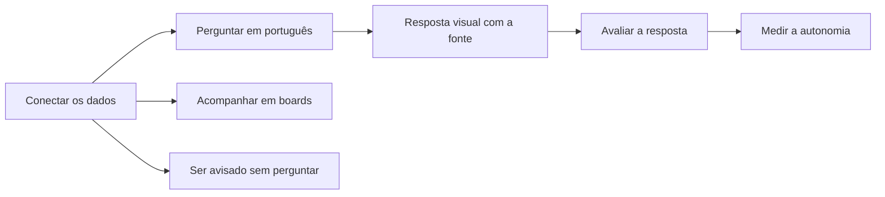

# O Horus v2

> **Em uma frase:** o Horus responde na hora, em português e com gráficos, às perguntas de negócio sobre os dados
> da empresa, mostrando de onde veio cada número, para que quem decide não precise esperar ninguém.

## 🧭 O que é o Horus

O Horus é um **chat de análise**. A pessoa escreve uma pergunta de negócio do jeito que fala, a **pergunta de
análise** ("quanto vendemos a mais que na semana passada?"), e recebe a resposta em gráfico, tabela, indicador ou
texto.

A resposta sai das **fontes vivas**, os dados que existem agora: os bancos de dados da empresa e a pesquisa na web.
Toda resposta diz de onde veio cada informação, e o que veio da web traz o link e a data de publicação.

O propósito é a **autonomia**: o gestor e o executivo respondem às próprias perguntas de análise sem abrir chamado na
área de dados. "Na hora" quer dizer rápido em comparação com esse pedido, que às vezes leva dias. E o visual faz
parte do valor: é ele que torna o resultado fácil de entender.

> 💡 **Analogia:** é como ter ao lado um analista que conhece os sistemas da empresa, responde durante a reunião e
> mostra de onde tirou cada número. **Onde a analogia para:** o Horus só lê os dados como estão; não conserta dado
> errado nem decide por você.

> 📌 **Exemplo:** na reunião de resultado, o CEO pergunta: "e se tirarmos as lojas do Sul, como fica a margem?".
> Sem o Horus, a resposta é "abro um chamado e te retorno amanhã". Com ele, a gestora mostra o gráfico ali mesmo,
> com a fonte à vista. Diante do CEO, um número errado é pior que nenhum; por isso a origem aparece sempre.

O Horus v2 é a evolução do Horus em uso hoje, a v1.xx, e chega em duas entregas: a v2.0 e a v2.1.

## 👥 Para quem

O Horus é feito, primeiro, para três pessoas:

- **Gestor de área:** o gerente ou coordenador (de vendas, finanças, operações) que hoje espera a área de dados
  montar o relatório. Passa a responder sozinho.
- **Executivo:** o diretor, o CEO ou o dono. Tem o número certo na hora, sem aprender ferramenta.
- **Comprador:** quem aprova e paga a contratação. Vê a adoção subir e ganha a economia com o time que hoje monta
  painéis sob encomenda.

Dentro do produto, cada pessoa tem um **papel**. Uma **instância** é uma instalação do Horus, e nela vivem várias
**organizações**: cada uma é um setor da empresa ou um cliente.

| Papel | Quem é | O que faz no Horus |
| --- | --- | --- |
| 🏷️ **Owner da instância** | Quem administra a instalação | Cuida da marca (nome, logo e e-mail) e do que vale para todas as organizações |
| 🔑 **Owner da organização** | Quem administra um setor ou um cliente | Convida pessoas e aprova os convites dos gestores, define as preferências, cria as roles (os perfis de uso, logo abaixo), cuida das fontes de dados, recebe os reportes de resposta errada e consulta a auditoria, o rastro do que foi entregue |
| 👔 **Gestor** | Quem responde por uma equipe, a sua carteira | Cria os convites da equipe, que o owner aprova; monta grupos com quem gere; publica boards (painéis de gráficos), se o owner permitir; agenda envios para a equipe |
| 🙋 **Membro full** | Quem usa o Horus no dia a dia | Faz perguntas de análise e cria os próprios boards e alertas |
| 👀 **Membro leitor** | Quem só acompanha | Vê os boards de outras pessoas e recebe alertas e PDFs; não pergunta |
| 💰 **Comprador** | Quem aprova e paga | Acompanha a adoção na Home da organização (MF-117), a página inicial dela, e, com a Maind, calcula a economia |

Além do papel, o owner da organização monta **roles**: perfis que ligam ou desligam, recurso a recurso, o que cada
pessoa usa da conversa, como baixar os dados, ver a consulta que o Horus montou ou conversar pelo WhatsApp. A
organização nasce com uma role padrão, com tudo ligado, para ninguém ficar parado no primeiro dia.

## 🎯 Que problemas resolve

Três problemas, nesta ordem:

1. ⚡ **A pergunta de análise na hora.** Surge uma dúvida de negócio, e a resposta sai ali, como na reunião de
   resultado.
2. 🔍 **A investigação.** A pessoa vê que algo mudou e descobre o porquê, passo a passo, até a causa.
3. 🔔 **O aviso.** O Horus avisa quando algo muda, sem ninguém perguntar.

Fora dessa ordem fica o **acompanhamento recorrente**, o mesmo relatório toda semana ou todo mês. O Horus o resolve
com os **boards**: painéis de gráficos que se atualizam sozinhos e saem em PDF.

### 📈 Como se sabe que resolveu

- **Para quem usa, a autonomia:** quantas perguntas de análise o Horus respondeu, goste a pessoa ou não; se ele diz
  que não consegue, não conta. A qualidade se mede à parte, pelo retorno de quem perguntou: 👍🏻 gostei, 👎🏻 não
  gostei ou 🚫 reportar.
- **Para quem paga, o saving:** a economia com a área de dados, em horas ou pedidos que ela deixou de atender. O
  Horus mostra só o que mede, e o saving se calcula fora dele, com a Maind.

> 📌 **Exemplo:** em outubro, a Home de uma organização mostra 1.200 perguntas de análise respondidas, com 85% de 👍🏻
> entre as avaliadas. Antes do Horus, a área de dados atendia cerca de 300 pedidos por mês. Com os dois números, a
> Maind e o comprador calculam a economia.

## ⚙️ Como funciona, em grandes linhas

Do dado ligado ao aviso que chega sozinho, em seis passos.

1. **Conectar os dados.** O owner da organização liga ao Horus os bancos da empresa, com uma credencial que só
   permite ler. Cada fonte tem um **modelo semântico**: o dicionário que explica ao Horus o que cada coluna significa
   na empresa ("faturamento", "margem"). Quem o monta é o time de dados, da empresa ou da Maind. O owner também
   escolhe os modelos de inteligência artificial (IA) e acompanha quanto custam.

   > 💡 É como explicar o vocabulário da casa a um funcionário novo antes do primeiro relatório. **Onde a analogia
   > para:** o Horus não aprimora o dicionário sozinho; quem o escreve e o corrige são pessoas.

2. **Perguntar.** A pessoa pergunta na **conversa de análise**, a tela principal; na Pergunta rápida (MF-110), um
   botão que abre a mesma conversa em qualquer tela; ou no WhatsApp. Vale no computador, no celular e no tablet.

3. **Receber a resposta com a origem.** A resposta traz texto e até dois blocos visuais, como um gráfico e uma
   tabela, com a fonte de cada informação. Os números vêm do banco, e não da IA. A organização define até onde a
   resposta vai além dos dados, em cinco **níveis de inferência**, do descritivo (só o que está nos dados) ao
   especulativo, e a resposta avisa quando é hipótese. Com o 🚫, o reporte vai ao owner da organização, que procura o
   erro no modelo semântico ou nos dados.

4. **Acompanhar.** O que se olha toda semana vira um board, vivo na tela e pronto para sair em PDF. O owner e o
   gestor o publicam para a equipe, para grupos ou para a organização.

5. **Ser avisado.** O **agente**, um trabalhador de IA, segue instruções em texto. O **agendamento** decide quando
   ele roda, ou quando sai o PDF de um board. O **conector de saída**, o carteiro, entrega por e-mail ou WhatsApp, só
   a usuários do Horus.

   > 📌 **Exemplo:** a gestora Carla importa um arquivo com as perguntas de análise da semana. Toda segunda, o agente
   > consulta, analisa e entrega ao grupo "Vendas Sul" um PDF com gráficos, por e-mail. Quando as vendas caem mais de
   > 10%, chega um aviso.

6. **Medir e prestar contas.** A Home da organização mostra a medida de autonomia e a qualidade das respostas. A
   **auditoria** guarda quem entregou o quê a quem e quem abriu, sem o conteúdo; só o owner da organização a
   consulta, e nem ele altera um registro.

## 🧱 As macro funcionalidades

O Horus v2 se divide em 19 **macro funcionalidades (mf)**: cada uma é um pedaço do produto que entrega um valor
inteiro a alguém. Elas se agrupam em camadas, da base que sustenta tudo às partes que a pessoa vê. Cada nome leva à
página da mf.

| Camada | Macro funcionalidade | O que faz | Entrega |
| --- | --- | --- | --- |
| 🧱 **Plataforma:** quem entra e como se cobra | [Administração da instância](mfs/mf-101-administracao-da-instancia.md) (MF-101) | A marca de quem contrata, os administradores, o envio de e-mail e o painel em que a Maind libera os assentos | v2.0; a marca completa na v2.1 |
| | [Organizações, pessoas e papéis](mfs/mf-102-organizacoes-pessoas-e-papeis.md) (MF-102) | As organizações, os convites, a equipe de cada gestor, os grupos e as roles | v2.0 |
| | [Licenças e planos](mfs/mf-103-licencas-e-planos.md) (MF-103) | A cobrança por assento, por tipo, num plano só | v2.0; a instalação no contratante na v2.1 |
| 🔌 **Dados e IA:** de onde vêm os dados | [Conectar as fontes vivas](mfs/mf-104-conectar-as-fontes-vivas.md) (MF-104) | Os bancos da empresa, só para leitura, cada um com o seu modelo semântico | v2.0; a rede interna do contratante na v2.1 |
| | [IA sob controle da organização](mfs/mf-105-ia-sob-controle-da-organizacao.md) (MF-105) | A organização escolhe os modelos de IA de cada tarefa e acompanha o consumo e o custo | v2.0; a IA dentro de casa na v2.1 |
| | [Segurança dos dados por pessoa](mfs/mf-106-seguranca-dos-dados-por-pessoa.md) (MF-106) | Cada pessoa vê só os dados que pode ver, por regras configuradas no Horus e pelas que vêm do login da empresa | v2.1, inteira |
| 💬 **Motor de análise:** a pergunta de análise vira resposta | [Perguntar aos dados em português](mfs/mf-107-perguntar-aos-dados-em-portugues.md) (MF-107) | A conversa de análise, sobre os bancos e a web, com o retorno 👍🏻 👎🏻 🚫 de quem pergunta | v2.0 |
| | [Respostas visuais](mfs/mf-108-respostas-visuais.md) (MF-108) | Gráficos, tabelas, indicadores, mapa de calor (a grade em que a cor mostra a intensidade), chaveamento (o quadro de confrontos de um torneio) e fluxo (um diagrama de etapas), até dois por resposta | v2.0 |
| | [A web como fonte](mfs/mf-109-a-web-como-fonte.md) (MF-109) | A web completa os números da empresa, responde sozinha às perguntas de análise sobre o mundo lá fora, serve de régua para comparar e ajuda a investigar, sempre com link e data | v2.0 |
| 📲 **Canais:** por onde se pergunta | [Pergunta rápida](mfs/mf-110-pergunta-rapida.md) (MF-110) | Um botão em qualquer tela abre a conversa num popup, uma janela pequena sobre a tela, sem largar o que se está fazendo | v2.0 |
| | [Chat pelo WhatsApp](mfs/mf-111-chat-pelo-whatsapp.md) (MF-111) | A mesma conversa pelo WhatsApp, com o texto, os gráficos em imagem e um link para o app | v2.0 |
| 📌 **Acompanhar e avisar:** o que chega sozinho | [Boards e Relatórios](mfs/mf-112-boards-e-relatorios.md) (MF-112) | O board vivo na tela e em PDF, feito num editor só e publicado para quem precisa vê-lo | v2.0 |
| | [Conectores de Saída](mfs/mf-113-conectores-de-saida.md) (MF-113) | O carteiro: entrega por e-mail e WhatsApp, só a usuários do Horus | v2.0; Teams, Google Chat e outros na v2.1 |
| | [Módulo de Agendamentos de Agentes](mfs/mf-114-modulo-de-agendamentos-de-agentes.md) (MF-114) | O relógio: decide quando sai o PDF de um board ou quando roda um agente | v2.0 |
| | [Agentes ativos](mfs/mf-115-agentes-ativos.md) (MF-115) | O trabalhador de IA que, a partir de instruções em texto, consulta, analisa e avisa | v2.0 |
| 📈 **Prova e controle:** mostrar o valor e prestar contas | [Auditoria](mfs/mf-116-auditoria.md) (MF-116) | O rastro de quem entregou o quê a quem e de quem abriu, sem o conteúdo | v2.0 |
| | [Home da organização](mfs/mf-117-home-da-organizacao.md) (MF-117) | A página inicial da organização, com os indicadores de uso, a medida de autonomia e a qualidade das respostas | v2.0 |
| | [Bases de demonstração](mfs/mf-118-bases-de-demonstracao.md) (MF-118) | Dados fictícios, como os de uma rede de lojas, para demonstrar o Horus e testar cada entrega | v2.0 |
| 🔵 **Para a v2.1:** o porquê | [Investigação guiada](mfs/mf-119-investigacao-guiada.md) (MF-119) | Ver que algo mudou e chegar ao porquê, passo a passo, com o Horus mostrando o caminho | v2.1, ainda em desenho |

## 🗓️ As entregas: v2.0 e v2.1

A v2.0 resolve o primeiro problema, o terceiro e o acompanhamento, e sai inteira, de uma vez, em SaaS. A v2.1 reúne
tudo o que ficou fora dela, a começar pela investigação.

| | 🟢 v2.0 | 🔵 v2.1 |
| --- | --- | --- |
| **A promessa** | Perguntar e ter a resposta na hora, acompanhar o negócio em boards e ser avisado quando algo muda, com a fonte à vista. A empresa mede a adoção e paga por assento | Descobrir o porquê de uma mudança, passo a passo, e levar o Horus a empresas mais exigentes: com login e segurança corporativos, com a própria marca ou com os dados dentro de casa |
| **Os problemas** | A pergunta de análise na hora, o aviso e o acompanhamento recorrente | A investigação |
| **O que traz** | A conversa de análise com o retorno de quem pergunta; as respostas visuais; a web com link e data; a Pergunta rápida e o WhatsApp; os boards em PDF; os agentes, os agendamentos e os envios por e-mail e WhatsApp; as pessoas, os grupos e as roles; a cobrança por assento; a auditoria; a medida de autonomia; as bases de demonstração | A investigação guiada; a segurança dos dados por pessoa, com o login corporativo; a marca completa; o Horus instalado no contratante, com a IA dentro de casa; outros conectores, como Teams e Google Chat |
| **Onde roda** | Em SaaS, na infraestrutura da Maind | Também na infraestrutura do contratante |

> ⚠️ **Quem vê o quê, na v2.0.** Toda consulta usa os dados da organização inteira. O que separa uma pessoa da outra é
> o papel e as roles, que decidem o que cada pessoa usa do Horus, mas não limitam as fontes: quem pode perguntar
> alcança todas as fontes da sua organização, e um setor que precise de dados à parte ganha a sua própria organização.
> Na v2.1, cada pessoa passa a ver só os dados
> que pode ver (o gestor do Sul, só o Sul), e a empresa pode usar o **login corporativo**: a mesma conta com que a
> pessoa entra nos sistemas da empresa.

## 🏢 Como o Horus é entregue

- 🏷️ **Com a marca de quem contrata.** O Horus é *white label*, uma marca branca: leva o nome, o logo e o e-mail do
  contratante. A marca completa, em todo o produto e no remetente dos e-mails, chega na v2.1. A frase da promessa,
  hoje "Informação na palma da mão", fica na comunicação comercial da Maind, fora das telas.
- 🧩 **Uma versão só, em dois lugares.** Em **SaaS**, o Horus roda na infraestrutura da Maind, e o cliente o usa pela
  internet. **On-premises**, roda na infraestrutura do próprio contratante. A versão é a mesma; muda só a instância,
  ou seja, onde ela roda e quem a opera.
- 🎚️ **O contratante escolhe o que sai de casa.** A IA e a pesquisa web funcionam "com serviços externos
  autorizados", o padrão, ou "tudo dentro" da infraestrutura dele, modo que chega na v2.1.
- 🗂️ **Várias organizações numa instância.** Cada organização tem as próprias pessoas, fontes e configurações, num
  banco de dados só dela, para que nada de uma apareça na outra. O primeiro contratante é a empresa que usa o Horus
  por dentro, um setor por organização; a revenda vem depois.

  > 💡 A instância é um prédio com a fachada de quem contrata, e cada organização é uma sala com chave própria.
  > **Onde a analogia para:** o prédio pode ficar no terreno da Maind ou no do cliente, e é o mesmo prédio nos dois.

- 🎫 **Um plano, cobrado por assento.** Na v2.0 há um plano só, com tudo o que ela oferece. Cobra-se por
  **assento**, o lugar de cada pessoa, de um de quatro tipos: owner, gestor, membro full ou membro leitor. Cada
  organização nasce com um assento de owner grátis. A Maind libera e desativa os assentos num painel, e o owner pede
  mais por contato comercial. Sem assento livre do tipo, a pessoa não entra. Se a Maind desativa os assentos, por
  exemplo por falta de pagamento, o acesso e o que roda sozinho param, e as configurações ficam guardadas. O valor em
  reais se acerta em contrato.

  > 📌 **Exemplo:** a Maind libera, para uma organização, o assento de owner grátis, 30 de membro full e 100 de membro
  > leitor. Ninguém precisa escolher plano para começar.

## 🚧 O que o Horus não é

- **Não altera nada.** Só lê as fontes: nunca muda dados nem executa ações nos sistemas da empresa. Enviar um alerta
  é saída de informação, e não ação sobre os sistemas.
- **Não arruma os dados.** Usa os dados como estão, sem limpar nem reconciliar.
- **Não inventa número.** Sem dado suficiente, diz que não consegue responder.
- **Não decide por você.** A decisão continua humana, e a resposta só vai além dos dados até o nível de inferência
  que a organização autorizou. A exceção é o agente: quem o cria escolhe o nível dele, e todo alerta mostra o nível
  usado.

## 📚 Para saber mais

- [Norte do produto](../raw/produto/02-norte-do-produto.md): propósito, público, problemas em ordem, promessa, fontes,
  formas de entrega, medidas de sucesso e limites (`D-001` a `D-015`, `D-017`, `D-022` e `D-024`).
- [Temas da visão do produto](../raw/produto/01-temas-da-visao-do-produto.md): os 20 temas e as perguntas que orientaram
  a visão.
- [Macro funcionalidades de hoje](../raw/produto/04-macro-funcionalidades-de-hoje.md): o que a v1.xx já entrega e a
  tabela de conversão, com a camada de cada mf (`D-137` a `D-139`).
- [A v2.0 consolidada](../raw/produto/05-v2.0-consolidada.md): §1 (a v2.0 em uma página), §2 (o que resolve e o que não
  resolve), §4 (a prova de valor passo a passo), §5 (as regras de cada mf) e §6 (o que fica fora).
- [As versões](../raw/produto/06-versoes.md): a v2.0 e a v2.1, mf a mf (`D-105`, `D-109`, `D-119`, `D-121` e `D-122`).
- [Mapa de objetivos e funcionalidades](../raw/produto/07-mapa-de-objetivos-e-funcionalidades.md): o objetivo de cada
  entrega e os objetivos O1 a O8 (`D-136`).
- [Backlog estratégico](../raw/produto/backlog-estrategico.md): `D-145` (a organização como fronteira dos dados na v2.0 e a
  segurança por pessoa inteira na v2.1);
  - marca branca, formas de entrega e modos da IA: `D-007`, `D-010`, `D-011`, `D-012`, `D-016` e `D-017`;
  - organizações e os dois níveis de owner: `D-008`, `D-009` e `D-013`;
  - pessoas, roles e role padrão: `D-056`, `D-110` a `D-114` e `D-118` (o login corporativo fora da v2.0);
  - assentos e plano: `D-069`, `D-080`, `D-115` a `D-117` e `D-123`;
  - medidas: `D-004`, `D-005`, `D-014`, `D-125`, `D-132` e `D-133`;
  - o aviso e os limites: `D-022`, `D-024`, `D-035`, `D-062`, `D-083` e `D-122`.
- [Estratégia da solução](../raw/arquitetura/01-estrategia-da-solucao.md): §1 (a solução numa página e o que continua
  valendo) e §2 (as duas entregas).
- [Registro de decisões da arquitetura](../raw/arquitetura/02-registro-de-decisoes.md): `ARQ-090` (a Segurança dos dados
  por pessoa inteira na v2.1; na v2.0, toda consulta com os dados da organização inteira) e `ARQ-010` (um banco por
  organização).
- [Documentação de leitura](README.md): o índice desta pasta.
