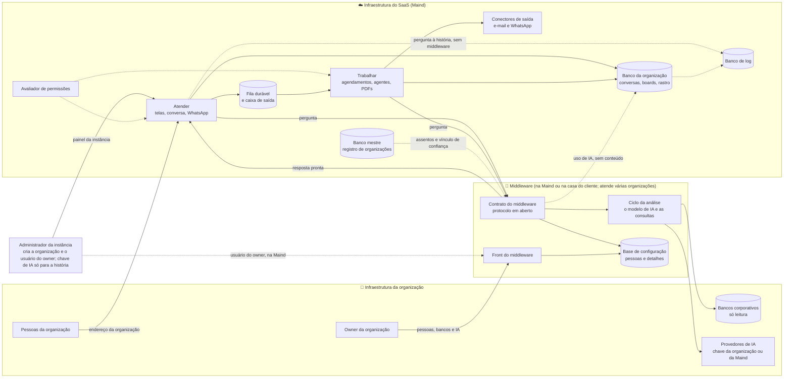

# Estratégia da solução do Horus v2

Situação: 🟢 escrita pelo arquiteto · os catorze documentos da lista escritos; ⚠️ os documentos 04 a 14 ainda não refletem a infraestrutura separada (`D-258` a `D-280`) e se refazem a partir deste (seção 8.2) · 97 decisões no registro (32 ✅, 54 🟢, 5 🟡, 6 ⚪) · 🟡 cinco decisões registradas à espera do dono e nove propostas da infraestrutura separada, ainda sem número, a registrar (seção 8.1) · 📤 os trinta itens devolvidos ao PO: vinte e um fechados pelo dono, um fechado em parte, um sem objeto e sete ainda sem número (seção 9) · 19 verificações pendentes (V-01 a V-19, documento 14).

Última atualização: 07/11/2026, à tarde (as `D-271` a `D-280`: o middleware atende várias organizações em qualquer hospedagem, e o da Maind atende todas as do SaaS, cada uma isolada pelo seu certificado, o que substitui a `D-259` (`D-272`); o owner da organização configura os bancos e a IA no front do middleware em qualquer hospedagem, com o usuário que a Maind cria na dela, e o time da Maind só dá suporte (`D-271`, `D-273`); o relatório da Maind sem o nome de quem ocupa o assento (`D-274`); o estado e a versão do middleware no painel da instância (`D-275`); a pergunta do administrador à história, com uma chave de IA da instância só para ela (`D-276`); a organização ativa só com o middleware ligado e um banco e a IA configurados (`D-277`); a exclusão que apaga também o que é dela no middleware (`D-278`); o painel da Maind com o consumo de IA só das chaves que ela dá (`D-279`); e a `MF-101` redefinida (`D-280`). Antes, no mesmo dia, a infraestrutura separada, `D-258` a `D-270`: toda organização chega à autenticação, aos dados e à IA por um middleware, hospedado pela Maind ou pelo cliente; a `MF-121:Middleware da organização` sobe para a v2.0, que passa a ter 19 mfs, e a v2.1 fica com 4; as pessoas, os bancos e a IA vão para o middleware, e a conexão de IA da instância deixa de existir. E, onde tocam este documento, as `D-146` a `D-257`: as mfs novas `MF-120` a `MF-123`; uma mf numa versão só, com a marca da Maind na v2.0 e o interruptor geral na `MF-106`; os cinco tipos de assento; nenhuma transferência do que a pessoa criou; a web como interruptor; o PDF de uma página só; a exportação da conversa; o login da empresa da v2.1; e os itens do documento 14 que o backlog numerou e o dono fechou. Antes, em 03/11/2026: a `ARQ-096`, a solução sem ficar presa a uma nuvem, e a `ARQ-085`, a escolha da nuvem, adiada para a primeira produção real).

Este documento diz **como o Horus v2 atinge os objetivos do produto**, no nível da estratégia: a solução numa página, as duas entregas, cada objetivo (O1 a O8) e cada macro funcionalidade (mf), de `MF-101` a `MF-123`, o que vem da v1.xx camada a camada e os marcos de construção. O detalhe de cada tema fica nos documentos 04 a 14, apontados em cada linha.

- O **quê** e o **porquê** são do produto: [mapa de objetivos e funcionalidades](../produto/07-mapa-de-objetivos-e-funcionalidades.md), [a v2.0 consolidada](../produto/05-v2.0-consolidada.md), [as versões](../produto/06-versoes.md) e o [backlog estratégico](../produto/backlog-estrategico.md). Se houver divergência, vale o backlog.
- Cada decisão de tecnologia citada aqui (`ARQ-nnn`) está no [registro de decisões](02-registro-de-decisoes.md); as metas, em [metas de qualidade](03-metas-de-qualidade.md).
- O código da v1.xx se cita como `horus@318db52b:<caminho>` (a `main` do repositório `horus`). Nada foi executado: o levantamento é de leitura do código e dos documentos.
- ⚠️ O backlog tem dois números repetidos. A `D-138` e a `D-139` vêm sempre com o título curto: `D-138` ("A v1.xx fecha como MVP no HML…") e `D-139` ("No MVP da v1.xx, as seis peças…") são do MVP; `D-138` ("O número novo das mfs tem três dígitos…") e `D-139` ("Tabela de conversão das mfs…") são da numeração. O backlog as cita como `D-138 (MVP)`, `D-139 (MVP)`, `D-138 (numeração)` e `D-139 (conversão)`.
- As decisões desta rodada que ainda não têm número aparecem como 🟢 (do arquiteto) ou 🟡 (proposta ao dono), sem `ARQ-nnn`: entram no registro na rodada seguinte (seção 8.1).

Legenda: 🟢 decidida pelo arquiteto · 🟡 proposta ao dono · ✅ confirmada pelo dono · 🔎 hipótese a confirmar.

## 1. A solução numa página

🎯 **O Horus v2 é a v1.xx evoluída, e não um produto novo**, agora em duas partes. O mesmo sistema, na mesma stack (`ARQ-001`), parte do código, do histórico e dos testes de hoje (`ARQ-002`) e se reorganiza em módulos pelas camadas da fundação (`ARQ-003`). O que muda de forma é a casa dos dados: **toda organização chega à autenticação, aos dados e à IA por um middleware**, uma infraestrutura separada do SaaS que atende várias organizações, cada uma isolada pelo seu certificado: o da Maind atende todas as organizações do SaaS, e o da casa do cliente, as organizações dele, com o mesmo contrato (`D-258`, `D-260`, `D-272`). O ciclo da análise roda dentro dele, e ao SaaS chegam só a pergunta e a resposta pronta (`D-189`). Sobre o que já responde com números do banco, a v2.0 acrescenta o que falta à promessa: um motor só para todos os canais, a plataforma de pessoas, roles e assentos, o rastro, e o trabalho que roda sozinho (agendamentos, agentes e envios) sem se perder.

| Peça | O que é | Decisão |
| --- | --- | --- |
| 🧭 Ponto de partida | O código, o histórico e os testes da v1.xx, levados ao repositório da v2 no fechamento do MVP | `ARQ-002` 🟢 |
| 🧰 Stack | A da v1.xx: .NET 10, PostgreSQL 17, Vue 3 com TypeScript, `@horus/ds`, OpenTelemetry com Grafana; na construção, a VPS com o minikube; na produção real, o Kubernetes gerenciado de uma nuvem pública, com o Postgres gerenciado dela; a imagem e o chart do Helm em toda instância, sem nada preso a uma nuvem. O middleware usa a mesma stack: o executável em .NET 10, a base de configuração em PostgreSQL 17 e o front em Vue 3 com o `@horus/ds` | `ARQ-001` ✅, `ARQ-093` ✅, `ARQ-096` ✅; o middleware na mesma stack, 🟢 (a registrar) |
| 🧱 Forma | Dois executáveis do mesmo código: o do SaaS, um sistema só, em módulos com fronteiras verificadas por teste, e o do middleware, numa imagem própria (`D-195`), no mesmo repositório e no mesmo CI, para que as fontes, a IA e o motor da v1.xx vão a ele sem cópia | `ARQ-003` 🟢; o executável do middleware, 🟢 (a registrar) |
| 🏛️ O middleware | A infraestrutura separada que atende várias organizações, cada uma isolada pelo seu certificado: um só na Maind, para todas as organizações do SaaS, e o da casa do cliente, para as organizações dele (`D-260`, `D-272`). É a autoridade de identidade, com a autenticação e as pessoas (`D-258`, `D-261`); a **base de configuração**, com os membros e os detalhes de cada organização; o **front do middleware**, o mesmo nas duas hospedagens, onde o owner gere as pessoas e configura os bancos e a IA, e o time da Maind só dá suporte (`D-262`, `D-265`, `D-271`, `D-273`); e o ciclo da análise (`D-189`) | `D-258`, `D-260` a `D-265` e `D-271` a `D-273` ✅ (produto; a `D-265`, em parte); o desenho técnico, 🟡 (seção 8.1, `P-048`) |
| 🔗 O vínculo de confiança | Criar a organização gera um certificado digital e uma chave de instalação cifrada; importar o certificado no middleware adiciona a organização a ele, sem subir outro middleware, e ele devolve um arquivo de configuração assinado e cifrado, e as duas pontas confirmam o handshake (`D-258`, `D-272`). Na hospedagem da Maind, a criação também cria o usuário do owner no front do middleware (`D-271`, `D-280`). O **registro de organizações**, no banco mestre, guarda, de cada organização, onde mora o middleware que a atende e a chave pública dela | `D-146`, `D-258`, `D-271`, `D-272` ✅; o registro no banco mestre, 🟢; o formato, a rotação e a revogação, 🟡 (seção 8.1) |
| 📡 O contrato do middleware | Só a pergunta vai, e só a resposta pronta volta (`D-189`); o SaaS também leva ao middleware os assentos liberados (`D-258`) e a exclusão da organização, que apaga só o que é dela (`D-278`), e recebe dele a contagem de uso de IA, sem conteúdo, separando as chaves que a Maind dá (`D-267`, `D-279`), o estado e a versão que o painel da instância mostra (`D-275`) e o que a ativação confere, sem as credenciais: se a organização já tem um banco e a IA configurados (`D-258`, `D-277`). O protocolo segue em aberto, de preferência gRPC | `D-189`, `D-196`; o protocolo é do arquiteto (`P-042`); o uso de IA, 🟡 (seção 8.1); o resto, com o arquiteto (`P-048`) |
| ⚙️ Dois papéis | O executável do SaaS **atende** (telas, conversa, mensagens do WhatsApp) e **trabalha** (agendamentos, agentes, PDFs, envios) | `ARQ-004` 🟢 |
| 📥 Nada se perde | Todo trabalho em segundo plano é um registro numa fila no banco, gravado junto com a mudança que o pediu | `ARQ-005` 🟢 |
| 💬 Um motor só | A conversa, a Pergunta rápida, o WhatsApp, os cartões e os agentes chamam o mesmo motor de análise, cujo ciclo (o modelo de IA e as consultas) roda no middleware; o corte exato entre o SaaS e o middleware se decide no documento 05. A exceção é a pergunta do administrador à história da instância, que lê o banco de log no SaaS, com uma chave de IA da instância só para ela, sem passar por middleware nenhum (`D-276`) | `ARQ-006` 🟢; `D-189`, `D-258`, `D-276`; como a pergunta à história roda, com o arquiteto (`P-048`) |
| 🎨 Um desenho só | A resposta visual se desenha uma vez e sai em tela, em imagem e em PDF | `ARQ-007` 🟢 |
| 🛡️ Um "pode?" só | O avaliador de permissões: primeiro o tipo de assento, depois o papel e as roles; na v2.1, a segurança dos dados, que roda no middleware (`D-263`). O que ele lê da sessão emitida pelo middleware entra na proposta da sessão (seção 8.1) | `ARQ-008` 🟢 |
| 🧾 O rastro | Um registro só de acréscimo, gravado junto com cada entrega, cada abertura e cada exportação de conversa (`D-252`) | `ARQ-009` 🟢 |
| 🗂️ Organizações isoladas | No SaaS, um banco mestre com o mapa das organizações e um banco por organização, cada um com o seu login, e a marca e o filtro como segunda trava; fora dele, o middleware, que atende várias organizações, cada uma isolada pelo seu certificado (`D-272`); como elas se separam dentro dele é a proposta 9 (seção 8.1) | `ARQ-010` ✅, `ARQ-088`; o isolamento no middleware, 🟡 |
| 🕰️ A história | O estado de hoje no banco transacional e a história num banco de log, só de inclusão, que o administrador pergunta ao próprio Horus, com uma chave de IA da instância só para isso, que a Maind paga (`D-158`, `D-276`). A história dos assentos sai sem o nome de quem os ocupou (`D-274`), e a dimensão de pessoas do banco de log, que guarda o nome, se revê (proposta 4) | `ARQ-097` ✅, a rever na dimensão de pessoas (proposta 4) |
| 🚪 A chegada | A v2.0 nasce numa instância nova, sem converter os dados da v1.xx; o McDonald's e a Global Fleet chegam pelo semeador, adicionados ao middleware da Maind (`D-272`), e, como toda organização, só ficam ativos com o middleware ligado e um banco e a IA configurados (`D-277`) | `ARQ-011` ✅, `ARQ-089` 🟢, a rever com o middleware |
| 🪜 A ordem | Oito marcos para a v2.0 (M0 a M7) e quatro para a v2.1 (M8, M11, M12 e M13); o M9 e o M10 ficam sem objeto (seção 6) | `ARQ-012` 🟢, a substituir por uma decisão nova do arquiteto (a registrar) |
| 📏 A qualidade | O tempo medido por etapa; 99,9% no ar por mês; a cópia fora do Horus, com o contrato da cópia e a conferência da volta; o envelope do primeiro ano; o custo por organização | `ARQ-013` 🟢, `ARQ-014` ✅, `ARQ-016` e `ARQ-017` ✅, `ARQ-086` ✅, `ARQ-087` 🟢 |
| 🧪 A prova | Seis camadas de teste no CI e os ensaios na homologação, sem modelo de IA pago; um catálogo de provas que fecha cada marco; o contrato do middleware provado contra um dublê | `ARQ-075` a `ARQ-080` 🟢, `ARQ-081` ✅, `ARQ-082` ✅ |
| 💸 O custo | O custo de cada chamada de IA medido ou estimado; a IA é quase todo o custo variável, paga pela organização ou, na chave que a Maind dá, pela Maind (`D-264`, `D-267`), que também paga a chave da instância, só para a pergunta do administrador (`D-276`); o plantão é o maior fixo; o middleware da Maind é um só para todas as organizações do SaaS (`D-272`), e quem paga a infraestrutura dele e a do middleware na casa do cliente ainda não tem decisão de produto | `ARQ-083` 🟢, `ARQ-084` ✅, `ARQ-085` 🟡 |

### O que continua valendo, da v1.xx e do produto

Estas regras não se renegociam no redesenho. Elas estão no código e nas regras da v1.xx (`horus@318db52b:CLAUDE.md`, `horus@318db52b:.claude/rules/`) e no produto.

- **O Horus só lê as fontes** (`D-001`, `D-022`): a credencial deve ser somente leitura, o Horus pergunta ao banco se ela é, e toda consulta passa por um guarda que recusa escrita. Desde a v2.0, a consulta roda no middleware.
- **Os números vêm do banco, e não do modelo.** O modelo escreve a consulta e o plano; quem preenche os blocos com os números é o materializador em C#.
- **O parser da resposta é tolerante** (um bloco inválido degrada e nunca quebra a tela), os provedores devolvem texto puro, há no máximo dois blocos por resposta, e toda resposta fecha com o bloco `meta`.
- **Pelo middleware, só a pergunta e a resposta pronta saem da casa do cliente** (`D-189`); o owner da organização pode permitir mais, como o comando da consulta e o CSV.
- **A telemetria nunca carrega conteúdo de conversa**, e pessoa nunca vira rótulo de métrica; **valor de claim nunca entra** em texto de SQL, log, trace nem métrica.
- **A fonte não alcança a rede interna de quem hospeda o Horus** (a guarda de rede). O middleware na casa do cliente alcança os bancos da rede dele, e como a guarda vale ali é proposta ao dono (seção 8.1); a instalação completa, com a rede interna autorizada fonte a fonte (`D-186`, `D-187`), está sem versão (`D-188`).
- **O servidor decide as permissões**, e a tela só pergunta o que a pessoa pode.

## 2. As duas entregas

### 🟢 v2.0: a pergunta na hora, com confiança, o acompanhamento e o aviso

| Campo | O que diz |
| --- | --- |
| Onde | Em SaaS, numa instância só da Maind, nova, num subdomínio próprio, ao lado da v1.xx, que fica no domínio de hoje até a Maind decidir (`D-016`, `D-017`, `D-193`; `ARQ-011` ✅, `ARQ-065` ✅). Toda organização chega aos dados e à IA por um middleware, numa infraestrutura separada do SaaS: o da Maind atende todas as organizações do SaaS, e o da casa do cliente, as organizações dele, com o mesmo contrato (`D-258`, `D-260`, `D-272`) |
| Como sai | De uma vez só (`D-109`), com 19 mfs (`D-260`). Os marcos M0 a M7 são internos: cada um termina com o produto de pé nas bases de demonstração, e o cliente recebe a v2.0 inteira |
| O que é trabalho novo | O middleware, que atende várias organizações (`MF-121`, `D-272`); a plataforma de pessoas, roles e assentos com o avaliador (`MF-102`, `MF-103`), com as pessoas no middleware (`D-261`); a faixa de avisos e números (`MF-120`); o retorno do usuário, a web com link e data, a exportação da conversa e a medida de autonomia (o problema nº 1); os dois canais novos (`MF-110`, `MF-111`); o editor único de boards e relatórios (`MF-112`); o aviso inteiro (`MF-113`, `MF-114`, `MF-115`); o rastro (`MF-116`) |
| O que vem quase pronto | As fontes, a IA por função, os blocos visuais, a Home e as bases de demonstração: a base herdada (`D-021`). As fontes e a IA mudam de casa, para o middleware, onde o owner as configura (`D-265`, `D-273`) |
| O que depende de fora do produto | A conta de WhatsApp Business de cada organização e a aprovação na Meta (`D-097`); o servidor de e-mail; a cópia de segurança, que é da infra de cada instância (`ARQ-086`); a sonda de fora da máquina (`ARQ-014`); a TI do cliente que hospeda o middleware na casa dele, que precisa aceitá-lo e deixar a rede alcançá-lo (`D-260`, 🔎); e o owner de cada organização nova, que configura no front do middleware ao menos um banco e a IA, com o suporte do time da Maind, sem o que a organização não passa a ativa (`D-273`, `D-277`, 🔎) |

### 🔵 v2.1: o porquê e a segurança corporativa

| Campo | O que diz |
| --- | --- |
| Onde | A **mesma versão** (`D-017`), no SaaS da Maind: o Horus fica sempre na Maind, e a casa do cliente é atendida pelo middleware, que já é da v2.0 (`D-188`, `D-192`, `D-260`) |
| O que entra | Quatro mfs, todas da onda 1, o SaaS (`D-181`): a investigação guiada (`MF-119`, definida na `D-180`); a segurança dos dados por pessoa inteira, trazida de volta do código da v1.xx, rodando no middleware e ligada ao login da empresa só por OpenID Connect (`MF-106`, as duas etapas, `ARQ-090` ✅, `D-184`, `D-263`); o Teams e o Google Chat (`MF-122`); e o AWS Athena terminado (`MF-123`) |
| Como sai | Em ondas (`D-181`): a onda 1 leva as quatro mfs, e a onda 2, a casa do contratante, ficou sem mfs, porque o middleware subiu para a v2.0 (`D-260`; se a v2.1 passa a ter uma onda só é leitura do PO a confirmar com o dono 🔎). Os marcos M8, M11, M12 e M13 são internos (seção 6) |
| O que trava | O Athena: o conector, o dialeto e a segurança por pessoa, que hoje só cobre o SQL Server (`P-033`); a integração do Teams e do Google Chat (`P-038`). A definição da investigação guiada já está decidida (`D-180`) |

### ➖ Sem versão

| Item | Por quê | Decisão |
| --- | --- | --- |
| A instalação completa do Horus no contratante (a ativação dos assentos por arquivo de licença, a fonte alcançando a rede interna e o modo "tudo dentro") | É a porta de volta: só entra se um cliente exigir que nada, nem a pergunta, saia de casa; a `ARQ-060` e a `ARQ-074` ficam com ela | `D-175`, `D-176`, `D-185` a `D-188` |
| A marca completa do contratante e o tema | Na v2.0 a marca é a da Maind; o tema dos gráficos por organização fica na v2.0, como na v1.xx | `D-183`, `D-200`, `D-237` |
| O teto automático de custo da IA | Ficam os tetos técnicos por execução (`ARQ-030`) e o aviso de custo | `D-234` |
| A transferência do que a pessoa criou | Não existe em nenhuma versão: quem é excluído perde o que criou, e quem é rebaixado o mantém desabilitado | `D-206`, `D-209` |

## 3. Como cada objetivo é atingido

| Objetivo | Mfs | Como a arquitetura o atinge | Decisões | Detalhe |
| --- | --- | --- | --- | --- |
| **O1** ⚡ Perguntar e ter a resposta na hora | `MF-107`, `MF-108`, `MF-104`, `MF-109`, `MF-105`, `MF-110`, `MF-111`; `MF-123` (v2.1) | O motor da v1.xx, que já responde com os números do banco, vira o motor único e passa a servir o popup e o WhatsApp sem copiar regra. O ciclo dele (o modelo de IA e as consultas) roda no middleware, ao lado dos bancos e da IA da organização, e ao SaaS volta a resposta pronta (`D-189`). O retorno do usuário nasce no motor e vale em todo canal. A web entra com link e data em qualquer nível, por um interruptor ao lado dos dados (`D-215`). A conversa se exporta em PDF ou HTML (`D-250`). O tempo se mede por etapa para achar onde ele vai, sem virar promessa (`D-125`, `D-126`); a ida e a volta ao middleware são uma etapa medida 🔎 | `ARQ-006`, `ARQ-007`, `ARQ-013` | 05, 08, 03 |
| **O2** 🛡️ Confiar no que vê | `MF-116`; a `MF-106` foi para a v2.1 (`ARQ-090`) | A segurança dos dados por pessoa da v1.xx sai do código da v2.0 e volta inteira na v2.1, como a terceira camada do avaliador, rodando no middleware (`D-263`). Toda entrega, toda abertura e toda exportação de conversa gravam no rastro, na mesma transação (`D-252`). Cada organização ganha o seu banco, com o seu login, e o filtro testado como segunda trava; e o middleware a isola das outras pelo certificado dela, com as credenciais dos bancos e da IA fora do SaaS (`D-258`, `D-272`); como as organizações se separam dentro dele é a proposta 9 da seção 8.1 | `ARQ-008`, `ARQ-009`, `ARQ-010` ✅, `ARQ-088`; o isolamento no middleware, 🟡 | 07, 06 |
| **O3** 📌 Acompanhar o negócio | `MF-112` | O editor de relatórios da v1.xx vira o editor único (`D-018`), e o cartão escrito por descrição mostra o resultado antes de salvar (`D-230`). Todo board se imprime pela mesma montagem que a tela mostra, num PDF de uma página só (`D-229`). Publicar e desabilitar passam pelo avaliador e gravam no rastro; a liberação de dados do gestor volta com a `MF-106` (`D-199`) | `ARQ-007`, `ARQ-008`, `ARQ-009` | 04, 05 |
| **O4** 🔔 Ser avisado sem perguntar | `MF-113`, `MF-114`, `MF-115`, `MF-120`; `MF-122` (v2.1) | A agenda dos relatórios da v1.xx serve de molde ao agendador único, que roda sobre a fila durável, no papel "trabalhar". O agente é o motor em ciclo e chega aos dados e à IA pelo middleware. Os conectores só transportam, a partir do SaaS: o e-mail por SMTP e o WhatsApp pela conta da organização; o Teams e o Google Chat entram na v2.1, sobre o mesmo contrato. A faixa leva o aviso da instância e os números a todas as telas (o objetivo dela é leitura do PO 🔎) | `ARQ-004`, `ARQ-005`, `ARQ-006` | 05, 08, 13 |
| **O5** 🔍 Descobrir o porquê | `MF-119` (v2.1) | Um modo novo do mesmo motor, que parte do número que mudou e conduz a pessoa passo a passo pelas partes que mais explicam a variação (`D-177`, `D-178`); o caminho fica na conversa (`D-179`) e se mostra a outras pessoas pela exportação (`D-249`). A definição está decidida (`D-180`) | `ARQ-006` | 05 |
| **O6** 📈 Provar o valor e vender | `MF-117`, `MF-118` | Os eventos de uso da v1.xx já marcam o resultado de cada resposta; somados ao retorno, dão a medida de autonomia e a qualidade em todos os canais, com a divisão por canal (`D-239`) e a da equipe para o gestor (`D-238`). O tempo do lado do Horus sai da medição por etapa para a comparação que a Maind faz fora do produto (`D-132`). As bases de demonstração seguem como vitrine e banco de prova, com duas organizações de exemplo e um cenário por prova de valor (`D-232`, `D-233`). De onde vem o nome das pessoas na medida é proposta ao dono (seção 8.1) | `ARQ-013`, `ARQ-011` ✅, `ARQ-089` | 06, 11 |
| **O7** 🏢 Organizar as pessoas e cobrar | `MF-102`, `MF-101`, `MF-103` | A matriz fixa de papéis da v1.xx vira o avaliador em três camadas. As pessoas passam ao middleware, e o owner as gere no front dele, enquanto o gestor pede convites e trocas pelo Horus (`D-261`, `D-262`). Os cinco tipos de assento, com até dois owners a mais em assento contratado (`D-194`, `D-269`), a carteira do gestor, a quarentena, os grupos e as roles são novos. Só o administrador da instância cria organizações, e a criação adiciona a organização ao middleware, com o vínculo de confiança, e cria o usuário do owner no front dele (`D-146`, `D-258`, `D-271`). A organização nasce em configuração e só passa a ativa com o middleware ligado e um banco e a IA configurados pelo owner (`D-277`). O corte inativa a organização e pausa o que roda sozinho pela fila (`D-148`), e a exclusão apaga também o que é dela no middleware (`D-278`) | `ARQ-008`, `ARQ-005`, `ARQ-010` ✅ | 04, 06, 07 |
| **O8** 🏛️ Atender empresas com exigências próprias | `MF-121` (v2.0); `MF-106` (as duas etapas, v2.1) | Na v2.0, o middleware na casa do cliente, que atende as organizações dele (`D-272`), deixa os dados e a IA na casa de quem exige privacidade, com o mesmo contrato do middleware que a Maind hospeda (`D-258`, `D-260`); só a pergunta e a resposta pronta saem (`D-189`). É só ali que vale a promessa de que a Maind não alcança as credenciais (`D-273`), e é ali que vai quem exigir mais isolamento que o do certificado no middleware da Maind (`D-272`). Na v2.1, o login da empresa, só por OpenID Connect, liga-se no middleware, que é a autoridade de identidade da organização (`D-184`, `D-258`). A instalação completa e a marca do contratante ficaram sem versão (`D-188`, `D-200`) | `ARQ-003`, `ARQ-008`; o desenho do middleware, 🟡 (seção 8.1) | 07, 08, 09 |

## 4. As 23 mfs, uma a uma

"Da v1.xx" resume o levantamento na `main` (`horus@318db52b`); a resposta completa às `P-002`, `P-003` e `P-008` fica no documento 14. Dezenove mfs são da v2.0 e quatro da v2.1, cada uma numa versão só (`D-197`), na ordem dos números ([as versões](../produto/06-versoes.md)).

| Mf | Entrega | Estratégia | Da v1.xx | Marco | Detalhe |
| --- | --- | --- | --- | --- | --- |
| `MF-101:Administração da instância` | v2.0 | A identidade, os administradores, que entram sempre por usuário e senha (`D-147`, `D-258`), e o envio de e-mail continuam, com o ritmo de envio e o cache de prompt (`D-155`). Ganha o painel dos assentos por organização (`D-067`, `D-068`), com o estado e a versão do middleware de cada uma (`D-275`), as três situações da organização, em que ela só passa a ativa com o middleware ligado e um banco e a IA configurados pelo owner (`D-148`, `D-277`), o relatório em planilha e PDF com a história dos assentos em números, sem o nome de quem os ocupou (`D-157`, `D-166`, `D-274`), o uso e o custo guardados enquanto a organização existir (`D-150`), com o consumo de IA só das chaves que a Maind dá e o aviso de custo só disso (`D-279`), o banco de log que o administrador pergunta ao próprio Horus, com uma chave de IA da instância só para isso (`D-158`, `D-276`, `ARQ-097` ✅), o aviso da instância pela faixa (`D-151`, `D-165`) e a página de manutenção (`D-154`). Só o administrador cria organizações (`D-146`), e criar adiciona a organização ao middleware, com o certificado e a chave de instalação (`D-258`, `D-272`), e cria o usuário do owner no front do middleware (`D-271`); excluí-la apaga também o que é dela no middleware (`D-278`). A marca é a da Maind (`D-200`); o interruptor geral foi para a `MF-106` (`D-199`); não há conexão de IA da instância para as organizações (`D-266`), e o time da Maind é avisado quando a chave dela para (`D-268`). A definição macro é a `D-280` | Reaproveita a identidade da instância e as telas de administração (`horus@318db52b:apps/server/Horus.Core/Identity/IdentityEntities.cs`, `horus@318db52b:apps/web/src/pages/admin/`). O remetente do e-mail vem só da configuração. O painel dos assentos, o estado do middleware, o relatório, o aviso da instância e o registro de organizações não existem | M1; M3 (a pergunta à história) | 04, 06, 08 |
| `MF-102:Organizações, pessoas e papéis` | v2.0 | Redesenho, agora em duas casas: as pessoas ficam no middleware, fora do SaaS, e o owner as cadastra e gere no front do middleware, onde aprova os convites e as trocas de assento que o gestor pede pelo Horus (`D-261`, `D-262`); a aprovação pode ser automática (`D-248`). A carteira do gestor, a quarentena, os grupos do gestor e da organização, os grupos dinâmicos pelo tipo de assento (`D-235`), a planilha de convites só do owner (`D-236`), as roles com os nove botões, a role padrão e a cópia, a área de avisos e a preferência de e-mail (`D-128`). Quem é excluído perde o que criou e os registros dele, e quem é rebaixado o mantém desabilitado (`D-206` a `D-210`). Em qual das duas casas mora cada peça é a proposta 4 da seção 8.1 | Reaproveita as várias organizações, a sessão, os convites nominais e por link com QR, a recuperação de senha, a foto e a planilha CSV, que passam ao middleware com as pessoas (o Google, conforme a proposta 3). Reescreve a matriz de 23 ações e três papéis fixos (`horus@318db52b:apps/server/Horus.Core/Identity/PermissoesDaOrg.cs`). A carteira, a quarentena, os grupos, as roles e a área de avisos não existem (o sininho saiu da tela e só volta "quando houver notificação de verdade", `horus@318db52b:apps/web/src/layout/HeaderApp.vue`) | M1 | 04, 06, 07 |
| `MF-103:Licenças e planos` | v2.0 | Novo: os cinco tipos de assento (`D-194`), o owner grátis (`D-123`) e até dois owners a mais, cada um num assento de owner contratado (`D-269`), a reserva, a troca, a contagem e o corte, que inativa a organização e pausa tudo o que roda sozinho pela fila (`D-075`, `D-148`). Os assentos contratados ficam no SaaS, e os liberados vão ao middleware, onde o owner os ocupa com as pessoas (`D-258`). Plano único, sem seletor (`D-115`, `D-117`); a cobrança do owner mostra só a contagem (`D-214`). O arquivo de licença do on-premises ficou com a instalação completa, sem versão (`D-175`, `D-188`) | Não existe nada (buscas por assento, seat e licença) | M1 | 04, 06, 07 |
| `MF-104:Conectar as fontes vivas` | v2.0 | Base herdada, que muda de casa: as fontes se configuram no front do middleware, pelo owner da organização, em qualquer hospedagem, com o suporte do time da Maind, e as credenciais ficam no middleware, fora do SaaS (`D-258`, `D-265`, `D-273`); a organização só passa a ativa com ao menos um banco configurado (`D-277`). O modelo semântico é escrito fora do Horus e o owner o carrega (`D-219`); o teto do nível de inferência é o de cada fonte (`D-220`). Sem o Athena, que é a `MF-123`, e sem a rede interna da instalação completa, sem versão (`D-188`, `D-198`) | Reaproveita os conectores (SQL Server, PostgreSQL, Oracle, MongoDB, BigQuery), o túnel SSH, a guarda de rede, o cofre de credenciais, o cache de execução e o modelo semântico por fonte, que vão para o middleware. O Athena só cadastra, sem conector (`horus@318db52b:apps/server/Horus.Core/Data/Connections/Tecnologias/TecnologiasDeNuvem.cs`), e a fonte de páginas web sai: a web da v2.0 é a pesquisa do modelo (`D-162`; o tipo `web` espera a `P-034`) | M2 | 05, 08 |
| `MF-105:IA sob controle da organização` | v2.0 | Base herdada, que também muda de casa: a IA é sempre da organização, configurada pelo owner no front do middleware, e não há mais conexão da instância para as organizações (`D-265`, `D-266`, `D-273`); a chave da instância serve só à pergunta do administrador à história (`D-276`). A chave é a da organização, que ela paga, ou a que a Maind dá e paga, que o owner também cadastra (`D-264`, `D-267`, `D-273`), e fica no middleware. Ganha a função do agente, o modelo que o owner configura (`D-061`), e o custo por organização e por componente (`ARQ-017`); o owner vê o consumo e o custo de toda a IA (`D-267`), e o painel da Maind, só o das chaves que ela dá (`D-279`); o caminho desses números até a tela é a proposta 6 da seção 8.1. Quando a IA para, são avisados o owner e, na chave da Maind, o time da Maind (`D-268`). Sem teto automático de custo (`D-234`); o "tudo dentro" ficou com a instalação completa (`D-185`, `D-188`) | Reaproveita inteiro, levado ao middleware: as conexões (OpenRouter e Bedrock), o roteador, as quinze funções e o consumo por chamada (`horus@318db52b:apps/server/Horus.Core/Llm/`) | M2 | 05, 08, 13 |
| `MF-106:Segurança dos dados por pessoa` | v2.1 | As duas etapas na v2.1 (`ARQ-090` ✅), dentro do middleware, e a mf passa a depender da `MF-121` (`D-263`). Volta com o interruptor geral, os grupos por claims, as colunas de claims da planilha, a liberação de dados do gestor no board, o registro dessas liberações no rastro e a demonstração da segurança (`D-199`). Etapa 1: a Semântica de Segurança inteira, como a terceira camada do avaliador. Etapa 2: o login da empresa só por OpenID Connect, ligado pelo owner no middleware (`D-027`, `D-184`), que só autentica (`D-253`), com a role que ele traz (`D-254`) e a sessão confirmada a cada 8 horas (`D-255`), e os controles das tecnologias de dados, valendo a mais restritiva (`D-026`), com os avisos da `D-256` e da `D-257` | Reaproveita inteiro: as claims, o compilador, o motor, o reescritor, o verificador, o "ver como", a caixa de revisão, a homologação e a bateria (`horus@318db52b:apps/server/Horus.Core/Seguranca/`). Há duas camadas de claims convivendo, a decidir no documento 07 (`ARQ-040`). Nada de login corporativo existe | M8 | 07 |
| `MF-107:Perguntar aos dados em português` | v2.0 | O motor único, cujo ciclo (o modelo de IA e as consultas) roda no middleware, com a resposta pronta de volta ao SaaS (`D-189`). Os modos passam a dois, dados e conversa, com a pesquisa na web como interruptor (`D-215`). O retorno 👍🏻, 👎🏻 e 🚫 com os três motivos, o reporte ao owner, o aviso de "recebido" e a resposta reportada guardada, que se apaga com quem é excluído (`D-210`). A contagem da pergunta de análise respondida em todo canal (`D-222`). As roles limitando os botões, dentro do teto de cada fonte (`D-220`). A exportação da conversa em PDF ou HTML, pelo botão Baixar, registrada no rastro (`D-250` a `D-252`; o desenho é a `P-047`). O owner lê as conversas de todos (`D-223`) | Reaproveita o Planejador, o materializador, o reparo, os níveis, o Apresentador, a Análise avançada e o streaming por SSE. Reescreve o `ChatEngine` (2.901 linhas) em torno do contrato de turno. O retorno e a exportação não existem: o chat só baixa o CSV e a imagem de um bloco, e o PDF só existe no board (`D-250`) | M3 | 05 |
| `MF-108:Respostas visuais` | v2.0 | Base herdada, com o tema dos gráficos por organização (`D-237`). O mesmo desenho vira imagem e PDF no servidor | Reaproveita os seis tipos de bloco e as quinze variantes; os blocos portados não se editam (`horus@318db52b:.claude/rules/front/blocos-do-chat.md`) | M3 | 05 |
| `MF-109:A web como fonte` | v2.0 | O modelo sai à web quando autorizado (`D-162`), pelo interruptor "pesquisar na web", ao lado dos dados (`D-215`), pela busca nativa da conexão de IA, que mora no middleware (`ARQ-027` ✅, `D-265`). O fato da web entra com link e data em qualquer nível, e a causa de fora só do nível 4 em diante (`D-130`). Sem fato, a resposta sai com os dados e um aviso curto (`D-243`); o cartão do board guarda os fatos, sem pesquisar de novo (`D-242`) | Reaproveita a pesquisa do OpenRouter (o sufixo `:online`). Hoje a regra do nível 4 está no prompt do servidor, as citações não têm endereço nem data, e o Bedrock não pesquisa: sem busca nativa, a opção some do chat (`ARQ-027` ✅) | M3 | 05, 08 |
| `MF-110:Pergunta rápida` | v2.0 | O popup usa o mesmo componente de conversa da tela de análise e o mesmo motor. A conversa fica no popup até ser limpa ou salva (`D-086`); a pergunta descartada conta sem guardar o conteúdo (`D-087`, `D-222`). Fixar uma resposta num board é só do dono do board (`D-221`) | Não existe. O compositor e o cartão da resposta só são usados pela página da conversa e precisam virar componente | M4 | 04, 05 |
| `MF-111:Chat pelo WhatsApp` | v2.0 | Uma entrada nova: a mensagem chega da Meta, a confirmação sai na hora, e o turno roda na fila, com o mesmo motor. A resposta vai em texto, imagem e link. A conta da organização ou a da Maind, e a organização paga as mensagens que gerar no número da Maind (`D-097`, `D-160`); o telefone fica ligado a uma organização por vez (`D-224`), e quem não pode conversar recebe uma resposta fixa que aponta para o app (`D-225`). O mesmo canal serve ao conector de WhatsApp (leitura `D-124.1`) | Não existe nada | M4 | 08, 13 |
| `MF-112:Boards e Relatórios` | v2.0 | O editor de relatórios vira o editor único (`D-018`, `D-058`), com o cartão por descrição aprovado ao salvar (`D-230`), e todo board se imprime pela mesma montagem, num PDF de uma página só (`D-229`). Publicar, desabilitar e o espaço da organização passam pelo avaliador e gravam no rastro; o espaço calcula com o acesso de quem abre, e o board público, com o do owner que o publicou (`D-163`, `D-164`). O espaço não recebe o que as pessoas deixam (`D-206`). A liberação de dados do gestor passou à `MF-106` (`D-199`) | Reaproveita o recalculador de cartões (2.211 linhas), a apresentação, o "Quem abre", o editor de relatórios e o impressor de PDF. Reescreve os dois editores em um e os boards corporativos como o espaço da organização | M5 | 04, 05 |
| `MF-113:Conectores de Saída` | v2.0 | O conector só transporta (`D-035`), sobre a fila, a partir do SaaS: o e-mail pelo SMTP e o WhatsApp pela conta da `MF-111:Chat pelo WhatsApp`. O contato de cada pessoa, com a aprovação do owner, que nasce automática (`D-038`, `D-039`, `D-228`). O artefato que não cabe no canal não sai nele, e o autor é avisado (`D-227`). O Teams e o Google Chat são a `MF-122` (`D-198`) | Reaproveita o envio por SMTP e o ritmo de envio (`horus@318db52b:apps/server/Horus.Core/Email/`). Hoje o relatório agendado vai só a membros da organização, até 50 (`horus@318db52b:apps/server/Horus.Core/Relatorios/EntregaDeRelatorio.cs`) | M6 | 08 |
| `MF-114:Módulo de Agendamentos de Agentes` | v2.0 | O agendador único sobre a fila: roda o PDF de um board ou um agente (`D-064`), com a permissão de quem criou, pausado no corte, sem refazer rodadas perdidas. O que espera o owner aparece "aguardando aprovação" (`D-244`); a falha avisa só o autor (`D-226`); o de quem é excluído deixa de existir, e o de quem é rebaixado fica desabilitado (`D-206` a `D-209`) | A agenda dos relatórios (de minuto em minuto, reivindicando cada rodada) serve de molde (`horus@318db52b:apps/server/Horus.Api/VigiaDeAgendaDeRelatorios.cs`) | M6 | 04, 05 |
| `MF-115:Agentes ativos` | v2.0 | O agente é o motor em ciclo, no papel "trabalhar", e chega aos dados e à IA pelo middleware: instruções em texto ou .md, o que o Horus entendeu mostrado antes de ligar, o ciclo controlado pelo modelo até o JSON final por tipo de saída (`D-061`) e o alerta rotulado com o nível. Sem teto automático de custo: ficam os tetos por execução e o aviso de custo (`D-234`) | Não existe | M6 | 05, 13 |
| `MF-116:Auditoria` | v2.0 | O registro só de acréscimo nasce na plataforma, com as entregas, as aberturas e as exportações de conversa (`D-252`); a consulta do owner, com o prazo de guarda e o texto padrão do aviso de abertura (`D-231`), vem no fim. Os registros de quem é excluído se apagam junto (`D-210`; a guarda técnica de seis meses é a `P-044`) | A trilha de eventos de segurança (29 tipos) serve de molde (`horus@318db52b:apps/server/Horus.Core/Seguranca/SegurancaEntities.cs`) | M1 e M7 | 06, 07 |
| `MF-117:Home da organização` | v2.0 | A medida de autonomia e a qualidade (`D-133`), a partir dos eventos de uso e do retorno, em todos os canais, com a divisão por canal (`D-239`); o gestor vê a da própria equipe (`D-238`); o total segue como número sem dono quando alguém é excluído (`D-211`). O nome das pessoas vem do middleware (proposta 4 da seção 8.1) | Reaproveita os eventos de uso (400 dias), o catálogo de 63 indicadores e a grade editável (`horus@318db52b:apps/server/Horus.Core/Uso/`). O evento da resposta já guarda o resultado (sucesso, erro ou vazio) | M7 | 06, 11 |
| `MF-118:Bases de demonstração` | v2.0 | Base herdada, com duas organizações de exemplo, a rede de lojas e a frota (`D-233`), adicionadas ao middleware da Maind (`D-272`) e, como qualquer organização, ativas só com o middleware ligado e um banco e a IA configurados (`D-277`), um cenário para cada prova de valor da v2.0 (`D-232`) e os boards de exemplo no espaço da organização, publicados (`D-245`); é o banco de prova de cada marco. Sem a demonstração da segurança por pessoa (`D-199`) | Reaproveita inteiro: os geradores determinísticos, a ingestão contínua e a conferência (`horus@318db52b:data/`) | Todos | 12 |
| `MF-119:Investigação guiada` | v2.1 | No mesmo motor, um modo que parte do número ou do gráfico que mudou e conduz a pessoa passo a passo pelas partes que mais explicam a variação (`D-177`, `D-178`); o caminho fica na conversa (`D-179`) e se mostra a outras pessoas pela exportação (`D-249`). A definição está decidida (`D-180`) | A investigação só existe pela conversa (perguntas em sequência, sugestões, Análise avançada) | M11 | 05 |
| `MF-120:Faixa de avisos e números` | v2.0 | Nova: a faixa contínua abaixo do cabeçalho, um contêiner de componentes (`D-213`), com o aviso da instância, com hora de fim opcional e retirada à mão (`D-151`, `D-165`), a caixa de texto livre do owner e o card de número, que aponta uma métrica do modelo semântico e um período (`D-212`), no acesso de quem vê (`D-167`, `D-169`); os Instance Cards e os Organization Cards, montados em telas separadas (`D-152`, `D-172`), com um catálogo próprio (`D-173`). Indispensável, porque o aviso da instância só chega às pessoas por ela (`D-204`). Os números do card saem do motor, pelo middleware; como se calculam sem pesar na abertura da tela é a `P-036` | Não existe faixa nem aviso da instância. O catálogo de indicadores e a grade da Home (`horus@318db52b:apps/server/Horus.Core/Uso/`) e o recálculo dos cartões servem de molde aos cards de número 🔎 | M1; M5 | 04, 05 |
| `MF-121:Middleware da organização` | v2.0 | Nova, e o caminho de toda organização (`D-258`): uma infraestrutura separada do SaaS que atende várias organizações, cada uma isolada pelo seu certificado; a da Maind atende todas as organizações do SaaS, e a da casa do cliente, as dele, com o mesmo contrato (`D-260`, `D-272`). É a autoridade de identidade de cada organização, com a autenticação e as pessoas (`D-258`, `D-261`); os bancos e a IA se configuram no front dela, o mesmo nas duas hospedagens, pelo owner, com o suporte do time da Maind e as credenciais fora do SaaS (`D-265`, `D-271`, `D-273`); o ciclo da análise roda dentro dela, e ao SaaS chegam a pergunta e a resposta pronta (`D-189`). Excluir uma organização apaga só o que é dela no middleware (`D-278`). 🟢 Na mesma stack e no mesmo código da v1.xx, numa imagem própria. 🟡 A infraestrutura, o vínculo de confiança, a sessão, as pessoas fora do SaaS, o fora do ar, o uso de IA, a guarda de rede, a casa do cliente e o isolamento entre as organizações dentro dela são propostas ao dono (seção 8.1); o protocolo é do arquiteto (`P-042`). Não depende da `MF-106` (`D-263`) | Não existe nada. O que vai para dentro dele vem da v1.xx: os conectores, o túnel, a guarda de rede e o cofre (`horus@318db52b:apps/server/Horus.Core/Data/Connections/`), as conexões de IA e o roteador (`horus@318db52b:apps/server/Horus.Core/Llm/`), o motor (`horus@318db52b:apps/server/Horus.Core/Chat/`) e a senha e os convites (`horus@318db52b:apps/server/Horus.Core/Identity/`) | M1; M2; M7 | 04, 05, 07, 08, 09 |
| `MF-122:Conectores de chat corporativo` | v2.1 | O Microsoft Teams e o Google Chat como conectores de saída, sobre o mesmo contrato de conector da `MF-113`, só a usuários do Horus, com a aprovação da TI do cliente (`D-124`, `D-198`, `D-201`); a forma de integrar é a `P-038` | Não existe: a única saída de hoje é o e-mail (`horus@318db52b:apps/server/Horus.Core/Email/`) | M12 | 08 |
| `MF-123:Fonte AWS Athena` | v2.1 | O Athena terminado, respondendo perguntas de análise como as outras fontes, no middleware, como toda fonte (`D-161`, `D-201`, `D-265`); depende da `MF-106`, porque a segurança por pessoa hoje só cobre o SQL Server (`P-033`) | O Athena só cadastra, sem conector (`horus@318db52b:apps/server/Horus.Core/Data/Connections/Tecnologias/TecnologiasDeNuvem.cs`) | M13 | 05, 08 |

## 5. O que da v1.xx se reaproveita, se reescreve ou se descarta, camada a camada

A regra geral é a da `ARQ-002`: o código vem inteiro, e cada camada decide o destino de cada peça. Nenhuma linha desta tabela troca uma peça da stack. Desde a `D-258`, cada peça também tem uma casa: o SaaS ou o middleware, que atende várias organizações (`D-272`); onde a casa ainda não está decidida, a linha aponta a proposta da seção 8.1.

| Camada | Reaproveita | Reescreve ou cria | Descarta | Detalhe |
| --- | --- | --- | --- | --- |
| **Front** (Vue) | O app, o design system `@horus/ds`, os blocos do chat, as telas de Home, boards e relatórios; as telas de fontes e de IA, que vão para o front do middleware, onde o owner as usa (`D-265`, `D-273`), e a de segurança, que vai com elas na v2.1 (`D-263`) | A conversa como componente que o popup reusa; o front do middleware, o mesmo nas duas hospedagens, com as pessoas, os convites e as aprovações do owner (`D-261`, `D-262`, `D-271`); as telas de roles, grupos e assentos, no Horus ou no front do middleware conforme a proposta 4; no painel da instância, o estado e a versão do middleware (`D-275`) e o cadastro da chave de IA da instância, só para a pergunta à história (`D-276`); o pedido de convite do gestor, o editor único, a faixa, a área de avisos, o retorno na resposta, a exportação da conversa, os agentes, os agendamentos e a consulta do rastro | O que o MVP tirou da tela continua fora: a fonte de páginas web (a web da v2.0 é a pesquisa do modelo, `D-162`) e o Athena, até a `MF-123` | 04 |
| **API** (Minimal API) | O estilo das rotas, o tratamento de erro, os limites de taxa e a sessão por cookie | O registro dos serviços por módulo, no lugar das 1.086 linhas do `Program.cs`; as rotas novas (assentos, roles, grupos, agentes, rastro, faixa) e a entrada do WhatsApp; o lado do SaaS do contrato do middleware, que leva cada pedido ao middleware certo e à organização certa dentro dele, pelo registro de organizações (`D-272`); a sessão emitida pelo middleware e conferida pelo SaaS (proposta 3) | — | 04, 07 |
| **Motor de análise** (`Chat`, `Planner`, `Prompts`) | O Planejador, o materializador, o reparo, os níveis, o Apresentador, o workflow, o streaming e a peça que a análise avulsa divide com o chat; o ciclo da análise vai para o middleware (`D-189`, `D-258`) | O `ChatEngine` em torno do contrato de turno (`ARQ-006`); o corte entre o SaaS e o middleware (documento 05); a separação entre o fato da web e a causa; o retorno; o ciclo do agente; a exportação da conversa (`P-047`); a pergunta do administrador à história da instância, que lê o banco de log no SaaS, com a chave da instância, sem passar por middleware (`D-276`; como roda, com o arquiteto, `P-048`) | — | 05 |
| **Fontes** (`Data`) | Os conectores, o túnel, a guarda de rede, o cofre de credenciais, o cache de execução e o modelo semântico por fonte, que passam a morar no middleware, configurados pelo owner no front dele (`D-265`, `D-273`) | O acesso pelo middleware, com as credenciais fora do SaaS (`D-258`); a guarda de rede conforme a hospedagem do middleware (proposta 7) | A fonte de páginas web, que saiu da v2.0 (`D-162`; o tipo `web` espera a `P-034`); o Athena volta terminado como a `MF-123`, na v2.1 | 05, 08 |
| **IA** (`Llm`) | As conexões, o roteador, as quinze funções, o consumo, o OpenRouter e o Bedrock, que passam ao middleware, configurados pelo owner no front dele, em qualquer hospedagem (`D-265`, `D-273`) | A função do agente; o custo por componente, com a contagem que o middleware manda ao SaaS, sem conteúdo, separando as chaves que a Maind dá, as únicas que o painel dela mostra (proposta 6, `D-279`); a chave que a Maind dá e paga, que o owner cadastra, sem conexão da instância para as organizações (`D-264`, `D-266`, `D-267`, `D-273`); a chave da instância, só para a pergunta do administrador à história (`D-276`) | — | 05, 13 |
| **Segurança dos dados** (`Seguranca`) | Na v2.0, a guarda de rede e o ponto único de execução, que vão com as fontes ao middleware; a Semântica de Segurança inteira, com a bateria do `Horus.Evals`, sai do código e volta na v2.1, no middleware (`ARQ-090`, `D-263`) | A ligação com o avaliador (`ARQ-008`); na v2.1, o login da empresa no middleware e os controles das tecnologias de dados (`D-253` a `D-257`) | Uma das duas camadas de claims, se o documento 07 concluir que a mais antiga sobra (`ARQ-040`) | 07 |
| **Organizações e pessoas** (`Identity`) | A senha, os convites, o QR, a recuperação de senha, a foto e o cadastro fechado, que vão para o middleware, a autoridade de identidade de cada organização (`D-258`, `D-261`); as organizações, no SaaS; o Google, conforme a proposta 3 | A matriz de papéis vira o avaliador; a carteira, a quarentena, os grupos, as roles, os assentos e os avisos são novos; o owner e o administrador entram sempre por usuário e senha (`D-258`), e, na hospedagem da Maind, o usuário do owner nasce com a organização (`D-271`); a exclusão da organização apaga também as pessoas dela no middleware (`D-278`) | A criação de organização por qualquer pessoa logada (`D-146`) | 04, 06, 07 |
| **Boards e relatórios** | O recalculador de cartões, a apresentação, o "Quem abre", o editor de relatórios e o impressor de PDF | Os dois editores em um, com o cartão por descrição aprovado ao salvar (`D-230`) e o PDF de uma página só (`D-229`); os boards corporativos como o espaço da organização, que não recebe o que as pessoas deixam (`D-206`); a agenda dos relatórios como o agendador único | O segundo editor | 04, 05 |
| **Trabalho em segundo plano e envio** | O envio por SMTP, o ritmo de envio, a fila de convites em tabela e a reivindicação das rodadas da agenda | A fila durável e a caixa de saída (`ARQ-005`), no papel "trabalhar" (`ARQ-004`) | As filas em memória do que precisa sobreviver a uma publicação | 04, 06, 10 |
| **Uso, Home e rastro** (`Uso`) | Os eventos de uso, o catálogo de indicadores, a grade da Home e o molde da trilha de segurança | O rastro de entregas, aberturas e exportações (`ARQ-009`, `D-252`); a medida de autonomia com a qualidade e a divisão por canal (`D-239`); a faixa de avisos e números (`MF-120`); o nome das pessoas, que vem do middleware (proposta 4); o relatório da Maind com a história dos assentos em números, sem nome (`D-274`) | — | 06, 11 |
| **Banco da aplicação** | O PostgreSQL 17, o EF Core e a cadeia de 89 migrações | O banco mestre, com o registro de organizações, e um banco por organização (`ARQ-010`, `ARQ-088`), com o filtro como segunda trava; o banco de log (`ARQ-097` ✅), com a dimensão de pessoas a rever, porque a história não guarda o nome (`D-274`, proposta 4); as tabelas novas (fila, rastro, assentos, roles, grupos, avisos, retorno); a base de configuração do middleware, que guarda várias organizações, no mesmo PostgreSQL 17 🟢, para onde saem as pessoas (`D-261`, `D-272`), com a separação entre as organizações na proposta 9; o semeador das organizações de exemplo (`ARQ-011`, `ARQ-089`) | O legado das bases de conhecimento na conversa (o campo `KbIdsJson`), que saíram do produto em 13/09/2026 | 06 |
| **Infraestrutura e publicação** | A VPS, o Nginx, o systemd, o `redeploy.sh` com a troca por diretório e a volta automática, o workflow manual, a guarda "passou pelo HML" e o provisionamento do zero | A imagem e o chart, no minikube da construção e no Kubernetes gerenciado da produção real (`ARQ-093`, `ARQ-094`); os dois papéis em várias réplicas (`ARQ-095`); a imagem do middleware, um só na Maind para todas as organizações do SaaS e a mesma na casa do cliente, para as organizações dele (`D-260`, `D-272`), com a forma de subir e a atualização propostas ao dono (propostas 1 e 8); o contrato da cópia e a conferência da volta (a cópia em si é da infra de cada instância, `ARQ-086`, e não existe hoje na PRD); um CI que rode os testes (não existe hoje). O mesmo chart no contratante ficou com a instalação completa, sem versão (`D-188`, `ARQ-060`) | — | 09, 10 |
| **Observabilidade** | A stack inteira e as regras de cardinalidade e de conteúdo | O histograma do primeiro token, que para em 30 segundos; o alerta de lentidão, que exclui a rota das mensagens; as métricas por etapa e canal, da fila e do custo; a telemetria do middleware, que na casa do cliente fica com ele (proposta 8); o estado e a versão do middleware que o painel da instância mostra (`D-275`, proposta 5) | — | 11 |
| **Testes** | Os cerca de 6.000 casos do servidor, os 388 arquivos do front, os 12 cenários de ponta a ponta e as baterias com modelo falso | Os testes de arquitetura, o teste de isolamento por tabela, o contrato do middleware provado contra um dublê, sem modelo pago, e o CI | — | 12 |
| **Bases de demonstração** (`horus@318db52b:data/`) | Os geradores, a ingestão contínua e a conferência | Os cenários da v2.0, um por prova de valor (`D-232`), nas duas organizações de exemplo, adicionadas ao middleware da Maind e ativas só com um banco e a IA configurados (`D-233`, `D-272`, `D-277`) | A DRE de usina, fora da vitrine da v2.0 (`D-233`) | 12 |

## 6. Os marcos de construção (`ARQ-012`, a substituir)

Cada marco diz **o que fica de pé** ao fim, provado nas bases de demonstração (`MF-118:Bases de demonstração`), e do que depende. A entrega ao cliente continua uma só (`D-109`). 🟢 A ordem abaixo é decisão do arquiteto e substitui a da `ARQ-012`: o middleware entra no M1, porque com ele "a autenticação e a autorização estão prontas, e o resto é funcionalidade" (`D-258`); a faixa nasce no M1, com o aviso da instância, e ganha os cards de número no M5; a organização nasce no M1, em configuração, e a passagem a ativa se prova no M2, quando o middleware já tem um banco e a IA (`D-277`); a pergunta do administrador à história da instância fica de pé no M3, com o motor (`D-276`); o M9 e o M10 ficam sem objeto, e os números não se reaproveitam; o Athena ganha o M13. A decisão nova entra no registro na rodada seguinte.

### v2.0

| Marco | Fica de pé ao fim | Mfs | Depende de |
| --- | --- | --- | --- |
| **M0 · Fundação** | O repositório da v2 com o código e o histórico da v1.xx, compilando e com os testes de hoje passando num CI, sem modelo pago. Os módulos com fronteiras e os testes de arquitetura. O executável em dois papéis. A fila durável. O banco mestre e o banco por organização, com o roteamento. O contrato da cópia e a conferência da volta (`ARQ-087`). A medição por etapa, com o histograma corrigido. O catálogo de provas do M0 verde e os alertas que acordam provados (`ARQ-079`, `ARQ-080`) | — | O fechamento do MVP (`D-138` "A v1.xx fecha como MVP no HML…"); nenhuma decisão da fila do dono: as do M0 foram todas decididas em 03/11/2026 (`ARQ-010`, `ARQ-016`, `ARQ-044`, `ARQ-055`, `ARQ-056`, `ARQ-058`, `ARQ-059`, `ARQ-066`, `ARQ-067`, `ARQ-069`, `ARQ-082` e `ARQ-086`, todas ✅) |
| **M1 · Plataforma e middleware** | O middleware de pé na Maind, na mesma stack, com a base de configuração e o front do middleware, atendendo mais de uma organização, cada uma isolada pelo seu certificado (`D-272`). A criação da organização no SaaS, pelo administrador da instância, com o certificado, a chave de instalação, o handshake, o registro de organizações e o usuário do owner no front do middleware (`D-271`); a organização nasce em configuração (`D-277`); a autenticação no middleware, com o owner e o administrador por usuário e senha, a sessão que o SaaS aceita e o endereço da organização que leva cada pessoa ao middleware e à organização certos. A instância com o painel dos assentos, o estado e a versão do middleware (`D-275`), as três situações da organização, o relatório com a história dos assentos em números, sem nome (`D-274`), o banco de log e a exclusão da organização, que apaga também o que é dela no middleware (`D-278`). Os assentos liberados chegando ao middleware, o owner cadastrando e gerindo as pessoas no front dele e o gestor pedindo convites e trocas pelo Horus. Os cinco tipos de assento, até dois owners a mais, a reserva, a troca e o corte. O avaliador de permissões. O **registro do rastro**, a **área de avisos** e a **faixa** com o aviso da instância. O semeador das organizações de exemplo nesse modelo, adicionadas ao middleware da Maind (`ARQ-089`, a rever) | `MF-101`, `MF-102`, `MF-103`, `MF-121` (o vínculo, a autenticação e as pessoas), `MF-116` (o registro), `MF-120` (o aviso da instância) | M0; o protocolo do contrato (`P-042`, do arquiteto); as propostas 1 a 5 e 9 da seção 8.1 (🟡) |
| **M2 · Dados e IA** | As fontes e os conectores de hoje dentro do middleware, configurados pelo owner no front dele, com as credenciais fora do SaaS (`D-273`). A IA da organização no middleware, com a chave dela ou a que a Maind dá, cadastrada pelo owner, a função do agente e o custo por componente, com o uso de IA chegando ao SaaS sem conteúdo e o painel da Maind mostrando só o das chaves que ela dá (`D-279`). A organização passando a ativa só com o middleware ligado e um banco e a IA configurados, inclusive as de exemplo (`D-277`). O aviso ao owner e, na chave da Maind, ao time da Maind quando a IA para (`D-268`) | `MF-104`, `MF-105`, `MF-121` (as fontes e a IA dentro dele) | M1; as propostas 6 e 7 da seção 8.1 (🟡) |
| **M3 · Motor** | O motor único com o contrato de turno, usado pela conversa, com o ciclo da análise dentro do middleware e a resposta pronta de volta ao SaaS. O retorno com os três motivos, o reporte ao owner, o aviso de "recebido" e a resposta reportada guardada. A web com link e data em qualquer nível, pelo interruptor "pesquisar na web", separando o fato da causa, e o aviso quando ela não traz fato (`D-215`, `D-243`). A exportação da conversa em PDF ou HTML, registrada no rastro (`D-250` a `D-252`). A contagem da pergunta respondida (`D-222`). As roles limitando os botões da conversa. A pergunta do administrador à história da instância, com a chave da instância, lendo o banco de log no SaaS, sem passar por middleware (`D-158`, `D-276`) | `MF-107`, `MF-108`, `MF-109`, `MF-101` (a pergunta à história) | M2; o corte do motor (documento 05, 🟢); a `P-047`; como a pergunta à história roda (`P-048`, do arquiteto) |
| **M4 · Canais** | A Pergunta rápida em todas as telas, com a conversa do popup. O WhatsApp: o número ligado com código, a conta da organização ou a da Maind, a mesma conversa do app, a resposta em texto, imagem e link, o aviso de "trabalhando", o telefone numa organização por vez e a resposta fixa a quem não pode conversar (`D-224`, `D-225`) | `MF-110`, `MF-111` | M3; fora do produto, uma conta de WhatsApp Business aprovada para o ensaio (`D-097`) |
| **M5 · Acompanhar** | O editor único, com todo board vivo e em PDF de uma página só, pela mesma montagem (`D-229`), e o cartão por descrição aprovado ao salvar (`D-230`). Publicar nas quatro visibilidades, desabilitar, o espaço da organização e os boards públicos da quarentena, com o acesso de quem abre e o do owner que publicou (`D-163`, `D-164`), tudo gravando no rastro. Os cards de número da faixa, com a métrica do modelo semântico (`D-212`). Os boards de exemplo no espaço da organização, publicados (`D-245`) | `MF-112`, `MF-120` (os cards de número) | M3; M1 (grupos e papéis); a `P-035` e a `P-036` |
| **M6 · Avisar** | Os conectores de e-mail e de WhatsApp, com o contato de cada pessoa e a aprovação, que nasce automática (`D-228`). O agendador único rodando o PDF de um board ou um agente, com a permissão de quem criou, pausado no corte e marcado "aguardando aprovação" quando o owner a liga (`D-244`). Os agentes com instruções em texto ou .md, o ciclo controlado pelo modelo, que chega aos dados e à IA pelo middleware, e o alerta rotulado com o nível. A falha avisa só o autor, e o artefato que não cabe no canal não sai nele (`D-226`, `D-227`). Tudo gravando no rastro e no custo | `MF-113`, `MF-114`, `MF-115` | M4 (a conta de WhatsApp); M5 (o PDF do board) |
| **M7 · Prova e controle** | A consulta do rastro pelo owner, com o prazo de guarda e o aviso de abertura (`D-231`). A medida de autonomia e a qualidade na Home, com a divisão por canal e a da equipe do gestor (`D-238`, `D-239`). As bases de demonstração cobrindo as provas de valor da v2.0. O middleware na casa de um cliente, atendendo as organizações dele (`D-272`), pela mesma imagem e o mesmo contrato, provado de ponta a ponta, com o estado e a versão dele no painel da instância (`D-275`) e a exclusão de uma organização apagando o que é dela nele (`D-278`). A v2.0 inteira no HML, com as organizações de exemplo semeadas, pronta para a abertura (`ARQ-065`) | `MF-116` (a consulta), `MF-117`, `MF-118`, `MF-121` (na casa do cliente) | M1 a M6; a proposta 8 da seção 8.1 (🟡) |

### v2.1

Os quatro marcos da v2.1 são da onda 1, o SaaS (`D-181`). O M12 depende só da v2.0; o M11 e o M13 esperam o M8, porque cada passo da investigação roda no acesso de quem investiga (`D-180`) e o Athena depende da segurança por pessoa (`D-201`).

| Marco | Fica de pé ao fim | Mfs | Depende de |
| --- | --- | --- | --- |
| **M8 · Segurança corporativa** | A segurança dos dados por pessoa, trazida de volta do código da v1.xx sobre o modelo da v2, dentro do middleware (`ARQ-090`, `D-263`), com o interruptor geral, os grupos por claims, as colunas de claims da planilha, a liberação de dados do gestor e o registro dela no rastro (`D-199`). O login da empresa só por OpenID Connect, ligado pelo owner no middleware (`D-027`, `D-184`, `ARQ-054` ✅), que só autentica (`D-253`), com a role que ele traz (`D-254`), a sessão confirmada a cada 8 horas (`D-255`) e os avisos da resposta limitada e da fonte que não aceita a identidade da pessoa (`D-256`, `D-257`) | `MF-106` (as duas etapas) | A v2.0 (a `MF-121`, `D-263`); a `ARQ-040` (🟡) |
| **M9 · Marca completa** | ⚪ Sem objeto: a marca completa do contratante ficou sem versão (`D-200`) | — | — |
| **M10 · Dentro da casa do contratante** | ⚪ Sem objeto: o middleware subiu para a v2.0 (M1, M2 e M7, `D-260`), e a instalação completa ficou sem versão (`D-188`) | — | — |
| **M11 · Investigação guiada** | O modo de investigação no motor, conforme a definição macro (`D-180`): o "investigar" no número ou no gráfico que mudou, o passo a passo com a fonte à vista e o caminho na conversa (`D-177` a `D-179`) | `MF-119` | A v2.0; o M8 |
| **M12 · Os outros conectores** | O Teams e o Google Chat, sobre o mesmo contrato de conector, só a usuários do Horus (`D-198`, `D-201`) | `MF-122` | A v2.0; a `P-038` |
| **M13 · Fonte AWS Athena** 🆕 | O Athena respondendo perguntas de análise como as outras fontes, dentro do middleware (`D-161`, `D-201`) | `MF-123` | O M8; a `P-033` |

## 7. Riscos

| Risco | Por quê | O que a arquitetura faz | Onde |
| --- | --- | --- | --- |
| 📏 A v2.0 é grande e sai de uma vez | São oito marcos e 19 mfs antes do primeiro uso real (`D-109`), agora com o middleware (`D-260`) | Cada marco fica de pé e testado nas bases de demonstração e no uso interno da Maind (leitura `D-109.2`) | Seção 6 |
| 🏛️ Um middleware só para todas as organizações do SaaS | O da Maind atende todas as organizações do SaaS (`D-272`): se for invadido, expõe as credenciais e as regras de todas; se para, todas param juntas, inclusive o login (`D-258`). As hipóteses são que o certificado baste para isolá-las e que a Maind o opere sem ele virar ponto único de falha 🔎 | Criar uma organização é adicioná-la ao middleware, sem subir outro (`D-272`); o isolamento dentro dele, a infraestrutura e o fora do ar se decidem com o dono (propostas 9, 1 e 5 da seção 8.1); quem exigir mais isolamento usa o middleware na casa dele (`D-272`) | `P-048` |
| 👤 As pessoas fora do SaaS e os nomes na tela | O SaaS não guarda as pessoas (`D-261`), mas a Home, o rastro e a medida de autonomia mostram nomes à organização (`D-238`, `D-261`); o relatório da Maind já não mostra (`D-274`), e a dimensão de pessoas do banco de log, que guarda o nome atual (`ARQ-097` ✅), deixa de caber (`D-274`) | A proposta 4 da seção 8.1: o SaaS guarda só o identificador, o nome vem do middleware, e a revisão da `ARQ-097` vai ao dono como decisão nova | `P-048`, `ARQ-097` |
| 🔐 "A Maind não vê" depende de onde o middleware está | Na hospedagem da Maind, quem configura é o owner, e o time da Maind só dá suporte (`D-273`), mas quem opera o middleware da Maind segue podendo, tecnicamente, alcançar as credenciais de todas as organizações do SaaS (`D-272`, `D-273`); na casa do cliente, a chave de IA que a Maind dá fica legível para a TI dele (`D-264`) | A arquitetura não promete o "não vê" no middleware da Maind: a promessa só vale com o middleware na casa do cliente (`D-189`, `D-273`); as credenciais ficam cifradas no cofre do middleware, o mesmo cofre da v1.xx 🔎, separadas por organização (proposta 9) | `D-264`, `D-272`, `D-273` |
| 🧭 Uma pergunta que não passa pelo middleware | A pergunta do administrador à história da instância lê o banco de log no SaaS, com uma chave de IA da instância, e não passa por middleware nenhum (`D-276`): o SaaS volta a ter uma credencial de IA, e essa análise não segue o caminho de todas as outras (`D-189`, `D-258`) | A chave só serve a essa pergunta, e nenhuma organização a usa (`D-266`, `D-276`); onde e como ela roda se decide no documento 05, com o corte do motor (`P-048`) | `D-276`, `P-048` |
| 🌐 O contrato precisa atravessar a rede do cliente | O gRPC, o preferido, pede HTTP/2, e proxies e firewalls corporativos podem barrá-lo (`D-196`) | O protocolo (`P-042`) se escolhe com a travessia provada numa rede de cliente, antes do M1 🔎 | `P-042` |
| 🌱 A vitrine depende do semeador | Os boards, as regras e os membros de exemplo só existem no banco da v1.xx até a exportação, e agora também precisam da base de configuração do middleware da Maind, onde as organizações de exemplo são adicionadas, e de um banco e da IA configurados para ficarem ativas (`D-272`, `D-277`) | A exportação, uma vez, antes de a v1.xx sair, e o CI que semeia num banco vazio (`ARQ-089`, a rever com o middleware) | `ARQ-011`, documento 06 |
| 🧠 O processo único está espalhado em memória | A v1.xx declara "uma instância da API" e guarda em memória o registro dos streams, os limites de taxa, o cache e várias filas | O M0 levanta cada peça e a leva ao banco ou a prende a um papel | `ARQ-004`, `ARQ-005` |
| 💾 Não há cópia de segurança hoje | Nem do banco da aplicação nem das bases de demonstração; uma pane da VPS leva tudo. O middleware traz mais uma base, a de configuração, com as pessoas, e excluir uma organização apaga o que é dela nessa base, o que leva também ao middleware a guarda técnica do registro de acesso e as cópias (`D-278`, `P-044`) | A cópia é da infra de cada instância: na SaaS, a Maind a configura no provedor das VPS, e o Horus entrega o contrato da cópia no M0; a falta dela no MVP foi ao PO (A-06); a cópia da base de configuração e o que a exclusão faz com ela entram nas propostas 1 e 8 | `ARQ-086`, `ARQ-087` |
| 🧪 Os testes não rodam sozinhos | O único workflow publica e não testa; os cerca de 6.000 casos dependem de alguém rodá-los | O CI entra no M0 | Documento 12 |
| 🗂️ O isolamento entre organizações é manual | A organização passa à mão em cada consulta, sem filtro global; um esquecimento expõe dados | Um banco por organização, com o filtro como segunda trava e o teste de isolamento, entra no M0; e o middleware, que atende várias organizações, isola cada uma pelo seu certificado (`D-272`), com a separação dentro dele na proposta 9 | `ARQ-010`, `ARQ-088` |
| 📱 O WhatsApp depende da Meta | A aprovação da conta, os modelos de mensagem e o custo por mensagem estão fora do produto | A integração isola a Meta atrás do contrato de conector e de canal; o ensaio do M4 precisa de uma conta aprovada | Documentos 08 e 13 |
| 🌐 A pesquisa web depende do provedor do modelo | Só o OpenRouter pesquisa; numa organização com o modelo no Bedrock, a web não vem | A pesquisa é a busca nativa da conexão, e sem ela a opção some do chat (`ARQ-027` ✅); a conexão mora no middleware (`D-265`); o fornecedor de busca, se for preciso, é do dono | Documento 05 |
| ⏱️ O primeiro texto já é lento | 27,6% das respostas medidas passaram de 30 segundos até o primeiro token, e o histograma para nos 30; a ida e a volta ao middleware somam uma etapa | A medição por etapa mostra onde o tempo vai, inclusive no middleware 🔎, e a promessa continua sendo a comparação com dias de espera (`D-125`) | `ARQ-013`, documento 03 |
| 🖨️ O navegador sem tela pesa | Imagens do WhatsApp e PDFs dos agentes no pico de segunda de manhã; a v1.xx limita a dois PDFs ao mesmo tempo | Roda no papel "trabalhar", com fila e concorrência limitada | `ARQ-004`, `ARQ-007` |
| 🧱 Os módulos mais críticos são os maiores | O `ChatEngine` tem 2.901 linhas e o `RecalculadorDeBoard`, 2.211 | O redesenho se apoia nos testes de hoje e nas fronteiras testadas | `ARQ-003` |
| 🗄️ O SQL Server das bases de demonstração | Roda na edição Developer, sem limite de memória, na mesma máquina da API, que não tem swap | A swap na máquina, sem teto, porque nenhuma instância é produção real (`ARQ-056` ✅); a licença da edição Developer vai à verificação V-05 antes da primeira produção real | `ARQ-056`, `ARQ-059`, documento 09 |
| 📱 A Meta precisa aprovar a Maind antes do M4 | A verificação da empresa, a revisão do aplicativo e o programa de provedores de tecnologia levam semanas | O pedido à Meta começa no M1, com o dono; até lá, o canal se prova com o dublê da porta da Meta | `ARQ-047`, `ARQ-048`, documento 08 |

## 8. O que falta decidir

### 8.1 A fila do dono

Todas as decisões 🟡 do [registro](02-registro-de-decisoes.md), cinco, com a recomendação já escrita lá, **ordenadas por urgência**: primeiro as que travam a v2.0, marco a marco, e, dentro de cada marco, primeiro a que pede mais tempo de fora (contratar, pedir a um fornecedor, conferir uma licença) ou que também protege o que já está no ar. As do M0 foram todas decididas pelo dono em 03/11/2026, e a história delas está no registro. Desde a versão anterior deste documento, a `ARQ-054` saiu da fila (✅ em 05/11/2026, com a `D-184`: o login da empresa só por OpenID Connect); a `ARQ-097`, o banco de log, entrou e foi confirmada no mesmo dia; e a `ARQ-060` e a `ARQ-074`, que eram do M10, passaram a valer só para a instalação completa, sem versão (`D-188`). **A infraestrutura separada (`D-258` a `D-270`) trouxe oito propostas novas**, ainda sem número, que travam o M1, o M2 e o M7 (a segunda tabela): com elas, a v2.0 volta a esperar o dono. As `D-271` a `D-280` reescreveram a 1, a 4, a 5, a 6 e a 8, completaram a 2 e a 3 e acrescentaram a 9, sobre o isolamento das organizações dentro do middleware, que o middleware compartilhado abriu (`D-272`); a 9 é do M1 e fica no fim do bloco dele, para os números das outras não mudarem.

| # | Decisão | O que ela trava | Por que nesta posição |
| --- | --- | --- | --- |
| **M1 · Plataforma e middleware** | | | |
| 1 | `ARQ-047` · O Horus chega ao WhatsApp pela API oficial na nuvem da Meta, direto, com a Maind como provedora de tecnologia e o cadastro incorporado | O M4, mas o pedido à Meta começa no M1 | A aprovação da Meta leva semanas (V-03). ⏸️ Em estudo pelo dono, que avalia alguns plugins; a opção 1 é a hipótese de trabalho desde 03/11/2026 |
| **M7 · Prova e controle** | | | |
| 2 | `ARQ-085` · O orçamento de operação: a produção real na Google Cloud, os outros serviços nos planos já escolhidos e a VPS da construção, numa faixa mensal revista a cada trimestre contra as faturas | O M7: a contratação da sonda, do plantão e dos executores hospedados do CI, na primeira produção real | Junta o custo numa aprovação só e escolhe a nuvem da produção real, pelos preços da V-19. ⏸️ Adiada pelo dono em 03/11/2026: a nuvem se escolhe na primeira produção real, sem ficar presa a ela (`ARQ-096` ✅). Com o middleware da Maind, um só para todas as organizações do SaaS (`D-272`), o orçamento ganha a parcela dele, e não uma por organização; quem paga a infraestrutura do middleware ainda não tem decisão de produto |
| **M8 · Segurança corporativa (v2.1)** | | | |
| 3 | `ARQ-040` · As claims ficam numa camada só, e a segurança dos dados por pessoa tem uma chave só por organização | O M8: a segurança dos dados por pessoa, na v2.1 | Adiada pelo dono em 03/11/2026, com a `MF-106` inteira, que agora roda no middleware (`D-263`) |
| **Sem versão: a instalação completa (`D-188`)** | | | |
| 4 | `ARQ-060` · O on-premises da v2.1 é a mesma imagem e o mesmo chart, no Kubernetes do contratante ou num Kubernetes de um nó numa máquina Linux dele, sem compilar nem baixar nada na hora | Só a instalação completa, se um cliente a exigir; o M10 ficou sem objeto | Como o middleware sobe na casa do cliente é a proposta 8 da tabela seguinte, e não esta |
| 5 | `ARQ-074` · A telemetria do contratante fica na casa dele: a Maind vê só com o acesso que ele conceder, e um sinal de vida sem dado sai só se o contrato permitir, nunca no "tudo dentro" | Só a instalação completa | O que a Maind vê do middleware na casa do cliente é a proposta 8 |

**As propostas da infraestrutura separada**, a registrar no registro com o número `ARQ-nnn` e as três opções de cada uma (`P-048`, com o que muda na `P-040` e na `P-042`):

| # | Proposta | O que ela trava | Por que nesta posição |
| --- | --- | --- | --- |
| **M1 · Plataforma e middleware** | | | |
| 1 | 🟡 **A infraestrutura do middleware na Maind**: a mesma imagem para todo middleware; na hospedagem da Maind, um só para todas as organizações do SaaS, separado do SaaS na infraestrutura da instância (`D-272`); criar uma organização é adicioná-la ao middleware, sem subir outro nem passo manual, porque importar o certificado replica a organização nele (`D-258`, `D-272`); a base de configuração copiada como o resto da instância (`ARQ-086`), e o que a exclusão de uma organização faz com essas cópias (`D-278`, `P-044`); como ele deixa de ser ponto único de falha (🔎 `D-272`); e como isso convive com o chart único (`ARQ-094`) e com o "docker compose" que o dono citou | O M1 e a criação de toda organização | Sem ela não há onde o middleware rode; é a que mais pesa no custo e na operação, e, com um só para todas as organizações do SaaS, decide o tamanho do ponto único (`D-272`) |
| 2 | 🟡 **O vínculo de confiança**: o formato do certificado, a rotação e a revogação, a chave de instalação cifrada, o handshake e os arquivos assinados e cifrados de cada lado; e como o certificado de uma organização nova se importa num middleware que já atende outras (`D-272`) | O M1 | Toda conversa entre o SaaS e o middleware passa por ele (`D-258`), e é ele que separa uma organização da outra no middleware compartilhado (`D-272`) |
| 3 | 🟡 **O endereço da organização e a sessão**: o SaaS guarda o endereço, a porta e a chave pública no registro de organizações; o token do endereço é só um identificador da organização, nunca uma credencial, e não fica nos registros nem no histórico; a sessão é emitida pelo middleware, assinada, e o SaaS a confere com a chave pública da organização, sem endereço nem porta dentro dela; como o owner recebe o usuário que a Maind cria no middleware dela e define a senha (`D-271`); e se o login com o Google continua para os membros (`D-118`, `ARQ-053`), já que o owner e o administrador entram sempre por usuário e senha (`D-258`) | O M1 | É o que a pessoa vê ao entrar, e muda a `ARQ-038` e a `ARQ-053` |
| 4 | 🟡 **As pessoas fora do SaaS**: o SaaS guarda só o identificador de cada pessoa (recomendado), e o nome que a Home, o rastro e a medida de autonomia mostram à organização vem do middleware (`D-238`, `D-261`); o relatório da Maind já não mostra nome (`D-274`); onde moram a carteira, os grupos e as roles; o e-mail do convite que o gestor cria só passa pelo SaaS, sem ficar guardado (`D-262`); a revisão da `ARQ-097` ✅, cuja dimensão de pessoas do banco de log guarda o nome atual e deixa de poder guardá-lo (`D-274`), numa decisão nova que a substitui em parte; e o que muda no inventário dos dados pessoais (`ARQ-045`) | O M1 | O lado do produto fechou com a `D-274`; falta rever uma decisão já confirmada (`ARQ-097`), e toca a LGPD |
| 5 | 🟡 **O middleware fora do ar**: o que a pessoa vê, já que o login da organização cai junto, e, no da Maind, cai o de todas as organizações do SaaS ao mesmo tempo (`D-258`, `D-272`); o que acontece com o que roda sozinho (os agendamentos e os agentes esperam a volta, sem refazer rodadas perdidas, como no corte 🔎). Já decidido: o painel da instância mostra o estado e a versão do middleware de cada organização, enquanto o SaaS o alcança, e quem é avisado é o dono do serviço, a Maind no dela e o cliente no dele (`D-240`, `D-275`); como o SaaS mede o estado do middleware do cliente é do arquiteto (`P-042`, `P-048`) | O M1 (o login e o painel) e o M6 | É o que a pessoa vê; com o middleware compartilhado, uma queda alcança todas as organizações do SaaS, e a hipótese da `D-272` é que ele não vire ponto único de falha |
| 9 | 🟡 **O isolamento das organizações dentro do middleware**: como o middleware, que atende várias organizações, separa as pessoas, os bancos, a IA e a configuração de cada uma, isolada pelo seu certificado (`D-258`, `D-272`): uma base de configuração por organização, com um login só dela, como o banco por organização do SaaS (`ARQ-010` ✅; recomendado), ou uma base só, com a marca da organização e um filtro; as credenciais cifradas por organização no cofre; e a exclusão que apaga só o que é daquela organização (`D-278`) | O M1 | É segurança dos dados: se o middleware da Maind for invadido, expõe todas as organizações do SaaS, e a hipótese da `D-272` é que o certificado baste para isolá-las 🔎 |
| **M2 · Dados e IA** | | | |
| 6 | 🟡 **O uso e o custo da IA vindos do middleware**: o middleware manda ao SaaS só a contagem de uso de IA, sem conteúdo (o contrato "uso de IA"), separando as chaves que a Maind dá; o owner vê o consumo e o custo de toda a IA da organização (`D-267`), no Horus, onde a v1.xx já os mostra (recomendado), ou no front do middleware; onde aparece o custo da chave da instância, só para a pergunta do administrador (`D-276`), que o painel por organização não cobre; e como o time da Maind é avisado quando a chave dela para (`D-268`). Já decidido: o painel da Maind mostra, por organização, o consumo e o custo só das chaves que ela dá, e o aviso de custo alcança só isso (`D-153`, `D-279`) | O M2 | Muda o que o owner e a Maind veem, e onde |
| 7 | 🟡 **A guarda de rede e as saídas no middleware**: na hospedagem da Maind, a guarda de hoje, que não alcança a rede interna; na casa do cliente, o alcance da rede dele pelo IP e pela porta que ele define (`D-190`, `D-195`); e as saídas a mais que o owner pode permitir, o comando da consulta e o CSV (`D-189`), ligadas no front do middleware | O M2 | É segurança, e na casa do cliente o banco mora na rede interna |
| **M7 · Prova e controle** | | | |
| 8 | 🟡 **O middleware na casa do cliente**, que atende as organizações dele (`D-272`): o que a TI dele precisa ter para rodar a imagem; quem a atualiza e como o SaaS convive com middlewares de versões diferentes, cuja versão o painel da instância mostra (`D-275`); a cópia da base de configuração, que é dele (`ARQ-086`), e a exclusão de uma organização, que apaga o que é dela nele (`D-278`) e alcança as cópias dele (`P-044`), inclusive quando o SaaS não o alcança no momento; e o que a Maind vê da telemetria e do suporte (a `ARQ-074`, que era da instalação completa, trazida ao middleware) | O M7 | Só vale quando o primeiro cliente o hospedar, e a TI dele precisa aceitar (`D-260`) |

**Do arquiteto, sem esperar o dono** (🟢, antes do marco que trava): o protocolo do contrato do middleware (`P-042`; de preferência gRPC, `D-196`), provado numa rede de cliente, antes do M1; o corte do motor entre o SaaS e o middleware, com o lugar do modelo semântico, da curadoria dos modelos e do modelo padrão, no documento 05, antes do M2; pela `P-048`, onde e como roda a pergunta do administrador à história da instância, que lê o banco de log no SaaS com a chave da instância, sem passar por middleware (`D-276`), também no documento 05, antes do M3, e como o contrato do middleware leva ao SaaS o que a ativação confere, sem as credenciais (`D-277`), e leva ao middleware a exclusão da organização (`D-278`), antes do M1; e, já valendo neste documento, o middleware na mesma stack e no mesmo código (seção 1) e os marcos da seção 6, que substituem a `ARQ-012`.

### 8.2 O que os próximos documentos decidem

| Documento | O que decide | Quem decide |
| --- | --- | --- |
| 04 Software | A refazer com a `D-258` a `D-280`: os módulos dos dois executáveis, o do SaaS e o do middleware, que atende várias organizações (`D-272`); o contrato do middleware, com a exclusão, o estado e a versão e o que a ativação confere (`D-275`, `D-277`, `D-278`), e o registro de organizações; o que muda nas fachadas das pessoas, das fontes e da IA; os módulos das `MF-120` a `MF-123`; a `MF-101` pela `D-280` | Arquiteto |
| 05 Motor de análise e IA | O corte do motor entre o SaaS e o middleware, dentro do que a `D-189` e a `D-258` fixam; onde moram o modelo semântico, a curadoria e o modelo padrão; a pergunta do administrador à história da instância, que lê o banco de log no SaaS, com a chave da instância, sem passar por middleware (`D-276`, `P-048`); a exportação da conversa (`P-047`); e o que já estava: o contrato de turno, o ciclo do agente e o teto técnico de rodadas, a separação entre o fato da web e a causa | Arquiteto; o fornecedor de busca, se for preciso, é do dono |
| 06 Dados | O que fica no SaaS e o que fica na base de configuração do middleware, e como as organizações se separam nela (proposta 9); o que o SaaS guarda de cada pessoa e a dimensão de pessoas do banco de log, sem o nome (`D-274`, proposta 4); por quanto tempo se guardam as conversas e as mensagens; apagar tudo de quem é excluído e, na exclusão da organização, tudo o que é dela no middleware, contra a guarda de seis meses e as cópias (`D-278`, `P-044`) | Dono, na retenção e nos dados pessoais |
| 07 Segurança | O vínculo de confiança, a sessão emitida pelo middleware e o endereço com token (propostas 2 e 3); o isolamento das organizações dentro do middleware e o ponto único na hospedagem da Maind (proposta 9, `D-272`); o login no middleware, com o owner e o administrador por usuário e senha (`D-258`) e o usuário do owner que a Maind cria (`D-271`); a promessa de que a Maind não alcança as credenciais, que só vale na casa do cliente (`D-273`); a chave de IA da instância (`D-276`); o que o avaliador lê da sessão; na v2.1, o login da empresa no middleware (`D-253` a `D-257`) e a convivência das duas camadas de claims (`ARQ-040`) | Dono, nas 🟡; arquiteto no resto |
| 08 Integrações | ✅ Escrito, a refazer: o middleware, que atende várias organizações, como a integração de todas (`D-272`); a IA e as fontes pelo middleware, configuradas pelo owner (`D-273`), sem conexão da instância para as organizações (`D-266`) e com a chave da instância só para a pergunta à história (`D-276`); o Google com a autenticação no middleware (proposta 3); o login corporativo (`ARQ-054` ✅); o Teams e o Google Chat (`MF-122`, `P-038`) | Dono, nas 🟡 |
| 09 Infraestrutura e ambientes | ✅ Escrito, a refazer: o middleware na Maind, um só para todas as organizações do SaaS, e o da casa do cliente, para as organizações dele (`D-260`, `D-272`), pelas propostas 1 e 8; a `ARQ-060` passa a ser só da instalação completa, sem versão (`D-188`). Falta também: as verificações V-01 e V-05 a V-08 | Dono, nas 🟡 |
| 10 Publicação e operação | ✅ Escrito, a refazer: a publicação das duas imagens, a do SaaS e a do middleware; as migrações da base de configuração; a atualização do middleware na Maind, uma só para todas as organizações do SaaS (`D-272`), e na casa do cliente (proposta 8); a cópia da base de configuração. Falta também: as verificações V-09 a V-11 | Dono, nas 🟡 |
| 11 Observabilidade | ✅ Escrito, a refazer: a telemetria do middleware, na Maind e na casa do cliente (proposta 8); o estado e a versão dele no painel da instância e quem é avisado quando ele para (`D-240`, `D-275`, proposta 5); o contrato "uso de IA" sem conteúdo (proposta 6). Falta também: as verificações V-12 e V-13 | Dono, nas 🟡 |
| 12 Qualidade e testes | ✅ Escrito, a refazer: o contrato do middleware provado contra um dublê, sem modelo pago; o catálogo de provas dos marcos novos. Falta também: a V-16 | Arquiteto |
| 13 Custo de operação | ✅ Escrito, a refazer: o custo do middleware da Maind, um só para todas as organizações do SaaS (`D-272`), sem decisão de quem paga a infraestrutura dele; a IA que a organização paga e a chave que a Maind dá e paga (`D-264`, `D-267`), cujo consumo é o único que o painel da Maind mostra (`D-279`), e a chave da instância, só para a pergunta à história (`D-276`); o custo do número da Maind no WhatsApp, pago pela organização (`D-160`). Falta também: a V-15, a V-17 e a V-18 | Dono, nas 🟡 |
| 14 Conferência do produto | ✅ Escrito, a refazer: a nota do backlog congelado; os itens A-nn com o número que o backlog lhes deu; as letras da `P-008` que as decisões de produto mudaram; e as respostas às `P-032`, `P-034` a `P-036`, `P-040`, `P-042`, `P-044`, `P-047` e `P-048`, esta já com o middleware compartilhado (`D-272`), a revisão da `ARQ-097` (`D-274`) e a pergunta à história (`D-276`) | Arquiteto, com o que volta ao PO |

## 9. A devolver ao PO

O backlog estratégico voltou a receber os itens: desde 05/11/2026, o PO dá a cada um o número `P-nnn` ou `I-nnn` (`P-029`), e quase todos já se fecharam com decisões do dono. O texto inteiro de cada item continua no [documento 14](14-conferencia-do-produto.md), seção 4, com o tipo, a origem `ARQ-nnn`, as decisões de produto que toca e o marco que trava.

São trinta itens: vinte e um fechados pelo dono, um fechado em parte (A-16), um sem objeto (A-01) e sete ainda sem número (A-05, A-06 e A-15, do dono; A-07, A-12, A-26 e A-27, do PO).

- **A-01** · As regras de conversão das organizações de hoje. ⚪ Sem objeto desde 03/11/2026: a v2.0 não converte os dados (`ARQ-011`).
- **A-02** · Quem cria organizações no SaaS. ✅ `I-015`, fechado pela `D-146`: só o administrador da instância.
- **A-03** · De quem é cada custo no SaaS. ✅ `I-016`, fechado pela `D-159` e pela `D-160`; a IA mudou depois: é sempre da organização, e a chave que a Maind dá, a Maind paga (`D-216`, `D-266`, `D-267`).
- **A-04** · As duas fontes que o MVP tira da tela. ✅ `I-017`, fechado pela `D-161` (o Athena, terminado, na v2.1) e pela `D-162` (a web da v2.0 é a pesquisa do modelo).
- **A-05** · O registro do rastro vem antes das mfs que gravam nele. 🕓 Sem número, com o dono.
- **A-06** · Cópia de segurança e testes antes de publicar, já no MVP. 🕓 Sem número, com o dono; sem urgência desde a `ARQ-056`.
- **A-07** · Qual decisão sustenta o "SaaS primeiro". 🕓 Sem número, com o PO.
- **A-08** · Os casos de borda da "pergunta de análise respondida". ✅ `I-034`, fechado pela `D-222`.
- **A-09** · Os fatos da web no cartão do board. ✅ `I-062`, fechado pela `D-242`.
- **A-10** · O que acontece quando uma execução de agente ou uma rodada de agendamento falha. ✅ `I-038`, fechado pela `D-226`.
- **A-11** · Com que alcance de dados roda o espaço da organização. ✅ `I-018` e `I-019`, fechados pela `D-163` e pela `D-164`.
- **A-12** · Corrigir o inventário de lacunas sobre a web. 🕓 Sem número, com o PO.
- **A-13** · O que é "o teto da organização" dos níveis de inferência. ✅ `I-032`, fechado pela `D-220`: o teto de cada fonte.
- **A-14** · O que os painéis corporativos de hoje viram na v2.0. ✅ `I-043`, `I-058` e `I-065`, fechados pela `D-232`, pela `D-233` e pela `D-245`.
- **A-15** · O escopo dos boards e dos envios em que não há liberação. 🕓 Sem número, com o dono; na v2.0, sem a `MF-106`, todos da organização veem os mesmos dados (`D-145`), e o item perde a urgência até a v2.1 🔎.
- **A-16** · O que a pessoa sabe e o que pode pedir (LGPD). ⚠️ Em parte: o item 2 fechou com o `I-035` (`D-223`) e a `P-045` (`D-247`); os itens 3 e 4, com a `D-206` e a `D-210`; o aviso de privacidade da instância (os itens 1 e 5) segue com a A-16 (`D-247`).
- **A-17** · O número de WhatsApp da pessoa: um número, dois usos, e a conta da Maind. ✅ `I-036`, fechado pela `D-224`.
- **A-18** · O que a pessoa recebe pelo WhatsApp quando não pode conversar, o corte e o "sair de todos". ✅ `I-037`, fechado pela `D-225`.
- **A-19** · O que cabe em cada canal de saída. ✅ `I-055`, fechado pela `D-227`.
- **A-20** · Quem entra pelo login da empresa, na v2.1. ✅ `I-070` a `I-072`, fechados pela `D-253` a `D-255`.
- **A-21** · Como a instância fala com todas as pessoas quando ela para. ✅ `P-025`, fechada pela `D-151` e pela `D-154`.
- **A-22** · Quem fica sabendo quando um serviço da organização para. ✅ `I-030` e `I-057`, fechados pela `D-218` (hoje substituída em parte pela `D-268`) e pela `D-240`.
- **A-23** · O editor único: como um board grande vira PDF, e a região escrita por descrição. ✅ `I-041` e `I-056`, fechados pela `D-229` e pela `D-230`.
- **A-24** · A lista dos interruptores da `D-110` contra a tela. ✅ `I-033`, fechado pela `D-221`: só o dono do board fixa uma resposta nele.
- **A-25** · O que a pessoa lê quando a regra da empresa esconde um dado (v2.1). ✅ `I-073` e `I-074`, fechados pela `D-256` e pela `D-257`.
- **A-26** · Corrigir o inventário de lacunas e o mapa das mfs de hoje. 🕓 Sem número, com o PO.
- **A-27** · A tela das preferências de guarda da organização (`ARQ-035`). 🕓 Sem número, com o PO.
- **A-28** · A `MF-106` inteira na v2.1, e o que muda na v2.0 sem ela (`ARQ-090`). ✅ Fechado pela `D-145`.
- **A-29** · O painel de controle do owner da instância, com o uso (`ARQ-017`). ✅ `P-026`, fechada pela `D-152` e pela `D-153`.
- **A-30** · O documento da organização, em PDF, com o aviso do registro da abertura (`ARQ-043`). ✅ `I-042`, fechado pela `D-231`.
