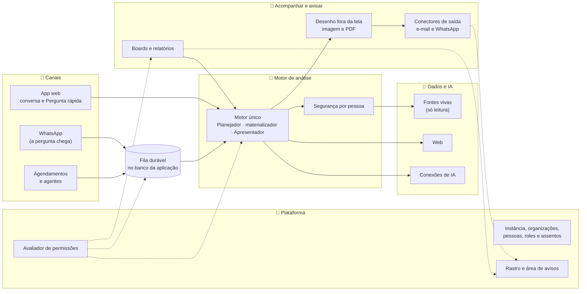

# Estratégia da solução do Horus v2

Situação: 🟢 escrita pelo arquiteto · os catorze documentos da lista escritos · 96 decisões no registro (30 ✅, 54 🟢, 6 🟡, 6 ⚪) · 🟡 seis decisões à espera do dono, ordenadas por urgência (seção 8.1) · 📤 trinta itens a devolver ao PO, consolidados no [documento 14](14-conferencia-do-produto.md) (seção 9) · 19 verificações pendentes (V-01 a V-19, documento 14).

Última atualização: 03/11/2026 (o dono decidiu a `ARQ-096`: a solução não fica presa a uma nuvem; e adiou a `ARQ-085`, a escolha da nuvem, para a primeira produção real. Antes, no mesmo dia: a `ARQ-065`, a v2.0 num subdomínio; a `ARQ-068`, os incidentes; a `ARQ-071`, o plantão; a `ARQ-070`, a sonda de fora; e a `ARQ-093`, com o Kubernetes gerenciado na produção real e o minikube na VPS).

Este documento diz **como o Horus v2 atinge os objetivos do produto**, no nível da estratégia: a solução numa página, as duas entregas, cada objetivo (O1 a O8) e cada macro funcionalidade (mf), de `MF-101` a `MF-119`, o que vem da v1.xx camada a camada e os marcos de construção. O detalhe de cada tema fica nos documentos 04 a 14, apontados em cada linha.

- O **quê** e o **porquê** são do produto: [mapa de objetivos e funcionalidades](../produto/07-mapa-de-objetivos-e-funcionalidades.md), [a v2.0 consolidada](../produto/05-v2.0-consolidada.md), [as versões](../produto/06-versoes.md) e o [backlog estratégico](../produto/backlog-estrategico.md). Se houver divergência, vale o backlog.
- Cada decisão de tecnologia citada aqui (`ARQ-nnn`) está no [registro de decisões](02-registro-de-decisoes.md); as metas, em [metas de qualidade](03-metas-de-qualidade.md).
- O código da v1.xx se cita como `horus@318db52b:<caminho>` (a `main` do repositório `horus`). Nada foi executado: o levantamento é de leitura do código e dos documentos.
- ⚠️ O backlog tem dois números repetidos. A `D-138` e a `D-139` vêm sempre com o título curto: `D-138` ("A v1.xx fecha como MVP no HML…") e `D-139` ("No MVP da v1.xx, as seis peças…") são do MVP; `D-138` ("O número novo das mfs tem três dígitos…") e `D-139` ("Tabela de conversão das mfs…") são da numeração.

Legenda: 🟢 decidida pelo arquiteto · 🟡 proposta ao dono · ✅ confirmada pelo dono · 🔎 hipótese a confirmar.

## 1. A solução numa página

🎯 **O Horus v2 é a v1.xx evoluída, e não um produto novo.** O mesmo sistema, na mesma stack (`ARQ-001`), parte do código, do histórico e dos testes de hoje (`ARQ-002`) e se reorganiza em módulos pelas camadas da fundação (`ARQ-003`). Sobre o que já responde com números do banco, a v2.0 acrescenta o que falta à promessa: um motor só para todos os canais, a plataforma de pessoas, roles e assentos, o rastro, e o trabalho que roda sozinho (agendamentos, agentes e envios) sem se perder.

| Peça | O que é | Decisão |
| --- | --- | --- |
| 🧭 Ponto de partida | O código, o histórico e os testes da v1.xx, levados ao repositório da v2 no fechamento do MVP | `ARQ-002` 🟢 |
| 🧰 Stack | A da v1.xx: .NET 10, PostgreSQL 17, Vue 3 com TypeScript, `@horus/ds`, OpenTelemetry com Grafana; na construção, a VPS com o minikube; na produção real, o Kubernetes gerenciado de uma nuvem pública, com o Postgres gerenciado dela; a imagem e o chart do Helm em toda instância, sem nada preso a uma nuvem | `ARQ-001` ✅, `ARQ-093` ✅, `ARQ-096` ✅ |
| 🧱 Forma | Um sistema só, em módulos com fronteiras verificadas por teste | `ARQ-003` 🟢 |
| ⚙️ Dois papéis | O mesmo executável **atende** (telas, conversa, mensagens do WhatsApp) e **trabalha** (agendamentos, agentes, PDFs, envios) | `ARQ-004` 🟢 |
| 📥 Nada se perde | Todo trabalho em segundo plano é um registro numa fila no banco, gravado junto com a mudança que o pediu | `ARQ-005` 🟢 |
| 💬 Um motor só | A conversa, a Pergunta rápida, o WhatsApp, os cartões e os agentes chamam o mesmo motor de análise | `ARQ-006` 🟢 |
| 🎨 Um desenho só | A resposta visual se desenha uma vez e sai em tela, em imagem e em PDF | `ARQ-007` 🟢 |
| 🛡️ Um "pode?" só | O avaliador de permissões: primeiro o tipo de assento, depois as roles, depois a segurança dos dados | `ARQ-008` 🟢 |
| 🧾 O rastro | Um registro só de acréscimo, gravado junto com cada entrega e cada abertura | `ARQ-009` 🟢 |
| 🗂️ Organizações isoladas | Um banco mestre com o mapa das organizações e um banco por organização, cada um com o seu login; a marca e o filtro como segunda trava | `ARQ-010` ✅, `ARQ-088` |
| 🚪 A chegada | A v2.0 nasce numa instância nova, sem converter os dados da v1.xx; o McDonald's e a Global Fleet chegam pelo semeador | `ARQ-011` ✅, `ARQ-089` 🟢 |
| 🪜 A ordem | Oito marcos para a v2.0 e cinco para a v2.1 (seção 6) | `ARQ-012` 🟢 |
| 📏 A qualidade | O tempo medido por etapa; 99,9% no ar por mês; a cópia fora do Horus, com o contrato da cópia e a conferência da volta; o envelope do primeiro ano; o custo por organização | `ARQ-013` 🟢, `ARQ-014` ✅, `ARQ-016` e `ARQ-017` ✅, `ARQ-086` ✅, `ARQ-087` 🟢 |
| 🧪 A prova | Seis camadas de teste no CI e os ensaios na homologação, sem modelo de IA pago; um catálogo de provas que fecha cada marco | `ARQ-075` a `ARQ-080` 🟢, `ARQ-081` ✅, `ARQ-082` ✅ |
| 💸 O custo | O custo de cada chamada de IA medido ou estimado; a IA é quase todo o custo variável, e o plantão, o maior fixo | `ARQ-083` 🟢, `ARQ-084` e `ARQ-085` 🟡 |

### O que continua valendo, da v1.xx e do produto

Estas regras não se renegociam no redesenho. Elas estão no código e nas regras da v1.xx (`horus@318db52b:CLAUDE.md`, `horus@318db52b:.claude/rules/`) e no produto.

- **O Horus só lê as fontes** (`D-001`, `D-022`): a credencial deve ser somente leitura, o Horus pergunta ao banco se ela é, e toda consulta passa por um guarda que recusa escrita.
- **Os números vêm do banco, e não do modelo.** O modelo escreve a consulta e o plano; quem preenche os blocos com os números é o materializador em C#.
- **O parser da resposta é tolerante** (um bloco inválido degrada e nunca quebra a tela), os provedores devolvem texto puro, há no máximo dois blocos por resposta, e toda resposta fecha com o bloco `meta`.
- **A telemetria nunca carrega conteúdo de conversa**, e pessoa nunca vira rótulo de métrica; **valor de claim nunca entra** em texto de SQL, log, trace nem métrica.
- **A fonte cadastrada pela organização não alcança a rede interna** (a guarda de rede), até a v2.1 decidir a exceção do on-premises.
- **O servidor decide as permissões**, e a tela só pergunta o que a pessoa pode.

## 2. As duas entregas

### 🟢 v2.0: a pergunta na hora, com confiança, o acompanhamento e o aviso

| Campo | O que diz |
| --- | --- |
| Onde | Em SaaS, numa instância nova da Maind, num subdomínio próprio, ao lado da v1.xx, que fica no domínio de hoje até a Maind decidir (`D-016`, `D-017`; `ARQ-011` ✅, `ARQ-065` ✅) |
| Como sai | De uma vez só (`D-109`). Os marcos M0 a M7 são internos: cada um termina com o produto de pé nas bases de demonstração, e o cliente recebe a v2.0 inteira |
| O que é trabalho novo | A plataforma de pessoas, roles e assentos com o avaliador (`MF-102`, `MF-103`); o retorno do usuário, a web com link e data e a medida de autonomia (o problema nº 1); os dois canais novos (`MF-110`, `MF-111`); o editor único de boards e relatórios (`MF-112`); o aviso inteiro (`MF-113`, `MF-114`, `MF-115`); o rastro (`MF-116`) |
| O que vem quase pronto | As fontes, a IA por função, os blocos visuais, a Home e as bases de demonstração: a base herdada (`D-021`) |
| O que depende de fora do produto | A conta de WhatsApp Business de cada organização e a aprovação na Meta (`D-097`); o servidor de e-mail; a cópia de segurança, que é da infra de cada instância (`ARQ-086`); a sonda de fora da máquina (`ARQ-014`) |

### 🔵 v2.1: o porquê, e as empresas mais exigentes

| Campo | O que diz |
| --- | --- |
| Onde | A **mesma versão** (`D-017`) em instâncias com exigências próprias: na da Maind, com login corporativo e marca completa, e na infraestrutura do contratante. A publicação de hoje já serve a uma segunda VPS, só com a PRD (`horus@318db52b:infra/github/ambientes.yml`), o que mostra que o roteiro aceita outras instâncias |
| O que entra | A investigação guiada (`MF-119`), a segurança dos dados por pessoa inteira, trazida de volta do código da v1.xx e ligada ao login corporativo (`MF-106`, as duas etapas, `ARQ-090`), a marca completa (`MF-101`), o Horus dentro da casa do contratante (`MF-104`, `MF-105`, `MF-103`) e os outros conectores (`MF-113`) |
| Como sai | Não decidido (leitura `D-121.2`); por isso os marcos M8 a M12 são independentes entre si |
| O que trava | A definição macro da investigação guiada (`P-018`); a ativação dos assentos no on-premises (`P-016`) |

## 3. Como cada objetivo é atingido

| Objetivo | Mfs | Como a arquitetura o atinge | Decisões | Detalhe |
| --- | --- | --- | --- | --- |
| **O1** ⚡ Perguntar e ter a resposta na hora | `MF-107`, `MF-108`, `MF-104`, `MF-109`, `MF-105`, `MF-110`, `MF-111` | O motor da v1.xx, que já responde com os números do banco, vira o motor único e passa a servir o popup e o WhatsApp sem copiar regra. O retorno do usuário nasce no motor e vale em todo canal. A web entra com link e data em qualquer nível. O tempo se mede por etapa para achar onde ele vai, sem virar promessa (`D-125`, `D-126`). | `ARQ-006`, `ARQ-007`, `ARQ-013` | 05, 08, 03 |
| **O2** 🛡️ Confiar no que vê | `MF-116`; a `MF-106` foi para a v2.1 (`ARQ-090`) | A segurança dos dados por pessoa da v1.xx sai do código da v2.0 e volta inteira na v2.1, como a terceira camada do avaliador. Toda entrega e toda abertura gravam no rastro, na mesma transação. Cada organização ganha o seu banco, com o seu login, e o filtro testado como segunda trava. | `ARQ-008`, `ARQ-009`, `ARQ-010` ✅, `ARQ-088` | 07, 06 |
| **O3** 📌 Acompanhar o negócio | `MF-112` | O editor de relatórios da v1.xx vira o editor único (`D-018`). Todo board se imprime pela mesma montagem que a tela mostra. Publicar, desabilitar e liberar dados passam pelo avaliador e gravam no rastro. | `ARQ-007`, `ARQ-008`, `ARQ-009` | 04, 05 |
| **O4** 🔔 Ser avisado sem perguntar | `MF-113`, `MF-114`, `MF-115` | A agenda dos relatórios da v1.xx serve de molde ao agendador único, que roda sobre a fila durável, no papel "trabalhar". O agente é o motor em ciclo. Os conectores só transportam: o e-mail por SMTP e o WhatsApp pela conta da organização. | `ARQ-004`, `ARQ-005`, `ARQ-006` | 05, 08, 13 |
| **O5** 🔍 Descobrir o porquê | `MF-119` (v2.1) | Um modo novo do mesmo motor, que decompõe uma variação nas partes que mais a explicam. O desenho espera a `P-018`. | `ARQ-006` | 05 |
| **O6** 📈 Provar o valor e vender | `MF-117`, `MF-118` | Os eventos de uso da v1.xx já marcam o resultado de cada resposta; somados ao retorno, dão a medida de autonomia e a qualidade em todos os canais. O tempo do lado do Horus sai da medição por etapa para a comparação que a Maind faz fora do produto (`D-132`). As bases de demonstração seguem como vitrine e banco de prova. | `ARQ-013`, `ARQ-011` ✅, `ARQ-089` | 06, 11 |
| **O7** 🏢 Organizar as pessoas e cobrar | `MF-102`, `MF-101`, `MF-103` | A matriz fixa de papéis da v1.xx vira o avaliador em três camadas. A carteira do gestor, a quarentena, os grupos, as roles e os assentos são novos. O corte pausa o que roda sozinho pela fila. | `ARQ-008`, `ARQ-005`, `ARQ-010` ✅ | 04, 06, 07 |
| **O8** 🏛️ Atender empresas com exigências próprias | `MF-106` (as duas etapas), `MF-101`, `MF-104`, `MF-105`, `MF-103` (v2.1) | O login corporativo entra pelo mesmo mecanismo de autenticação externa que já serve ao Google. Como o produto é um sistema só, a mesma versão se empacota para a instância do contratante. A IA dentro de casa é um provedor novo, e escolher o fornecedor é do dono. | `ARQ-003`, `ARQ-008` | 07, 08, 09 |

## 4. As 19 mfs, uma a uma

"Da v1.xx" resume o levantamento na `main` (`horus@318db52b`); a resposta completa às `P-002`, `P-003` e `P-008` fica no documento 14.

| Mf | Entrega | Estratégia | Da v1.xx | Marco | Detalhe |
| --- | --- | --- | --- | --- | --- |
| `MF-101:Administração da instância` | v2.0; a marca completa na v2.1 | A identidade, os administradores, o envio de e-mail e o interruptor geral da segurança continuam. Ganha o painel dos assentos por organização (`D-067`, `D-068`). Na v2.1, a marca completa: logo, nome e e-mail em todo o produto, inclusive no remetente | Reaproveita a identidade da instância e as telas de administração (`horus@318db52b:apps/server/Horus.Core/Identity/IdentityEntities.cs`, `horus@318db52b:apps/web/src/pages/admin/`). O remetente do e-mail vem só da configuração. O painel dos assentos não existe | M1; M9 | 04, 06, 08 |
| `MF-102:Organizações, pessoas e papéis` | v2.0 | Redesenho: a carteira do gestor, a quarentena, o convite do gestor com aprovação do owner e reserva do assento, os grupos do gestor e da organização, as roles com os nove botões, a role padrão e a cópia de role, tudo respondendo ao avaliador. Ganha a área de avisos da conta e a preferência de e-mail (`D-128`) | Reaproveita as várias organizações, a sessão, os convites nominais e por link com QR, o Google, a recuperação de senha, a foto e a planilha CSV. Reescreve a matriz de 23 ações e três papéis fixos (`horus@318db52b:apps/server/Horus.Core/Identity/PermissoesDaOrg.cs`). A carteira, a quarentena, os grupos, as roles e a área de avisos não existem (o sininho saiu da tela e só volta "quando houver notificação de verdade", `horus@318db52b:apps/web/src/layout/HeaderApp.vue`) | M1 | 04, 06, 07 |
| `MF-103:Licenças e planos` | v2.0; o on-premises na v2.1 | Novo: os quatro tipos de assento por organização, o owner grátis (`D-123`), a reserva, a troca, a contagem e o corte, que pausa tudo o que roda sozinho pela fila (`D-075`). Plano único, sem seletor (`D-115`, `D-117`) | Não existe nada (buscas por assento, seat e licença) | M1; M10 | 04, 06, 07 |
| `MF-104:Conectar as fontes vivas` | v2.0; a rede interna na v2.1 | Base herdada, sob o filtro por organização. Na v2.1, a fonte alcança a rede interna do contratante, com autorização explícita | Reaproveita os conectores (SQL Server, PostgreSQL, Oracle, MongoDB, BigQuery), o túnel SSH, a guarda de rede, o cofre de credenciais, o cache de execução e o modelo semântico por fonte. O Athena só cadastra, sem conector (`horus@318db52b:apps/server/Horus.Core/Data/Connections/Tecnologias/TecnologiasDeNuvem.cs`), e a fonte de páginas web sai da tela no MVP: o destino das duas foi ao PO (A-04) | M2; M10 | 05, 08 |
| `MF-105:IA sob controle da organização` | v2.0; o "tudo dentro" na v2.1 | Base herdada. Ganha a função do agente, o modelo que o owner configura (`D-061`), e o custo por organização e por componente (`ARQ-017`). Na v2.1, um provedor dentro de casa para o modo "tudo dentro" (`D-010`) | Reaproveita inteiro: as conexões (OpenRouter e Bedrock), o roteador, as quinze funções e o consumo por chamada (`horus@318db52b:apps/server/Horus.Core/Llm/`) | M2; M10 | 05, 08, 13 |
| `MF-106:Segurança dos dados por pessoa` | As duas etapas na v2.1 (`ARQ-090`, decisão do dono de 03/11/2026) | Etapa 1: a Semântica de Segurança inteira, como a terceira camada do avaliador. Etapa 2: o login corporativo ligado por organização (`D-027`), as roles pelo JWT (`D-052`) e os controles de acesso das tecnologias de dados, valendo a mais restritiva (`D-026`) | Reaproveita inteiro: as claims, o compilador, o motor, o reescritor, o verificador, o "ver como", a caixa de revisão, a homologação e a bateria (`horus@318db52b:apps/server/Horus.Core/Seguranca/`). Há duas camadas de claims convivendo, a decidir no documento 07. Nada de login corporativo existe | M2; M8 | 07 |
| `MF-107:Perguntar aos dados em português` | v2.0 | O motor único. O retorno 👍🏻, 👎🏻 e 🚫 com os três motivos, o reporte ao owner, o aviso de "recebido" e a resposta reportada guardada. A contagem da pergunta de análise respondida em todo canal. As roles limitando os botões | Reaproveita o Planejador, o materializador, o reparo, os níveis, o Apresentador, a Análise avançada e o streaming por SSE. Reescreve o `ChatEngine` (2.901 linhas) em torno do contrato de turno. O retorno não existe | M3 | 05 |
| `MF-108:Respostas visuais` | v2.0 | Base herdada. O mesmo desenho vira imagem e PDF no servidor | Reaproveita os seis tipos de bloco e as quinze variantes; os blocos portados não se editam (`horus@318db52b:.claude/rules/front/blocos-do-chat.md`) | M3 | 05 |
| `MF-109:A web como fonte` | v2.0 | O fato da web entra com link e data em qualquer nível, e a causa de fora só do nível 4 em diante (`D-130`). A pesquisa deixa de depender do provedor do modelo | Reaproveita o modo web e a pesquisa do OpenRouter (o sufixo `:online`). Hoje a regra do nível 4 está no prompt do servidor, as citações não têm endereço nem data, e o Bedrock não pesquisa | M3 | 05, 08 |
| `MF-110:Pergunta rápida` | v2.0 | O popup usa o mesmo componente de conversa da tela de análise e o mesmo motor. A conversa fica no popup até ser limpa ou salva (`D-086`); a pergunta descartada conta sem guardar o conteúdo (`D-087`) | Não existe. O compositor e o cartão da resposta só são usados pela página da conversa e precisam virar componente | M4 | 04, 05 |
| `MF-111:Chat pelo WhatsApp` | v2.0 | Uma entrada nova: a mensagem chega da Meta, a confirmação sai na hora, e o turno roda na fila, com o mesmo motor. A resposta vai em texto, imagem e link. A conta da organização ou a da Maind (`D-097`). O mesmo canal serve ao conector de WhatsApp (leitura `D-124.1`) | Não existe nada | M4 | 08, 13 |
| `MF-112:Boards e Relatórios` | v2.0 | O editor de relatórios vira o editor único (`D-018`, `D-058`), e todo board se imprime pela mesma montagem. Publicar, desabilitar, o espaço da organização e a liberação do gestor passam pelo avaliador e gravam no rastro | Reaproveita o recalculador de cartões (2.211 linhas), a apresentação, o "Quem abre", o editor de relatórios e o impressor de PDF. Reescreve os dois editores em um e os boards corporativos como o espaço da organização | M5 | 04, 05 |
| `MF-113:Conectores de Saída` | v2.0; Teams e outros na v2.1 | O conector só transporta (`D-035`), sobre a fila: o e-mail pelo SMTP e o WhatsApp pela conta da `MF-111:Chat pelo WhatsApp`. O contato de cada pessoa, com a aprovação do owner (`D-038`, `D-039`); bloqueados no "tudo dentro" (`D-040`) | Reaproveita o envio por SMTP e o ritmo de envio (`horus@318db52b:apps/server/Horus.Core/Email/`). Hoje o relatório agendado vai só a membros da organização, até 50 (`horus@318db52b:apps/server/Horus.Core/Relatorios/EntregaDeRelatorio.cs`) | M6; M12 | 08 |
| `MF-114:Módulo de Agendamentos de Agentes` | v2.0 | O agendador único sobre a fila: roda o PDF de um board ou um agente (`D-064`), com a permissão de quem criou, pausado no corte, sem refazer rodadas perdidas | A agenda dos relatórios (de minuto em minuto, reivindicando cada rodada) serve de molde (`horus@318db52b:apps/server/Horus.Api/VigiaDeAgendaDeRelatorios.cs`) | M6 | 04, 05 |
| `MF-115:Agentes ativos` | v2.0 | O agente é o motor em ciclo, no papel "trabalhar": instruções em texto ou .md, o que o Horus entendeu mostrado antes de ligar, o ciclo controlado pelo modelo até o JSON final por tipo de saída (`D-061`) e o alerta rotulado com o nível | Não existe | M6 | 05, 13 |
| `MF-116:Auditoria` | v2.0 | O registro só de acréscimo nasce na plataforma, e a consulta do owner, com o prazo de guarda, vem no fim | A trilha de eventos de segurança (29 tipos) serve de molde (`horus@318db52b:apps/server/Horus.Core/Seguranca/SegurancaEntities.cs`) | M1 e M7 | 06, 07 |
| `MF-117:Home da organização` | v2.0 | A medida de autonomia e a qualidade (`D-133`), a partir dos eventos de uso e do retorno, em todos os canais | Reaproveita os eventos de uso (400 dias), o catálogo de 63 indicadores e a grade editável (`horus@318db52b:apps/server/Horus.Core/Uso/`). O evento da resposta já guarda o resultado (sucesso, erro ou vazio) | M7 | 06, 11 |
| `MF-118:Bases de demonstração` | v2.0 | Base herdada; ganha os cenários das provas de valor da v2.0 (agentes, WhatsApp, rastro) e é o banco de prova de cada marco | Reaproveita inteiro: os geradores determinísticos, a ingestão contínua e a conferência (`horus@318db52b:data/`) | Todos | 12 |
| `MF-119:Investigação guiada` | v2.1 | No mesmo motor, um modo que decompõe uma variação nas partes que mais a explicam; o desenho espera a `P-018` | A investigação só existe pela conversa (perguntas em sequência, sugestões, Análise avançada) | M11 | 05 |

## 5. O que da v1.xx se reaproveita, se reescreve ou se descarta, camada a camada

A regra geral é a da `ARQ-002`: o código vem inteiro, e cada camada decide o destino de cada peça. Nenhuma linha desta tabela troca uma peça da stack.

| Camada | Reaproveita | Reescreve ou cria | Descarta | Detalhe |
| --- | --- | --- | --- | --- |
| **Front** (Vue) | O app, o design system `@horus/ds`, os blocos do chat, as telas de fontes, IA, segurança, Home, boards e relatórios | A conversa como componente que o popup reusa; as telas de pessoas, roles, grupos e assentos; o editor único; a área de avisos, o retorno na resposta, os agentes, os agendamentos e a consulta do rastro | O que o MVP tirou da tela fica fora até o PO decidir (A-04) | 04 |
| **API** (Minimal API) | O estilo das rotas, o tratamento de erro, os limites de taxa e a sessão por cookie | O registro dos serviços por módulo, no lugar das 1.086 linhas do `Program.cs`; as rotas novas (assentos, roles, grupos, agentes, rastro) e a entrada do WhatsApp | — | 04 |
| **Motor de análise** (`Chat`, `Planner`, `Prompts`) | O Planejador, o materializador, o reparo, os níveis, o Apresentador, o workflow, o streaming e a peça que a análise avulsa divide com o chat | O `ChatEngine` em torno do contrato de turno (`ARQ-006`); a separação entre o fato da web e a causa; a pesquisa web sem depender do provedor; o retorno; o ciclo do agente | — | 05 |
| **Fontes** (`Data`) | Os conectores, o túnel, a guarda de rede, o cofre de credenciais, o cache de execução e o modelo semântico por fonte | O acesso pelo banco da organização (`ARQ-010`, `ARQ-088`) | O Athena e a fonte de páginas web, se o PO decidir que ficam fora (A-04) | 05, 08 |
| **IA** (`Llm`) | As conexões, o roteador, as quinze funções, o consumo, o OpenRouter e o Bedrock | A função do agente; o custo por componente | — | 05, 13 |
| **Segurança dos dados** (`Seguranca`) | Na v2.0, a guarda de rede e o ponto único de execução; a Semântica de Segurança inteira, com a bateria do `Horus.Evals`, sai do código e volta na v2.1 (`ARQ-090`) | A ligação com o avaliador (`ARQ-008`); na v2.1, o login corporativo e os controles das tecnologias de dados | Uma das duas camadas de claims, se o documento 07 concluir que a mais antiga sobra | 07 |
| **Organizações e pessoas** (`Identity`) | As organizações, a sessão, os convites, o QR, o Google, a recuperação de senha, a foto e o cadastro fechado | A matriz de papéis vira o avaliador; a carteira, a quarentena, os grupos, as roles, os assentos e os avisos são novos | A criação de organização por qualquer pessoa logada, se o PO decidir assim (A-02) | 04, 06, 07 |
| **Boards e relatórios** | O recalculador de cartões, a apresentação, o "Quem abre", o editor de relatórios e o impressor de PDF | Os dois editores em um; os boards corporativos como o espaço da organização; a agenda dos relatórios como o agendador único | O segundo editor | 04, 05 |
| **Trabalho em segundo plano e envio** | O envio por SMTP, o ritmo de envio, a fila de convites em tabela e a reivindicação das rodadas da agenda | A fila durável e a caixa de saída (`ARQ-005`), no papel "trabalhar" (`ARQ-004`) | As filas em memória do que precisa sobreviver a uma publicação | 04, 06, 10 |
| **Uso, Home e rastro** (`Uso`) | Os eventos de uso, o catálogo de indicadores, a grade da Home e o molde da trilha de segurança | O rastro de entregas e aberturas (`ARQ-009`); a medida de autonomia com a qualidade | — | 06, 11 |
| **Banco da aplicação** | O PostgreSQL 17, o EF Core e a cadeia de 89 migrações | O banco mestre e um banco por organização (`ARQ-010`, `ARQ-088`), com o filtro como segunda trava; as tabelas novas (fila, rastro, assentos, roles, grupos, avisos, retorno); o semeador das organizações de exemplo (`ARQ-011`, `ARQ-089`) | O legado das bases de conhecimento na conversa (o campo `KbIdsJson`), que saíram do produto em 13/09/2026 | 06 |
| **Infraestrutura e publicação** | A VPS, o Nginx, o systemd, o `redeploy.sh` com a troca por diretório e a volta automática, o workflow manual, a guarda "passou pelo HML" e o provisionamento do zero | A imagem e o chart, no minikube da construção e no Kubernetes gerenciado da produção real (`ARQ-093`, `ARQ-094`); os dois papéis em várias réplicas (`ARQ-095`); o contrato da cópia e a conferência da volta (a cópia em si é da infra de cada instância, `ARQ-086`, e não existe hoje na PRD); um CI que rode os testes (não existe hoje); na v2.1, o mesmo chart no contratante | — | 09, 10 |
| **Observabilidade** | A stack inteira e as regras de cardinalidade e de conteúdo | O histograma do primeiro token, que para em 30 segundos; o alerta de lentidão, que exclui a rota das mensagens; as métricas por etapa e canal, da fila e do custo | — | 11 |
| **Testes** | Os cerca de 6.000 casos do servidor, os 388 arquivos do front, os 12 cenários de ponta a ponta e as baterias com modelo falso | Os testes de arquitetura, o teste de isolamento por tabela e o CI | — | 12 |
| **Bases de demonstração** (`horus@318db52b:data/`) | Os geradores, a ingestão contínua e a conferência | Os cenários da v2.0 | — | 12 |

## 6. Os marcos de construção (`ARQ-012`)

Cada marco diz **o que fica de pé** ao fim, provado nas bases de demonstração (`MF-118:Bases de demonstração`), e do que depende. A entrega ao cliente continua uma só (`D-109`).

### v2.0

| Marco | Fica de pé ao fim | Mfs | Depende de |
| --- | --- | --- | --- |
| **M0 · Fundação** | O repositório da v2 com o código e o histórico da v1.xx, compilando e com os testes de hoje passando num CI, sem modelo pago. Os módulos com fronteiras e os testes de arquitetura. O executável em dois papéis. A fila durável. O banco mestre e o banco por organização, com o roteamento. O contrato da cópia e a conferência da volta (`ARQ-087`). A medição por etapa, com o histograma corrigido. O catálogo de provas do M0 verde e os alertas que acordam provados (`ARQ-079`, `ARQ-080`) | — | O fechamento do MVP (`D-138` "A v1.xx fecha como MVP no HML…"); nenhuma decisão da fila do dono (8.1): todas as do M0 foram decididas em 03/11/2026 — a `ARQ-067` ✅ (o calendário dos segredos); a `ARQ-069` ✅ (uma stack por máquina); a `ARQ-016` ✅ (o envelope do primeiro ano); a `ARQ-066` ✅ (o acesso às máquinas); a `ARQ-010` ✅ (um banco por organização), a `ARQ-044` ✅ (os segredos pelos Secrets do GitHub), a `ARQ-058` ✅ (o endurecimento da VPS de hoje), a `ARQ-082` ✅ (o CI na VPS de hoje), a `ARQ-055` ✅ (a homologação da v2 na VPS de hoje), a `ARQ-056` ✅ e a `ARQ-059` ✅ (a máquina dividida e uma base de demonstração só) e a `ARQ-086` ✅ (a cópia fora do Horus) |
| **M1 · Plataforma** | A instância com o painel dos assentos. A gestão de pessoas inteira (carteira, quarentena, convite do gestor com aprovação, grupos, roles com os botões, role padrão e cópia). Os quatro tipos de assento, a reserva, a troca e o corte. O avaliador de permissões. O **registro do rastro** e a **área de avisos**. O semeador das organizações de exemplo nesse modelo (`ARQ-089`) | `MF-101`, `MF-102`, `MF-103`, `MF-116` (o registro) | M0; as regras de criação de organizações (A-02); `ARQ-011` ✅ |
| **M2 · Dados e IA** | As fontes e os conectores de hoje sob o filtro e o avaliador. As conexões de IA com a função do agente e o custo por componente. | `MF-104`, `MF-105` | M1 |
| **M3 · Motor** | O motor único com o contrato de turno, usado pela conversa. O retorno com os três motivos, o reporte ao owner, o aviso de "recebido" e a resposta reportada guardada. A web com link e data em qualquer nível, separando o fato da causa. A contagem da pergunta respondida. As roles limitando os botões da conversa | `MF-107`, `MF-108`, `MF-109` | M2 |
| **M4 · Canais** | A Pergunta rápida em todas as telas, com a conversa do popup. O WhatsApp: o número ligado com código, a conta da organização ou a da Maind, a mesma conversa do app, a resposta em texto, imagem e link, e o aviso de "trabalhando" | `MF-110`, `MF-111` | M3; fora do produto, uma conta de WhatsApp Business aprovada para o ensaio (`D-097`) |
| **M5 · Acompanhar** | O editor único, com todo board vivo e em PDF pela mesma montagem. Publicar nas quatro visibilidades, desabilitar, o espaço da organização, os boards públicos da quarentena e a liberação do gestor, tudo gravando no rastro. Os boards e relatórios de hoje convertidos | `MF-112` | M3; M1 (grupos e papéis) |
| **M6 · Avisar** | Os conectores de e-mail e de WhatsApp, com o contato de cada pessoa e a aprovação. O agendador único rodando o PDF de um board ou um agente, com a permissão de quem criou, pausado no corte. Os agentes com instruções em texto ou .md, o ciclo controlado pelo modelo e o alerta rotulado com o nível. Tudo gravando no rastro e no custo | `MF-113`, `MF-114`, `MF-115` | M4 (a conta de WhatsApp); M5 (o PDF do board) |
| **M7 · Prova e controle** | A consulta do rastro pelo owner, com o prazo de guarda. A medida de autonomia e a qualidade na Home. As bases de demonstração cobrindo as provas de valor da v2.0. A v2.0 inteira no HML, com as organizações de exemplo semeadas, pronta para a abertura (`ARQ-065`) | `MF-116` (a consulta), `MF-117`, `MF-118` | M1 a M6 |

### v2.1

Os cinco marcos são independentes entre si; a ordem espera a forma de entrega da v2.1 (leitura `D-121.2`).

| Marco | Fica de pé ao fim | Mfs | Depende de |
| --- | --- | --- | --- |
| **M8 · Segurança corporativa** | A segurança dos dados por pessoa, trazida de volta do código da v1.xx sobre o modelo da v2 (`ARQ-090`). O login corporativo ligado por organização pelo owner (`D-027`), as roles pelo mapeamento do JWT (`D-052`), os controles de acesso das tecnologias de dados somados pela regra mais restritiva (`D-026`) | `MF-106` (as duas etapas) | A v2.0 |
| **M9 · Marca completa** | Logo, nome e e-mail do contratante em todo o produto, inclusive no remetente e nas mensagens | `MF-101` (nº 6) | A v2.0 |
| **M10 · Dentro da casa do contratante** | A mesma versão empacotada para a infraestrutura do contratante; a fonte alcançando a rede interna com autorização explícita; o modo "tudo dentro", com a IA dentro de casa; os conectores e o WhatsApp bloqueados até a instância liberar (`D-040`); os assentos ativados | `MF-104`, `MF-105`, `MF-103` (nº 5) | A v2.0; a `P-016` |
| **M11 · Investigação guiada** | O modo de investigação no motor, conforme a definição macro | `MF-119` | A v2.0; a `P-018` |
| **M12 · Os outros conectores** | Teams, Google Chat e os outros, sobre o mesmo contrato de conector | `MF-113` (parte) | A v2.0 |

## 7. Riscos

| Risco | Por quê | O que a arquitetura faz | Onde |
| --- | --- | --- | --- |
| 📏 A v2.0 é grande e sai de uma vez | São oito marcos antes do primeiro uso real (`D-109`) | Cada marco fica de pé e testado nas bases de demonstração e no uso interno da Maind (leitura `D-109.2`) | Seção 6 |
| 🌱 A vitrine depende do semeador | Os boards, as regras e os membros de exemplo só existem no banco da v1.xx até a exportação | A exportação, uma vez, antes de a v1.xx sair, e o CI que semeia num banco vazio (`ARQ-089`) | `ARQ-011`, documento 06 |
| 🧠 O processo único está espalhado em memória | A v1.xx declara "uma instância da API" e guarda em memória o registro dos streams, os limites de taxa, o cache e várias filas | O M0 levanta cada peça e a leva ao banco ou a prende a um papel | `ARQ-004`, `ARQ-005` |
| 💾 Não há cópia de segurança hoje | Nem do banco da aplicação nem das bases de demonstração; uma pane da VPS leva tudo | A cópia é da infra de cada instância: na SaaS, a Maind a configura no provedor das VPS, e o Horus entrega o contrato da cópia no M0; a falta dela no MVP foi ao PO (A-06) | `ARQ-086`, `ARQ-087` |
| 🧪 Os testes não rodam sozinhos | O único workflow publica e não testa; os cerca de 6.000 casos dependem de alguém rodá-los | O CI entra no M0 | Documento 12 |
| 🗂️ O isolamento entre organizações é manual | A organização passa à mão em cada consulta, sem filtro global; um esquecimento expõe dados | Um banco por organização, com o filtro como segunda trava e o teste de isolamento, entra no M0 | `ARQ-010`, `ARQ-088` |
| 📱 O WhatsApp depende da Meta | A aprovação da conta, os modelos de mensagem e o custo por mensagem estão fora do produto | A integração isola a Meta atrás do contrato de conector e de canal; o ensaio do M4 precisa de uma conta aprovada | Documentos 08 e 13 |
| 🌐 A pesquisa web depende do provedor do modelo | Só o OpenRouter pesquisa; numa organização com o modelo no Bedrock, a web não vem | O documento 05 desacopla a pesquisa do provedor, e o fornecedor, se for preciso, é do dono | Documento 05 |
| ⏱️ O primeiro texto já é lento | 27,6% das respostas medidas passaram de 30 segundos até o primeiro token, e o histograma para nos 30 | A medição por etapa mostra onde o tempo vai, e a promessa continua sendo a comparação com dias de espera (`D-125`) | `ARQ-013`, documento 03 |
| 🖨️ O navegador sem tela pesa | Imagens do WhatsApp e PDFs dos agentes no pico de segunda de manhã; a v1.xx limita a dois PDFs ao mesmo tempo | Roda no papel "trabalhar", com fila e concorrência limitada | `ARQ-004`, `ARQ-007` |
| 🧱 Os módulos mais críticos são os maiores | O `ChatEngine` tem 2.901 linhas e o `RecalculadorDeBoard`, 2.211 | O redesenho se apoia nos testes de hoje e nas fronteiras testadas | `ARQ-003` |
| 🗄️ O SQL Server das bases de demonstração | Roda na edição Developer, sem limite de memória, na mesma máquina da API, que não tem swap | A swap na máquina, sem teto, porque nenhuma instância é produção real (`ARQ-056` ✅); a licença da edição Developer vai à verificação V-05 antes da primeira produção real | `ARQ-056`, `ARQ-059`, documento 09 |
| 📱 A Meta precisa aprovar a Maind antes do M4 | A verificação da empresa, a revisão do aplicativo e o programa de provedores de tecnologia levam semanas | O pedido à Meta começa no M1, com o dono; até lá, o canal se prova com o dublê da porta da Meta | `ARQ-047`, `ARQ-048`, documento 08 |

## 8. O que falta decidir

### 8.1 A fila do dono

Todas as decisões 🟡 do [registro](02-registro-de-decisoes.md), seis (uma delas, a `ARQ-040`, adiada para a v2.1 com a `MF-106`), com a recomendação já escrita lá, **ordenadas por urgência**: primeiro as que travam o M0, depois o M1, e assim por diante; dentro de cada marco, primeiro a que pede mais tempo de fora (contratar, pedir a um fornecedor, conferir uma licença) ou que também protege o que já está no ar. A `ARQ-011` foi decidida pelo dono em 03/11/2026: a v2.0 nasce numa instância nova, e só o McDonald's e a Global Fleet chegam, pelo semeador (`ARQ-089`); a `ARQ-046` também, com o e-mail pelo mesmo SMTP e o plano gratuito até a primeira produção real; e a `ARQ-035`, com um prazo padrão por tipo de dado e os da organização ajustáveis nas preferências dela; a `ARQ-010` foi decidida pelo dono em 03/11/2026, com um banco por organização, e a `ARQ-082` também, com o CI na VPS de hoje até a primeira produção real; com ela, o orçamento (`ARQ-085`) foi para o M7, porque até lá não há o que contratar. A `ARQ-044` também foi decidida, com os segredos da instância nos Secrets do GitHub, gravados pelo CD, e a `ARQ-058`, com o endurecimento da VPS de hoje no lugar, a `ARQ-066`, com o nome e a chave por pessoa nas máquinas, a `ARQ-016`, com o envelope do primeiro ano, a `ARQ-069`, com uma stack de observabilidade por máquina, e a `ARQ-067`, com o calendário de troca dos segredos. Com ela, nenhuma decisão do M0 espera mais o dono. A `ARQ-047` está em estudo pelo dono, com a opção 1 como hipótese de trabalho. A `ARQ-064`, que abria a fila, foi decidida pelo dono em 03/11/2026 e, no mesmo dia, substituída pela `ARQ-086` ✅: a cópia de segurança fica fora do Horus, configurada por cada dono de instância. Com ela, a `ARQ-015` (a meta de perda) também saiu da fila, porque a meta passou a ser de cada instância. A `ARQ-055`, que abria a fila em seguida, foi decidida pelo dono no mesmo dia, com a homologação da v2 numa terceira instância da VPS de hoje; com ela, a `ARQ-056` (os tetos de memória e a swap) passou à frente, porque virou o pré-requisito de a homologação subir. Logo depois, o dono decidiu a `ARQ-056` e a `ARQ-059`: nenhuma instância de hoje é produção real, todas dividem os recursos da máquina, e as bases de demonstração são uma só; as duas saíram da fila, e a meta de 99,9% (`ARQ-014`), a sonda de fora (`ARQ-070`) e o plantão (`ARQ-071`) foram para o M7, porque só valem com a primeira produção real. Por último, a `ARQ-091` (a troca entre duas máquinas próprias) saiu, substituída pela `ARQ-092` ✅: a produção real vai para uma nuvem pública, e a forma dela lá entrou como `ARQ-093`, à frente do M7, porque o orçamento e a sonda dependem dela. O dono a decidiu no mesmo dia: o Kubernetes gerenciado e o Postgres gerenciado na produção real, e o minikube na VPS durante a construção. Em seguida, a `ARQ-070`: a sonda de fora é um serviço de monitoramento de outro provedor, contratado na primeira produção real; e a `ARQ-071`: o plantão acorda só para o que ameaça a disponibilidade, os dados ou a segurança; e a `ARQ-068`: os incidentes com gravidade, responsável, prazos e registro; e a `ARQ-065`: a v2.0 abre num subdomínio próprio, ao lado da v1.xx, na mesma VPS. Por fim, o dono adiou a escolha da nuvem (`ARQ-085`) para a primeira produção real e decidiu que a solução não fica presa a uma nuvem (`ARQ-096` ✅). Com isso, nenhuma decisão da v2.0 espera o dono, fora as duas em pausa: a `ARQ-047`, em estudo, e a `ARQ-085`, adiada.

| # | Decisão | O que ela trava | Por que nesta posição |
| --- | --- | --- | --- |
| **M1 · Plataforma** | | | |
| 1 | `ARQ-047` · O Horus chega ao WhatsApp pela API oficial na nuvem da Meta, direto, com a Maind como provedora de tecnologia e o cadastro incorporado | O M4, mas o pedido à Meta começa no M1 | A aprovação da Meta leva semanas (V-03). ⏸️ Em estudo pelo dono, que avalia alguns plugins; a opção 1 é a hipótese de trabalho desde 03/11/2026 |
| **M7 · Prova e controle** | | | |
| 2 | `ARQ-085` · O orçamento de operação: a produção real na Google Cloud, os outros serviços nos planos já escolhidos e a VPS da construção, numa faixa mensal revista a cada trimestre contra as faturas | O M7: a contratação da sonda, do plantão e dos executores hospedados do CI, na primeira produção real | Junta o custo numa aprovação só e escolhe a nuvem da produção real, pelos preços da V-19. ⏸️ Adiada pelo dono em 03/11/2026: a nuvem se escolhe na primeira produção real, sem ficar presa a ela (`ARQ-096` ✅) |
| **M8 · Segurança corporativa (v2.1)** | | | |
| 3 | `ARQ-040` · As claims ficam numa camada só, e a segurança dos dados por pessoa tem uma chave só por organização | O M8: a segurança dos dados por pessoa, na v2.1 | Adiada pelo dono em 03/11/2026, com a `MF-106` inteira |
| 4 | `ARQ-054` · O login corporativo da v2.1 é OpenID Connect, um por organização; SAML só com decisão nova | O M8 | — |
| **M10 · Dentro da casa do contratante (v2.1)** | | | |
| 5 | `ARQ-060` · O on-premises da v2.1 é a mesma imagem e o mesmo chart, no Kubernetes do contratante ou num Kubernetes de um nó numa máquina Linux dele, sem compilar nem baixar nada na hora | O M10 | Espera também a `P-016` |
| 6 | `ARQ-074` · A telemetria do contratante fica na casa dele: a Maind vê só com o acesso que ele conceder, e um sinal de vida sem dado sai só se o contrato permitir, nunca no "tudo dentro" | O M10 | — |

### 8.2 O que os próximos documentos decidem

| Documento | O que decide | Quem decide |
| --- | --- | --- |
| 04 Software | Os módulos, os contratos entre eles e os papéis de cada um | Arquiteto |
| 05 Motor de análise e IA | O contrato de turno; o ciclo do agente e o teto técnico de rodadas por execução; a separação entre o fato da web e a causa (`P-008`, aa); a pesquisa web sem depender do provedor do modelo | Arquiteto; o fornecedor de busca, se for preciso, é do dono |
| 06 Dados | Por quanto tempo se guardam as conversas e as mensagens (hoje sem regra); o prazo padrão e o mínimo do rastro (leitura `D-092.2`) | Dono, na retenção |
| 07 Segurança | As camadas do avaliador; a convivência das duas camadas de claims; o protocolo do login corporativo (v2.1); o aviso de que a abertura é registrada (leitura `D-090.2`) | Arquiteto; dono no que muda o que alguém vê |
| 08 Integrações | ✅ Escrito: o e-mail (`ARQ-046` ✅), o caminho até o WhatsApp (`ARQ-047` 🟡), a porta da Meta, as janelas e os modelos, as contas e os números (`ARQ-048` a `ARQ-050`), os provedores de IA, as fontes e o Google (`ARQ-051` a `ARQ-053`), o login corporativo (`ARQ-054` 🟡). Falta: os outros conectores (v2.1, M12) | Dono, nas 🟡 |
| 09 Infraestrutura e ambientes | ✅ Escrito: os ambientes (`ARQ-055` ✅, a homologação da v2 na VPS de hoje), a máquina da PRD e onde roda cada papel (`ARQ-056` ✅, a máquina dividida por todas as instâncias, que são de teste), o Kubernetes gerenciado na produção real e o minikube na construção (`ARQ-093` ✅), a imagem e o chart (`ARQ-094`), o endurecimento (`ARQ-058` ✅), as bases de demonstração (`ARQ-059` ✅, uma só para todas as instâncias), o on-premises (`ARQ-060` 🟡). Falta: as verificações V-01 e V-05 a V-08 | Dono, nas 🟡 |
| 10 Publicação e operação | ✅ Escrito: a publicação sobre o pacote e a guarda entre máquinas (`ARQ-061`), as migrações compatíveis com a versão no ar (`ARQ-062`), a troca sem perder trabalho (`ARQ-063`), a cópia fora do Horus (`ARQ-086` ✅) e o contrato da cópia com a conferência da volta (`ARQ-087`), a abertura da v2.0 num subdomínio, ao lado da v1.xx (`ARQ-065` ✅), o acesso às máquinas (`ARQ-066` ✅), a rotação dos segredos (`ARQ-067` ✅) e os incidentes (`ARQ-068` ✅). Falta: as verificações V-09 a V-11 | Dono, nas 🟡 |
| 11 Observabilidade | ✅ Escrito: onde a stack roda (`ARQ-069` ✅, uma por máquina), a sonda de fora e os sinais de vida (`ARQ-070` ✅), os alertas e o plantão (`ARQ-071` ✅), o catálogo do que se mede (`ARQ-072`), o que a telemetria nunca carrega (`ARQ-073`) e a telemetria do contratante (`ARQ-074` 🟡). Falta: as verificações V-12 e V-13 | Dono, nas 🟡 |
| 12 Qualidade e testes | ✅ Escrito: as camadas de teste sem modelo pago (`ARQ-075`), o CI e o pacote (`ARQ-076`), as travas de arquitetura (`ARQ-077`), o contrato com a tela (`ARQ-078`), o catálogo de provas que fecha cada marco (`ARQ-079`), a prova dos alertas que acordam (`ARQ-080`), a bateria com modelo real (`ARQ-081` ✅) e onde o CI roda (`ARQ-082` ✅, na VPS de hoje até a primeira produção real). Falta: a V-16 | Arquiteto; dono nas 🟡 |
| 13 Custo de operação | ✅ Escrito: a IA por função e por modelo, o WhatsApp pela tabela da Meta, o e-mail, as máquinas, a cópia da instância SaaS, a sonda, o CI e o plantão, em faixas; a estimativa da chamada sem custo (`ARQ-083`), o rateio e o aviso (`ARQ-084` ✅) e o orçamento (`ARQ-085` 🟡). Falta: a V-15, a V-17 e a V-18 | Dono, nas 🟡 |
| 14 Conferência do produto | ✅ Escrito: a `P-008` (14 ✅, 13 ⚠️, nenhuma ❌), a `P-002`, a `P-003`, os 30 itens a devolver ao PO e as 19 verificações | Arquiteto, com o que volta ao PO |

## 9. A devolver ao PO

O backlog estratégico está congelado por decisão do dono, e tem uma colisão de números a resolver (duas `D-138` e duas `D-139`). O que a arquitetura devolve ao PO está **consolidado no [documento 14](14-conferencia-do-produto.md), seção 4**: cada item com o texto inteiro, o tipo proposto (pendência ou impasse), o responsável proposto, a origem `ARQ-nnn`, as decisões de produto que toca e o marco que trava. Os números A-nn são provisórios; o PO dá o número `P-nnn` ou `I-nnn` quando descongelar.

São trinta itens: os vinte e dois das rodadas anteriores, quatro da rodada de 02/11/2026 (A-23 a A-26) e quatro de 03/11/2026 (A-27 a A-30).

- **A-01** · As regras de conversão das organizações de hoje. ⚪ Sem objeto desde 03/11/2026: a v2.0 não converte os dados (`ARQ-011`).
- **A-02** · Quem cria organizações no SaaS.
- **A-03** · De quem é cada custo no SaaS.
- **A-04** · As duas fontes que o MVP tira da tela.
- **A-05** · O registro do rastro vem antes das mfs que gravam nele.
- **A-06** · Cópia de segurança e testes antes de publicar, já no MVP.
- **A-07** · Qual decisão sustenta o "SaaS primeiro".
- **A-08** · Os casos de borda da "pergunta de análise respondida".
- **A-09** · Os fatos da web no cartão do board.
- **A-10** · O que acontece quando uma execução de agente ou uma rodada de agendamento falha.
- **A-11** · Com que alcance de dados roda o espaço da organização
- **A-12** · Corrigir o inventário de lacunas sobre a web
- **A-13** · O que é "o teto da organização" dos níveis de inferência.
- **A-14** · O que os painéis corporativos de hoje viram na v2.0
- **A-15** · O escopo dos boards e dos envios em que não há liberação
- **A-16** · O que a pessoa sabe e o que pode pedir (LGPD).
- **A-17** · O número de WhatsApp da pessoa: um número, dois usos, e a conta da Maind.
- **A-18** · O que a pessoa recebe pelo WhatsApp quando não pode conversar, o corte e o "sair de todos".
- **A-19** · O que cabe em cada canal de saída.
- **A-20** · Quem entra pelo login da empresa, na v2.1.
- **A-21** · Como a instância fala com todas as pessoas quando ela para.
- **A-22** · Quem fica sabendo quando um serviço da organização para
- **A-23** 🆕 · O editor único: como um board grande vira PDF, e a região escrita por descrição.
- **A-24** 🆕 · A lista dos interruptores da `D-110` contra a tela.
- **A-25** 🆕 · O que a pessoa lê quando a regra da empresa esconde um dado (v2.1).
- **A-26** 🆕 · Corrigir o inventário de lacunas e o mapa das mfs de hoje
- **A-27** 🆕 · A tela das preferências de guarda da organização (`ARQ-035`)
- **A-28** 🆕 · A `MF-106` inteira na v2.1, e o que muda na v2.0 sem ela (`ARQ-090`)
- **A-29** 🆕 · O painel de controle do owner da instância, com o uso (`ARQ-017`)
- **A-30** 🆕 · O documento da organização, em PDF, com o aviso do registro da abertura (`ARQ-043`)
