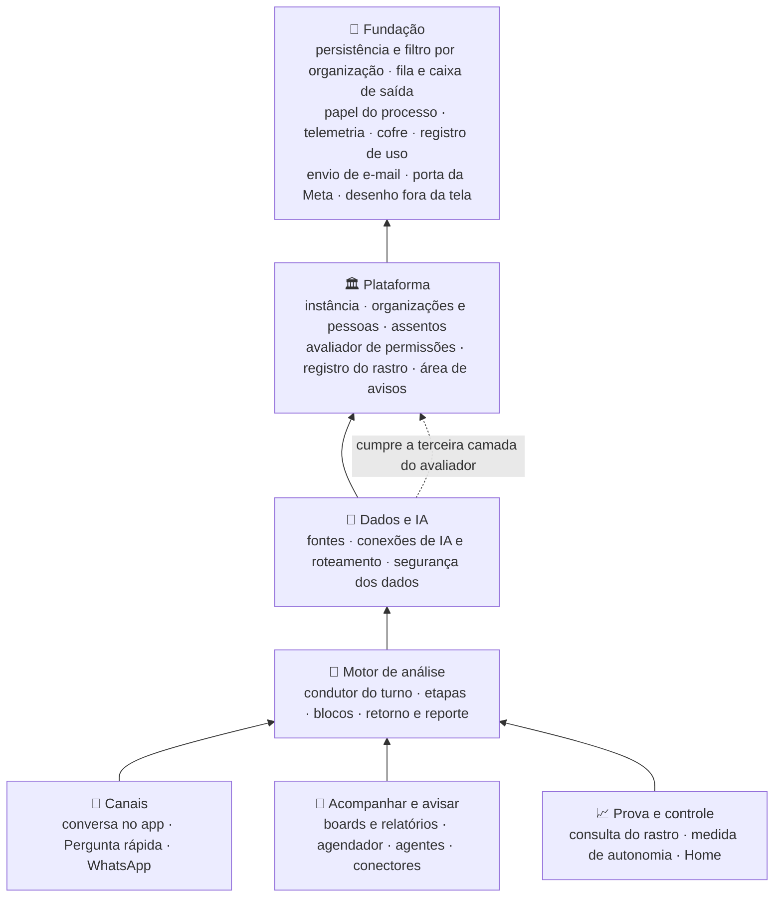

# Software do Horus v2: módulos, componentes e contratos

Situação: 🟢 escrito pelo arquiteto · cinco decisões novas (`ARQ-018` a `ARQ-022`): quatro 🟢 e uma ⚪ (a `ARQ-095`, substituída em 03/11/2026 pela `ARQ-095` 🟢) · nenhuma decisão do dono nasce aqui.

Última atualização: 03/11/2026 (o roteamento ao banco da organização, pela `ARQ-010` ✅ e pela `ARQ-088`; a segurança por pessoa fora da v2.0, pela `ARQ-090` ✅; os dois papéis em duas réplicas ou mais, pela `ARQ-095`, que substitui a `ARQ-095`).

Este documento diz **como o servidor e o front se dividem por dentro**: os módulos, os componentes de cada um, o que cada componente faz e os contratos entre eles, camada a camada, de `MF-101` a `MF-119`. Como a pergunta vira resposta, dentro do módulo do motor, está no [documento 05](05-motor-de-analise-e-ia.md).

- O **quê** e o **porquê** são do produto: [mapa de objetivos e funcionalidades](../produto/07-mapa-de-objetivos-e-funcionalidades.md), [a v2.0 consolidada](../produto/05-v2.0-consolidada.md) e o [backlog estratégico](../produto/backlog-estrategico.md). As decisões citadas (`ARQ-nnn`) estão no [registro](02-registro-de-decisoes.md); a estratégia, em [01-estrategia-da-solucao.md](01-estrategia-da-solucao.md).
- O código da v1.xx se cita como `horus@318db52b:<caminho>`. Nada foi executado: o levantamento é de leitura do código e das regras do repositório.
- O nível de detalhe para no componente e no contrato, pelo nome e pela responsabilidade. Tabela, rota e assinatura de código ficam para o desenvolvimento.
- ⚠️ A `D-138` e a `D-139` vêm sempre com o título curto: `D-139` ("Tabela de conversão das mfs…") é a que ordena as mfs pelas camadas.

Legenda: 🟢 decidida pelo arquiteto · 🟡 proposta ao dono · 🔎 hipótese a confirmar · 🆕 componente novo · ♻️ vem da v1.xx · 🔧 vem da v1.xx e muda.

## 1. O que o software precisa garantir

| Garantia | Por quê | Objetivos | Decisões de produto |
| --- | --- | --- | --- |
| 🎯 **Cada regra mora num lugar só** | A mesma pergunta chega da conversa, do popup, do WhatsApp, do board e do agente; a resposta, a segurança, os níveis e a contagem têm de ser os mesmos | O1, O2, O6 | `D-088`, `D-095`, `D-098`, `D-087`, `D-130` |
| 🛡️ **O servidor decide; a tela só pergunta** | Nove botões por role, quatro tipos de assento e a segurança dos dados por pessoa não podem divergir entre telas e canais | O2, O7 | `D-110` a `D-114`, `D-069`, `D-026`, `D-054` |
| 📥 **O que roda sozinho não se perde nem se duplica, e para no corte** | O aviso é promessa da v2.0, e o corte pausa tudo o que roda sem ninguém | O3, O4, O7 | `D-122`, `D-075` e a leitura `D-075.2`, `D-060` |
| 📦 **O conector só transporta** | O formato do que sai (o artefato) é outra coisa, e o conector só entrega a usuários do Horus | O4 | `D-035`, `D-041`, `D-064`, `D-079` |
| 🧾 **Nenhuma entrega escapa do rastro** | O rastro só prova a responsabilidade do gestor se tudo o que sai gravar junto | O2 | `D-090`, `D-093`, `D-054`, `D-059` |
| 🗂️ **As organizações não se misturam** | Uma instância comporta várias organizações, cada setor uma | O2, O7 | `D-008`, `D-009` |
| 🏛️ **A mesma versão em qualquer instância** | O SaaS e, na v2.1, a infraestrutura do contratante rodam o mesmo produto | O8 | `D-017` |
| ♻️ **O que a v1.xx já faz bem continua** | A v1.xx é o ponto de partida, e a base herdada entra sem ser refeita | Todos | `D-134`, `D-021`, `D-143` |

## 2. As decisões

| Decisão | O que decide | Situação |
| --- | --- | --- |
| `ARQ-003` | Um sistema só, em módulos com fronteiras verificadas por teste | 🟢 |
| `ARQ-004` | O mesmo executável em dois papéis: atender e trabalhar | 🟢 |
| `ARQ-005` | A fila durável e a caixa de saída no banco da aplicação | 🟢 |
| `ARQ-006`, `ARQ-007`, `ARQ-008`, `ARQ-009`, `ARQ-010` | Um motor só; um desenho só; um avaliador só; o rastro; o banco por organização, com o filtro | 🟢 (a `ARQ-010` ✅, com a `ARQ-088`) |
| **`ARQ-018`** | **O servidor se divide em sete módulos, numa direção só de dependência, dentro do projeto de domínio** | 🟢 |
| **`ARQ-019`** | **Um módulo pede a outro pela fachada e avisa os outros por evento gravado na caixa de saída** | 🟢 |
| **`ARQ-020`** | **O front segue os mesmos módulos, e a conversa vira um componente só, usado pela tela de análise e pelo popup** | 🟢 |
| `ARQ-021` | O que vive em memória fica preso a um papel, e a fila reparte o trabalho entre as organizações, com prioridade para quem espera | ⚪ (`ARQ-095`) |
| **`ARQ-095`** | **Os dois papéis rodam em duas réplicas ou mais: o que precisa valer em todas mora no Postgres, o que só acelera fica em cada uma, e a fila reparte o trabalho entre as organizações, com prioridade para quem espera** | 🟢 |
| **`ARQ-022`** | **Toda entrega é um artefato pronto, e o conector só o transporta** | 🟢 |

## 3. Os componentes e a responsabilidade de cada um

### 3.1 O mapa dos módulos (`ARQ-018`)

Os módulos seguem as camadas da tabela de conversão das mfs (`D-139` "Tabela de conversão das mfs…"), com uma camada técnica embaixo, a **Fundação**, que não é de nenhuma mf e serve a todas. A seta quer dizer "depende de": cada módulo só conhece os que estão abaixo dele.

**A regra de dependência:**

| Módulo | Pode chamar | Não pode chamar | Como o de baixo reage ao de cima |
| --- | --- | --- | --- |
| 🧱 Fundação | — | Nenhum módulo de negócio | — |
| 🏛️ Plataforma | Fundação | Dados e IA, Motor, Canais, Acompanhar | Pelos eventos da caixa de saída (`ARQ-019`) |
| 🔌 Dados e IA | Plataforma, Fundação | Motor e acima | Idem |
| 💬 Motor de análise | Dados e IA, Plataforma, Fundação | Canais, Acompanhar, Prova e controle | Idem |
| 📲 Canais | Motor e abaixo | Acompanhar e avisar | Idem |
| 📌 Acompanhar e avisar | Motor e abaixo | Canais | Idem |
| 📈 Prova e controle | Motor e abaixo | Canais, Acompanhar | Lê os registros (rastro, uso, retorno) pelas fachadas de quem os grava |

Duas peças pedem cuidado para a regra valer:

- **A terceira camada do avaliador.** O avaliador mora na Plataforma (`ARQ-008`) e responde "pode usar?" pelo tipo de assento e pelas roles. A terceira camada, "o que vê dos dados", é da segurança dos dados, um módulo acima. Por isso a Plataforma declara o contrato da terceira camada e a Segurança dos dados o cumpre e o registra: o avaliador continua sendo a porta única, e nenhum módulo depende de outro acima dele.
- **O WhatsApp entra e sai.** O canal de conversa pelo WhatsApp (`MF-111:Chat pelo WhatsApp`) e o conector de WhatsApp (`MF-113:Conectores de Saída`) usam a mesma conta da organização (leitura `D-124.1`). A conversa técnica com a Meta (a conta própria ou a da Maind, o recebimento das mensagens, o envio de texto, imagem e modelos aprovados) é a **porta da Meta**, na Fundação, e o canal e o conector a usam sem depender um do outro. O caminho até a Meta é do documento 08.

### 3.2 Os componentes, módulo a módulo

#### 🧱 Fundação

| Componente | Responsabilidade | Mfs | Situação |
| --- | --- | --- | --- |
| Persistência da aplicação | O contexto único do banco da aplicação, as migrações e a configuração de cada entidade junto do módulo dono dela | Todas | 🔧 `horus@318db52b:apps/server/Horus.Core/Data/HorusDbContext.cs` (1.025 linhas), 89 migrações |
| Roteamento e filtro por organização | Toda leitura e escrita de dado de organização abre o banco dela, pelo mapa do mestre, e passa pelo filtro, a segunda trava; o que é da instância fica no banco mestre | Todas | 🆕 sobre o escopo de hoje, passado à mão (`horus@318db52b:apps/server/Horus.Core/Identity/OrgScope.cs`); `ARQ-010` ✅, `ARQ-088` |
| Fila durável e caixa de saída | Guarda cada trabalho e cada evento na transação da mudança; entrega com trava por linha, tentativas e motivo de desistência; reparte por organização e por prioridade (`ARQ-005`, `ARQ-095`) | `MF-103`, `MF-111` a `MF-115` | 🆕; molde na fila de convites (`horus@318db52b:apps/server/Horus.Api/ProcessadorDaFilaDeConvites.cs`) e na reivindicação da agenda (`horus@318db52b:apps/server/Horus.Api/VigiaDeAgendaDeRelatorios.cs`) |
| Papel do processo | Diz se o processo atende, trabalha ou os dois, e liga só os componentes do papel (`ARQ-004`) | — | 🆕 |
| Telemetria e medição | Métricas, logs e traces sem conteúdo e sem pessoa como rótulo; o tempo por etapa e por canal (`ARQ-013`) | Todas | 🔧 `horus@318db52b:apps/server/Horus.Api/Telemetria.cs` |
| Cofre | Cifra e abre as credenciais das fontes, as chaves de IA e, na v2.0, as credenciais da conta da Meta | `MF-104`, `MF-105`, `MF-111` | ♻️ ASP.NET Core Data Protection, com um propósito por segredo |
| Registro de uso | Enfileira os fatos de uso sem esperar o banco e os grava em lote | `MF-117` | ♻️ `horus@318db52b:apps/server/Horus.Core/Uso/RegistroDeUso.cs`, `Horus.Api/GravadorEmLote.cs` |
| Envio de e-mail | O servidor de e-mail da instância e o ritmo de envio, por instância e por organização | `MF-101`, `MF-113` | ♻️ `horus@318db52b:apps/server/Horus.Core/Email/` |
| Porta da Meta | A conta de WhatsApp de cada organização (a própria ou a da Maind, `D-097`), o recebimento das mensagens e o envio de texto, imagem e modelos aprovados | `MF-111`, `MF-113` | 🆕 (documento 08) |
| Desenho fora da tela | Abre a montagem do front num navegador sem tela e devolve a imagem ou o PDF, com concorrência limitada (`ARQ-007`) | `MF-108`, `MF-111`, `MF-112`, `MF-115` | 🔧 `horus@318db52b:apps/server/Horus.Core/Relatorios/ImpressorDePdfChromium.cs`, `TokensDeRenderizacao.cs` |

#### 🏛️ Plataforma

| Componente | Responsabilidade | Mfs | Situação |
| --- | --- | --- | --- |
| Instância | Identidade e marca, administradores, o interruptor geral da segurança, o remetente do e-mail; na v2.1, a marca completa | `MF-101` | ♻️ `horus@318db52b:apps/server/Horus.Core/Identity/AppConfigStore.cs`, `AdminsDoAmbiente.cs` |
| Painel dos assentos | O administrador da instância libera e corta os assentos de cada organização, sem deixar reduzir abaixo do ocupado | `MF-101`, `MF-103` | 🆕 (`D-067`, `D-068`, `D-076`) |
| Organizações e sessão | As organizações, o login por senha e pelo Google, a sessão por cookie, a recuperação de senha, a foto | `MF-102` | ♻️ `horus@318db52b:apps/server/Horus.Core/Identity/`, `Horus.Api/Sessao.cs` |
| Pessoas e gestão | A carteira do gestor, a quarentena, o convite do gestor com aprovação do owner e reserva do assento, a planilha | `MF-102`, `MF-103` | 🔧 os convites e a planilha (`horus@318db52b:apps/server/Horus.Core/Seguranca/Planilha/`); 🆕 a carteira e a quarentena |
| Grupos | Os grupos do gestor (só com quem ele gere) e os da organização (do owner) | `MF-102` | 🆕 (`D-049`, `D-055`) |
| Roles | As roles com os nove botões, a soma, a role padrão e a cópia | `MF-102` | 🆕 (`D-110` a `D-114`) |
| Assentos | Os quatro tipos por organização, o owner grátis, a reserva, a troca e o corte; o corte vira evento | `MF-103` | 🆕 (`D-069` a `D-079`, `D-123`) |
| Avaliador de permissões | A porta única do "pode?": tipo de assento, roles e, pelo contrato da terceira camada, a segurança dos dados (`ARQ-008`); entrega também as **permissões efetivas** de uma pessoa numa organização, que a tela e o motor usam | `MF-102`, `MF-103`, `MF-106` | 🔧 a matriz de 23 ações e três papéis vira a primeira tabela (`horus@318db52b:apps/server/Horus.Core/Identity/PermissoesDaOrg.cs`) |
| Registro do rastro | Grava, na transação do que aconteceu, cada entrega e cada abertura, sem conteúdo (`ARQ-009`) | `MF-116` | 🆕; molde na trilha de segurança (`horus@318db52b:apps/server/Horus.Core/Seguranca/SegurancaEntities.cs`) |
| Área de avisos | Os avisos da conta de cada pessoa, com a preferência de também receber por e-mail (`D-128`, leituras `D-128.1` a `D-128.3`) | `MF-102`, `MF-107`, `MF-115` | 🆕 (o sininho saiu da tela: `horus@318db52b:apps/web/src/layout/HeaderApp.vue`) |

#### 🔌 Dados e IA

| Componente | Responsabilidade | Mfs | Situação |
| --- | --- | --- | --- |
| Catálogo de fontes | As fontes de cada organização, o documento semântico de cada uma, o teto de inferência por fonte, o "Testar" | `MF-104` | ♻️ `horus@318db52b:apps/server/Horus.Core/Data/Connections/ConnectionCatalog.cs` |
| Conectores | SQL Server, PostgreSQL, Oracle, MongoDB e BigQuery, com o túnel SSH, a conferência de "só leitura" e a guarda de rede | `MF-104` | ♻️ `horus@318db52b:apps/server/Horus.Core/Data/Connections/`; o Athena e as páginas web dependem da A-04 |
| Histórico de consultas e execuções | A consulta gravada e o resultado de cada execução, que o cartão e o filtro reaproveitam | `MF-104`, `MF-112` | ♻️ `horus@318db52b:apps/server/Horus.Core/Data/Consultas/` |
| Conexões de IA e roteador | As conexões da organização, a curadoria dos pares modelo e fornecedor, a rota de cada função e o consumo por chamada | `MF-105` | ♻️ `horus@318db52b:apps/server/Horus.Core/Llm/`; ganha três funções (`ARQ-031`) |
| Segurança dos dados | ⏭️ Na v2.1, fora do código da v2.0 (`ARQ-090`): a Semântica de Segurança inteira: claims, compilador, motor, reescritor, verificador, revisão, simulação, homologação e conferência diária; cumpre a terceira camada do avaliador | `MF-106` | ♻️ `horus@318db52b:apps/server/Horus.Core/Seguranca/` (85 arquivos); as duas camadas de claims ficam para o documento 07 |
| Ponto único de execução | O único componente que executa consulta no banco do cliente, travado por teste que lê o IL | `MF-104`; fica na v2.0, sem o caminho protegido (`ARQ-090`) | ♻️ `horus@318db52b:apps/server/Horus.Core/Seguranca/Motor/ExecucaoNoBanco.cs` |

#### 💬 Motor de análise

O detalhe de cada etapa está no [documento 05](05-motor-de-analise-e-ia.md).

| Componente | Responsabilidade | Mfs | Situação |
| --- | --- | --- | --- |
| Condutor do turno | Recebe o pedido de turno, decide a sequência pelas fontes e pelos modos e publica os eventos a quem o ouve; tem duas operações, responder e reexecutar (`ARQ-023`, `ARQ-024`) | `MF-107`, `MF-109` | 🔧 do `horus@318db52b:apps/server/Horus.Core/Chat/ChatEngine.cs` (2.901 linhas) e de `Planner/AnaliseAvulsa.cs` (1.031) |
| Etapas | Triagem, Planejador, workflow, preparo protegido, reparo, gerador de plano, materializador, pesquisa na web, leitura depois da consulta, Apresentador e montagem | `MF-107`, `MF-108`, `MF-109` | ♻️ `horus@318db52b:apps/server/Horus.Core/Planner/`, `Prompts/`; 🆕 a pesquisa na web (`ARQ-026`) |
| Blocos da resposta | O protocolo dos seis tipos, o parser tolerante e o materializador que põe os números do banco nos blocos | `MF-108` | ♻️ `horus@318db52b:apps/server/Horus.Core/Planner/Materializer.cs`, `Chat/BlocosUi.cs` |
| Retorno e reporte | O 👍🏻, o 👎🏻 e o 🚫 de cada resposta, o reporte ao owner com a cópia da resposta (`ARQ-028`) | `MF-107` | 🆕 |
| Fecho do turno | O desfecho, o custo e o tempo de cada turno, para a medida e para a telemetria (`ARQ-029`) | `MF-107`, `MF-117` | 🔧 os fatos `pergunta` e `resposta` de `horus@318db52b:apps/server/Horus.Core/Uso/TiposDeEventoDeUso.cs` |

#### 📲 Canais

| Componente | Responsabilidade | Mfs | Situação |
| --- | --- | --- | --- |
| Conversa no app | As conversas, o histórico e a transmissão da resposta por SSE, no papel "atender" | `MF-107` | ♻️ `horus@318db52b:apps/server/Horus.Api/Endpoints/ConversationEndpoints.cs`, `Data/ConversationStore.cs` |
| Conversa do popup | A conversa da Pergunta rápida: existe no servidor, fora da lista do histórico, até a pessoa salvá-la ou limpá-la (`ARQ-029`) | `MF-110` | 🆕 |
| Canal WhatsApp | A ligação do número ao perfil com código (`D-094`), a mensagem que chega, a confirmação na hora, o turno na fila e a resposta em texto, imagem e link (`D-096`) | `MF-111` | 🆕 |

#### 📌 Acompanhar e avisar

| Componente | Responsabilidade | Mfs | Situação |
| --- | --- | --- | --- |
| Boards e relatórios | O editor único, o board vivo e em PDF pela mesma montagem, publicar, desabilitar, o espaço da organização, os boards públicos da quarentena e a liberação do gestor | `MF-112` | 🔧 `horus@318db52b:apps/server/Horus.Core/Data/BoardStore.cs` (2.735 linhas), `RecalculadorDeBoard.cs` (2.211), `Relatorios/` |
| Agendador | Decide quando roda o PDF de um board ou um agente, com a permissão de quem criou, pausado no corte, sem refazer rodadas perdidas | `MF-114` | 🔧 a agenda dos relatórios (`horus@318db52b:apps/server/Horus.Core/Relatorios/AgendaDeRelatorio.cs`, `EntregaDeRelatorio.cs`) |
| Agentes | As instruções, a interpretação confirmada, a execução em ciclo e o artefato final (`ARQ-030`) | `MF-115` | 🆕 |
| Conectores de saída | O e-mail e o WhatsApp; o contato de cada pessoa por conector e a aprovação do owner; o transporte do artefato e o registro de cada entrega (`ARQ-022`) | `MF-113` | 🔧 o envio por SMTP; 🆕 o resto |

#### 📈 Prova e controle

| Componente | Responsabilidade | Mfs | Situação |
| --- | --- | --- | --- |
| Consulta do rastro | A tela do owner e o prazo de guarda que ele define (`D-091`, `D-092`) | `MF-116` | 🆕 |
| Medida de autonomia e qualidade | As perguntas de análise respondidas e a proporção do retorno, por gestor e por pessoa, em todos os canais (`D-133`) | `MF-117` | 🔧 `horus@318db52b:apps/server/Horus.Core/Uso/UsoDaOrg.cs` |
| Home | O painel da organização com o catálogo de indicadores e a grade editável | `MF-117` | ♻️ `horus@318db52b:apps/server/Horus.Core/Data/PainelDaOrg.cs`, `LayoutDaHome.cs` |
| Bases de demonstração | Fora do executável: os geradores determinísticos, a ingestão contínua e a conferência | `MF-118` | ♻️ `horus@318db52b:data/` |

### 3.3 Os contratos entre os módulos (`ARQ-019`, `ARQ-022`)

| Contrato | De quem | Para quem | O que leva | O que garante |
| --- | --- | --- | --- | --- |
| **"Pode?"** | Toda rota, todo canal, todo trabalho | Avaliador | Quem (a pessoa, ou em nome de quem o trabalho roda), a organização, o botão ou a ação, o recurso | Sim ou não, com o motivo em categoria; nenhum módulo decide permissão sozinho |
| **Permissões efetivas** | A tela e o motor | Avaliador | A pessoa e a organização | Os botões ligados, o nível máximo, os modos e o tipo de assento, já somados (`D-111`) |
| **Pedido de turno** | Canais, boards, agentes | Motor | Ver o documento 05 (`ARQ-023`) | A mesma resposta, com as mesmas regras, em qualquer canal |
| **Pedido de reexecução** | Boards (recálculo), a conversa ("Filtrar") | Motor | A receita gravada (a consulta, o plano e os filtros), em nome de quem | Os números de agora, pela mesma segurança, sem gerar consulta nova |
| **Pedido de trabalho** | Qualquer módulo | Fila | O tipo, a organização, em nome de quem, a prioridade, a chave que impede o trabalho em dobro | Roda uma vez, no papel "trabalhar", na vez da organização (`ARQ-095`) |
| **Evento** | O módulo onde o fato aconteceu | Os módulos interessados, pela fila | O tipo do fato e os ids, nunca conteúdo | Gravado na transação do fato; consumido sem efeito em dobro |
| **Artefato** | O agendador e o agente | Conectores | O tipo (PDF, imagem, texto de alerta, JSON), o conteúdo pronto, a origem, em nome de quem, o rótulo do nível e os destinatários | O conector só transporta; cada destino gera um registro no rastro (`ARQ-022`) |
| **Registro do rastro** | Boards, conectores, agentes, agendador | Registro do rastro | Quem, o quê, para quem, por onde e quando (`D-090`) | Na transação da entrega ou da abertura; só de acréscimo |
| **Aviso** | Motor (o "recebido"), agentes, agendador, assentos | Área de avisos | A pessoa, o tipo do aviso e o texto fixo do tipo | Chega na área de avisos e, se a preferência permitir, pelo e-mail da instância (leitura `D-128.3`) |
| **Pedido de desenho** | Canal WhatsApp, agendador, agentes | Desenho fora da tela | O que desenhar (uma resposta, um board, o artefato de um agente) e o formato | A imagem e o PDF são a mesma montagem da tela (`ARQ-007`) |
| **Mensagem da Meta** | Porta da Meta | Canal WhatsApp | O número de quem escreveu, a conta e o conteúdo | A pessoa é achada pelo número ligado (`D-094`) |

**Os eventos da v2.0** (a lista cresce com a construção; o nome é o fato, no passado):

| Evento | Nasce em | Quem reage, e como |
| --- | --- | --- |
| Assentos cortados | Assentos | Agendador e agentes pausam a organização (`D-075`); canal WhatsApp desliga os números |
| Pessoa removida da organização | Pessoas e gestão | Boards, agendamentos e agentes dela vão para o espaço da organização, pausados (`D-044`, `D-060`); canal WhatsApp desliga o número (leitura `D-094.3`); ela deixa de ser destino |
| Pessoa passou a membro leitor | Assentos | O que ela criou vai para o espaço da organização (`D-073`) |
| Board desabilitado | Boards e relatórios | O agendador põe o aviso no lugar do board (`D-044`, `D-045`) |
| Reporte recebido | Retorno e reporte | A área de avisos de quem reportou e a do owner (`D-128`, `D-129`) |
| Execução de agente terminada | Agentes | Conectores entregam o artefato; se falhou, o autor é avisado (A-10) |
| Regras de segurança aprovadas, modelo do motor trocado | Segurança dos dados | O pré-aquecimento das consultas protegidas, como na v1.xx (`horus@318db52b:.claude/rules/llm/pontos-de-montagem-do-system.md`, nono ponto) |
| Mensagem do WhatsApp recebida | Canal WhatsApp | O turno entra na fila, com prioridade (`ARQ-095`, `ARQ-024`) |

### 3.4 O que cada papel do executável roda (`ARQ-004`, `ARQ-095`)

| Papel | Componentes ligados | O que vive na memória dele |
| --- | --- | --- |
| **Atender** | As rotas e as telas; a conversa no app e no popup, com a transmissão; o recálculo dos cartões ao abrir um board; a análise avulsa; a entrada do WhatsApp (recebe, confirma, grava e enfileira) | O registro das respostas em transmissão (`horus@318db52b:apps/server/Horus.Core/Chat/StreamRegistry.cs`), com a parada e a geração nova avisadas pelo Postgres à réplica que transmite; o cache do resumo das fontes, de cada réplica; os tokens de renderização das telas, do próprio pod. Os limites de taxa saem da memória e contam no banco mestre (`ARQ-095`) |
| **Trabalhar** | O turno do WhatsApp e a imagem dele; as rodadas do agendador; os agentes; os PDFs; os envios dos conectores; os e-mails de aviso; a compilação de segurança, o pré-aquecimento e a conferência diária; a fila de convites e a recuperação de senha; as limpezas e a conversão dos dados | Os tokens das próprias impressões, servidos só em loopback ao Chromium do mesmo pod; o cache do resumo das fontes, de cada réplica |

Os onze serviços em segundo plano da v1.xx (`horus@318db52b:apps/server/Horus.Api/Program.cs`) vão para o papel "trabalhar", e os que precisam sobreviver a uma publicação passam a ler a fila. Com duas réplicas ou mais do "trabalhar" (`ARQ-095`), nenhum serviço supõe rodar sozinho: o que não pode rodar em dobro pega a vez no banco, como a reivindicação da agenda de hoje. Os dois gravadores em lote (consumo de IA e uso) continuam em cada processo: o que eles perdem numa queda é a última leva de números, e o rastro, que não pode se perder, grava na transação (`ARQ-009`).

### 3.5 O front (`ARQ-020`)

| Peça | Como fica | Da v1.xx |
| --- | --- | --- |
| Organização das pastas | As páginas e os clientes da API agrupados pelos mesmos módulos do servidor | 🔧 `horus@318db52b:apps/web/src/pages/` (295 arquivos), `api/` (26 clientes) |
| Componente de conversa | O compositor, o cartão da resposta, a transmissão, a linha de raciocínio e o retorno, num componente só, usado pela tela de análise e pelo popup | 🔧 de `horus@318db52b:apps/web/src/pages/AnaliseConversaPage.vue` (714 linhas) e `pages/analise/` (49 arquivos) |
| Estado da transmissão | A resposta em transmissão vive num estado do app (Pinia), e não na página: fechar o popup ou trocar de tela não a corta (leitura `D-086.1`); a tela de análise mantém o comportamento de hoje ao sair dela | 🔧 `horus@318db52b:apps/web/src/api/sse.ts`, `session/` |
| Botão da Pergunta rápida | No leiaute do app, fora da tela de análise e escondido do membro leitor (`D-089`) | 🆕 |
| Permissões na tela | A tela lê as permissões efetivas do servidor e só esconde o que ele nega; nenhuma regra de permissão mora no front | 🔧 `horus@318db52b:apps/web/src/session/permissoesDaOrg.ts` |
| Blocos e design system | Os blocos portados continuam sem edição, com as exceções registradas; o `@horus/ds` continua gerado da fonte | ♻️ `horus@318db52b:apps/web/src/chat/`, `.claude/rules/front/blocos-do-chat.md`, `packages/horus-ds/` |
| Rota de impressão | A montagem que o desenho fora da tela abre, para a resposta, o board e o artefato do agente | 🔧 a rota de impressão dos relatórios e do PDF da resposta |

### 3.6 As 19 mfs nos módulos

| Mf | Módulo | Componentes que a entregam | Contratos que usa |
| --- | --- | --- | --- |
| `MF-101:Administração da instância` | Plataforma | Instância, painel dos assentos; envio de e-mail (Fundação) | "Pode?", aviso |
| `MF-102:Organizações, pessoas e papéis` | Plataforma | Organizações e sessão, pessoas e gestão, grupos, roles, área de avisos | "Pode?", permissões efetivas, eventos |
| `MF-103:Licenças e planos` | Plataforma | Assentos, painel dos assentos | Evento "assentos cortados" |
| `MF-104:Conectar as fontes vivas` | Dados e IA | Catálogo de fontes, conectores, histórico, ponto único de execução | Filtro por organização |
| `MF-105:IA sob controle da organização` | Dados e IA | Conexões de IA e roteador | Consumo e custo |
| `MF-106:Segurança dos dados por pessoa` | Dados e IA | Segurança dos dados | ⏭️ Na v2.1 (`ARQ-090`). Terceira camada do avaliador; preparo protegido (documento 05) |
| `MF-107:Perguntar aos dados em português` | Motor | Condutor, etapas, retorno e reporte, fecho do turno | Pedido de turno, aviso |
| `MF-108:Respostas visuais` | Motor e front | Blocos da resposta; blocos portados; desenho fora da tela | Pedido de desenho |
| `MF-109:A web como fonte` | Motor | Pesquisa na web e as etapas que escrevem prosa | Pedido de turno |
| `MF-110:Pergunta rápida` | Canais e front | Conversa do popup, componente de conversa, botão | Pedido de turno |
| `MF-111:Chat pelo WhatsApp` | Canais | Canal WhatsApp; porta da Meta (Fundação) | Mensagem da Meta, pedido de trabalho, pedido de turno, pedido de desenho |
| `MF-112:Boards e Relatórios` | Acompanhar e avisar | Boards e relatórios | Pedido de reexecução, pedido de desenho, registro do rastro |
| `MF-113:Conectores de Saída` | Acompanhar e avisar | Conectores; envio de e-mail e porta da Meta (Fundação) | Artefato, registro do rastro |
| `MF-114:Módulo de Agendamentos de Agentes` | Acompanhar e avisar | Agendador | Pedido de trabalho, artefato, evento |
| `MF-115:Agentes ativos` | Acompanhar e avisar | Agentes | Pedido de turno, pedido de desenho, artefato, aviso |
| `MF-116:Auditoria` | Plataforma (o registro) e Prova e controle (a consulta) | Registro do rastro, consulta do rastro | Registro do rastro |
| `MF-117:Home da organização` | Prova e controle | Medida de autonomia e qualidade, Home | Leitura dos fatos de uso e do retorno |
| `MF-118:Bases de demonstração` | Fora do executável | Geradores, ingestão, conferência | — |
| `MF-119:Investigação guiada` (v2.1) | Motor | Um modo novo do condutor, que espera a `P-018` | Pedido de turno |

## 4. O que vem da v1.xx e o que não vem

| Peça da v1.xx | Destino | Por quê |
| --- | --- | --- |
| Os quatro projetos da solução (`horus@318db52b:apps/server/Horus.slnx`) | ♻️ Ficam: o `Horus.Core` é o projeto de domínio, dividido nos módulos; o `Horus.Api` é o hospedeiro | `ARQ-018` |
| O registro manual de serviços em 1.086 linhas (`horus@318db52b:apps/server/Horus.Api/Program.cs`) | 🔧 Vira um registro por módulo, chamado pelo hospedeiro conforme o papel | `ARQ-004`, `ARQ-018` |
| Os 20 grupos de rotas (`horus@318db52b:apps/server/Horus.Api/Endpoints/`) | 🔧 Agrupadas por módulo, no mesmo estilo de Minimal API, com o mesmo tratamento de erro (`HorusExceptionHandler.cs`) | — |
| As travas que leem o IL (`horus@318db52b:apps/server/Horus.Core.Tests/ArquiteturaDoMotorTests.cs`, 2.088 linhas, e `LeitoresDoCodigo.cs`) | 🔧 Viram a base dos testes de arquitetura dos módulos: a regra de dependência e "só o módulo dono escreve a sua tabela" | `ARQ-018`, documento 12 |
| Os quatro executores do motor de segurança (o chat, o "Filtrar", o recálculo e a análise avulsa) | 🔧 Viram as duas operações do motor, responder e reexecutar; o caminho protegido sai da v2.0 e volta na v2.1 | `ARQ-023`, `ARQ-032`, `ARQ-090` |
| A matriz de permissões (`horus@318db52b:apps/server/Horus.Core/Identity/PermissoesDaOrg.cs`) | 🔧 Vira a primeira tabela do avaliador | `ARQ-008` |
| A fila de convites em tabela e a reivindicação da agenda | 🔧 Viram a fila durável geral | `ARQ-005` |
| O registro das respostas em transmissão, os limites de taxa, os caches e os tokens de renderização, em memória | 🔧 A parada e os limites passam pelo Postgres; o cache fica em cada réplica; os tokens, no pod que renderiza | `ARQ-095` |
| Os onze serviços em segundo plano | 🔧 Vão ao papel "trabalhar"; os que precisam sobreviver a uma publicação leem a fila | `ARQ-004`, `ARQ-005` |
| O front: `pages/`, `ui/`, `chat/`, `api/`, `session/`, `layout/` | 🔧 Reagrupado pelos módulos; a conversa vira componente | `ARQ-020` |
| O design system `@horus/ds` e os blocos portados | ♻️ Ficam como estão | `ARQ-001`, `ARQ-007` |
| A suposição de "uma instância da API" espalhada no código | ❌ Sai: cada peça diz em que papel vive e se o estado dela é de todas as réplicas ou só da dela | `ARQ-095` |
| As filas em memória do que precisa sobreviver a uma publicação | ❌ Saem para a fila durável | `ARQ-005` |

## 5. Os riscos e o que falta decidir

| Risco | Por quê | O que se faz |
| --- | --- | --- |
| 🧱 Reorganizar sem quebrar | São cerca de 6.000 casos de teste no servidor e 388 arquivos de teste no front, sobre arquivos de mais de 2.000 linhas | Mover sem reescrever, um módulo por vez, no M0. A regra de dependência entra reprovando só o que é novo; o que já existe fica numa lista de exceções que só encolhe, como as listas das travas do motor de hoje |
| 🗄️ Um contexto de banco para tudo | O `HorusDbContext` tem 1.025 linhas e vai crescer com as tabelas novas | A configuração de cada entidade mora no módulo dono, e o teste de arquitetura reprova a escrita na tabela de outro módulo |
| 🔁 A terceira camada do avaliador por inversão | Se a segurança dos dados não registrar o contrato, o avaliador responderia sem ela | O avaliador fecha sem a terceira camada registrada ("não pode"), e um teste prova que ela está lá em todo papel |
| 📅 O pico de segunda de manhã | Os agentes e os PDFs de uma organização grande podem ocupar a fila inteira | A fila reparte por organização e dá a vez a quem espera (`ARQ-095`) |
| 🧠 Várias réplicas de cada papel | O que vivia em memória supunha um processo só | O que precisa valer em todas passa pelo Postgres, e a transmissão fica na réplica que a abriu (`ARQ-095`) |
| 📉 Os fatos de uso em lote | Uma queda perde a última leva antes de gravar | Aceito para a medida; o rastro grava na transação |

**O que falta decidir, e onde:**
- Documento 06: o que cada fila, evento, artefato, reporte e aviso guarda e por quanto tempo; a marca da organização em cada tabela nova.
- Documento 07: as camadas do avaliador em detalhe e as duas camadas de claims.
- Documento 08: a porta da Meta (a API da Meta direta ou um parceiro), o servidor de e-mail.
- Documento 09: onde roda cada papel.
- Documento 12: os testes de arquitetura, o teste de isolamento por tabela e o CI.
