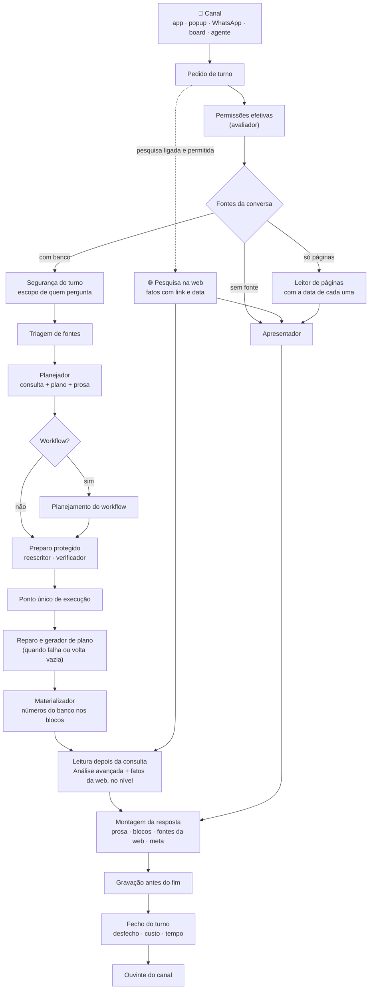
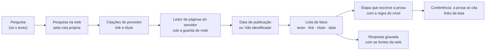
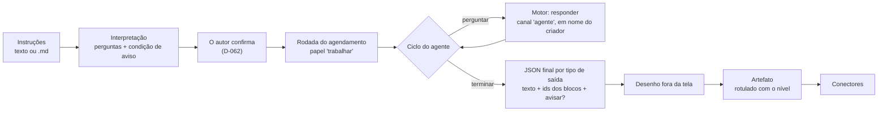

# Motor de análise e IA do Horus v2

Situação: 🟢 escrito pelo arquiteto · dez decisões novas (`ARQ-023` a `ARQ-032`): nove 🟢 e uma ✅ do dono (`ARQ-027`, em 03/11/2026) · seis itens a devolver ao PO (A-08 a A-13, no [documento 01](01-estrategia-da-solucao.md), seção 9).

Última atualização: 03/11/2026 (a segurança por pessoa fora da v2.0, pela `ARQ-090` ✅; a pesquisa na web pela busca nativa da conexão, pela `ARQ-027` ✅).

Este documento diz **como a pergunta vira resposta**: o pedido de turno, as etapas do motor, o modelo semântico, os níveis de inferência, a web, a Análise avançada, o retorno e a medida, o agente, os provedores de IA com o roteamento por função e a segurança por pessoa dentro do motor. Os módulos em volta estão no [documento 04](04-software.md).

- O **quê** e o **porquê** são do produto ([backlog estratégico](../produto/backlog-estrategico.md), [a v2.0 consolidada](../produto/05-v2.0-consolidada.md)). As decisões (`ARQ-nnn`) estão no [registro](02-registro-de-decisoes.md).
- O código da v1.xx se cita como `horus@318db52b:<caminho>`. As regras do repositório que este documento lê são `horus@318db52b:.claude/rules/llm/pontos-de-montagem-do-system.md`, `llm/conexoes-e-roteamento.md`, `seguranca/motor.md`, `seguranca/superficies.md` e `front/blocos-do-chat.md`. Nada foi executado, e nenhum modelo foi chamado.

Legenda: 🟢 decidida pelo arquiteto · 🟡 proposta ao dono · 🔎 hipótese a confirmar · ♻️ vem da v1.xx · 🔧 vem e muda · 🆕 novo.

## 1. O que o motor precisa garantir

| Garantia | Objetivos | Decisões de produto |
| --- | --- | --- |
| 🔢 **Os números vêm do banco.** O modelo escreve a consulta e o plano; o servidor põe os números nos blocos. O palpite fica no texto e nunca entra num bloco | O1, O2 | `D-001`; os invariantes da v1.xx (`horus@318db52b:CLAUDE.md`) |
| 👀 **Só lê as fontes** | O2 | `D-001`, `D-022` |
| 💬 **A mesma conversa, com tudo o que ela oferece, em todo canal** | O1 | `D-088`, `D-095`, `D-098`, `D-089`, `D-099` |
| 🎚️ **Os níveis de inferência**: autorizados, somados pelas roles dentro do teto, livres no agente | O1, O2 | `D-001`, `D-024`, `D-110`, `D-111`, `D-114` |
| 🌐 **A web com link e data**; o fato em qualquer nível; a causa vinda de fora só a partir do nível 4 | O1, O2 | `D-006`, `D-130`, `D-131` e as leituras `D-130.1` e `D-130.2` |
| 🛡️ **Cada um vê só o que pode**, e o gestor libera dentro do board e no artefato | O2 | `D-025`, `D-026`, `D-028`, `D-054`, `D-059` |
| 👍🏻 **Toda resposta recebe retorno**, e o reporte chega ao owner com a resposta guardada | O1, O6 | `D-005`, `D-014`, `D-127`, `D-128`, `D-129` e a leitura `D-087.1` |
| 📈 **Toda pergunta de análise respondida conta**, também a do popup limpa sem salvar | O6 | `D-004`, `D-087`, `D-133` |
| 🤖 **O agente**: instruções em texto, o que entendeu confirmado antes, o ciclo controlado pelo modelo, o fim por tipo de saída, o rótulo do nível, a permissão de quem criou | O4 | `D-061` a `D-064`, `D-060`, `D-024`, `D-022` |
| 🤝 **A IA sob controle da organização**: as conexões, o modelo por função, o modelo do agente e o custo | O1, O7 | `D-061`, `D-062`, `D-063`; `ARQ-017` |
| ⏱️ **"Em segundos" é comparação**; o tempo se mede por etapa e por canal | O1, O6 | `D-125`, `D-126`; `ARQ-013` |
| 🧭 **O modelo semântico é do time de dados** | O1 | `D-083` |

## 2. As decisões

| Decisão | O que decide | Situação |
| --- | --- | --- |
| `ARQ-006` | Um motor só, chamado por todos os canais | 🟢 |
| `ARQ-007` | A resposta visual se desenha uma vez e sai em tela, imagem e PDF | 🟢 |
| `ARQ-013` | O tempo se mede por etapa e por canal | 🟢 |
| **`ARQ-023`** | **O motor é um condutor de turno com etapas de contrato próprio, em duas operações: responder e reexecutar** | 🟢 |
| **`ARQ-024`** | **O turno não depende de quem o ouve: o app ouve ao vivo; o WhatsApp e o agente rodam na fila** | 🟢 |
| **`ARQ-025`** | **O nível de inferência vale em toda etapa que escreve prosa sobre dados ou sobre a web, e o servidor calcula o nível efetivo** | 🟢 |
| **`ARQ-026`** | **A web é uma etapa própria que devolve fatos com link e data, e o servidor separa o fato da causa** | 🟢 |
| **`ARQ-027`** | **A pesquisa na web usa a busca nativa do provedor da conexão de IA, com a saída para a web autorizada, e só a pergunta vai a ela; sem busca nativa, a opção não aparece no chat** | ✅ |
| **`ARQ-028`** | **O retorno pertence à resposta, e o reporte guarda uma cópia dela para o owner** | 🟢 |
| **`ARQ-029`** | **A pergunta respondida se conta no fecho de cada turno, com o desfecho e o canal, sem o conteúdo** | 🟢 |
| **`ARQ-030`** | **O agente é o motor em ciclo: o modelo do agente pergunta ao motor e fecha citando só o que o servidor calculou** | 🟢 |
| **`ARQ-031`** | **O roteamento por função continua, com três funções novas** | 🟢 |
| **`ARQ-032`** | **A segurança por pessoa entra no motor sem executor novo** | 🟢 |

## 3. Como a pergunta vira resposta

### 3.1 O caminho de uma pergunta

A pesquisa na web começa junto com o turno e corre em paralelo com o Planejador e a consulta; quem a usa é a etapa que escreve a prosa depois de o dado existir. No modo dados, o Planejador continua sem web, pela razão medida na v1.xx: ele devolve um JSON estrito e escreve a prosa antes de a consulta rodar (`horus@318db52b:apps/server/Horus.Core/Chat/ChatEngine.cs`, o comentário "SEM `WebSearch`, de propósito (2026-09-09)").

### 3.2 O pedido de turno e o que sai dele (`ARQ-023`, `ARQ-024`)

| Parte | O que leva | Quem preenche |
| --- | --- | --- |
| **Quem** | A pessoa, a organização e em nome de quem o turno roda (a pessoa; o criador de um agente ou de um agendamento; o espaço da organização, conforme a A-11) | O canal |
| **Canal** | App, Pergunta rápida, WhatsApp, board ou agente | O canal |
| **Conversa** | A conversa (no popup, a conversa do popup; no agente, a da execução) e o histórico até o teto de hoje | O canal |
| **Pergunta** | O texto, até o teto de hoje | A pessoa, ou o modelo do agente |
| **Escolhas** | Os modos, o nível, a pesquisa na web, a Análise avançada, o modelo | A pessoa, limitada pelas permissões efetivas |
| **Permissões efetivas** | Os botões ligados, o nível máximo e o tipo de assento, já somados (`D-111`) | O avaliador, nunca o canal |

| O que sai | Para quê |
| --- | --- |
| **Eventos do turno**: início, etapa, fonte escolhida, texto, sugestões, fim e erro (os de hoje, `horus@318db52b:apps/server/Horus.Core/Chat/ChatStreamEvent.cs`), mais as **fontes da web** | O ouvinte do canal os traduz: a transmissão na tela, a mensagem no WhatsApp, a próxima volta no agente |
| **A resposta gravada**, antes do evento de fim | A prosa, os blocos, a consulta e o plano, as fontes da web com link e data, o nível efetivo, o recorte de acesso e as chamadas ao modelo |
| **O fecho do turno** | O desfecho em categoria, o canal, o tempo por etapa e o custo (`ARQ-013`, `ARQ-017`, `ARQ-029`) |

A operação **reexecutar** recebe, no lugar da pergunta, a receita gravada (a consulta, o plano e os filtros) e devolve os blocos com os números de agora, pela mesma segurança e pelo mesmo materializador, sem gerar consulta nova. É o "Filtrar" da conversa e o recálculo dos cartões.

### 3.3 As etapas, uma a uma

As etapas vêm da v1.xx e só mudam de casa: o condutor as chama em sequência, e cada uma tem o seu contrato. Os pontos em que o servidor monta um system e chama um modelo, do terceiro ao décimo, estão descritos com o que mandam e o que nunca mandam em `horus@318db52b:.claude/rules/llm/pontos-de-montagem-do-system.md`, e continuam valendo.

| Etapa | Responsabilidade | Chama modelo? (função) | O que nunca manda ao modelo | Da v1.xx |
| --- | --- | --- | --- | --- |
| Fontes e modo | Resolve as fontes da conversa uma vez e decide o modo: dados (há banco), páginas (a fonte é de páginas) ou conversa (sem fonte) | Não | — | ♻️ `ChatEngine.SendAsync` |
| Segurança do turno | Avalia o escopo de quem pergunta em cada fonte, tira a fonte que a pessoa não usa e monta as seções protegidas do Planejador | Não | Valor de claim em texto | ♻️ `horus@318db52b:apps/server/Horus.Core/Seguranca/Motor/MotorNoTurno.cs` |
| Triagem e resumo de fontes | Escolhe as fontes que merecem o documento inteiro, nas conversas com muitas fontes | Sim (`triagem-de-fontes`, `resumo-de-fontes`) | Linhas do banco | ♻️ `horus@318db52b:apps/server/Horus.Core/Planner/TriagemDeFontes.cs`, `ResumoDeFontes.cs` |
| Planejador | Escreve a consulta, o plano dos blocos e a prosa de abertura, antes de a consulta rodar | Sim (`planejador`) | Linhas do banco; a web | ♻️ `horus@318db52b:apps/server/Horus.Core/Planner/PlannerInstruction.cs`, `PlannerEnvelope.cs`; 🔧 sai a instrução de web, que hoje ele recebe sem poder pesquisar |
| Workflow | Monta o fluxo de um processo da seção `## Workflows` e o pinta sobre os números | Sim (`planejamento-de-workflow`, `renderizacao-de-workflow`) | Linhas cruas, o SQL, o documento inteiro (na pintura) | ♻️ `horus@318db52b:apps/server/Horus.Core/Planner/Workflow/` |
| Preparo protegido | Para quem tem acesso restrito, protege a consulta pelas regras aprovadas, com os portões | Sim (`reescritor-de-seguranca`, `verificador-de-seguranca`) | Linhas, valores de claim, a pergunta | ♻️ `horus@318db52b:apps/server/Horus.Core/Seguranca/Motor/ProtecaoDeConsulta.cs` |
| Execução | Roda a consulta no banco do cliente, pelo ponto único, com os tetos de 500 linhas e 30 segundos | Não | — | ♻️ `horus@318db52b:apps/server/Horus.Core/Seguranca/Motor/ExecucaoNoBanco.cs` |
| Reparo e gerador de plano | Uma tentativa de consertar a consulta que falhou ou voltou vazia, e o plano novo para a consulta reparada | Sim (`reparo-de-consulta`, `gerador-de-plano`) | Linhas (no gerador) | ♻️ `horus@318db52b:apps/server/Horus.Core/Planner/ReparoDeConsulta.cs`, `GeradorDePlano.cs` |
| Materializador | Põe os números do resultado nos blocos, pelo plano; a frase honesta quando não há o que mostrar | Não | — | ♻️ `horus@318db52b:apps/server/Horus.Core/Planner/Materializer.cs` |
| 🆕 Pesquisa na web | Busca os fatos de fora que a pergunta pede e devolve a lista estruturada (`ARQ-026`) | Sim (`pesquisa-na-web`, nova) | Linhas do banco, valores de claim, o documento semântico (`ARQ-027`) | 🆕; a busca de hoje é o `:online` do OpenRouter, dentro da leitura depois da consulta |
| Leitura depois da consulta | A Análise avançada: lê o resultado real (até 12.000 caracteres) e escreve a seção de leitura; recebe os fatos da web e o nível efetivo (`ARQ-025`) | Sim (`analise-avancada`) | Mais que o teto do resultado; regras de segurança | 🔧 `horus@318db52b:apps/server/Horus.Core/Planner/AnalisePosConsulta.cs`: deixa de pesquisar e passa a receber o nível |
| Apresentador | Escreve a resposta no modo conversa e no modo páginas, com o protocolo dos blocos e o `meta`; recebe os fatos da web e o nível quando há fatos | Sim (`resposta-conversa`, `resposta-web`) | — | ♻️ `horus@318db52b:apps/server/Horus.Core/Prompts/PresenterInstruction.cs` |
| Montagem | Junta a prosa, os blocos (no máximo dois), as fontes da web e o `meta`; tira cerca da prosa | Não | — | ♻️ `horus@318db52b:apps/server/Horus.Core/Chat/CercasDaTela.cs` |
| Gravação e fecho | Grava a resposta antes do fim e fecha o turno com o desfecho, o tempo e o custo | Não | Conteúdo na telemetria | 🔧 `ConversationStore`, `UsoDoTurno`, `TiposDeEventoDeUso` |

### 3.4 O modelo semântico

O modelo semântico continua como na v1.xx, e melhorá-lo é trabalho do time de dados (`D-083`):

- **Um documento em markdown por fonte**, até 20.000 caracteres, e até 160.000 somando as fontes de uma conversa (`horus@318db52b:apps/server/Horus.Core/Data/Connections/ConnectionCatalog.cs`, `Chat/ChatEngine.cs`). O documento cadastrado na fonte vence o arquivo.
- **Duas seções que o servidor lê**, além do texto que vai ao Planejador: `## Colunas de tempo` (o que tem hora; o servidor não pergunta ao banco) e `## Workflows` (os processos que viram o sexto tipo de bloco) (`horus@318db52b:apps/server/Horus.Core/Planner/ColunasDeTempoDoSemantico.cs`, `Workflow/WorkflowsDoSemantico.cs`).
- **O teto de inferência é da fonte**, e quem o define é o dono do dado (`ConnectionConfig.MaxInference`); o turno usa o menor teto das fontes da conversa. A leitura disso como "o teto da organização" foi ao PO (A-13).
- **O documento de segurança é outro**, por base, e vira regras pelo compilador, com a aprovação do owner (Semântica de Segurança).
- As bases de demonstração trazem os modelos de referência (`horus@318db52b:data/mcdonalds/semantic/`, `data/frota/semantic/`) e são o banco de prova de cada mudança no prompt.

Nada muda na forma do documento na v2.0. O que muda é quem o lê: os canais novos e o agente leem o mesmo documento pelo mesmo Planejador.

### 3.5 Os níveis de inferência (`ARQ-025`)

| Nível | O que a prosa pode dizer | O fato da web (`D-130`, leitura `D-130.2`) | A causa vinda de fora dos dados |
| --- | --- | --- | --- |
| 1 · Descritivo | Só o que a consulta devolveu | ✅ Entra, com link e data | ❌ |
| 2 · Explicativo (padrão) | Explica com os mecanismos que o documento semântico declara | ✅ | ❌ |
| 3 · Comparativo | Propõe causa ao alcance dos próprios dados, com a coluna que a testa na mesma consulta | ✅ | ❌ |
| 4 · Hipótese de domínio | Arrisca causa do conhecimento geral, num parágrafo rotulado | ✅ | ✅ Rotulada como hipótese |
| 5 · Especulativo | Especula, rotulado | ✅ | ✅ Rotulada como especulação |

**O nível efetivo de um turno** é o menor entre o que a pessoa pediu, o maior que as roles dela liberam (`D-111`; o owner não depende de roles, leitura da `D-114`) e o teto das fontes. No agente, é o nível que o autor escolheu (`D-024`). O servidor calcula, grava na resposta e manda a toda etapa que escreve prosa sobre dados ou sobre fatos da web.

**Hoje, pela leitura do código:**
- O nível chega só ao Planejador (`horus@318db52b:apps/server/Horus.Core/Planner/InferenceLevel.cs`).
- A leitura depois da consulta, que é onde a web é buscada no modo dados, roda **sem o nível**: a instrução depende só de a Análise avançada e a pesquisa estarem ligadas (`horus@318db52b:apps/server/Horus.Core/Planner/AnalisePosConsulta.cs`, `Instrucao`). Com a pesquisa ligada, ela já compara número com número da web em qualquer nível, cita a fonte só no texto e não traz data.
- O modo conversa não pesquisa nada, e o modo páginas não recebe o nível (`ChatEngine.cs`, o modo texto e `ModoWebAsync`).
- O "só do nível 4 em diante" que o inventário registra é o título do botão (`horus@318db52b:apps/web/src/pages/analise/composerLogica.ts`, `tituloPesqWeb`) e a instrução de web do Planejador, que não pesquisa desde 09/09/2026. A correção do inventário foi ao PO (A-12).

### 3.6 A web (`ARQ-026`, `ARQ-027` ✅)

**A escolha do dono** (`ARQ-027`, em 03/11/2026): a pesquisa usa a busca nativa do provedor da conexão de IA, ligando a saída para a web; o OpenRouter conta pelo `:online`. Sem busca nativa, como no Bedrock, a opção de pesquisa não aparece no chat. A pesquisa só roda no modo "com serviços externos autorizados" (`D-010`) e com o modo web na role (`D-110`, `D-131`).

- **Quando roda:** com a pesquisa ligada na conversa e o modo web na role da pessoa (`D-110`, `D-131`), em qualquer modo, inclusive o modo conversa, onde a web responde sozinha à pergunta de fora (o [norte](../produto/02-norte-do-produto.md)). Nos canais: na conversa, no popup, no WhatsApp (o link e a data vão no texto, `D-131`) e no agente.
- **O fato é do servidor; a frase é do modelo.** O link vem da citação que o provedor devolve, e não do texto do modelo; a data, o servidor a lê na própria página, pelo leitor da v1.xx (`horus@318db52b:apps/server/Horus.Core/Web/WebReader.cs`), que só abre http e https e recusa destino interno (`Web/DestinoDeRede.cs`). Sem data na página, a fonte sai com o aviso de data não identificada (`D-006`). A lista vai gravada com a resposta, e a tela a mostra separada da prosa.
- **A separação do fato e da causa** (`P-008`, letra aa): o fato fica garantido pelo servidor, com link e data, em qualquer nível; a causa vinda de fora, abaixo do nível 4, é proibida pela instrução da etapa que escreve a prosa, e só a medição com a bateria mostra quanto o modelo respeita. A conferência depois da escrita tira da prosa todo link que não está na lista. A resposta da letra (aa) no documento 14 é ⚠️ viável com restrição: a parte do fato é garantida; a parte da causa depende do modelo e se mede.
- **O modo páginas** (a fonte de páginas cadastradas, leitura `D-130.1`) ganha a mesma data, lida do mesmo jeito, se a fonte ficar no produto (A-04).
- **No cartão do board** os fatos da web ficam com a data da resposta que o originou, e o recálculo não pesquisa de novo; no agente, cada execução pesquisa, porque cada execução é um turno. O comportamento do cartão foi ao PO (A-09).

### 3.7 A Análise avançada

A Análise avançada continua sendo a leitura depois da consulta (`analise-avancada`, "Ultrathink" na tela): a única etapa que vê o resultado real, até 12.000 caracteres, e escreve a seção que corrige a prosa escrita antes da consulta. Na v2.0 ela muda em três pontos:

1. **Deixa de pesquisar.** Os fatos da web chegam prontos da pesquisa (`ARQ-026`), e ela os confronta com os números.
2. **Recebe o nível efetivo** (`ARQ-025`): abaixo do 4, aponta o que salta aos olhos e quantifica, sem causa de fora.
3. **Roda em qualquer canal**, dentro da role (`D-110`, terceiro botão). No WhatsApp, quando demora, o canal avisa que está trabalhando (leitura `D-098.3`).

O que não muda: o teto de caracteres, as notas das estranhezas dos gráficos, o "NADA" quando não há o que acrescentar, e a regra de que nada dela vira gráfico.

### 3.8 O retorno, o reporte e a medida (`ARQ-028`, `ARQ-029`)

- **O retorno** (👍🏻, 👎🏻, 🚫) grava-se pela resposta, venha da tela, do popup ou do WhatsApp (leitura `D-096.2`). A pessoa pode trocar o próprio sinal, e vale o último; é o comportamento dos botões que a `D-005` deixou ao arquiteto.
- **O reporte** (🚫, com um dos três motivos da `D-127`) cria, na organização da resposta, um registro com uma **cópia da resposta**: a pergunta, a prosa, os blocos, a consulta, a fonte, o nível, os modos, o modelo e o recorte de acesso. A cópia não depende da conversa e sobrevive à limpeza do popup e à exclusão da conversa (leitura `D-087.1`). Na mesma transação, a caixa de saída leva o "recebido" à área de avisos de quem reportou e, se a preferência dele permitir, ao e-mail da instância (`D-128`, leitura `D-128.3`), e o reporte novo à área de avisos do owner (`D-014`). Por quanto tempo a cópia fica é retenção, do dono, no documento 06.
- **A conversa do popup** existe no servidor, porque o motor precisa do histórico, marcada como do popup e fora da lista do histórico; salvar a desmarca (leitura `D-086.2`); limpar a apaga de vez (leitura `D-086.4`), e ficam só o fato de uso, sem conteúdo, e a cópia do que foi reportado. É a resposta à letra (y) da `P-008`: ✅ viável.
- **A medida**: o fecho de cada turno grava um fato de uso com o canal, o modo, o nível efetivo e o desfecho em categoria — respondida, ou não respondida por erro, por barrada da segurança ou porque o Horus disse que não consegue —, sem a pergunta e sem a resposta. A medida de autonomia (`MF-117:Home da organização`) conta as respondidas da conversa, do popup e do WhatsApp (`D-133`), e o retorno dá a qualidade. O agente fica fora da contagem, pela `D-133`. Os casos de borda (a consulta sem linhas, o modo conversa sem fonte, a resposta barrada) foram ao PO (A-08).
- **Hoje:** o fato `resposta` guarda só sucesso ou erro e as etapas, e o fato `pergunta` guarda o modo (`horus@318db52b:apps/server/Horus.Core/Uso/TiposDeEventoDeUso.cs`), por 400 dias. A letra (b) da `P-008` fica ⚠️ viável com restrição: os eventos servem, com o desfecho e o canal acrescentados.

### 3.9 O agente (`ARQ-030`)

| Parte | O que acontece | O modelo vê |
| --- | --- | --- |
| **Interpretação** | O modelo do agente lê as instruções e devolve as perguntas de análise e a condição de aviso, em linguagem de quem perguntou; o autor confirma, e a interpretação confirmada fica gravada (`D-062`) | As instruções e a descrição das fontes que o criador pode usar |
| **Ciclo** | A cada volta, o modelo devolve a próxima ação em JSON: fazer uma pergunta ao motor, ou terminar. Cada pergunta é um turno inteiro do motor, com a segurança, o nível e a web do criador | A interpretação confirmada e as respostas já recebidas: a prosa e os números dos blocos, até o mesmo teto da leitura depois da consulta |
| **Fim** | O JSON final traz, para cada tipo de saída do agendamento, o texto do agente, os blocos que ele escolhe pelos ids que o motor deu e se avisa. O servidor desenha (`ARQ-007`) e entrega ao conector (`ARQ-022`), com o rótulo do nível (`D-062`) | — |

- **Os números continuam do banco**: o agente cita blocos pelos ids, e um bloco que ele não recebeu do motor não existe. A letra (q) da `P-008` fica ✅ viável, e a (p), pela `ARQ-007`.
- **A permissão**: em nome de quem criou, com as claims e as roles lidas na hora da execução (`D-060`; a agenda de hoje já lê as claims "agora", `horus@318db52b:apps/server/Horus.Core/Relatorios/EntregaDeRelatorio.cs`). O nível é o do autor, sem o teto da organização (`D-024`); os modos e a web seguem as roles dele.
- **Os tetos técnicos por execução** 🔎: até 8 perguntas ao motor, até 16 voltas do ciclo e até 15 minutos, a calibrar nas bases de demonstração. O que passa do teto termina como falha registrada, sem artefato parcial; o que o autor recebe nesse caso foi ao PO (A-10).
- **A condição de aviso é avaliada pelo modelo**, sobre os números que o motor devolveu. Uma condição conferida pelo servidor (um número contra um limite) fica para quando o uso mostrar a necessidade.

### 3.10 Os provedores e o roteamento por função (`ARQ-031`)

Na v2.0, as funções da segurança por pessoa (o compilador, o reescritor e o verificador) saem com ela e voltam na v2.1 (`ARQ-090`).

**Vem inteiro:** as conexões de IA da organização (OpenRouter e Amazon Bedrock), a curadoria dos pares modelo e fornecedor, o roteador, que resolve provedor, modelo e chave de cada chamada (`horus@318db52b:apps/server/Horus.Core/Llm/RoteadorDeIa.cs`), o consumo gravado por chamada e por resposta, o cache de prompt da organização e a regra de que o modelo nunca é trocado em silêncio (`horus@318db52b:.claude/rules/llm/conexoes-e-roteamento.md`).

**As funções**, de quinze para dezoito:

| Grupo | Funções | Sem rota própria |
| --- | --- | --- |
| Responder | `resposta-conversa`, `resposta-web`, `analise-avancada` | O modelo da conversa |
| Consultar dados | `planejador`, `reparo-de-consulta`, `gerador-de-plano`, `analise-avulsa`, `planejamento-de-workflow`, `renderizacao-de-workflow` | O modelo da conversa (na avulsa, o da tela) |
| Apoio | `triagem-de-fontes`, `resumo-de-fontes`, `titulo-por-ia` | O modelo da conversa |
| Segurança | `compilador-de-seguranca`, `reescritor-de-seguranca`, `verificador-de-seguranca` | Não rodam (`FuncoesDeIa.ExigeRotaPropria`) |
| 🆕 Agentes | `interpretacao-do-agente`, `ciclo-do-agente` (o modelo que o owner configura, `D-061`) | O modelo padrão da organização, que é obrigatório |
| 🆕 Web | `pesquisa-na-web` | Uma conexão cujo provedor tem busca nativa; sem nenhuma, a opção de pesquisa não aparece no chat (`ARQ-027` ✅) |

**O contrato do provedor** continua "transmite texto puro". Ganha um canal ao lado, como o do consumo: as **citações** que o provedor devolve (o link e o título), que hoje se descartam (o Bedrock as joga fora de propósito, `horus@318db52b:apps/server/Horus.Core/Llm/Bedrock/BedrockProvider.cs`; o OpenRouter não as lê). Só a pesquisa na web as usa.

**O consumo** ganha o canal e o agente em cada chamada, para o custo por organização e por componente (`ARQ-017`); tudo continua só número e id.

**O Bedrock não pesquisa na web** (`horus@318db52b:apps/server/Horus.Core/Llm/FuncoesDeIa.cs`, `ProvedoresDeIa.BuscaNaWeb`). Por isso a organização que só usa o Bedrock fica sem a opção de pesquisa no chat (`ARQ-027` ✅). A IA dentro da casa do contratante (o modo "tudo dentro", `D-010`) é um provedor novo da v2.1, e o fornecedor é do dono (documento 08).

### 3.11 A segurança por pessoa dentro do motor (`ARQ-032`)

⏭️ **Vai para a v2.1** (`ARQ-090` ✅, decisão do dono em 03/11/2026): a segurança dos dados por pessoa sai do código da v2.0, e o que vem abaixo descreve como ela volta na v2.1. Na v2.0, toda consulta roda com os dados da organização inteira, pelo ponto único de execução, sem a reescrita nem a verificação.

**Vem inteira** a Semântica de Segurança da v1.xx, com as regras que o repositório registra (`horus@318db52b:.claude/rules/seguranca/motor.md`):

- O SQL gravado é o **gabarito**; a consulta protegida, com a regra dentro, é uma por fonte, gabarito e versão, a mesma para todas as pessoas.
- **As claims viajam só como parâmetro** e nunca entram em texto de SQL, log, trace nem métrica.
- **Só o ponto único executa** no banco do cliente, e as travas que leem o IL reprovam qualquer outro caminho.
- **Toda falha do motor fecha**, com uma das frases fixas.
- O verificador é de **família diferente** do gerador real; a homologação do par vira aviso; a conferência diária roda sem modelo.

**O que muda:**

| Ponto | Hoje | Na v2.0 |
| --- | --- | --- |
| Quem chama o preparo protegido | Quatro executores: o chat, o "Filtrar", o recálculo e a análise avulsa | As duas operações do motor, responder e reexecutar; todo canal novo passa por elas, e as travas listam as duas e a conferência diária |
| Em nome de quem | A pessoa; o autor do painel pessoal; o painel corporativo, com acesso total | Acrescenta o criador do agendamento e do agente (`D-060`) e o espaço da organização (A-11) |
| O que sai por um conector | A agenda pausa se algum dado saiu de cálculo restrito (a regra A14: o conteúdo calculado com restrição não vai a painel corporativo nem a uma lista; `horus@318db52b:.claude/rules/seguranca/superficies.md`) | A liberação do gestor vale no board e no artefato (`D-054`, `D-059`); como a A14 convive com ela é do documento 07 |
| As camadas | A Semântica de Segurança decide sozinha o que a pessoa vê | É a terceira camada do avaliador (`ARQ-008`), depois do tipo de assento e das roles |

### 3.12 Os canais, vistos do motor

| Canal | Operação | Papel | Ouvinte | O que entrega |
| --- | --- | --- | --- | --- |
| Tela de análise | Responder | Atender | A transmissão por SSE de hoje; sair da tela corta a resposta, como hoje (`horus@318db52b:apps/web/src/pages/AnaliseConversaPage.vue`) | A conversa ao vivo |
| Pergunta rápida | Responder | Atender | A mesma transmissão, guardada no estado do app: fechar o popup não corta (`ARQ-020`, leitura `D-086.1`) | A conversa ao vivo |
| WhatsApp | Responder | Trabalhar, pela fila | O adaptador do WhatsApp: a confirmação na hora, o "trabalhando" quando demora, a resposta gravada no fim | Texto, imagem de cada bloco e o link (`D-096`) |
| Board | Reexecutar (recálculo); Responder (análise avulsa) | Atender | A rota do board | Os cartões |
| Agente | Responder, em ciclo | Trabalhar | O ciclo do agente | O artefato (`ARQ-022`) |
| Investigação guiada (v2.1) | Um modo novo do condutor | — | — | Espera a `P-018` |

## 4. O que vem da v1.xx e o que não vem

**Vem como está:**
- O Planejador, o envelope, o materializador, o reparo, o gerador de plano, a triagem e o resumo de fontes, o workflow, as sugestões de próxima pergunta e o `meta` (`horus@318db52b:apps/server/Horus.Core/Planner/`).
- O Apresentador e as regras de formatação (`horus@318db52b:apps/server/Horus.Core/Prompts/`), com os cinco tipos que ele ensina; o sexto, o workflow, só nasce no modo dados.
- Os invariantes: o parser tolerante, os provedores em texto puro, no máximo dois blocos, o `meta` em toda resposta, a gravação antes do fim, a prosa do Planejador escrita antes do SQL e a ordem do prompt medida em 17/09/2026.
- A Semântica de Segurança, as conexões de IA, o roteador, o consumo e o cache de prompt.
- Os tetos de hoje (500 linhas e 30 segundos por consulta; 20.000 e 160.000 caracteres de documento; 60.000 de histórico; 12.000 de pergunta; 12.000 de resultado na leitura).
- O leitor de páginas e a guarda de rede.

**Muda:**
- O `ChatEngine` (2.901 linhas) e a `AnaliseAvulsa` (1.031) viram o condutor e as etapas, movendo código sem reescrever prompt (`ARQ-023`).
- O turno deixa de depender da conexão HTTP que o pediu (`ARQ-024`).
- A web sai da leitura depois da consulta para uma etapa própria, com fatos estruturados, e a instrução de web sai do Planejador (`ARQ-026`).
- O nível chega a toda etapa que escreve prosa (`ARQ-025`).
- O contrato do provedor ganha o canal das citações; o roteador, três funções (`ARQ-031`).
- O fecho do turno ganha o desfecho e o canal (`ARQ-029`).

**Sai:**
- A instrução de web do Planejador (`InferenceLevel.InstrucaoWeb` no system dele), que pede fontes que ele não tem como buscar.
- O campo de fontes da web no envelope do Planejador, sem data (`WebSource`, em `horus@318db52b:apps/server/Horus.Core/Planner/PlannerEnvelope.cs`), substituído pela lista de fatos.
- A citação da web como texto solto na prosa: hoje a leitura depois da consulta cita a fonte no meio do texto, e o front só destaca as marcas de citação que o provedor `claude-code` deixa, sem link (`horus@318db52b:apps/web/src/chat/citacoesDaWeb.ts`). A fonte passa a ser a lista de fatos.

## 5. Os riscos e o que falta decidir

| Risco | Por quê | O que se faz |
| --- | --- | --- |
| 🧪 Mover o motor muda o prompt sem ninguém ver | A ordem do system foi medida (bateria de 106 casos, 17/09/2026), e os prompts do motor de segurança estão presos a um hash | O condutor chama as etapas com os mesmos textos, byte a byte; a bateria NL→SQL roda antes de cada marco, com o modelo falso no CI e com modelo real só com autorização do dono |
| 🌐 A causa de fora abaixo do nível 4 depende do modelo | Só o fato é garantido pelo servidor | A bateria mede; a conferência tira links fora da lista; reabrir a `D-130` se o modelo não mantiver a separação (a própria `D-130` prevê isso) |
| 🗓️ A data de publicação não está em toda página | Muitas páginas não declaram a data | O aviso de data não identificada é o comportamento esperado (`D-006`), e não uma falha |
| ⏱️ A pesquisa acrescenta uma chamada | Uma ida à web e a leitura das páginas citadas, por pergunta com a pesquisa ligada | Corre em paralelo com o Planejador e a consulta; tem prazo próprio e, se não responde, a resposta sai sem fatos da web |
| 💸 O agente faz turnos inteiros | Cada pergunta do ciclo é Planejador, consulta e leitura | Os tetos por execução e o custo por agente (`ARQ-017`, documento 13) |
| 🤖 A condição de aviso é do modelo | Um modelo pode avisar sem motivo ou deixar de avisar | O número que ele cita vem do bloco do motor; o rótulo do nível vai no alerta; a condição conferida pelo servidor fica como evolução |
| 📱 O WhatsApp e a Análise avançada | A resposta pode demorar mais que a janela do canal | O "trabalhando" e a entrega quando ficar pronta (leitura `D-098.3`); as janelas e o custo são do documento 08 |
| 🔐 A A14 contra a liberação do gestor | A regra da v1.xx impede o que a `D-054` e a `D-059` permitem | Documento 07 |

**O que falta decidir:**
- 🟡 Com o dono: nenhuma decisão deste documento.
- Ao PO: A-08 a A-13 (documento 01, seção 9).
- Documento 06: por quanto tempo ficam a cópia do reporte, os fatos da web gravados e as execuções dos agentes.
- Documento 07: a A14 e a liberação do gestor; as duas camadas de claims; em nome de quem roda o espaço da organização, depois da A-11.
- Documento 08: a porta da Meta e as janelas do WhatsApp; o provedor dentro de casa (v2.1).
- Documento 13: o custo da pesquisa e dos agentes por organização.
- Desenho, com o dono: o que a tela mostra quando a pesquisa não traz fato nenhum, e como a pessoa pede cada ajuste numa conversa de texto do WhatsApp (leitura `D-098.2`).
