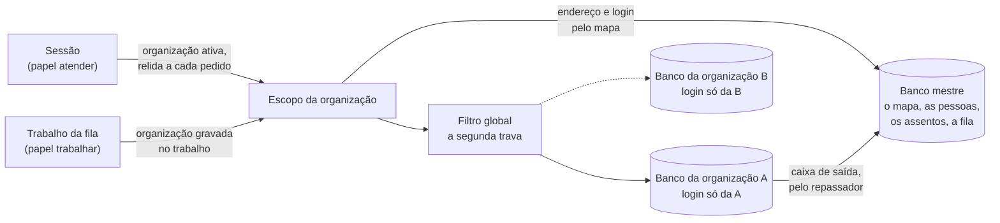

# Dados do Horus v2

Situação: 🟢 escrito pelo arquiteto · seis decisões novas (`ARQ-033` a `ARQ-037` e `ARQ-089`): quatro 🟢, uma ⚪ (`ARQ-036`, substituída pela `ARQ-089`) e uma ✅ do dono (`ARQ-035`, a guarda, em 03/11/2026) · o isolamento decidido pelo dono (`ARQ-010` ✅, um banco por organização), com o roteamento do arquiteto (`ARQ-088`) · a chegada da v2.0 decidida pelo dono (`ARQ-011` ✅: uma instância nova, com as organizações de exemplo semeadas, `ARQ-089`) · dois itens a devolver ao PO (A-14 e A-16, no [documento 01](01-estrategia-da-solucao.md), seção 9).

Última atualização: 03/11/2026 (a cópia de segurança fora do Horus, `ARQ-086`: o prazo das cópias é de cada instância; um banco por organização, pela `ARQ-010` ✅, e o roteamento, pela `ARQ-088`; o envelope, `ARQ-016` ✅; a v2.0 numa instância nova, com as organizações de exemplo semeadas, pela `ARQ-011` ✅ e pela `ARQ-089`; os prazos da organização nas preferências dela, pela `ARQ-035` ✅; as regras e as claims de exemplo só na v2.1, pela `ARQ-090` ✅).

Este documento diz **o que o Horus v2 guarda, de quem é cada dado, como as organizações ficam separadas, por quanto tempo cada dado fica e como as organizações de exemplo chegam à v2.0**. Quem lê o quê dentro de uma organização (o login, os papéis, as roles e a segurança por pessoa) está no [documento 07](07-seguranca.md); a cópia de segurança e a volta de versão, no documento 10.

- O **quê** e o **porquê** são do produto ([backlog estratégico](../produto/backlog-estrategico.md), [a v2.0 consolidada](../produto/05-v2.0-consolidada.md)). As decisões (`ARQ-nnn`) estão no [registro](02-registro-de-decisoes.md); os módulos e os contratos, no [documento 04](04-software.md).
- O código da v1.xx se cita como `horus@318db52b:<caminho>`. Nada foi executado: o levantamento é de leitura do código e das regras do repositório.
- O nível de detalhe para no componente, no padrão e no contrato. Tabela, coluna e passo de migração ficam para o desenvolvimento; os nomes de dado abaixo ("as conversas", "o rastro") são do negócio.
- ⚠️ A `D-138` e a `D-139` vêm sempre com o título curto: `D-138` ("A v1.xx fecha como MVP no HML…") e `D-139` ("Tabela de conversão das mfs…").

Legenda: 🟢 decidida pelo arquiteto · 🟡 proposta ao dono · 🔎 hipótese a confirmar · ♻️ vem da v1.xx · 🔧 vem e muda · 🆕 novo.

## 1. O que o tema precisa garantir

| Garantia | Por quê | Objetivos | Decisões de produto |
| --- | --- | --- | --- |
| 🗂️ **As organizações não se misturam** | Uma instância comporta várias organizações, e cada setor de uma empresa é uma | O2, O7 | `D-008` (prova de valor: "sem misturar os dados de uma com os de outra"), `D-009`, `D-013`, `D-017` |
| 👀 **O Horus só lê e não copia as bases do cliente** | O cliente confia porque os bancos dele ficam intocados; guardar as linhas dele seria outra promessa | O2 | `D-001`, `D-022` |
| 🧾 **O rastro não se altera e dura o prazo do owner** | Sem isso, o rastro não prova a responsabilidade do gestor | O2 | `D-090`, `D-092` e a leitura `D-092.1`, `D-093` |
| 💤 **No corte, nada se apaga** | O cliente que volta a pagar encontra tudo como deixou | O7 | `D-068`, `D-075` e a leitura `D-075.3` |
| 🔁 **O que a organização já configurou chega à v2.0** | O modelo semântico, as regras de segurança e os boards são o trabalho mais caro do cliente | O6, O7 | `D-134`, `D-021`, `D-133` (a medida sem quebra de série) |
| ⏳ **Cada dado tem prazo, e o dado pessoal não fica além do necessário** | A `D-092` não escolheu o rastro "para sempre", que guardaria dado pessoal além do necessário; a conversa limpa do popup some de vez | O2 | `D-092` (opção C recusada), `D-086` e a leitura `D-086.4`, `D-087` e a leitura `D-087.1` |
| 🛟 **O que uma instância precisa copiar está escrito, e a volta se confere** | A organização paga e o rastro não pode sumir; a cópia é da infra de cada instância | O2, O7 | `ARQ-086` ✅, `ARQ-087` |
| 📦 **Cabe no envelope do primeiro ano** | De 15 a 40 GB por ano no banco da aplicação | O1, O3, O4, O7 | `ARQ-016` ✅ |

## 2. As decisões

| Decisão | O que decide | Situação |
| --- | --- | --- |
| `ARQ-005` | A fila de trabalhos e a caixa de saída moram no banco da aplicação | 🟢 |
| `ARQ-009` | O rastro é um registro só de acréscimo, no banco da aplicação | 🟢 |
| `ARQ-010` | O banco mestre e um banco por organização, cada um com o seu login | ✅ |
| `ARQ-011` | A v2.0 nasce numa instância nova; só as organizações de exemplo chegam, pelo semeador | ✅ |
| `ARQ-016` | O envelope do primeiro ano | ✅ |
| `ARQ-086`, `ARQ-087` | A cópia fora do Horus, pela infra de cada instância; o contrato da cópia e a conferência da volta | ✅, 🟢 |
| **`ARQ-033`** | **O que se guarda tem quatro donos — a instância, a organização, a pessoa e o cliente das fontes —, e o Horus não copia as bases do cliente** | 🟢 |
| **`ARQ-034`** | **O filtro por organização é um filtro global do contexto do banco, com a organização da sessão ou do trabalho, uma lista fechada de exceções e a falha fechada** | 🟢 (a segunda trava, sob a `ARQ-010` e a `ARQ-088`) |
| **`ARQ-035`** | **A guarda de cada dado: um prazo padrão por tipo, que o owner ajusta nas preferências da organização entre um piso e um teto, e o registro de acesso por seis meses** | ✅ |
| `ARQ-036` | A conversão é uma sequência de migrações idempotentes, com relatório e conferência, ensaiada numa cópia da PRD, e a volta depois dela é a restauração da cópia de antes | ⚪ (substituída pela `ARQ-089`) |
| **`ARQ-037`** | **Apagar segue o dono do dado: cada módulo apaga o que é seu ao receber o evento, e um teste reprova a tabela com a marca da organização sem quem a apague** | 🟢 |
| **`ARQ-088`** | **O banco mestre guarda o mapa e o que é da instância; o contexto da organização abre o banco dela com o login dela, e a marca e o filtro continuam como segunda trava** | 🟢 |
| **`ARQ-089`** | **As organizações de exemplo nascem de um semeador versionado no repositório: os arquivos das duas organizações e um comando do pacote que as cria em qualquer instância** | 🟢 |

## 3. Os componentes e a responsabilidade de cada um

### 3.1 O que se guarda e de quem é (`ARQ-033`)

Todo dado do banco da aplicação tem **um dono**, e o dono decide a marca do registro, quem pode apagá-lo e o prazo.

| Dono | O que é | Quem responde por ele | Marca do registro |
| --- | --- | --- | --- |
| 🏛️ **A instância** | A identidade e a marca, os administradores, o envio de e-mail, o interruptor geral da segurança, os assentos liberados a cada organização | O owner da instância, que no SaaS é a Maind (`D-013`, leitura `D-068.1`) | Nenhuma: fica no banco mestre (3.2) |
| 🏢 **A organização** | As fontes e os modelos semânticos, as regras de segurança, as conexões de IA, os boards e os relatórios, os agendamentos e os agentes, as roles e os grupos, as conversas, os reportes, o rastro, os fatos de uso e o custo | O owner da organização (`D-013`) | A da organização, em todo registro |
| 👤 **A pessoa** | A conta (nome, e-mail, foto, senha cifrada, a ligação com o Google), as preferências e a área de avisos | A própria pessoa | Nenhuma: a conta é da instância, e a mesma pessoa está em várias organizações |
| 👤🏢 **A pessoa na organização** | O vínculo (papel, gestor, tipo de assento, roles), os valores de claim, o número de WhatsApp ligado (`D-094`), o contato em cada conector (`D-038`) | O owner (o vínculo e as claims) e a pessoa (o número e os contatos) | A da organização |
| 🗄️ **O cliente, das fontes** | Os números que a resposta mostrou: os blocos de cada resposta e de cada cartão, o resultado guardado por sete dias para o cartão e o filtro, os artefatos até a entrega | A organização, que é quem tem a fonte | A da organização |

**O Horus não copia as bases do cliente.** Ele guarda só o que mostrou: os blocos já desenhados, com os números (`horus@318db52b:apps/server/Horus.Core/Data/Consultas/ConsultaEntities.cs`, a execução guarda os blocos e não as linhas), e a prosa. As linhas cruas passam pela memória do servidor, vão ao modelo só na leitura depois da consulta (até 12.000 caracteres) e não se gravam. O PDF agendado da v1.xx já segue a regra: "nenhum número calculado é guardado" (`horus@318db52b:apps/server/Horus.Core/Relatorios/EntregaDeRelatorio.cs`). Na v2.0, o artefato pronto fica guardado só entre o desenho e a entrega (`ARQ-022`, prazo em 3.3).

**O que cada módulo guarda** (os módulos são os do [documento 04](04-software.md)):

| Módulo | O que guarda | Dono | Dado pessoal? | Dado do cliente? |
| --- | --- | --- | --- | --- |
| 🧱 Fundação | Os trabalhos da fila e os eventos da caixa de saída (só ids e o tipo, nunca conteúdo, `ARQ-019`); os fatos de uso; o consumo de IA e de mensagens | Organização | Ids de pessoa | Não |
| 🏛️ Plataforma | A instância, os assentos, as organizações, as contas e os vínculos, os convites, os grupos, as roles, o rastro, a área de avisos | Instância, pessoa e organização | Sim (conta, vínculo, rastro de quem abriu) | Não |
| 🔌 Dados e IA | As fontes (credencial cifrada), os modelos semânticos, as conexões de IA (chave cifrada), as claims, as regras e as consultas protegidas, a trilha de segurança, o histórico de consultas e execuções | Organização | Sim (valores de claim) | Sim (os blocos das execuções, por sete dias) |
| 💬 Motor de análise | As conversas e as mensagens (prosa, blocos, consulta, fontes da web, nível, recorte de acesso), o retorno e a cópia da resposta reportada | Organização | Sim (o texto da pergunta e o recorte de acesso) | Sim (os números da resposta) |
| 📲 Canais | A conversa do popup até ser salva ou limpa; a ligação do número de WhatsApp | Organização e pessoa | Sim (o número) | Sim (a resposta) |
| 📌 Acompanhar e avisar | Os boards, os cartões, as páginas, os relatórios; os agendamentos; os agentes (as instruções, a interpretação confirmada, as execuções); os artefatos até a entrega; os contatos aprovados | Organização | Sim (os contatos) | Sim (os números dos cartões e dos artefatos) |
| 📈 Prova e controle | Nada próprio: lê o rastro, os fatos de uso e o retorno pelas fachadas de quem os grava | — | — | — |

### 3.2 O isolamento entre organizações (`ARQ-010` ✅, `ARQ-088`, `ARQ-034`)

**A escolha do dono** (`ARQ-010`, em 03/11/2026): o Postgres da instância tem um **banco mestre**, com o mapa das organizações, e **um banco por organização**, com um login só dela. A `ARQ-088` decide o que fica em cada um e como o Horus chega ao banco certo, e a `ARQ-034`, a segunda trava dentro do banco da organização.

| Peça | Como é | Por quê |
| --- | --- | --- |
| **O banco mestre** | As pessoas e o login (a conta, a sessão, o perfil, a preferência de e-mail); a lista das organizações, com o endereço e o login cifrado do banco de cada uma; o vínculo de cada pessoa com cada organização, só como "existe"; os assentos liberados e a administração da instância; a fila de trabalho, sem conteúdo | É o que cruza organizações, e o login precisa listar as organizações de uma pessoa antes de abrir o banco de alguma |
| **O banco da organização** | Todo o resto: os membros com papel, tipo de assento, gestor, quarentena, roles e claims; as conversas, os boards, as fontes, os modelos, as regras, o rastro, o consumo, os avisos e a caixa de saída | A organização fica apartada no próprio banco, e o login dela não alcança o de outra |
| **O roteamento** | O contexto do banco da organização se abre com a organização em uso, e o endereço e o login vêm do mapa; um pool pequeno de conexões por organização 🔎; o nome do banco é um identificador opaco | Um erro de código não alcança outra organização, porque a conexão nem chega ao banco dela |
| **De onde vem a organização** | No papel "atender", da sessão: a organização ativa já relida contra o vínculo a cada pedido, como hoje (`horus@318db52b:apps/server/Horus.Core/Identity/OrgScope.cs`). No papel "trabalhar", do próprio trabalho: cada trabalho da fila nasce com a organização gravada | Nunca vem do corpo de um pedido nem do valor cru do cookie |
| **A segunda trava** | A marca da organização continua em cada registro, **também nos filhos** (a mensagem, o cartão, o estado de um gráfico), e o filtro global do EF Core só devolve o que é da organização em uso (`ARQ-034`) | Uma conexão que caísse no banco errado ainda não leria nada de outra organização. Hoje várias tabelas chegam à organização só pela mãe |
| **A falha fechada** | Sem organização em uso, não há banco a abrir, e a consulta de dado de organização não roda (erro, nunca "todas"). A fonte do arquivo de configuração sem organização declarada passa a ser de **nenhuma** organização | Hoje "sem dono declarado" quer dizer **todas** (`horus@318db52b:apps/server/Horus.Core/Data/Connections/ConnectionCatalog.cs`, `VisivelParaSlug`) |
| **O que cruza organizações** | O painel dos assentos e o custo por organização somam os bancos por um trabalho da fila, que grava o total, sem conteúdo, no mestre; o teto de assentos do mestre é copiado ao banco da organização, e a reserva confere lá, numa transação só | O mestre não guarda dado de organização, e a reserva não depende de dois bancos ao mesmo tempo |
| **Criar uma organização** | Cria o banco e o login dela, na versão de migração do pacote, por um login de provisionamento que só cria banco e login | Ninguém mais precisa desse privilégio |
| **A prova** | O login da A não abre o banco da B nem o mestre; com o contexto da A apontado de propósito para o banco da B, o filtro não devolve nada, em toda tabela, nos dois papéis; a consulta que não passa pelo roteamento ou pula o filtro reprova na trava de arquitetura; o CI roda tudo desde o M0 (documento 12) | O isolamento passa a ser verificado, e não lembrado |

**Sem a segurança em linha do Postgres.** Com um banco e um login por organização, a regra por linha amarrada à organização da conexão não acrescenta nada que o login de cada banco já não dê.

### 3.3 A guarda de cada dado (`ARQ-035` ✅)

Hoje, só seis dados têm prazo: as execuções de consulta e os resultados da análise avulsa (7 dias), os fatos de uso (400 dias), os pedidos de recuperação de senha (30 dias), a telemetria (30, 14 e 7 dias) e os convites (de 1 a 90 dias de validade) (`horus@318db52b:apps/server/Horus.Api/LimpezaDeExecucoes.cs`, `LimpezaDeEventosDeUso.cs`, `horus@318db52b:apps/server/Horus.Core/Identity/RedefinicaoDeSenha.cs`). O resto fica até alguém apagar ou a organização sair. A decisão do dono (`ARQ-035`, em 03/11/2026) é a tabela abaixo, com os prazos da organização ajustáveis nas preferências dela:

| Dado | Hoje (v1.xx) | Proposta para a v2.0 |
| --- | --- | --- |
| Conta da pessoa | Enquanto existir; não há exclusão de conta | Enquanto existir; a exclusão a pedido da pessoa foi ao PO (A-16) |
| Vínculo, claims, número de WhatsApp e contatos | Os valores de claim saem na saída da organização, na mesma transação (`horus@318db52b:apps/server/Horus.Core/Identity/OrgStore.cs`, `RemoveMemberAsync`) | Tudo sai na saída, na mesma transação, e o número é desligado (leitura `D-094.3`) |
| Conversas e mensagens (do app e do WhatsApp) | Sem prazo: até a pessoa, o owner ou a exclusão da organização apagar | Sem prazo automático: até a pessoa apagar a sua, o owner apagar as da organização ou a organização sair. As de quem sai ficam com a organização, como hoje 🔎 (A-16) |
| Conversa do popup não salva | Não existe | Até a pessoa limpar; limpar apaga de vez (`D-086`, leitura `D-086.4`) |
| Cópia da resposta reportada | Não existe | Enquanto o reporte estiver aberto e 180 dias depois de o owner concluir a análise (leitura `D-087.1`) |
| Retorno (👍🏻, 👎🏻) | Não existe | Junto com a resposta; a contagem, sem conteúdo, segue os fatos de uso |
| Rastro (entregas e aberturas) | Não existe | O prazo do owner (`D-092`): **padrão 365 dias, mínimo 180, máximo 1.825** (leitura `D-092.2`) |
| Trilha de segurança e log das análises de segurança | Sem prazo | O mesmo prazo do rastro da organização |
| Fatos de uso | 400 dias | 400 dias, para comparar o mesmo mês do ano anterior |
| Consumo de IA e de mensagens | Sem prazo | 25 meses, para o custo do mesmo mês do ano anterior e a conferência da fatura |
| Execuções de consulta e resultados da análise avulsa | 7 dias (o teto da idade aceitável, `horus@318db52b:apps/server/Horus.Core/Data/Consultas/IdadeDoDado.cs`) | 7 dias |
| Artefatos (PDF, imagem, JSON) | O PDF do relatório não se guarda | Até o fim da entrega e 7 dias depois, para reenviar e diagnosticar; o rastro fica, sem o conteúdo |
| Execuções de agente (as perguntas e os números de cada volta) | Não existe | 90 dias; a interpretação confirmada fica enquanto o agente existir |
| Avisos da conta | Não existe | 90 dias depois de lido, e 365 no máximo |
| Trabalhos da fila e eventos | Só a fila de convites, sem prazo | Os concluídos, 30 dias; os que desistiram, 90 dias |
| Convites e importações da planilha | O convite vale de 1 a 90 dias; as linhas ficam | O convite vencido ou revogado sai em 90 dias; a importação, em 365 |
| Registro de acesso (data, hora e endereço IP de cada uso) | Só no log do Nginx, 14 dias no Loki (`horus@318db52b:infra/observabilidade/nginx/log-json.conf`) | **6 meses**, sob sigilo e fora da telemetria, como pede o Marco Civil da Internet (Lei 12.965/2014, art. 15) a quem oferece aplicação com fins econômicos 🔎 a confirmar com o jurídico da Maind |
| Telemetria | Métricas 30 dias, logs 14 e traces 7 | Igual (documento 11) |
| Cópias de segurança | Não existem | Fora do Horus: o prazo é o que a infra de cada instância escolher (`ARQ-086`); o que se apaga no banco sai das cópias quando elas vencem |
| Organização cortada | — | Nada se apaga (`D-075`, leitura `D-075.3`) |
| Organização excluída | Tudo sai na hora (`horus@318db52b:apps/server/Horus.Core/Identity/OrgStore.cs`, `ExcluirAsync`) | Igual, por evento (`ARQ-037`); nas cópias, quando elas vencerem, pelo prazo da instância |

**O que o owner ajusta nas preferências da organização** 🔎 (os pisos e os tetos são hipótese a confirmar):

| Dado | Padrão | Piso | Teto |
| --- | --- | --- | --- |
| Rastro, e a trilha de segurança com ele | 365 dias | 180 dias | 1.825 dias |
| Conversas e mensagens | Sem prazo | 30 dias, se o owner ligar um prazo | 1.825 dias |
| Cópia da resposta reportada | 180 dias depois da análise | 30 dias | 365 dias |
| Fatos de uso | 400 dias | 400 dias, para comparar o mesmo mês do ano anterior | 1.825 dias |
| Execuções de agente | 90 dias | 30 dias | 365 dias |
| Avisos da conta | 90 dias depois de lido | 30 dias | 365 dias |

- **O resto fica fixo**, porque é da instância, da lei ou técnico: o consumo (a conferência da fatura), as execuções de consulta e os artefatos (o teto da idade do dado), os trabalhos da fila, os convites e as importações, o registro de acesso (o Marco Civil) e a telemetria.
- **Reduzir um prazo vale a partir da faxina do dia seguinte**, e a mudança fica no rastro, com quem mudou e de quanto para quanto; o que passou do prazo novo se apaga, sem volta.
- **A tela** é do PO (A-27): onde fica, como cada prazo aparece e o aviso de que reduzir apaga.

O cumprimento da guarda é de um componente só: a **faxina**, um trabalho diário da fila, no papel "trabalhar", que cada módulo alimenta com o seu prazo. É o molde das duas limpezas diárias de hoje.

### 3.4 Apagar (`ARQ-037`)

- **A exclusão da organização** vira um fato: a organização fica marcada como excluída no mapa do mestre e some de todas as telas na mesma transação; depois, o banco e o login dela são apagados (`ARQ-010`, `ARQ-088`). Hoje um método só apaga mais de 30 tabelas, listadas à mão, e uma tabela nova esquecida já deixou boards órfãos (o comentário da Task 034 em `ExcluirAsync`).
- **A saída de uma pessoa** gera o evento "pessoa removida da organização" (documento 04, 3.3): a Plataforma apaga o vínculo e as claims na transação da saída, como hoje; os boards, agendamentos e agentes dela vão para o espaço da organização (`D-044`, `D-060`); os contatos dela saem; o rastro fica (`D-093`).
- **O corte não apaga** (`D-075`): ele só pausa.
- **O que sai dentro de uma organização** (uma pessoa, uma conversa) continua com o apagador de cada módulo, por evento (`ARQ-019`).
- **A prova:** um teste de arquitetura reprova a tabela com a marca da organização que não tenha um apagador registrado pelo módulo dono, e o teste de exclusão grava uma organização completa, a apaga e confere que não sobrou nem o banco, nem o login, nem a linha do mapa.

### 3.5 As organizações de exemplo chegam à v2.0 (`ARQ-011` ✅, `ARQ-089`)

**A escolha do dono** (`ARQ-011`, em 03/11/2026): a Maind não tem clientes, e as únicas organizações que importam são as de exemplo, o McDonald's e a Global Fleet. A v2.0 nasce numa instância nova, sem conversão dos dados da v1.xx, e as duas chegam por um **semeador versionado no repositório** (`ARQ-089`).

| Dado da v1.xx | Na v2.0 | Como |
| --- | --- | --- |
| As fontes das organizações de exemplo | As mesmas, apontando para as bases de demonstração da máquina | Pelos arquivos do semeador; as bases são as mesmas para todas as instâncias (`ARQ-059`) |
| Os modelos semânticos | Os mesmos | Já são arquivos do repositório, conferidos pelos verificadores das bases (`horus@318db52b:data/`); o que a v1.xx guardou no banco por cima deles entra na exportação |
| As regras de segurança e as versões delas | Na v2.1 (`ARQ-090`) | Exportadas uma vez para os arquivos do semeador, e semeadas só na v2.1 |
| Os membros de exemplo, com as claims | Membros com papel, tipo de assento, gestor e roles | Exportados uma vez e completados nos arquivos com o que a v2.0 pede (a carteira, o assento, as roles), sem regra de conversão; as claims, exportadas, só se semeiam na v2.1 (`ARQ-090`) |
| Os boards de exemplo | Boards do espaço da organização, publicados 🔎 | Exportados uma vez; o que a vitrine mostra, o PO confirma (A-14) |
| As conexões e as rotas de IA | As mesmas, sem as chaves | As chaves se cadastram em cada instância (`ARQ-044`) |
| As pessoas reais da Maind | Convite novo | — |
| Conversas, mensagens, consumo, fatos de uso, rastro, execuções e simulações | Não vêm | Eram de teste; a medida de autonomia começa na v2.0 (`D-133`) |
| As outras organizações de hoje | Não vêm | Só as de exemplo importam (`ARQ-011`) |

**Como se semeia** (`ARQ-089`):

1. **A exportação**, uma vez, enquanto a v1.xx existe: um roteiro, que nasce do roteiro de cópia de uma organização de hoje (`horus@318db52b:infra/vps/copiar-org-postgres.py`), escreve os arquivos do McDonald's e da Global Fleet no repositório da v2; depois disso, os arquivos são a fonte.
2. **O semeador** é um comando do pacote, num modo de uso único: cria o banco e o login de cada organização (`ARQ-088`), grava os registros pelos arquivos e escreve um relatório em números. Rodado de novo, não duplica nada.
3. **A prova**: o CI semeia as duas num banco vazio e confere que as fontes abrem, que os modelos passam pelos verificadores, que as regras compilam (na v2.1) e que cada board recalcula com o modelo falso (documento 12).

### 3.6 Os componentes

| Componente | Módulo | Responsabilidade | Situação |
| --- | --- | --- | --- |
| Persistência da aplicação | Fundação | Os dois contextos do banco, o do mestre e o da organização, a configuração de cada entidade junto do módulo dono e as migrações de cada banco | 🔧 `horus@318db52b:apps/server/Horus.Core/Data/HorusDbContext.cs` |
| Roteamento | Fundação | Abre o banco da organização em uso pelo mapa do mestre; cria o banco e o login de uma organização nova; o repasse da caixa de saída à fila do mestre (`ARQ-088`) | 🆕 |
| Filtro por organização | Fundação | A marca, o filtro global e a falha fechada, como segunda trava (`ARQ-034`) | 🆕 sobre o `OrgScope` de hoje |
| Inventário dos dados | Fundação | O dono, a categoria (pessoal, do cliente ou nenhum), a finalidade e o prazo de cada dado, declarados junto da entidade (`ARQ-045`, documento 07) | 🆕 |
| Faxina | Fundação, no papel "trabalhar" | Aplica o prazo de cada dado, uma vez por dia, pela fila (`ARQ-035`) | 🔧 das duas limpezas diárias de hoje |
| Apagadores | Cada módulo | Apagam o que é do módulo nos eventos "organização excluída" e "pessoa removida" (`ARQ-037`) | 🔧 do `OrgStore.ExcluirAsync` |
| Semeador | Fundação, num modo de uso único | Cria as organizações de exemplo pelos arquivos do repositório, com relatório e conferência (`ARQ-089`) | 🆕 sobre o roteiro de cópia de uma organização |
| Registro de acesso | Plataforma | Guarda data, hora e IP de cada uso, sob sigilo, pelo prazo da `ARQ-035` | 🆕, se o dono aprovar |

## 4. O que vem da v1.xx e o que não vem

| Peça da v1.xx | Destino | Por quê |
| --- | --- | --- |
| O PostgreSQL 17, o EF Core e a cadeia de 89 migrações | ♻️ Ficam | `ARQ-001`, `ARQ-002` |
| Um banco só para todas as organizações | 🔧 Vira o banco mestre e um banco por organização | `ARQ-010`, `ARQ-088` |
| A coluna da organização nas tabelas e o `OrgScope` relido a cada pedido | 🔧 Viram a marca em todo registro e o filtro global | `ARQ-034` |
| "Fonte do arquivo sem organização declarada é de todas" | ❌ Sai: passa a ser de nenhuma | `ARQ-034` |
| As limpezas diárias das execuções (7 dias) e dos fatos de uso (400 dias) | 🔧 Viram a faxina geral | `ARQ-035` |
| A exclusão da organização num método só, com as tabelas listadas à mão | 🔧 Vira um apagador por módulo, por evento | `ARQ-037` |
| Os valores de claim apagados na saída, na mesma transação (R9) | ♻️ Ficam, e passam a valer também para o número e os contatos | `ARQ-035` |
| Os blocos guardados no lugar das linhas do cliente | ♻️ Fica a regra | `ARQ-033` |
| O clone da PRD para o HML, com o saneamento, e a cópia de uma organização | 🔧 A cópia de uma organização vira a exportação do semeador; o clone fica para o HML da v1.xx enquanto ele viver | `ARQ-089` |
| A migração na subida do processo | ❌ Sai: as migrações rodam num passo da publicação | `ARQ-062` |
| O legado das bases de conhecimento na conversa (`KbIdsJson`) | ❌ Sai: a v2.0 nasce sem ele | Documento 01 |
| O IP guardado só 14 dias, no log do Nginx | 🔧 Ganha o registro de acesso de 6 meses, se o dono aprovar | `ARQ-035` |

## 5. Os riscos e o que falta decidir

| Risco | Por quê | O que se faz |
| --- | --- | --- |
| 🔢 As migrações rodam uma vez por organização | Uma migração que falha no meio deixa bancos em versões diferentes | O passo retoma de onde parou, e a troca só acontece com todos na versão nova (`ARQ-062`, `ARQ-088`) |
| 🌱 A vitrine só existe no banco da v1.xx até a exportação | Os boards, as regras e os membros de exemplo não estão em arquivo nenhum hoje | A exportação, uma vez, antes de a v1.xx sair, e o CI que semeia num banco vazio (`ARQ-089`) |
| 🗂️ A marca nos filhos é uma mudança grande | Mensagens, cartões e estados de gráfico ganham a marca | Uma migração por tabela, no M0, com o teste de isolamento já valendo; o semeador já grava a marca |
| 🧪 A fonte do arquivo "de todas" pode estar em uso | A PRD e o HML podem depender da lista vazia para mostrar as bases de demonstração às organizações da Maind | Conferir o `api.env` de cada ambiente antes do M2 e declarar as organizações de cada fonte |
| 📈 O rastro e as mensagens crescem | 10.000 registros do rastro por dia e de 20 a 50 KB por resposta (documento 03) | O prazo do rastro tem teto (1.825 dias); o envelope da `ARQ-016` já conta as mensagens |
| ⚖️ Os prazos legais não são do arquiteto | O Marco Civil e a LGPD pedem leitura jurídica | Os prazos ficam 🟡 com o dono, e o registro de acesso, 🔎 com o jurídico |
| 💾 O apagado continua nas cópias | As cópias de segurança guardam o que se apagou até vencerem, pelo prazo que a infra de cada instância escolhe (`ARQ-086`) | O prazo das cópias da instância SaaS entra no aviso de privacidade (A-16) |

**O que falta decidir:**
- 🟡 Com o dono: nenhuma decisão deste documento.
- Ao PO: A-14 (o que os boards de exemplo mostram, agora só no semeador), A-27 (a tela das preferências de guarda) e A-16 (a LGPD: o que a pessoa sabe e o que pode pedir).
- Documento 07: a chave única da segurança dos dados (`ARQ-040` 🟡), que muda como o semeador grava as claims.
- Documento 10: o contrato da cópia, a conferência da volta e a janela da publicação da v2.0.
- Documento 12: o teste de isolamento por tabela, o teste de exclusão e a conferência do semeador.
