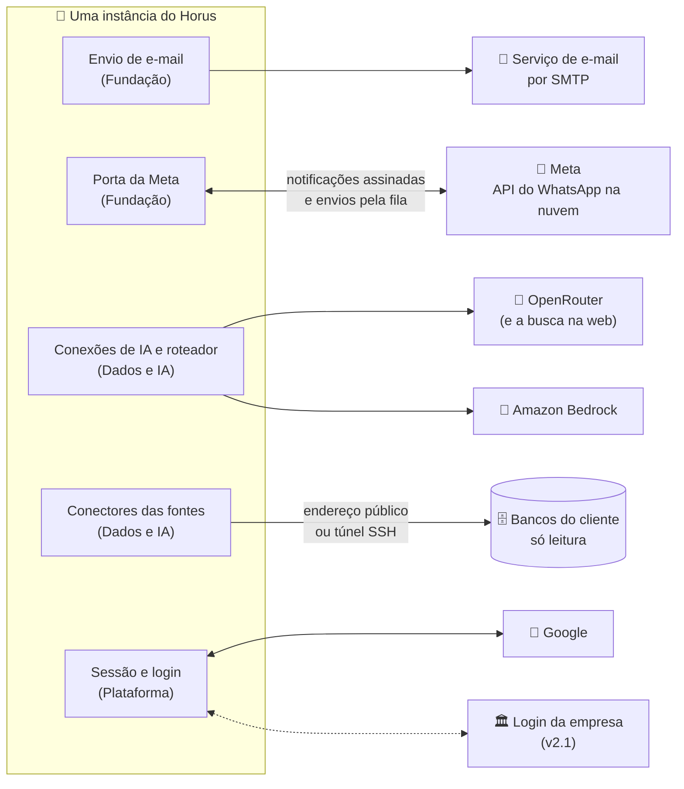
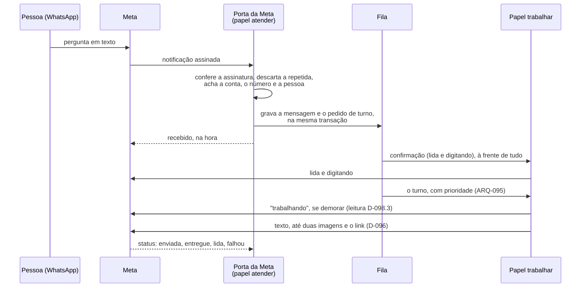

# Integrações do Horus v2

Situação: 🟢 escrito pelo arquiteto · nove decisões novas (`ARQ-046` a `ARQ-054`): seis 🟢, uma ✅ do dono (`ARQ-046`, o e-mail, em 03/11/2026) e duas 🟡 com o dono (`ARQ-047`, **o caminho até o WhatsApp**, em estudo; `ARQ-054`, o login corporativo) · quatro itens a devolver ao PO (A-17 a A-20, no [documento 01](01-estrategia-da-solucao.md), seção 9).

Última atualização: 03/11/2026 (o e-mail pelo mesmo SMTP, com o plano gratuito até a primeira produção real, `ARQ-046` ✅; a pesquisa na web pela busca nativa da conexão, `ARQ-027` ✅).

Este documento diz **como o Horus conversa com o que está fora dele**: o servidor de e-mail da instância; a Meta, pela qual o WhatsApp entra (a pergunta, `MF-111:Chat pelo WhatsApp`) e sai (o conector, `MF-113:Conectores de Saída`); os provedores de IA; os bancos dos clientes; o Google; e, na v2.1, o login da empresa. Onde cada peça roda está no [documento 09](09-infraestrutura-e-ambientes.md); quanto custa, no documento 13.

- O **quê** e o **porquê** são do produto ([backlog estratégico](../produto/backlog-estrategico.md), [a v2.0 consolidada](../produto/05-v2.0-consolidada.md)). As decisões (`ARQ-nnn`) estão no [registro](02-registro-de-decisoes.md); os módulos e os contratos, no [documento 04](04-software.md).
- O código da v1.xx se cita como `horus@318db52b:<caminho>`. Nada foi executado, nenhum modelo foi chamado e nenhuma conta externa foi acessada. O que se diz da Meta vem da documentação pública dela e está marcado 🔎 onde precisa ser conferido de novo no M4.
- O nível de detalhe para no componente, no padrão e no contrato. Rota, campo de configuração e formato de mensagem ficam para o desenvolvimento. Nenhum endereço de máquina aparece aqui: ele mora nas variáveis do GitHub.
- ⚠️ A `D-138` e a `D-139` vêm sempre com o título curto: `D-139` ("No MVP da v1.xx, as seis peças…") é a que tira da tela o Athena, a fonte de páginas e os três provedores de IA "em breve".

Legenda: 🟢 decidida pelo arquiteto · 🟡 proposta ao dono · 🔎 hipótese a confirmar · ♻️ vem da v1.xx · 🔧 vem e muda · 🆕 novo.

## 1. O que o tema precisa garantir

| Garantia | Objetivos | Decisões de produto |
| --- | --- | --- |
| 📧 **O e-mail chega**: o convite, a recuperação de senha, os avisos da conta pelo e-mail da instância e, pelo conector, os PDFs e os avisos dos agentes | O4, O7 | `D-124`, `D-128` e a leitura `D-128.3`, `D-011` (o remetente do contratante, na v2.1), `D-013` |
| 📱 **O WhatsApp entra e sai pela mesma conta da organização**: a pergunta chega pela via de entrada, e o aviso sai pelo conector | O1, O4 | `D-084`, `D-099`, `D-124` e a leitura `D-124.1` |
| 🏷️ **Cada organização usa o próprio número, e pode autorizar o da Maind** | O1, O7 | `D-097` e as leituras `D-097.1` a `D-097.3` |
| 🔑 **O número é uma credencial**: liga-se com um código, a uma pessoa só, e se desliga quando ela perde o assento | O2, O7 | `D-094` e as leituras `D-094.1` a `D-094.3` |
| 💬 **Pelo WhatsApp, tudo o que a conversa oferece**: o texto, as imagens fiéis, o link e o "trabalhando" quando demora | O1 | `D-095`, `D-096`, `D-098` e a leitura `D-098.3` |
| 🧾 **A Meta é respeitada**: os modelos de mensagem aprovados, as janelas de resposta e o custo próprio do que o Horus inicia | O4 | `D-124`; letra (x) da `P-008` |
| 🤖 **A IA fica sob controle da organização**, pela conexão dela | O1, O7 | `D-010`, `D-061`, `D-062`, `D-063`; `D-021` (a base herdada) |
| 🔌 **As fontes só leem**, e a da organização não alcança a rede interna até a v2.1 | O1, O2 | `D-001`, `D-022`, `D-021`, `D-017` |
| 🚪 **Só entra quem foi convidado**, pela senha ou pelo Google; na v2.1, também pelo login da empresa, ligado em cada organização | O7, O8 | `D-071`, `D-118`, `D-027`, `D-052` |
| 🏛️ **No "tudo dentro", nada sai** sem a instância liberar | O8 | `D-010`, `D-040`, a leitura `D-084.2`, a leitura `D-097.3` |

## 2. As decisões

| Decisão | O que decide | Situação |
| --- | --- | --- |
| `ARQ-022` | Toda entrega é um artefato pronto, e o conector só o transporta | 🟢 |
| `ARQ-024` | O turno do WhatsApp roda na fila, e o canal é o ouvinte | 🟢 |
| `ARQ-027` | A pesquisa na web usa a busca nativa do provedor da conexão de IA; sem ela, a opção não aparece no chat | ✅ |
| `ARQ-031` | O roteamento por função continua, com três funções novas | 🟢 |
| `ARQ-038` | O login e a sessão continuam os da v1.xx; o login corporativo é mais um esquema externo | 🟢 |
| `ARQ-044` | Os segredos da organização (a conta da Meta, o login corporativo) ficam no cofre | ✅ |
| **`ARQ-046`** | **O e-mail da instância e o conector de e-mail saem pelo mesmo SMTP, num serviço transacional com o domínio autenticado; no SaaS, o Resend de hoje, num plano que caiba no envelope** | ✅ |
| **`ARQ-047`** | **O Horus chega ao WhatsApp pela API oficial na nuvem da Meta, direto, com a Maind como provedora de tecnologia e o cadastro incorporado** | 🟡 **decisão esperada do dono** |
| **`ARQ-048`** | **A porta da Meta é a única peça que fala com a Meta: a entrada confere, grava e enfileira; a saída envia pela fila** | 🟢 |
| **`ARQ-049`** | **Dentro da janela de 24 horas a resposta sai livre; fora dela, só por um catálogo fixo de modelos do Horus, criado em cada conta; o conector envia sempre por modelo** | 🟢 |
| **`ARQ-050`** | **A conta de WhatsApp tem dono, a mensagem acha a organização pelo número, e a ligação do número é da pessoa na organização** | 🟢 |
| **`ARQ-051`** | **Os provedores de IA da v2.0 são os de hoje, pelo contrato de hoje; os três "em breve" saem do código** | 🟢 |
| **`ARQ-052`** | **As fontes da v2.0 são as cinco tecnologias que respondem hoje, e chegam ao banco do cliente pelo endereço público ou pelo túnel SSH** | 🟢 |
| **`ARQ-053`** | **O login com o Google continua, com o cliente OAuth de quem opera a instância, só em HTTPS** | 🟢 |
| **`ARQ-054`** | **O login corporativo da v2.1 é OpenID Connect, um por organização; SAML só com decisão nova** | 🟡 |

## 3. Os componentes e a responsabilidade de cada um

### 3.1 O mapa das integrações

Cada serviço de fora tem **uma peça só** do Horus que fala com ele, e o resto do sistema conversa com essa peça pelo contrato do [documento 04](04-software.md).

| Serviço de fora | Peça do Horus | Quem configura | Credencial | Bloqueado no "tudo dentro" |
| --- | --- | --- | --- | --- |
| Serviço de e-mail | Envio de e-mail | O administrador da instância | No arquivo de ambiente da instância (`ARQ-044`) | Não, se for o servidor do contratante (`D-040` deixa em aberto "o e-mail por servidor do próprio contratante") |
| Meta (WhatsApp) | Porta da Meta | O owner da organização liga o canal; a instância guarda a conta da Maind | No cofre, por conta (`ARQ-044`) | Sim (`D-040`, leitura `D-084.2`) |
| OpenRouter e Bedrock | Conexões de IA e roteador | O owner, por conexão | No cofre, por conexão | Sim; entra o provedor de dentro (`D-010`) |
| Bancos do cliente | Conectores das fontes | O owner, por fonte | No cofre, por fonte | Não: ficam dentro, por definição |
| Google | Sessão e login | Quem opera a instância | No arquivo de ambiente | Opcional |
| Login da empresa (v2.1) | Sessão e login | O owner, por organização (`D-027`) | No cofre, por organização | Não, se o provedor de identidade for do contratante |

### 3.2 O e-mail da instância (`ARQ-046` ✅)

**Como é hoje.** O envio sai por SMTP, pelo MailKit, por um servidor que vem da configuração; a única classe que fala rede é o enviador (`horus@318db52b:apps/server/Horus.Core/Email/EnviadorSmtp.cs`), e hoje ele aponta para o **SMTP do Resend** (o comentário do próprio enviador e o inventário da VPS, `horus@318db52b:docs/superpowers/plans/anexos/2026-10-27-inventario-vps-maind.md` §7). O HML envia pelo mesmo servidor, com outro nome de remetente (`horus@318db52b:docs/superpowers/specs/2026-09-25-ambientes-hml-e-prd-design.md` §5). Há um orçamento de envio só para a instância, com a vez de cada organização nos convites (`horus@318db52b:apps/server/Horus.Core/Email/RitmoDoEnvioDeEmail.cs`, `EnvioDeEmailDaOrg.cs`), o anexo do PDF do relatório agendado (`RelatorioEmail.cs`) e a marca da instância no cabeçalho (`MarcaNoEmail.cs`). A instância sem servidor configurado funciona, sem e-mail (`OpcoesDeEmail.cs`).

**Na v2.0** (a `ARQ-046`, decidida pelo dono em 03/11/2026): **um transporte só**, o SMTP de hoje, serve aos quatro usos, e o que muda é a vez de cada um no orçamento.

| Uso | Quem pede | Remetente | Vez no orçamento da instância | Desde |
| --- | --- | --- | --- | --- |
| Recuperação de senha | Plataforma | O da instância | Primeiro: alguém espera | ♻️ v1.xx |
| Avisos da conta (o "recebido", a falha de um agente) | Área de avisos, pela preferência da pessoa (`D-128`, leitura `D-128.3`) | O da instância | Logo depois | 🆕 v2.0 |
| Convites | Plataforma, com a vez de cada organização | O da instância | Depois dos avisos | ♻️ v1.xx |
| Conector de e-mail: o PDF de um board e o aviso de um agente | Conectores (`ARQ-022`), com o contato aprovado (`D-038`) | O da instância, com o nome da organização no assunto e no corpo, como o relatório agendado de hoje | Por último, em lote | 🔧 v1.xx (o relatório agendado) |
| Marca completa (v2.1, M9) | — | O do contratante (`D-011`), com o domínio dele autenticado no serviço | — | 🆕 v2.1 |

- **O domínio do remetente autenticado** (SPF, DKIM e DMARC) no serviço transacional é condição de entrega: sem ele, o aviso cai no lixo eletrônico. No SaaS é o domínio da Maind; com a marca completa, cada contratante autentica o dele 🔎 (o serviço precisa aceitar mais de um domínio por conta).
- **O plano precisa caber no envelope** da `ARQ-016`: com os avisos, os convites em lote e os PDFs do conector, a conta 🔎 chega a cerca de 2.000 e-mails por dia útil no primeiro ano. O plano gratuito do serviço de hoje tem um teto diário muito abaixo disso 🔎; conferir o plano da conta da Maind é a verificação **V-02** (seção 5). **Até a primeira produção real, o plano gratuito basta**, porque nenhuma instância é produção real (`ARQ-056`); o Pro de 100 mil entra com ela.
- **O desfecho que o Horus conhece** é "aceito pelo servidor" ou "recusado". A devolução depois disso (caixa inexistente, caixa cheia) fica no painel do serviço, porque ler os avisos de devolução seria uma integração nova (a opção 2 da `ARQ-046`). O rastro grava o que o Horus entregou ao servidor (`D-090`).
- **O anexo tem teto** no serviço 🔎, e o board de qualquer tamanho (`D-057`) pode passar dele. O que acontece com o artefato que não cabe foi ao PO (A-19).
- **No on-premises**, o servidor é o do contratante, por SMTP, pelo mesmo enviador; no "tudo dentro", ele conta como interno (a pergunta que a `D-040` deixou em aberto), e a decisão de liberá-lo é da instância.

### 3.3 O WhatsApp e a Meta (`ARQ-047` a `ARQ-050`)

Nada disso existe na v1.xx. As decisões abaixo respondem à letra (x) da `P-008` e desenham a **porta da Meta**, que o [documento 04](04-software.md) pôs na Fundação para o canal (`MF-111:Chat pelo WhatsApp`) e o conector (`MF-113:Conectores de Saída`) usarem a mesma conta sem depender um do outro (leitura `D-124.1`).

#### O caminho até a Meta (`ARQ-047` 🟡, a decisão esperada do dono)

| | **A. API na nuvem da Meta, direto, com a Maind como provedora de tecnologia** (recomendada) | B. Um parceiro oficial da Meta | C. API na nuvem, direto, com o aplicativo de cada organização |
| --- | --- | --- | --- |
| Como é | Um aplicativo da Maind na Meta, verificado. O owner liga a conta da organização pelo **cadastro incorporado**: uma janela da Meta, dentro do Horus, em que ele entra com a conta dele e escolhe ou cria a conta de WhatsApp Business e o número. A conta continua sendo da organização; o Horus recebe a permissão de usá-la | Um provedor de soluções da Meta faz a ligação, o suporte e às vezes a cobrança; o Horus fala com a API do parceiro | A organização cria o próprio aplicativo na Meta e entrega ao Horus a credencial dele |
| ✅ | Sem intermediário e sem acréscimo sobre o preço da Meta; nada novo na stack (é HTTP com JSON, como o OpenRouter); a conta é da organização, que é a razão da `D-097`; o mesmo aplicativo serve às instâncias que a Maind opera 🔎 | Menos processo da Meta para a Maind; suporte de quem faz isso todo dia | A Maind não precisa ser provedora de tecnologia; é o caminho do on-premises, onde o dado fica no contratante (leitura `D-097.3`) |
| ⚠️ | A Maind passa pela verificação da empresa, pela revisão do aplicativo e pelo programa de provedores de tecnologia **antes do M4** (semanas 🔎); a Maind dá o suporte aos owners nos passos da Meta; as mudanças da Meta chegam direto ao Horus (a versão do cadastro incorporado já mudou de número uma vez 🔎) | Fornecedor e contrato novos; mensalidade ou acréscimo por número; a conta de cada organização passa a depender também do parceiro; no on-premises, mais um fornecedor dentro do contratante | Pesado para o owner (aplicativo, usuário de sistema, credencial permanente), contra a prova de valor da `D-097` ("a maioria ativa sem pedir ajuda") |

🚫 **Eliminada:** automatizar o aplicativo comum do WhatsApp por bibliotecas não oficiais. É contra os termos da Meta e leva ao bloqueio do número.

**A recomendação** é a A para a instância SaaS e para as instâncias que a Maind opera, e a C como o caminho do on-premises (v2.1). As duas ficam atrás da porta da Meta (`ARQ-048`): se um dia a Maind preferir um parceiro, só a porta muda.

#### A porta da Meta (`ARQ-048` 🟢)

| Lado | O que a porta faz | Por quê |
| --- | --- | --- |
| **Entrada** (papel "atender") | Confere a assinatura de cada notificação com o segredo do aplicativo; descarta a mensagem repetida pelo identificador da Meta; acha a conta pelo número que recebeu e a pessoa pelo número que escreveu (`ARQ-050`); grava a mensagem e o pedido de turno na mesma transação (`ARQ-005`); responde à Meta na hora | A Meta reenvia o que não teve resposta, e o turno não pode rodar duas vezes; o turno longo não cabe no tempo da notificação (`ARQ-024`) |
| **Confirmação** | O primeiro trabalho, à frente de todos: marca a mensagem como lida e mostra que o Horus está digitando | É o limiar interno de 10 segundos no p95 do [documento 03](03-metas-de-qualidade.md) |
| **Saída** (papel "trabalhar") | Todo envio é um trabalho da fila, na vez da organização; a falha temporária (o limite de taxa, a Meta fora) tenta de novo; a recusa definitiva desiste com o motivo | Nenhum aviso se perde nem sai duas vezes (`ARQ-005`) |
| **Mídia** | As imagens dos blocos e os PDFs sobem à Meta como mídia, e a mensagem aponta para ela | Nenhum endereço público do Horus serve o artefato; o link da resposta não carrega dado (leitura `D-096.1`) |
| **Status** | Os avisos de enviada, entregue, lida e falhou atualizam o desfecho de cada envio; na entrega de conector, o desfecho vai ao rastro (`ARQ-022`) | O owner vê o que chegou a quem (`D-090`) |
| **Texto** | A prosa da resposta vira o texto do WhatsApp (negrito e listas, sem tabela); o que passa do teto de uma mensagem 🔎 se divide em mais de uma; tabela, gráfico, KPI, mapa de calor, chaveamento e fluxo vão como imagem (`ARQ-007`) | A resposta fiel ao chat (`D-096`) |
| **Dublê** | Uma porta falsa, que recebe e envia sem conta, serve ao desenvolvimento, ao CI e às bases de demonstração | Prova-se o canal sem conta real e sem custo, como o provedor `mock` da IA |

#### As janelas e os modelos de mensagem (`ARQ-049` 🟢)

A Meta separa dois jeitos de mandar mensagem: **dentro da janela de atendimento**, que abre por 24 horas a cada mensagem da pessoa, o Horus responde com texto, imagem e documento livres, as mensagens de serviço; **fora dela**, só com **modelos de mensagem aprovados** pela Meta, cobrados por mensagem entregue conforme a categoria (autenticação, utilidade ou marketing). ⚠️ **Atualizado em 02/11/2026** pela tabela da Meta (documento 13, 3.3): desde 01/10/2026, as mensagens de serviço só são grátis até 1.000 por número por mês, e o modelo de utilidade é cobrado também dentro da janela; a utilidade e a autenticação custam US$ 0,0068 no Brasil.

| Mensagem | Quando | Dentro da janela | Fora da janela | Custo na Meta (atualizado em 02/11/2026, documento 13, 3.3) |
| --- | --- | --- | --- | --- |
| **Código de ligação** | A pessoa liga o número no app (`D-094`) | Modelo de autenticação | Modelo de autenticação | US$ 0,0068, sempre |
| **Confirmação** (lida e digitando) | Toda pergunta | Livre | — | Sem custo: é um aviso de status, e não uma mensagem 🔎 |
| **"Trabalhando"** | A resposta demora (leitura `D-098.3`) | Livre | — | Mensagem de serviço: grátis até 1.000 por número por mês |
| **A resposta**: texto, até duas imagens e o link | Fim do turno | Livre | Modelo "sua resposta ficou pronta", com o link (raro: o turno dura minutos, e a janela, 24 horas) | Livre: mensagem de serviço, grátis até a franquia; o modelo, US$ 0,0068 |
| **Resposta fixa** a quem não pode conversar | A-18 | Livre | — | Mensagem de serviço |
| **Aviso de agente** | A execução decide avisar (`D-062`) | Modelo de utilidade | Modelo de utilidade | US$ 0,0068, dentro e fora |
| **PDF de um agendamento** | A rodada (`D-064`) | Modelo de utilidade com o documento | Idem | Idem |

- **O catálogo é fixo e do Horus**, em português, com as variáveis de cada tipo (o nome da organização, o do agente, o rótulo do nível, um texto curto e o link). A porta o cria na conta de cada organização quando o owner liga o canal, e na conta da Maind uma vez. O canal só aparece como **pronto** quando o modelo do código está aprovado, porque sem ele ninguém liga o número.
- **O conector envia sempre por modelo**, dentro ou fora da janela: a entrega não depende de a pessoa ter escrito nas últimas 24 horas. Desde 01/10/2026 o modelo de utilidade custa também dentro da janela, e por isso cada aviso custa US$ 0,0068 em qualquer caso (a nota da `ARQ-049`).
- **O texto de cada modelo** é o que a pessoa recebe: ele é aprovado pelo dono no desenho, e o do código é o texto fixo que a Meta impõe para autenticação 🔎.
- **A categoria é da Meta.** Se ela classificar o aviso do agente como marketing, o custo muda: isso vai ao documento 13 e à A-03.
- **O modelo tem teto de texto** 🔎, e o aviso de um agente pode ser mais longo. O que cabe no aviso pelo WhatsApp foi ao PO (A-19).

#### As contas, os números e a ligação (`ARQ-050` 🟢)

| | Conta da organização (o padrão, `D-097`) | Conta da Maind (autorizada pelo owner, leitura `D-097.1`) |
| --- | --- | --- |
| De quem é | Da organização, ligada pelo cadastro incorporado | Da instância SaaS da Maind |
| Como o Horus acha a organização | Pelo número que recebeu a mensagem | Pelo número de quem escreveu, entre as organizações que autorizaram a conta da Maind (leitura `D-097.2`) |
| Quem paga a Meta 🔎 | A organização, pelo meio de pagamento da conta dela | A Maind (A-03) |
| Teto de mensagens que o Horus inicia e nota de qualidade 🔎 | Da conta da organização; sem a verificação da empresa na Meta, o teto começa baixo | Da conta da Maind, dividido entre todas as organizações que a usam |
| Onde vale | Em qualquer instância | Só na instância SaaS da Maind: as notificações de um número vão a um destino só (A-17) |
| Credencial | No cofre, com propósito próprio (`ARQ-044`) | No arquivo de ambiente da instância |

**A ligação do número é da pessoa na organização** (`ARQ-033`): nasce com o código (`D-094`), guarda a data (a prova do consentimento que a Meta pede para o Horus iniciar mensagens) e serve aos dois usos — a conversa, para quem pode perguntar (leitura `D-094.1`), e o contato do conector, com a aprovação do owner (`D-038`). Que o contato do conector e o número da conversa sejam o mesmo, também para o membro leitor, que recebe artefatos (`D-079`), foi ao PO (A-17).

| Fato | O que acontece com a ligação | De onde vem |
| --- | --- | --- |
| A pessoa liga o número e confirma o código | A ligação nasce, com a data; um número liga-se a uma pessoa só | `D-094`, leitura `D-094.2` |
| A pessoa sai da organização | A ligação e o contato saem na transação da saída | Leitura `D-094.3`, `ARQ-037` |
| A pessoa passa a membro leitor | A conversa se desliga; o contato do conector fica, se a A-17 seguir a recomendação | Leitura `D-094.1`, `D-073`, `D-079` |
| A organização é cortada | A ligação fica guardada e desligada, e volta com os assentos 🔎 | `D-075` e a leitura `D-075.3` (A-18) |
| A role da pessoa perde o botão do WhatsApp | A ligação fica, e a conversa não abre turno | `D-110`, leitura `D-119.1` (A-18) |
| A pessoa pede "sair de todos" | 🔎 A recomendação é desligar também o número | `ARQ-038` (A-18) |

**Nenhuma mensagem abre turno sem pessoa achada e sem o avaliador dizer "pode"** (`ARQ-039`): número que não está ligado, organização cortada, quarentena, membro leitor e role sem o botão recebem, no máximo, uma resposta fixa, sem dado nenhum. Qual é essa resposta foi ao PO (A-18).

#### A letra (x) da `P-008`

⚠️ **Viável com restrição.** O Horus recebe a pergunta, acha a pessoa pelo número ligado e devolve o texto, as imagens fiéis (`ARQ-007`) e o link, pela conta de cada organização e pela da Maind. A Análise avançada cabe na janela (minutos contra 24 horas), com o "trabalhando" no meio. As restrições: (1) a Maind precisa estar aprovada na Meta antes do M4 (`ARQ-047`); (2) tudo o que o Horus inicia (o código, os avisos e os PDFs) sai por modelo aprovado e tem custo próprio (`ARQ-049`, documento 13); (3) a conta da Maind divide teto e qualidade entre as organizações e tem um caso sem regra, a pessoa em duas organizações (A-17); (4) o aviso do agente precisa caber num modelo (A-19). A resposta final da letra fica no documento 14.

### 3.4 Os provedores de IA (`ARQ-051` 🟢)

**Vem como está** (`horus@318db52b:apps/server/Horus.Core/Llm/`, `horus@318db52b:.claude/rules/llm/conexoes-e-roteamento.md`): as conexões de IA da organização, com a chave cifrada no cofre; o **OpenRouter** por HTTP com transmissão (o contrato compatível com o da OpenAI, `OpenRouterProvider.cs`), com o catálogo dos modelos e dos fornecedores e a busca `:online`; o **Amazon Bedrock** pelo SDK da AWS, com a credencial por chave IAM ou por chave de API, sempre com a região (`Bedrock/CredencialDoBedrock.cs`), e o gasto do mês pelo Cost Explorer; o roteador, que resolve provedor, modelo e chave de cada chamada e nunca troca o modelo em silêncio; o consumo por chamada; a espera de 5 minutos pelo modelo; o provedor `mock` para os testes.

| Ponto | Hoje | Na v2.0 |
| --- | --- | --- |
| Provedores | OpenRouter e Bedrock; três "em breve" (Anthropic, OpenAI, Gemini) só no diálogo de nova conexão (`horus@318db52b:apps/server/Horus.Core/Llm/ProvedoresDoDialogo.cs`), já fora da tela no MVP (`D-139` "No MVP da v1.xx, as seis peças…") | Os dois de hoje. Os três "em breve" saem do código: a v2.0 não os traz (a base herdada da `MF-105:IA sob controle da organização` são o OpenRouter e o Bedrock, [a v2.0 consolidada](../produto/05-v2.0-consolidada.md) §3.2), e os modelos deles chegam pelo OpenRouter. Provedor novo é fornecedor novo, decisão do dono |
| Falha do provedor | Sem nova tentativa; a falha vira uma categoria (`OpenRouterErros.cs`, `Bedrock/BedrockErros.cs`) | Uma nova tentativa só antes do primeiro texto e só na falha que o provedor declara passageira (o limite de taxa, o serviço indisponível); depois do primeiro texto, nunca, para não pagar duas vezes; nunca outro modelo. A pessoa vê a falha como falha do serviço (`ARQ-014`) |
| Citações da web | O Bedrock não pesquisa; o OpenRouter não as lê | O canal das citações ao lado do texto (`ARQ-031`), só para a pesquisa na web (`ARQ-027` ✅) |
| O `claude-code` | Só no desenvolvimento (`horus@318db52b:apps/server/Horus.Api/Program.cs`) | Igual |
| Prova do Bedrock | Sem prova na AWS real (fica de fora do MVP, `D-138` "A v1.xx fecha como MVP no HML…") | Provado no M2, numa conta de teste, com a autorização do dono e o custo declarado antes |
| O dado no país | O Bedrock permite a região de São Paulo; o OpenRouter encaminha a fornecedores de vários países | ⚠️ **Corrigido em 02/11/2026** (documento 13, 3.2): o Claude no Bedrock de São Paulo só existe pelo endpoint global, que não mantém o processamento no país; quais modelos processam ali é a V-18. A organização que exige o dado no país só o tem no "tudo dentro" da v2.1 (A-16) |
| A IA dentro de casa (v2.1, M10) | Não existe | Um provedor novo no mesmo roteador. A recomendação para o M10 é um provedor que fale o protocolo compatível com o da OpenAI, que o OpenRouter já fala e a maior parte dos servidores de modelo expõe; o fornecedor e o modelo são do contratante, com o dono. Ele mora na rede interna e pede a exceção da guarda de rede da instância do contratante (`ARQ-060`); a pesquisa na web fica fora no "tudo dentro" (`D-010`) |

### 3.5 As fontes de dados dos clientes (`ARQ-052` 🟢)

**Vem como está** (`horus@318db52b:apps/server/Horus.Core/Data/Connections/`): os conectores de **SQL Server, PostgreSQL, Oracle, MongoDB e BigQuery**, pelo mesmo contrato (só leitura, 500 linhas e 30 segundos por consulta, a conferência de que a credencial só lê, `D-001`); o **túnel SSH** pelo bastion do cliente (`Tunel/TunelSsh.cs`); a **guarda de rede**, que impede a fonte da organização de alcançar endereço interno e confere o nome a cada operação (`GuardaDeRede.cs`, `horus@318db52b:.claude/rules/seguranca/guarda-de-rede.md`); o cofre de credenciais; o "Testar" sem modelo; o modelo semântico por fonte.

| Peça | Na v2.0 | Por quê |
| --- | --- | --- |
| As cinco tecnologias | ♻️ Ficam | A base herdada (`D-021`) |
| O AWS Athena (só cadastra, `Tecnologias/TecnologiasDeNuvem.cs`) e a fonte de páginas web | Seguem a A-04, com o PO | Saem da tela no MVP (`D-139` "No MVP da v1.xx, as seis peças…") |
| O caminho até o banco do cliente | **Dois, e só dois**: o endereço público do banco, com a lista de permissão do cliente aberta para o **endereço de saída da instância**; ou o túnel SSH pelo bastion do cliente | É o que existe e foi revisado; o endereço de saída vira parte da implantação de cada cliente, e por isso a máquina o mantém estável (`ARQ-056`) |
| Rede privada (VPN, conexão privada da nuvem) | ❌ Fora da v2.0 | Seria uma peça nova, e a máquina do SaaS entraria na rede de vários clientes; a rede interna chega com o Horus dentro do contratante (`ARQ-060`) |
| A guarda de rede | ♻️ Fica, e ganha a **regra de saída da máquina** para o serviço da API (`ARQ-058`) | A guarda confere o endereço escrito; o redirecionamento do próprio protocolo e a troca de DNS passam por cima dela, e só a regra de saída da máquina fecha os dois (o resumo de `GuardaDeRede.cs`) |
| A fonte do arquivo de configuração | 🔧 Só para as bases de demonstração, com as organizações declaradas; sem organização declarada, de nenhuma (`ARQ-034`) | Hoje, sem organização declarada, ela aparece em todas (`ConnectionCatalog.cs`, `VisivelParaSlug`); a conferência dos ambientes é a verificação V-01 do [documento 09](09-infraestrutura-e-ambientes.md) |
| Tecnologia nova | Só com decisão do dono | É fornecedor e escopo novos |

### 3.6 O login com o Google (`ARQ-053` 🟢)

**Vem como está**: o autenticador do Google do ASP.NET Core, ligado só quando a instância tem as duas credenciais (`horus@318db52b:apps/server/Horus.Api/Program.cs`); a conta presa ao identificador da pessoa no Google; o e-mail aceito só quando o Google confirma que a pessoa o controla; o cadastro fechado, em que o Google só entra com convite para o mesmo e-mail (`horus@318db52b:apps/server/Horus.Core/Identity/PortaDeCadastro.cs`); o "vincular conta".

| Instância | Cliente OAuth do Google | Por quê |
| --- | --- | --- |
| SaaS da Maind, HML e as instâncias que a Maind opera | O da Maind, com o endereço de retorno de cada uma, como o HML e a PRD já fazem (spec dos ambientes, §5) | Um cliente só para quem a Maind opera |
| Instância do contratante (v2.1) | O do contratante, ou nenhum | O segredo da Maind não vai à casa do contratante, e a tela de consentimento mostra o nome de quem a pessoa conhece |

O Google não aceita endereço de IP nem HTTP como retorno (o inventário, §9): a instância com Google precisa de domínio e HTTPS (`ARQ-058`). A segunda VPS de hoje, servida sem domínio, já vive sem o Google por isso.

### 3.7 O login corporativo da v2.1 (`ARQ-054` 🟡)

O M8 (`MF-106:Segurança dos dados por pessoa`, etapa 2) liga o login da empresa **em cada organização, pelo owner** (`D-027`). A `ARQ-038` já decidiu a forma: mais um esquema externo, ao lado do Google, que cai na mesma sessão, com as roles do token gravadas no cadastro a cada entrada. Falta o protocolo.

| | **A. OpenID Connect** (recomendada) | B. OpenID Connect e SAML 2.0 | C. Um intermediário de identidade na frente |
| --- | --- | --- | --- |
| ✅ | O autenticador vem do próprio ASP.NET Core, da família do que já serve ao Google; os grandes provedores de identidade de empresa o falam 🔎 (Microsoft Entra ID, Google Workspace, Okta); o token traz os campos que o owner mapeia para as roles (`D-052`) | Alcança também os provedores antigos, que só falam SAML | Um lugar só para vários protocolos |
| ⚠️ | O cliente que só tiver SAML fica de fora até uma decisão nova | O SAML pede uma biblioteca fora do ASP.NET Core, uma peça nova na stack (`D-143`), e um segundo protocolo a testar | Um serviço novo para operar, e mais um servidor no on-premises |

**Como fica, com a A:**
- **Por organização**: o owner informa o emissor da empresa, o identificador e o segredo do cliente (o segredo vai ao cofre, por organização, `ARQ-044`) e o mapeamento dos campos do token para as roles (`D-052`). Várias organizações no mesmo provedor repetem a ligação, como a `D-027` já aceita.
- **A tela de entrada pergunta o e-mail primeiro** e oferece o login da empresa quando o domínio do e-mail é de uma organização com o login ligado; a senha e o Google continuam para as outras. É o que a pessoa vê, e por isso a proposta é do dono.
- **A sessão é a do Horus** (`ARQ-038`), com a revogação de hoje; quem entra numa organização com login da empresa precisa da sessão nascida por ele.
- **O que o produto ainda não disse**: quem entra pelo login da empresa sem convite, o que vale quando a role do cadastro e a do token discordam (a `D-052` deixou de fora) e o que acontece com a sessão de quem sai da empresa. Foram ao PO (A-20), porque travam o M8.

### 3.8 Os componentes

| Componente | Módulo | Responsabilidade | Situação |
| --- | --- | --- | --- |
| Envio de e-mail | Fundação | O SMTP da instância, o orçamento da conta e a vez de cada uso e de cada organização | ♻️ `horus@318db52b:apps/server/Horus.Core/Email/`; 🔧 a vez dos avisos e do conector |
| Porta da Meta | Fundação | A entrada assinada, a confirmação, a saída pela fila, a mídia, os status, o catálogo de modelos e o dublê | 🆕 |
| Contas de WhatsApp | Canais | A conta da organização e a autorização da conta da Maind, pelo owner | 🆕 |
| Ligação do número | Canais | O código, a data do consentimento, o desligamento por fato | 🆕 (documento 07, 3.1) |
| Canal WhatsApp | Canais | A mensagem que chega vira turno; a resposta vira texto, imagens e link | 🆕 (documento 04) |
| Conector de WhatsApp e conector de e-mail | Acompanhar e avisar | O artefato pronto, o contato aprovado, o modelo certo, o desfecho no rastro | 🆕; 🔧 o envio do relatório agendado |
| Conexões de IA e roteador | Dados e IA | O OpenRouter e o Bedrock, a nova tentativa antes do primeiro texto, o canal das citações | ♻️ `horus@318db52b:apps/server/Horus.Core/Llm/` |
| Conectores das fontes | Dados e IA | As cinco tecnologias, o túnel, a guarda de rede | ♻️ `horus@318db52b:apps/server/Horus.Core/Data/Connections/` |
| Sessão e login | Plataforma | A senha, o Google e, na v2.1, o login da empresa por organização | ♻️ `horus@318db52b:apps/server/Horus.Api/Sessao.cs`; 🆕 o OpenID Connect por organização |

## 4. O que vem da v1.xx e o que não vem

| Peça da v1.xx | Destino | Por quê |
| --- | --- | --- |
| O envio por SMTP, o MailKit, o orçamento da instância com a vez de cada organização, o anexo e a marca no e-mail | ♻️ Ficam, e o orçamento ganha a vez dos avisos e do conector | `ARQ-046` |
| O SMTP do Resend no SaaS | ♻️ Fica, no plano gratuito até a primeira produção real e, depois, num plano que caiba no envelope | `ARQ-046` ✅ |
| O relatório agendado só a membros da organização, até 50 (`horus@318db52b:apps/server/Horus.Core/Relatorios/EntregaDeRelatorio.cs`) | 🔧 Vira o primeiro caso do conector de e-mail | `ARQ-022` |
| As conexões de IA, o roteador, o consumo, o OpenRouter, o Bedrock e o `mock` | ♻️ Ficam | `ARQ-031`, `ARQ-051` |
| Os três provedores "em breve" no diálogo | ❌ Saem do código | `ARQ-051` |
| A falha do provedor sem nova tentativa | 🔧 Uma nova tentativa antes do primeiro texto, na falha passageira | `ARQ-051` |
| Os cinco conectores, o túnel, a guarda de rede e o cofre | ♻️ Ficam | `ARQ-052` |
| "A fonte do arquivo sem organização declarada é de todas" | ❌ Sai: passa a ser de nenhuma | `ARQ-034` |
| O login com o Google e o cliente OAuth da Maind | ♻️ Ficam; o contratante usa o dele | `ARQ-053` |
| WhatsApp, Meta, modelos de mensagem, ligação de número | 🆕 Não existem | `ARQ-047` a `ARQ-050` |
| Login corporativo | 🆕 Não existe; o leitor de claims já o prevê ("o espelhamento do JWT entra com o SSO", `horus@318db52b:apps/server/Horus.Core/Seguranca/ClaimsEfetivas.cs`) | `ARQ-054` 🟡 |

## 5. Os riscos e o que falta decidir

| Risco | Por quê | O que se faz |
| --- | --- | --- |
| ⏳ **A aprovação na Meta demora** | A verificação da empresa, a revisão do aplicativo e o programa de provedores de tecnologia levam semanas 🔎, e o M4 precisa de uma conta aprovada para o ensaio | O pedido à Meta começa no M1, com o dono, para estar pronto no M4; até lá, o canal se prova com o dublê da porta |
| 📉 **O teto de mensagens começa baixo** | A conta sem verificação da empresa na Meta tem um teto pequeno de mensagens que o Horus inicia por dia 🔎, o que limita os avisos dos agentes | O owner é orientado a verificar a empresa ao ligar o canal; o documento 11 mede os envios recusados pelo teto |
| 🧮 **A conta da Maind é de todos** | O teto e a nota de qualidade da conta da Maind se dividem entre as organizações que a autorizam; uma organização que avise demais rebaixa as outras | A vez por organização na fila (`ARQ-095`); o documento 11 vigia a nota da conta |
| 💸 **A Meta muda a categoria e o preço** | A categoria do modelo é dela, e o preço mudou de modelo em 2025 🔎 | O custo se mede por mensagem e categoria (`ARQ-017`); o documento 13 registra a tabela do M4 |
| 📨 **O e-mail que volta não aparece** | O Horus só sabe que o servidor aceitou; a caixa inexistente aparece no painel do serviço | Aceito na v2.0; a leitura das devoluções é a opção 2 da `ARQ-046` |
| 🧾 **O plano do e-mail não cabe** | O plano gratuito do serviço de hoje tem teto diário muito abaixo do envelope 🔎 | O plano pago com a primeira produção real; a V-02 confere o plano da conta e o teto de anexo |
| 🌍 **O dado do cliente sai do país** | O resultado do banco vai ao modelo na leitura depois da consulta (documento 07, 3.6) | Na v2.1, o "tudo dentro"; o Bedrock de São Paulo não resolve para os modelos Claude (corrigido em 02/11/2026, V-18) |
| 🧪 **O Bedrock nunca foi provado na AWS real** | Ficou fora do MVP (`D-138` "A v1.xx fecha como MVP no HML…") | A prova no M2, com a autorização do dono e o custo declarado |
| 🔑 **O número é uma credencial** | Quem tem o celular da pessoa pergunta como ela | O código na ligação, o desligamento por fato e, se o PO seguir a recomendação, no "sair de todos" (A-18) |
| 🏢 **A empresa só tem SAML** | O protocolo recomendado é o OpenID Connect | Reabrir a `ARQ-054` quando um cliente-âncora exigir SAML |

**O que falta decidir:**
- 🟡 Com o dono: `ARQ-047` (o caminho até o WhatsApp, em estudo, com a opção 1 como hipótese de trabalho; a mais urgente, porque o pedido à Meta tem de começar no M1) e `ARQ-054` (o protocolo do login corporativo).
- Ao PO (documento 01, seção 9): **A-17** (o número de WhatsApp da pessoa: um número, dois usos, e a conta da Maind com a pessoa em duas organizações); **A-18** (o que a pessoa recebe pelo WhatsApp quando não pode conversar, o corte e o "sair de todos"); **A-19** (o que cabe em cada canal de saída); **A-20** (quem entra pelo login da empresa, na v2.1).
- **Verificações pendentes**, sem rodar nada nesta rodada:

| Nº | O que conferir | Quem | Antes de |
| --- | --- | --- | --- |
| V-02 | O plano da conta do serviço de e-mail da Maind e o teto de anexo dele | O dono | M1 |
| V-03 | Se a Maind já tem a empresa verificada na Meta e um aplicativo na Meta | O dono | M1 (o pedido de provedor de tecnologia) |
| V-04 | A tabela de preços da Meta para o Brasil, por categoria, e o teto de texto dos modelos | O arquiteto, na documentação pública | M4 |

- **Desenho com o dono** (o como da tela e da conversa, que o produto deixou ao desenho): como a pessoa dá o 👍🏻, o 👎🏻 e o 🚫 pelo WhatsApp (leitura `D-096.2`; a recomendação são três botões de resposta na última mensagem, e o 🚫 pede o motivo numa lista com os três da `D-127`); como pede cada ajuste numa conversa de texto (leitura `D-098.2`); quando uma conversa do WhatsApp vira outra no histórico (a recomendação: depois de 24 horas sem mensagem, que é a janela da Meta); o texto de cada modelo de mensagem.
- Os outros conectores da v2.1 (Teams, Google Chat e outros, leitura `D-124.2`), antes do M12: cada um é mais uma peça de transporte sobre o mesmo contrato do artefato (`ARQ-022`), e o fornecedor de cada um é do dono.
- Documento 09: a instância com domínio e HTTPS (a Meta e o Google exigem), o endereço de saída estável e a regra de saída da máquina.
- Documento 11: a idade da fila de envios da Meta, os envios recusados pelo teto, a nota de qualidade da conta e as falhas por provedor de IA.
- Documento 13: o custo de cada modelo de mensagem, do plano do e-mail e da pesquisa na web, por organização.
