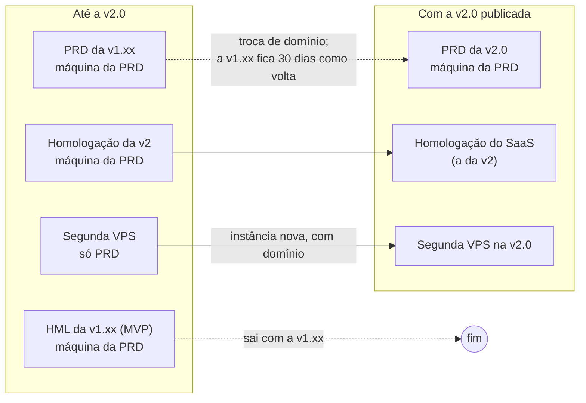
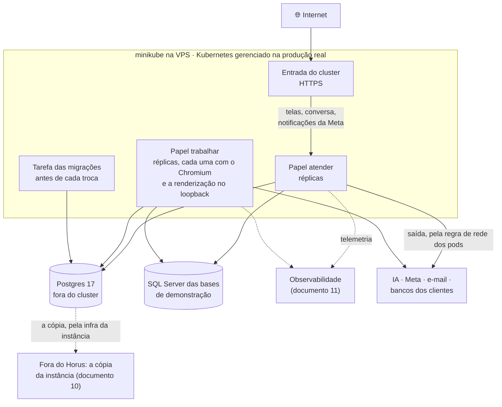

# Infraestrutura e ambientes do Horus v2

Situação: 🟢 escrito pelo arquiteto · seis decisões novas (`ARQ-055` a `ARQ-060`): quatro ✅ do dono (`ARQ-055`, `ARQ-056`, `ARQ-058` e `ARQ-059`, em 03/11/2026), uma 🟡 com o dono e uma ⚪ (a `ARQ-094`, substituída em 03/11/2026 pela `ARQ-094` 🟢) · uma verificação herdada da rodada anterior, antes do M2 (V-01, seção 5).

Última atualização: 03/11/2026 (o dono decidiu a `ARQ-055`, a homologação da v2 na VPS de hoje, a `ARQ-056`, nenhuma instância é produção real e todas dividem a máquina, e a `ARQ-059`, uma base de demonstração só; a cópia de segurança fora do Horus, `ARQ-086`; o banco mestre e um banco por organização, `ARQ-010` ✅; o executor do CI na VPS de hoje, `ARQ-082` ✅; os segredos pelos Secrets do GitHub, `ARQ-044` ✅; o endurecimento da VPS de hoje no lugar, `ARQ-058` ✅; o envelope, `ARQ-016` ✅; a v2.0 numa instância nova, com as organizações de exemplo semeadas, `ARQ-011` ✅; 99,9% na produção real, `ARQ-014` ✅, e a troca entre duas máquinas próprias, a `ARQ-091`, que passou a ⚪; a produção real numa nuvem pública com Kubernetes e a construção na VPS, `ARQ-092` ✅; a forma da produção real na nuvem, a `ARQ-093`, ainda como proposta; o Kubernetes gerenciado na produção real e o minikube na VPS, pela `ARQ-093` ✅; a imagem e o chart, pela `ARQ-094`; os papéis em várias réplicas, pela `ARQ-095`; o on-premises refeito sobre o chart, na `ARQ-060`; a v2.0 num subdomínio próprio, ao lado da v1.xx, pela `ARQ-065` ✅; a solução sem ficar presa a uma nuvem, pela `ARQ-096` ✅).

Este documento diz **onde o Horus v2 roda**: a instância SaaS da v2.0, os ambientes (desenvolvimento, CI, homologação e produção da v2, ao lado da v1.xx enquanto ela viver), a máquina e a capacidade, o banco da aplicação, as bases de demonstração e o Horus dentro da casa do contratante, na v2.1. Como se publica, como se volta uma versão e o que uma instância copia (a cópia fica fora do Horus) é do documento 10; o que se mede e quem é avisado, do 11. A ativação dos assentos no on-premises é a `P-016` e não se detalha aqui.

- O **quê** e o **porquê** são do produto ([backlog estratégico](../produto/backlog-estrategico.md), [a v2.0 consolidada](../produto/05-v2.0-consolidada.md)). As decisões (`ARQ-nnn`) estão no [registro](02-registro-de-decisoes.md); as metas, no [documento 03](03-metas-de-qualidade.md).
- O código da v1.xx se cita como `horus@318db52b:<caminho>`. As fontes desta rodada foram os roteiros de `horus@318db52b:infra/`, o inventário da máquina (`horus@318db52b:docs/superpowers/plans/anexos/2026-10-27-inventario-vps-maind.md`), a spec dos dois ambientes (`horus@318db52b:docs/superpowers/specs/2026-09-25-ambientes-hml-e-prd-design.md`) e as regras `horus@318db52b:.claude/rules/infra/observabilidade.md` e `seguranca/guarda-de-rede.md`. Nada foi executado, e nenhuma máquina foi acessada.
- **Nenhum host, endereço de IP ou domínio aparece aqui**: eles moram nas variáveis do GitHub, por regra do dono. O texto diz "a VPS de hoje", "a máquina da PRD" e "a segunda VPS".
- ⚠️ A `D-138` e a `D-139` vêm sempre com o título curto: `D-138` ("A v1.xx fecha como MVP no HML…").

Legenda: 🟢 decidida pelo arquiteto · 🟡 proposta ao dono · 🔎 hipótese a confirmar · ♻️ vem da v1.xx · 🔧 vem e muda · 🆕 novo.

## 1. O que o tema precisa garantir

| Garantia | Objetivos | Decisões |
| --- | --- | --- |
| 🏛️ **A mesma versão em qualquer instância**: o SaaS, a instância que a Maind opera para um cliente e, na v2.1, a do contratante | O8 | `D-017`, `D-007` |
| ☁️ **A v2.0 em SaaS**, numa instância nova da Maind, que substitui a de hoje, entregue de uma vez só | O1 a O7 | `D-017` (o SaaS primeiro: ver A-07), `D-109`; `ARQ-011` ✅ |
| 🧪 **Cada marco de pé antes da produção**, e a mesma versão do HML na PRD | O2 | A decisão D1 da spec dos ambientes da v1.xx; `D-138` "A v1.xx fecha como MVP no HML…" (a frente 4, a operação que sustenta o HML) |
| 📶 **No ar**: 99,9% por mês; a volta numa pane é a da cópia de cada instância | O1, O4 | `ARQ-014` ✅, `ARQ-086` ✅ |
| 📦 **O envelope do primeiro ano cabe**, e se sabe quando trocar de máquina | O1, O3, O4, O7 | `ARQ-016` ✅ |
| 🛡️ **A máquina não abre o que o código fecha**: os bancos só no loopback, a fonte da organização fora da rede interna, os segredos fora do repositório | O2 | `D-001`; `ARQ-044` ✅; a guarda de rede |
| 🏢 **Na v2.1, o Horus dentro da casa do contratante**, com a fonte na rede interna e, no "tudo dentro", a IA dentro de casa | O8 | `D-010`, `D-017`, `D-121`; a `P-016` à parte |
| 🎪 **As bases de demonstração seguem como vitrine e banco de prova** | O6 | `D-021`; `MF-118:Bases de demonstração` |

## 2. As decisões

| Decisão | O que decide | Situação |
| --- | --- | --- |
| `ARQ-004`, `ARQ-095` | O mesmo executável em dois papéis; duas réplicas ou mais de cada um na produção real, com o que precisa valer em todas pelo Postgres | 🟢, 🟢 |
| `ARQ-005` | A fila e a caixa de saída no banco da aplicação | 🟢 |
| `ARQ-011` | A v2.0 nasce numa instância nova, com as organizações de exemplo semeadas | ✅ |
| `ARQ-014`, `ARQ-016` | A disponibilidade e o envelope | ✅, ✅ |
| `ARQ-092`, `ARQ-093` | A produção real num Kubernetes gerenciado de uma nuvem pública, com o Postgres gerenciado; a construção no minikube da VPS de hoje | ✅, ✅ |
| `ARQ-096` | A solução não fica presa a uma nuvem: só o que roda igual em qualquer Kubernetes e em qualquer Postgres 17, e a saída provada | ✅ |
| `ARQ-086`, `ARQ-087` | A cópia fora do Horus, pela infra de cada instância; o contrato da cópia e a conferência da volta | ✅, 🟢 |
| `ARQ-036`, `ARQ-089` | A conversão, substituída pelo semeador das organizações de exemplo | ⚪, 🟢 |
| `ARQ-044` | Os segredos da instância nos Secrets do GitHub, gravados pelo CD no arquivo de ambiente; o anel cifrado por certificado; um login sem poder de dono em cada banco | ✅ |
| **`ARQ-055`** | **Os ambientes da v2: o desenvolvimento local, o CI, a homologação da v2 numa terceira instância da VPS de hoje e a PRD de hoje atualizada no fim; a v1.xx fica onde está até a v2.0 subir** | ✅ |
| **`ARQ-056`** | **As instâncias da VPS de hoje dividem todos os recursos da máquina, sem teto por instância, porque nenhuma é produção real; os dois papéis são dois serviços, e o banco fica em container** | ✅ |
| `ARQ-057` | Toda instância roda o mesmo pacote, compilado uma vez, e o que muda entre instâncias é só configuração e estado | ⚪ (`ARQ-094`) |
| **`ARQ-094`** | **Toda instância roda a mesma imagem de container, compilada uma vez, e o mesmo chart do Helm; o que muda entre instâncias é só a configuração e o estado** | 🟢 |
| **`ARQ-058`** | **Toda máquina do Horus fica endurecida — domínio com HTTPS, SSH só por chave, a regra de saída do serviço da API e os bancos só no loopback —, e a VPS de hoje se endurece no lugar, antes da homologação da v2** | ✅ |
| **`ARQ-059`** | **As bases de demonstração ficam no SQL Server Developer da VPS de hoje, só para demonstração e prova, uma só para todas as instâncias do Horus** | ✅ |
| **`ARQ-060`** | **O on-premises da v2.1 é a mesma imagem e o mesmo chart, no Kubernetes do contratante ou num Kubernetes de um nó numa máquina Linux dele, sem compilar nem baixar nada na hora** | 🟡 |

## 3. Os componentes e a responsabilidade de cada um

### 3.1 Onde a v1.xx roda hoje

| Peça | Hoje | Onde está |
| --- | --- | --- |
| **A VPS de hoje** | Ubuntu 24.04, 8 vCPU, 31 GB de memória, 387 GB de disco (47 GB usados), **sem swap**, fuso UTC | O inventário, §1 e §2 |
| **Dois ambientes na mesma VPS** | A PRD e o HML lado a lado, com usuário, diretório, configuração, banco e anel de chaves próprios; o HML com teto de 4 GB e de duas CPUs; a PRD **sem teto** | `horus@318db52b:infra/README.md`; a spec dos ambientes, §3 |
| **A segunda VPS** | Uma instância só com a PRD, para um cliente, servida **sem domínio e sem HTTPS** (e por isso sem o login do Google), publicada pelo mesmo roteiro, com uma cópia das bases de demonstração | `horus@318db52b:infra/github/ambientes.yml`; `horus@318db52b:infra/vps/copiar-bases-sqlserver.py`; o inventário, §9 |
| **O banco da aplicação** | Postgres 17 num container, só no loopback, dividido pela PRD e pelo HML com bancos e papéis separados; a aplicação entra como **superusuário**; a memória é a padrão do container; 59 MB em 27/10/2026 | `horus@318db52b:infra/vps/provisionar-base.sh`; o inventário, §6 |
| **As bases de demonstração** | SQL Server 2022 **Developer** num container, oito bases (cerca de 13,8 GB de dados), **sem teto de memória**, um login só de leitura por base; a ingestão contínua a cada 10 minutos, por um timer do systemd | O inventário, §4 e §6; `horus@318db52b:infra/horus-ingestao-mcdonalds.timer` |
| **A API** | Um serviço do systemd por ambiente, só no loopback, atrás do Nginx; os segredos no arquivo de ambiente, só do root | `horus@318db52b:infra/vps/provisionar-base.sh` |
| **O Nginx** | Um site por ambiente, com os certificados renovados pelo certbot; um site de renderização do PDF só no loopback; o log em JSON sem o token de convite | O inventário, §5 |
| **O PDF** | O Chromium do Playwright num diretório da máquina, instalado por roteiro, com as bibliotecas e as fontes do sistema | `horus@318db52b:infra/hml/preparar-pdf.sh` |
| **A publicação** | Manual, pelo GitHub Actions ou da máquina do dono; **compila na VPS**; troca por diretório; volta sozinha se a saúde reprovar; recusa na PRD o que não passou pelo HML, lendo o registro do HML na mesma máquina | `horus@318db52b:.github/workflows/deploy.yml`, `infra/redeploy.sh`, `infra/subir-versao.py` |
| **A observabilidade** | Nove containers na mesma máquina, todas as portas no loopback | `horus@318db52b:infra/observabilidade/compose.yml` |
| **Firewall e SSH** | Entram só 22, 80 e 443; **nenhuma regra de saída**; o SSH aceita senha, também para o root | O inventário, §8 |
| **Cópias de segurança e CI** | Não há rotina de cópia nem um CI que rode os testes | `ARQ-086` (a cópia é da infra da instância); o único workflow é o da publicação |

### 3.2 Os ambientes (`ARQ-055` ✅)

**Nenhuma instância de hoje é produção real** (o dono, em 03/11/2026): a PRD e o HML da v1.xx, a homologação da v2 e a segunda VPS são de teste, e as da VPS de hoje dividem todos os recursos da máquina (`ARQ-056`). 🔎 Na leitura do arquiteto, a produção real começa com a primeira organização que pagar (`D-107`).

| Ambiente | Onde | Para quê | Com que dados | De quando a quando |
| --- | --- | --- | --- | --- |
| **Desenvolvimento** | A máquina de cada pessoa do time: o Postgres em container, o SQL Server local com as bases, a API e o front; o ponta a ponta em portas próprias, com banco próprio (`horus@318db52b:CLAUDE.md`) | Construir e testar durante a construção, sem custo | As bases de demonstração; a IA `mock`; a porta da Meta falsa (`ARQ-048`); o e-mail nulo | Sempre |
| **CI** 🆕 | GitHub Actions, com um executor próprio na VPS de hoje até a primeira produção real, e os executores hospedados do GitHub depois (`ARQ-082`) | Compilar uma vez, rodar os testes sem modelo pago e gerar a imagem e o chart (`ARQ-094`); o desenho é do documento 12 | Containers descartáveis (Testcontainers) | Do M0 em diante |
| **Homologação da v2** 🆕 | Uma terceira instância na VPS de hoje, ao lado da PRD e do HML da v1.xx, com usuário, diretório, serviços, banco, logins, anel de chaves, certificado e domínio próprios, dividindo os recursos da máquina com as outras instâncias (`ARQ-055`, `ARQ-056`) | Pôr cada marco de pé: os dois papéis, a instalação da instância do zero, a notificação da Meta (que exige HTTPS público), o ensaio do semeador das organizações de exemplo (`ARQ-089`) e, se a Maind quiser, o ensaio da volta da instância SaaS (`ARQ-086`) | As bases de demonstração da máquina, com logins próprios só de leitura; organizações de prova; o McDonald's e a Global Fleet, pelo semeador | Do M0 ao M7; com a v2.0 publicada, vira a homologação do SaaS |
| **PRD da v2.0** | Uma instância nova no minikube da VPS de hoje, num subdomínio próprio (`ARQ-011`, `ARQ-065`, `ARQ-093`) | A instância SaaS da v2.0 | O McDonald's e a Global Fleet, pelo semeador (`ARQ-089`); as pessoas da Maind, por convite | Da abertura da v2.0 em diante (`ARQ-065`) |
| **PRD e HML da v1.xx** | A VPS de hoje, como estão | O SaaS de hoje e o MVP no HML (`D-138` "A v1.xx fecha como MVP no HML…") | Os de hoje | No domínio de hoje, ao lado da v2.0, até a Maind decidir tirá-las (`ARQ-065`); então a v2.0 pode assumir o domínio de hoje, e a máquina fica com a PRD da v2.0 e a homologação do SaaS |
| **A segunda VPS** | Como está | A instância dedicada de hoje | Os dela | Recebe a v2.0 depois da PRD, como instância nova, com as organizações de exemplo semeadas, já com domínio (`ARQ-058`) |

- **A homologação da v2 se separa da PRD como o HML de hoje**: usuário, diretório, serviços, banco e logins, anel de chaves, certificado e domínio próprios, com o domínio nas variáveis do GitHub; o login dela não alcança o banco da PRD nem o do MVP (`ARQ-055`).
- **A homologação da v2 recebe o McDonald's e a Global Fleet pelo semeador** (`ARQ-089`), e não por um clone da PRD; o clone de hoje (`horus@318db52b:infra/hml/clonar-prd-para-hml.sh`) fica só para o HML da v1.xx enquanto ele viver.
- **A guarda "passou pelo HML"** hoje lê o registro do HML na mesma máquina. O documento 10 a redesenha sobre a imagem (`ARQ-094`, `ARQ-061`), o que vale em qualquer instância, também na segunda VPS: a PRD recusa o pacote que a homologação não registrou.
- **O provisionamento do zero de uma máquina** não se prova na construção, porque a homologação nasce numa máquina que já existe: ele se prova numa máquina por hora antes do M7 (documento 13, 3.7), ou quando a segunda VPS receber a v2.0.

### 3.3 A instância SaaS da v2.0 e a máquina dividida (`ARQ-056` ✅, `ARQ-093` ✅)

- **Os dois papéis são dois conjuntos de réplicas da mesma imagem** (`ARQ-004`, `ARQ-094`), no minikube da VPS durante a construção: o "atender", atrás da entrada do cluster; o "trabalhar", sem entrada de fora, que serve a própria renderização no loopback ao Chromium do mesmo pod (`ARQ-095`; hoje o impressor só aceita loopback, `horus@318db52b:apps/server/Horus.Core/Relatorios/ImpressorDePdfChromium.cs`). Na VPS, uma réplica de cada basta, e a homologação roda duas do "atender", para provar o que a produção roda.
- **As migrações rodam numa tarefa do chart**, antes da troca, com o login das migrações (`ARQ-044`, `ARQ-062`), e nenhuma réplica migra ao subir.
- **Todas as réplicas leem o mesmo anel de chaves**, guardado no banco mestre e cifrado pelo certificado (`ARQ-087`, `ARQ-094`); a chave nova nasce na tarefa das migrações, e as réplicas só leem.
- **O Postgres da VPS fica fora do minikube**, no container de hoje, como o gerenciado fica fora do cluster na produção real; a v1.xx continua com os serviços do systemd e o Nginx de hoje até a v2.0 subir.
- **A observabilidade fica na máquina**, fora do minikube, até o documento 11 decidir; a sonda de fora da máquina é dele (`ARQ-014`).

**A capacidade** 🔎 (a partir do envelope da `ARQ-016` e da medição de hoje: CPU no máximo em 26,4% e memória entre 19% e 21%, [documento 03](03-metas-de-qualidade.md)): as instâncias da VPS de hoje dividem todos os recursos da máquina, sem teto por instância nem por serviço, porque nenhuma é produção real (`ARQ-056` ✅, a escolha do dono em 03/11/2026). A máquina ganha 8 GB de swap 🔎, que não reparte recurso: é a rede de segurança para um pico de memória não matar um processo. O minikube pesa na máquina, e o Kubernetes, por padrão, recusa swap no nó: ele se configura para aceitá-la, e a V-07 confere as duas coisas 🔎. O uso de cada instância e de cada serviço (o Postgres, o SQL Server das bases, a observabilidade e o executor do CI, `ARQ-082`) se mede no documento 11, e a V-07 confere, com a homologação da v2 de pé, se a máquina basta. Com a primeira produção real, a `ARQ-056` reabre: a produção ganha teto ou máquina própria.

**Na primeira produção real** (`ARQ-014` ✅, `ARQ-092` ✅, `ARQ-093` ✅): a PRD vai para um Kubernetes gerenciado de uma nuvem pública, com o Postgres gerenciado da mesma nuvem, na região de São Paulo; cada papel com duas réplicas ou mais, em zonas diferentes, e o banco com a réplica noutra zona e a troca automática (`ARQ-095`). A nuvem se escolhe na primeira produção real, pelos preços da V-19 (`ARQ-085`, adiada pelo dono), e nada fica preso a ela: o chart usa só os recursos padrão do Kubernetes, o banco é o PostgreSQL 17 padrão, e a entrada e o certificado são do cluster (`ARQ-096` ✅). A VPS de hoje fica com a construção e as instâncias de teste, no minikube, com a mesma imagem e o mesmo chart (`ARQ-094`).

**Quando trocar de máquina** (os gatilhos que reabrem a `ARQ-016`): o uso passou da metade do envelope; a memória ficou acima de 80% por uma semana; o trabalho mais antigo da fila passou de 10 minutos no pico de segunda (o limiar de 2.4 do documento 03); ou o tempo piorou por causa da máquina, e não do modelo nem do banco do cliente. **A ordem**: primeiro, uma máquina maior, pelo provisionamento do zero e pela volta da cópia da instância (`ARQ-086`, `ARQ-087`), numa janela combinada; depois, o papel "trabalhar" numa segunda máquina, com o banco alcançado pela rede privada do provedor; acima de dez vezes o envelope, este documento reabre.

**O endereço de saída é parte do contrato com cada cliente**: é ele que o cliente libera no firewall do banco (`ARQ-052`). A troca de máquina leva o endereço junto, se o provedor permitir (verificação V-06); senão, os clientes são avisados com antecedência, e o "Testar" de cada fonte roda depois da troca.

### 3.4 O banco da aplicação

| Ponto | Como fica | Decisão |
| --- | --- | --- |
| Tecnologia | Na VPS, o PostgreSQL 17 em container, fora do minikube, como hoje; na produção real, o Postgres gerenciado da nuvem | `ARQ-001`, `ARQ-056`, `ARQ-093` |
| Os bancos de cada instância | O container do Postgres da máquina guarda, para cada instância, o banco mestre e um banco por organização, cada um com o seu login; a homologação da v2 tem os dela, ao lado dos da PRD | `ARQ-010`, `ARQ-055`, `ARQ-088` |
| Os logins | O do mestre e o de cada organização, sem privilégio de dono, cada um só no seu banco; o das migrações, só no passo da publicação; o de provisionamento, que só cria banco e login, só para criar uma organização | `ARQ-044` ✅, `ARQ-088` |
| A cópia | Fora do Horus: a infra da instância copia o Postgres inteiro (o mestre e os bancos das organizações, do mesmo momento), o anel e o certificado, pelo contrato da cópia (documento 10) | `ARQ-086` ✅, `ARQ-087` |
| A memória | A da máquina, dividida com as outras instâncias; a memória de trabalho do banco se ajusta pela medida | `ARQ-056` |
| Uma versão nova do Postgres | Manutenção, ensaiada na homologação com a cópia da PRD | `ARQ-001` |
| Um Postgres gerenciado de nuvem | ✅ Na produção real, a partir da primeira organização paga, com a réplica noutra zona e a troca automática; a construção segue com o container da VPS (a escolha do dono em 03/11/2026) | `ARQ-093` |

### 3.5 A imagem e o chart (`ARQ-094` 🟢)

| Na imagem e no chart (igual em toda instância) | Na instância (configuração e estado) |
| --- | --- |
| O executável do servidor, com o runtime do .NET | O número de réplicas de cada papel, no arquivo de valores da instância |
| O front já compilado, servido pelo "atender" | Os segredos, nos Secrets do Kubernetes, gravados pelo CD a partir dos Secrets do ambiente no GitHub (`ARQ-044`) |
| O Chromium da versão do Playwright, com as bibliotecas e as fontes do sistema | O domínio e a origem da instância |
| As migrações e o semeador das organizações de exemplo (`ARQ-062`, `ARQ-089`) | O modo da instância: "com serviços externos autorizados" ou "tudo dentro" (`D-010`) |
| O chart: os dois papéis, a tarefa das migrações e a entrada do cluster | As fontes do arquivo, com as organizações declaradas (`ARQ-034`), e os documentos semânticos do arquivo |
| A identidade (o commit e o digest da imagem) | Os bancos; o anel de chaves, no banco mestre, cifrado pelo certificado, que mora num Secret (`ARQ-087`) |

Hoje a publicação compila na VPS (`horus@318db52b:infra/redeploy.sh`): o HML e a PRD compilam cada um o mesmo commit, mas não instalam os mesmos bytes, e a máquina de produção precisa do SDK do .NET e do Node. Com a imagem, o CI compila uma vez, e o cluster — o minikube da VPS, o Kubernetes gerenciado da produção real ou o do contratante — só baixa e sobe. Nenhum estado mora nos pods: a réplica que cai volta igual. O documento 10 redesenha a publicação sobre a imagem e o chart.

### 3.6 A máquina endurecida (`ARQ-058` ✅)

| Medida | Hoje | Na v2 | Por quê |
| --- | --- | --- | --- |
| **Domínio com HTTPS** | Na PRD e no HML, sim; na segunda VPS, não | Em toda instância | A Meta só entrega notificação a um endereço HTTPS com certificado válido 🔎, e o Google não aceita IP nem HTTP (o inventário, §9) |
| **SSH só por chave** | Aceita senha, também para o root (o inventário, §8) | Só por chave; os roteiros de operação que usam a senha do cofre passam à chave | Tira a porta mais tentada da internet |
| **A regra de saída do serviço da API** | Não existe | Nega loopback, redes privadas, link-local e CGNAT, menos os destinos que o Horus conhece na máquina (o Postgres, o SQL Server das bases, a renderização, a observabilidade); no contratante, mais as faixas que ele autoriza (`ARQ-060`) | É o único fechamento do redirecionamento do protocolo e da troca de DNS que a guarda de rede declara não fechar (`horus@318db52b:apps/server/Horus.Core/Data/Connections/GuardaDeRede.cs`) |
| **Os bancos e a observabilidade só no loopback** | Já é assim | Igual, conferido no provisionamento; a exceção é o SQL Server das bases, aberto só para as outras máquinas do Horus que a Maind opera, com a conexão cifrada (`ARQ-059`) | O Docker publica por cima do ufw sem o prefixo de loopback (`horus@318db52b:.claude/rules/infra/observabilidade.md`) |
| **A guarda de rede sem saída na PRD e no HML** | A saída nunca vai ao arquivo de ambiente do HML nem da PRD (`horus@318db52b:.claude/rules/seguranca/guarda-de-rede.md`) | Igual no SaaS; só a instância do contratante a liga (`ARQ-060`) | — |
| **Atualizações de segurança automáticas** | Ativas | Iguais | — |

### 3.7 As bases de demonstração (`ARQ-059` ✅)

| Ponto | Como fica |
| --- | --- |
| **Onde** | Uma base só, no SQL Server da VPS de hoje, para todas as instâncias do Horus que a Maind opera, cada uma com os seus logins só de leitura; a instância de outra máquina, como a segunda VPS, a lê pela rede, com a conexão cifrada e o firewall aberto só para ela; nunca na instância do contratante, salvo pedido |
| **A licença** | O SQL Server 2022 Developer, só para demonstração e prova, só nas organizações de demonstração da Maind, nunca como fonte de um cliente. A Microsoft licencia o Developer para desenvolvimento e teste, e não para produção; enquanto nenhuma instância for produção real, cabe; se a demonstração numa produção real cabe nessa licença é a verificação V-05, antes da primeira produção real 🔎 |
| **A memória** | A da máquina, dividida com as instâncias, sem teto (`ARQ-056`) |
| **Quem as vê** | Só as organizações declaradas em cada fonte do arquivo (`ARQ-034`); a fonte sem organização declarada passa a ser de nenhuma (V-01) |
| **A ingestão contínua** | ♻️ O timer de 10 minutos, uma vez só, na VPS de hoje |
| **A cópia para outra máquina** | ♻️ O roteiro de cópia por backup e restauração, conferido por contagem (`horus@318db52b:infra/vps/copiar-bases-sqlserver.py`), só para refazer a VPS de hoje; a segunda VPS deixa a cópia dela e passa a ler a base da VPS de hoje |
| **A volta numa pane** | Fora do contrato da cópia (`ARQ-087`): refazem-se pelos geradores determinísticos de `horus@318db52b:data/` |

### 3.8 O on-premises da v2.1 (`ARQ-060` 🟡)

A mesma versão (`D-017`) vira **a mesma imagem e o mesmo chart** (`ARQ-094`) no Kubernetes do contratante ou num Kubernetes de um nó numa máquina dele, instalados e atualizados como no SaaS, sem compilar e sem baixar nada da internet na hora (o Chromium e as fontes vão na imagem, e a imagem vai como arquivo, conferida pelo digest). O que o contratante fornece:

| Item | O que é | Em que modo |
| --- | --- | --- |
| **Cluster ou máquina** | O Kubernetes da empresa, ou uma máquina virtual Linux x64 com o Ubuntu LTS que o roteiro conhece, onde o roteiro da Maind instala um Kubernetes de um nó (o k3s ou o minikube 🔎); dimensionado pelo envelope do contratante com a conta do documento 03 (🔎 ponto de partida: 4 vCPU, 16 GB e 200 GB para até 300 assentos) | Os dois |
| **Nome e certificado** | Um nome no DNS da empresa e o certificado dele | Os dois |
| **Banco** | O Postgres 17 que o chart sobe (o padrão), ou um Postgres 17 da empresa, com um login sem poder de dono em cada banco (`ARQ-044`); a cópia é da infra da instância (`ARQ-086`) | Os dois |
| **Guarda das cópias** | Um lugar da empresa fora da máquina (documento 10) | Os dois |
| **Rede até as fontes** | A rota da máquina até os bancos internos, a saída da guarda de rede ligada nesta instância com as faixas que o contratante autoriza, e a regra de rede dos pods com as mesmas faixas (`ARQ-058`) | Os dois |
| **E-mail** | O servidor SMTP da empresa (`ARQ-046`) | Os dois; no "tudo dentro", como interno, se a instância o liberar (`D-040`) |
| **Login** | O login da empresa (`ARQ-054`), o Google com o cliente da empresa (`ARQ-053`) ou só a senha | Os dois |
| **Saída para fora** | Os provedores de IA; a Meta, com a conta e o aplicativo da própria empresa (`ARQ-047`, opção C) e um endereço HTTPS público só para as notificações dela | Só "com serviços externos autorizados" |
| **IA dentro de casa** | O servidor de modelos da empresa, pelo protocolo compatível com o da OpenAI (`ARQ-051`), escolhido com o dono no M10 | Só "tudo dentro" |
| **Atualização** | A Maind com acesso concedido, ou a TI da empresa aplicando o mesmo chart com a imagem nova | Os dois |
| **Ativação dos assentos** | A `P-016`, à parte | — |

- **No "tudo dentro"**, ficam bloqueados o WhatsApp (leitura `D-084.2`), os conectores até a instância liberar (`D-040`) e a pesquisa na web (`D-010`); a instância diz o modo pela configuração do pacote.
- **A observabilidade** é a mesma stack, na máquina do contratante, e nada dela sai sem ele permitir (no "tudo dentro", nunca); o documento 11 decide o que a Maind vê.
- **O que não vai ao contratante**: o aplicativo da Maind na Meta e o cliente OAuth da Maind (os segredos da Maind ficam com a Maind), e as bases de demonstração, salvo pedido.

### 3.9 Os componentes

| Componente | Responsabilidade | Situação |
| --- | --- | --- |
| Provisionamento do zero | Deixa uma máquina Ubuntu pronta, endurecida, com os bancos, o minikube e a entrada dele; a v1.xx segue com os serviços e o Nginx de hoje até a v2.0 subir | 🔧 `horus@318db52b:infra/vps/provisionar-base.sh`, com o endurecimento e o certificado do anel |
| Imagem e chart | O que roda em toda instância, compilado uma vez | 🆕 (`ARQ-094`) |
| Troca de versão | Aplica o chart: a tarefa das migrações, a troca gradual das réplicas e a volta à versão anterior do chart se a saúde reprovar | 🆕 (`ARQ-094`; documento 10), no lugar de `horus@318db52b:infra/redeploy.sh` |
| Os dois papéis | O "atender" e o "trabalhar" de cada instância, dois conjuntos de réplicas da mesma imagem, sem teto na VPS (`ARQ-056`) e com duas réplicas ou mais na produção real (`ARQ-095`) | 🔧 hoje um serviço do systemd por ambiente |
| Entrada do cluster | O HTTPS e a rota pública para o "atender"; o log sem o token. A renderização fica no loopback do pod do "trabalhar" | 🆕 uma implementação aberta da Gateway API e o certificado do Let's Encrypt renovado no cluster, iguais no minikube, na nuvem e no contratante (`ARQ-096`) 🔎; hoje o Nginx faz isso |
| Postgres | O banco mestre e os bancos das organizações de cada instância (`ARQ-010`): na VPS, em container, fora do minikube; na produção real, o gerenciado da nuvem (`ARQ-093`) | ♻️ na VPS, com um login sem poder de dono em cada banco |
| SQL Server das bases de demonstração | A vitrine e o banco de prova, uma base só para todas as instâncias (`ARQ-059`) | ♻️ |
| Ingestão contínua | A janela móvel de 12 meses da base de pedidos | ♻️ `horus@318db52b:infra/horus-ingestao-mcdonalds.timer` |
| Regra de saída da máquina | Fecha o que a guarda de rede não fecha; no cluster, com a regra de rede dos pods 🔎 | 🆕 (`ARQ-058`) |
| Semeador | As organizações de exemplo em qualquer instância, pelos arquivos do repositório | 🆕 (`ARQ-089`) |
| Ambientes do GitHub | Uma entrada por máquina e ambiente, com as variáveis e os segredos da publicação | ♻️ `horus@318db52b:infra/github/` |

## 4. O que vem da v1.xx e o que não vem

| Peça da v1.xx | Destino | Por quê |
| --- | --- | --- |
| A VPS com Ubuntu, Nginx, systemd, Docker Compose e ufw | ♻️ Fica para a construção, com o minikube a mais; a v1.xx segue nela até a v2.0 | `ARQ-001`, `ARQ-093` |
| O provisionamento do zero e a cópia das bases para outra máquina | ♻️ Ficam, e o provisionamento ganha o endurecimento; a cópia das bases serve só para refazer a VPS de hoje | `ARQ-058`, `ARQ-059` |
| A troca por diretório com a volta automática | 🔧 A volta automática fica; a troca por diretório dá lugar à troca gradual do cluster | `ARQ-094`; documento 10 |
| Compilar na máquina de produção | ❌ Sai: o cluster baixa a imagem | `ARQ-094` |
| A PRD e o HML na mesma máquina | ♻️ Fica: a homologação da v2 entra como terceira instância, e, com a v2.0, a máquina fica com a PRD e a homologação do SaaS | `ARQ-055` |
| A PRD sem teto de memória e a máquina sem swap | 🔧 O teto não entra, porque as instâncias dividem a máquina; entra a swap | `ARQ-056` |
| O SQL Server das bases sem teto de memória | ♻️ Fica: as bases dividem a máquina | `ARQ-059` |
| O login da aplicação como superusuário do banco | ❌ Sai | `ARQ-044` |
| O SSH com senha e a falta de regra de saída | ❌ Saem | `ARQ-058` |
| A instância sem domínio | ❌ Sai: toda instância tem domínio e HTTPS | `ARQ-058` |
| As bases de demonstração, os geradores, a ingestão e a conferência | ♻️ Ficam | `ARQ-059` |
| A guarda "passou pelo HML" lendo o registro na mesma máquina | 🔧 Passa a valer sobre a imagem, em qualquer instância | Documento 10 |

## 5. Os riscos e o que falta decidir

| Risco | Por quê | O que se faz |
| --- | --- | --- |
| 🖥️ **Uma máquina para tudo, sem teto** | Todas as instâncias, os dois bancos e a observabilidade dividem a VPS de hoje: uma instância que passa do limite derruba as outras | Aceito pelo dono, porque nenhuma é produção real (`ARQ-056`); a swap segura o pico raro; a V-07 e o gatilho da troca de máquina (3.3) dizem quando a máquina não basta; com a primeira produção real, a `ARQ-056` reabre |
| ⚖️ **A licença do SQL Server Developer** | A Microsoft o licencia para desenvolvimento e teste, e as bases vão servir a demonstrações numa produção real | A verificação V-05 antes da primeira produção real; se a licença não couber, a `ARQ-059` reabre, com o Express ou o Standard |
| 🌐 **O endereço de saída muda com a máquina** | Os clientes liberam esse endereço no firewall dos bancos deles | Manter o endereço na troca (V-06), ou avisar com antecedência |
| 🔁 **A guarda "passou pelo HML" muda de lugar** | Hoje ela lê um arquivo na mesma máquina | O documento 10 a redesenha sobre a imagem antes da primeira publicação da v2 |
| 🏢 **A TI do contratante não roda Kubernetes** | Algumas não têm cluster nem aceitam um endereço público para a Meta | O Kubernetes de um nó numa máquina Linux dela, que o roteiro da Maind instala (`ARQ-060`); sem o endereço público, o contratante fica sem o WhatsApp |
| 📴 **O contratante sem internet** | A imagem precisa trazer tudo: o runtime, o Chromium e as fontes | A imagem completa (`ARQ-094`) vai como arquivo e se prova num Kubernetes sem saída antes do M10 |
| ☸️ **A Maind opera um Kubernetes** | As atualizações de versão a cada poucos meses, a entrada, os certificados e os grupos de máquinas, num time pequeno; na VPS, o minikube divide a máquina com a v1.xx | A escolha do dono (`ARQ-093`); a atualização do cluster entra no calendário da operação e se ensaia no minikube antes 🔎 |
| 🧭 **A versão do Ubuntu muda** | O provisionamento foi montado na 24.04, e o inventário lista o que conferir numa versão nova (§9) | Fixar a versão do Ubuntu LTS por pacote e conferir a nova na homologação |

**Verificações pendentes** (nada disso foi rodado nesta rodada):

| Nº | O que conferir | Quem | Antes de |
| --- | --- | --- | --- |
| **V-01** | **Herdada da rodada anterior.** No arquivo de ambiente da PRD e no do HML, se alguma fonte do arquivo depende da regra "sem organização declarada, aparece para todas" (`horus@318db52b:apps/server/Horus.Core/Data/Connections/ConnectionCatalog.cs`, `VisivelParaSlug`). O inventário lista as chaves das organizações nas fontes da PRD, mas não prova que cada uma das oito as tem. Toda fonte precisa declarar as organizações antes de a regra mudar para "de nenhuma" (`ARQ-034`) | Quem opera os ambientes, com o dono | M2 |
| V-05 | Se a licença do SQL Server Developer cobre as bases de demonstração numa produção real | O dono, com o licenciamento da Microsoft | A primeira produção real |
| V-06 | Se o provedor da VPS permite manter o endereço de saída numa troca de máquina | O dono | A primeira troca de máquina |
| V-07 | Se a VPS de hoje comporta a homologação da v2 e, depois, a v2.0, ao lado da PRD e do HML da v1.xx: a memória, a CPU e o disco de cada serviço com a homologação da v2 de pé, com a swap, contra o gatilho da troca de máquina (3.3); e, com o minikube, o peso dele e a swap, que o Kubernetes, por padrão, recusa no nó (`ARQ-093`) 🔎 | O dono, com quem opera | O M0, logo depois de a homologação da v2 subir |
| V-08 | O domínio da segunda VPS | O dono | A v2.0 nela |

(As verificações V-02 a V-04 são das integrações, no [documento 08](08-integracoes.md).)

**O que falta decidir:**
- 🟡 Com o dono: `ARQ-060` (o on-premises).
- Documento 10: a publicação sobre a imagem e o chart; a guarda "passou pelo HML" sobre a imagem; o contrato da cópia e a volta numa máquina nova; a janela da publicação da v2.0; a rotação dos segredos; o incidente.
- Documento 11: onde a observabilidade roda; a sonda de fora da máquina; a telemetria da homologação da v2 e a do contratante.
- Documento 12: o CI, os testes de arquitetura e de isolamento, a prova do pacote numa máquina sem saída.
- Documento 13: o custo das máquinas, da guarda das cópias e da licença das bases.
- A `P-016` (a ativação dos assentos no on-premises), com o dono, antes do M10.
