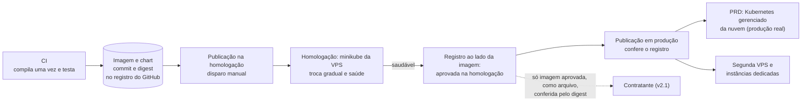

# Publicação e operação do Horus v2

Situação: 🟢 escrito pelo arquiteto · dez decisões novas (`ARQ-061` a `ARQ-068`, `ARQ-086` e `ARQ-087`): quatro 🟢, cinco ✅ do dono (`ARQ-086`, `ARQ-066`, `ARQ-067`, `ARQ-068` e `ARQ-065`, em 03/11/2026) e uma ⚪ (`ARQ-064`, substituída pela `ARQ-086`) · um item a devolver ao PO (A-21) · verificações V-09 a V-11 (seção 5).

Última atualização: 03/11/2026 (a cópia de segurança fora do Horus, pela `ARQ-086` ✅, e o contrato da cópia com a conferência da volta, pela `ARQ-087`; a homologação da v2 na VPS de hoje, pela `ARQ-055` ✅; nenhuma instância é produção real, pela `ARQ-056` ✅; as migrações e a cópia com um banco por organização, pela `ARQ-010` ✅; os segredos da instância nos Secrets do GitHub, gravados pelo CD, pela `ARQ-044` ✅; o endurecimento da VPS de hoje, pela `ARQ-058` ✅; o acesso às máquinas, pela `ARQ-066` ✅; o calendário de troca dos segredos, pela `ARQ-067` ✅; a abertura da v2.0 como troca de domínio, sem conversão, pela `ARQ-011` ✅; a meta de 99,9%, pela `ARQ-014` ✅; a produção real numa nuvem pública com Kubernetes e a construção na VPS, pela `ARQ-092` ✅; a publicação sobre a imagem e o chart, pela `ARQ-094`, no minikube da VPS e no Kubernetes gerenciado da produção real, pela `ARQ-093` ✅; o plantão só para o que não pode esperar, pela `ARQ-071` ✅; os incidentes com gravidade, responsável, prazos e registro, pela `ARQ-068` ✅; a v2.0 num subdomínio próprio, ao lado da v1.xx, pela `ARQ-065` ✅; a cópia lógica fora da nuvem e a prova da saída, pela `ARQ-096` ✅).

Este documento diz **como uma versão do Horus v2 chega a uma instância e como a instância se mantém de pé**: a publicação sobre o pacote único, a guarda "só vai à produção o que passou pela homologação", as migrações, a abertura da v2.0 com as organizações de exemplo semeadas, a volta de uma versão, o contrato da cópia de segurança, que fica fora do Horus, e a volta numa máquina nova, o acesso às máquinas, os segredos e os incidentes. Onde cada instância roda é do [documento 09](09-infraestrutura-e-ambientes.md); o que se mede e quem é avisado, do [documento 11](11-observabilidade.md); o CI que gera o pacote, do documento 12; o custo, do documento 13.

- O **quê** e o **porquê** são do produto ([backlog estratégico](../produto/backlog-estrategico.md), [a v2.0 consolidada](../produto/05-v2.0-consolidada.md)). As decisões (`ARQ-nnn`) estão no [registro](02-registro-de-decisoes.md); as metas, no [documento 03](03-metas-de-qualidade.md).
- O código da v1.xx se cita como `horus@318db52b:<caminho>`. As fontes desta rodada foram o workflow e os roteiros de publicação (`horus@318db52b:.github/workflows/deploy.yml`, `infra/github/`, `infra/subir-versao.py`, `infra/vps.py`, `infra/redeploy.sh`, `infra/README.md`), o plano da instalação do zero (`horus@318db52b:docs/superpowers/plans/2026-10-27-deploy-do-zero-da-vps.md`), o inventário da máquina (`horus@318db52b:docs/superpowers/plans/anexos/2026-10-27-inventario-vps-maind.md`) e a análise das métricas (`horus@318db52b:docs/produto/observabilidade/analise-metricas.html`). Nada foi executado, e nenhuma máquina foi acessada.
- **Nenhum host, endereço de IP ou domínio aparece aqui**: eles moram nas variáveis do GitHub, por regra do dono. O texto diz "a máquina da PRD", "a homologação" (uma instância na máquina da PRD, pela `ARQ-055`) e "a segunda VPS".
- ⚠️ A `D-138` vem sempre com o título curto: `D-138` ("A v1.xx fecha como MVP no HML…").

Legenda: 🟢 decidida pelo arquiteto · 🟡 proposta ao dono · 🔎 hipótese a confirmar · ♻️ vem da v1.xx · 🔧 vem e muda · 🆕 novo.

## 1. O que o tema precisa garantir

| Garantia | Objetivos | Decisões |
| --- | --- | --- |
| 📦 **O que a homologação provou é o que a produção instala**, em qualquer instância, também numa instância noutra máquina, como a segunda VPS | O2, O8 | `D-017`; a decisão D1 da spec dos ambientes da v1.xx (`horus@318db52b:docs/superpowers/specs/2026-09-25-ambientes-hml-e-prd-design.md`); `ARQ-055` ✅, `ARQ-094` |
| ⏯️ **Publicar não derruba quem está usando nem perde trabalho**: a conversa, a mensagem do WhatsApp, a rodada de um agendamento, o agente no meio | O1, O4 | `D-122`, `D-124`; `ARQ-004`, `ARQ-005`, `ARQ-024` |
| ↩️ **Toda versão tem volta**, sem um roteiro de comandos à mão para cada migração | O2 | `ARQ-094`, `ARQ-062` |
| 🚪 **A v2.0 abre num subdomínio próprio, ao lado da v1.xx**, com as organizações de exemplo semeadas | O6, O7 | `D-109`, `D-134`; `ARQ-011` ✅, `ARQ-065` ✅, `ARQ-089` |
| 💾 **O que uma instância precisa copiar está escrito, e o Horus confere a volta a cada subida**; a cópia é da infra de cada instância | O2, O7, O8 | `D-013`, `D-017`, `D-075` e a leitura `D-075.3`, `D-092`, `D-093` (o rastro não some); `ARQ-086` ✅, `ARQ-087` |
| 🔑 **Quem entra nas máquinas tem nome, e os segredos se renovam** | O2, O8 | `D-138` "A v1.xx fecha como MVP no HML…" (a frente 3, a segurança de onde o Horus roda); `ARQ-044` ✅, `ARQ-058` ✅ |
| 🚨 **Um incidente tem responsável, prazo e comunicação**, inclusive o que vai à ANPD | O2 | `D-013`, `D-090` a `D-093`; a LGPD (Lei 13.709/2018, art. 48) |
| 🏢 **A mesma operação na casa do contratante**, sem a Maind dentro dela | O8 | `D-007`, `D-017`, `D-121`; `ARQ-060` 🟡 |

## 2. As decisões

| Decisão | O que decide | Situação |
| --- | --- | --- |
| `ARQ-005` | A fila e a caixa de saída no banco da aplicação: todo trabalho pode ser repetido sem efeito em dobro | 🟢 |
| `ARQ-011`, `ARQ-089` | A v2.0 nasce numa instância nova; as organizações de exemplo chegam pelo semeador (a conversão, `ARQ-036`, saiu) | ✅, 🟢 |
| `ARQ-014` | 99,9% por mês | ✅ |
| `ARQ-044` | Os segredos da instância nos Secrets de cada ambiente do GitHub, gravados pelo CD no arquivo de ambiente; o anel cifrado por certificado, com uma cópia no cofre da Maind; um login sem poder de dono em cada banco | ✅ |
| `ARQ-055`, `ARQ-058` | Os ambientes, com a homologação da v2 na VPS de hoje; a máquina endurecida | ✅, ✅ |
| `ARQ-093`, `ARQ-094` | O Kubernetes gerenciado na produção real e o minikube na construção; a imagem e o chart, iguais em toda instância | ✅, 🟢 |
| `ARQ-096` | A solução não fica presa a uma nuvem; a cópia lógica fora dela e a prova da saída | ✅ |
| **`ARQ-061`** | **A publicação instala o pacote do CI, e a produção só aceita o pacote que a homologação registrou** | 🟢 |
| **`ARQ-062`** | **As migrações rodam num passo próprio e são compatíveis com a versão no ar; só a migração de corte pede janela** | 🟢 |
| **`ARQ-063`** | **A troca de versão drena o trabalho em curso, e nada se perde** | 🟢 |
| `ARQ-064` | As cópias de segurança ficam no próprio provedor das VPS, fora da máquina do Horus, e a volta se ensaia a cada trimestre | ⚪ (`ARQ-086`) |
| **`ARQ-065`** | **A v2.0 abre num subdomínio próprio, ao lado da v1.xx, que continua no domínio de hoje até a Maind decidir; as duas na mesma VPS, separadas pelo nome na entrada da máquina** | ✅ |
| **`ARQ-066`** | **Cada pessoa da operação entra nas máquinas com nome e chave próprios, a publicação com a chave do ambiente, o root não entra por SSH, e a senha sai dos roteiros** | ✅ |
| **`ARQ-067`** | **Os segredos têm um calendário de troca, a suspeita vira troca, e o certificado do anel se renova por acréscimo, com a recifragem do cofre** | ✅ |
| **`ARQ-068`** | **Os incidentes têm gravidade, responsável, prazos, comunicação às organizações e o apoio à comunicação à ANPD, e todo incidente se registra e se revisa** | ✅ |
| **`ARQ-086`** | **A cópia de segurança fica fora do Horus: cada dono de instância a configura na infraestrutura dele** | ✅ |
| **`ARQ-087`** | **O Horus diz o que uma instância precisa copiar e confere, a cada subida, se o banco e o anel de chaves são do mesmo par** | 🟢 |

## 3. Os componentes e a responsabilidade de cada um

### 3.1 Como a v1.xx publica hoje

| Peça | Hoje | Onde está |
| --- | --- | --- |
| **O disparo** | Só manual, pelo GitHub Actions ou da máquina de quem opera; nada publica sozinho (decisão do dono de 27/10/2026); simula por padrão; na PRD, exige a caixa "Confirmo publicar"; um disparo por ambiente de cada vez, nunca cancelado no meio | `horus@318db52b:.github/workflows/deploy.yml`, `infra/github/deploy-ambiente.py` |
| **O que viaja** | O código-fonte do commit, empacotado fora do diretório de trabalho, e o roteiro de troca, conferido pela soma nas duas pontas | `horus@318db52b:infra/subir-versao.py` |
| **Onde compila** | Na própria VPS, com o serviço no ar, num diretório novo | `horus@318db52b:infra/redeploy.sh` |
| **A troca** | Uma troca de diretórios de segundos, com a marca da troca pendente em disco; a saúde conferida até 24 vezes em dois minutos; a volta sozinha se reprovar; cinco pontos de volta; a execução destacada da sessão SSH, que sobrevive à queda da conexão (provada em 27/10/2026) | `horus@318db52b:infra/redeploy.sh`, `infra/README.md`; o plano do zero, tarefa B3 |
| **O anel de chaves** | Mora dentro do diretório da versão: cada troca junta as chaves de todos os lugares em que ele pode ter ficado e as confere byte a byte | `horus@318db52b:infra/redeploy.sh` (`montar_anel`) |
| **As migrações** | A API migra ao subir | `horus@318db52b:apps/server/Horus.Api/Program.cs` |
| **A volta** | Volta o código, e não o banco: cada versão que mexe em dado escreve à mão o que a volta precisa rodar, num aviso de quase 300 linhas | `horus@318db52b:infra/subir-versao.py` (`aviso_da_volta`) |
| **A guarda da PRD** | Lê o registro das publicações do HML na mesma máquina e recusa o commit sem uma publicação de verdade lá; a correção urgente passa com uma frase digitada inteira; a VPS de ambiente único passa sem a guarda | `horus@318db52b:infra/subir-versao.py` (`avaliar_promocao`), `infra/github/deploy-ambiente.py` |
| **O acesso** | O Actions entra com a chave do ambiente e a impressão digital do host fixada; o caminho da máquina de quem opera entra como root com a senha do cofre e aceita qualquer host | `horus@318db52b:infra/vps.py` (`conectar`) |
| **Testes antes de publicar** | Nenhum CI roda os testes | Documento 12 |
| **Cópias de segurança** | Não há rotina: só um passo manual antes de um deploy e duas cópias avulsas das bases de demonstração, de 30/08 | O inventário, §6; `ARQ-086` |
| **Incidentes** | Sem procedimento escrito. O de 03 e 04/09/2026 deixou a PRD 15h30 fora do ar, porque o deploy parou o serviço e nunca deu o start; a lição virou o guarda do roteiro | `horus@318db52b:docs/produto/observabilidade/analise-metricas.html`; `infra/redeploy.sh` |

O que a v1.xx já provou e fica: a volta automática, a saúde conferida antes de dar a troca por boa, o disparo manual e simulado. A troca por diretório, a marca da troca pendente e a execução destacada dão lugar à troca gradual do cluster (`ARQ-094`). O que muda é **o que viaja** (a imagem e o chart, no lugar da fonte), **onde mora a guarda**, **como se migra** e **quem entra na máquina**.

### 3.2 A publicação sobre a imagem e o chart (`ARQ-061` 🟢, `ARQ-094` 🟢)

| Passo | O que acontece | Quem |
| --- | --- | --- |
| 1. A imagem e o chart | O CI compila uma vez por commit da `main`, só com os testes verdes (documento 12), monta a imagem e o chart com a identidade (o commit e o digest) e os guarda no registro de imagens do GitHub, junto do repositório | O CI |
| 2. A homologação | O disparo manual escolhe a imagem; o CD aplica o chart na instância da homologação, no minikube da VPS: a tarefa das migrações, a troca gradual das réplicas e a saúde | Quem opera |
| 3. O registro | A publicação saudável deixa, ao lado da imagem, o registro "aprovada na homologação", com a data e quem disparou | O CD |
| 4. A produção | A publicação em qualquer instância de produção só aceita imagem com esse registro. A correção urgente continua possível, com a frase inteira digitada, e fica registrada como "sem homologação" | Quem opera |
| 5. O cluster | Guarda o histórico das versões do chart, para a volta e para a conferência | O Kubernetes |

- **A guarda deixa de ler um arquivo da mesma máquina.** O registro mora junto da imagem, fora das máquinas, e vale igual qualquer que seja a instância da homologação e a da produção, venha o disparo do Actions ou da máquina de quem opera.
- **Uma homologação aprova a imagem para todas as instâncias.** A imagem e o chart são os mesmos (`ARQ-094`), então o que passou pela homologação vale para a produção na nuvem, para a segunda VPS e para as instâncias dedicadas, e o passe sem guarda da VPS de ambiente único sai. A produção real ainda se homologa uma vez no cluster da nuvem, antes da primeira organização paga, para provar o ambiente (`ARQ-092`).
- **No contratante**, que não alcança o GitHub, a Maind entrega só imagem aprovada, como arquivo, com o digest publicado, e a instalação usa a imagem pelo digest.
- **O disparo continua manual**, simulado por padrão, com a caixa de confirmação na produção e um disparo por instância de cada vez.
- **Guardam-se** as imagens que estão no ar em alguma instância e as dez últimas 🔎; o cluster guarda as cinco últimas versões do chart, para a volta.
- **A troca fica mais simples.** O anel mora no banco mestre (`ARQ-094`), e a junção das chaves de todos os lugares, a parte mais delicada do roteiro de hoje, deixa de ser necessária.

### 3.3 As migrações e a volta (`ARQ-062` 🟢)

| Tipo de migração | Quando roda | A versão no ar | A volta |
| --- | --- | --- | --- |
| **Compatível** (o padrão): acrescenta tabela, coluna ou índice, ou copia dado sem apagar o de antes | No passo das migrações, **antes** da troca, com a versão anterior ainda no ar | Continua funcionando sobre o banco novo | Só a volta à versão anterior do chart: o banco fica, e a versão anterior o lê |
| **De limpeza**: apaga ou renomeia o que uma versão anterior usava | Só na versão seguinte à que deixou de usar (expandir numa versão, contrair na outra) | Já não usa o que sai | Igual |
| **De corte**: muda o sentido do dado de um jeito que a versão anterior não lê, nenhuma está prevista, desde que a v2.0 deixou de converter os dados da v1.xx (`ARQ-011`) | Só numa janela, com os dois papéis parados e a página de manutenção | Parada | A restauração da cópia tirada logo antes (`ARQ-062`) |

- **O passo das migrações** é o mesmo executável num modo de uso único, uma tarefa do chart (`ARQ-094`), que só migra e sai, com o login das migrações (`ARQ-044`). Nenhum dos dois papéis migra ao subir. Ele migra o banco mestre e depois o de cada organização, com o registro de onde parou: se um falhar, o passo retoma dele, e a troca só acontece com todos na versão nova (`ARQ-088`).
- **A prova da volta vem junto.** Como a migração compatível roda com a versão anterior no ar, a saúde dela, conferida logo depois do passo, mostra que a volta de código continua possível. Se reprovar, a troca não acontece, e a versão no ar segue.
- **A migração de corte se declara no pacote**, e o roteiro recusa rodá-la fora de uma janela. O teste que confere a compatibilidade é do documento 12.
- É o fim do aviso da volta da v1.xx, que lista à mão, versão a versão, os comandos que a volta não roda (`horus@318db52b:infra/subir-versao.py`).

### 3.4 Publicar sem perder trabalho (`ARQ-063` 🟢)

| Quem | O que faz na troca | O que se perde |
| --- | --- | --- |
| **Papel "trabalhar"** | Para de pegar trabalho novo, espera o que está em curso por até dois minutos 🔎 e solta o resto; o que foi solto volta à fila e roda de novo na versão nova, sem efeito em dobro (`ARQ-005`) | Nada; o trabalho longo recomeça |
| **Agente no meio da execução** | Cada volta do ciclo (`ARQ-030`) fica gravada; a execução retomada continua da última volta gravada, sem refazer as perguntas já respondidas | O tempo da volta em curso |
| **Rodada marcada para a hora da troca** | A reivindicação da rodada é do banco, como na agenda de hoje (`horus@318db52b:apps/server/Horus.Api/VigiaDeAgendaDeRelatorios.cs`); ela começa quando o "trabalhar" novo sobe, dentro do limiar de 10 minutos do documento 03 | Nada |
| **Papel "atender"** | Para de aceitar turno novo, espera as transmissões em curso por até um minuto 🔎 e fecha as que restarem; a resposta cortada fica gravada como interrompida (`ARQ-029`) | A resposta em transmissão que passar do minuto |
| **Notificação da Meta** | A entrada só responde depois de gravar (`ARQ-048`); a que chega durante a troca não recebe o "recebido", e a Meta a reenvia 🔎 (V-13, no documento 11) | Nada |

**A ordem da troca** (`ARQ-094`): (1) o cluster baixa a imagem nova, com tudo no ar; (2) a tarefa das migrações, e a saúde da versão no ar logo depois; (3) as réplicas do "trabalhar" trocam uma a uma, e cada uma drena antes de sair; (4) as do "atender", do mesmo jeito, com a nova pronta antes de a velha sair; (5) a saúde de todas; (6) a volta sozinha à versão anterior do chart, se reprovar; (7) o registro. No cluster, a drenagem é o tempo de encerramento de cada réplica. Uma publicação comum não precisa de janela: ela se faz no horário de menos uso, por quem opera.

### 3.5 A abertura da v2.0 (`ARQ-065` ✅, `ARQ-011` ✅, `ARQ-089`)

A v2.0 não converte os dados da v1.xx: ela nasce numa instância nova, na VPS de hoje, e as organizações de exemplo, o McDonald's e a Global Fleet, chegam pelo semeador (`ARQ-011`, `ARQ-089`). A abertura (`ARQ-065` ✅, a escolha do dono em 03/11/2026):

| Momento | O que acontece |
| --- | --- |
| **Antes** | A instância nova sobe com a forma da v2, no minikube da VPS (os dois papéis em réplicas, o anel no banco mestre, o mestre e um banco por organização: `ARQ-010`, `ARQ-044`, `ARQ-093`, `ARQ-094`); o semeador cria as duas organizações, e a Maind as confere: as fontes abrem, os boards recalculam, uma organização não enxerga a outra |
| **As pessoas** | As pessoas da Maind recebem convite na v2.0; as chaves de IA e da Meta se cadastram de novo (`ARQ-044`) |
| **A abertura** | A v2.0 abre num subdomínio próprio, com o certificado HTTPS dele; a entrada da VPS separa pelo nome e manda a v1.xx aos serviços dela e a v2.0 à entrada do minikube, numa porta interna. O nome fica nas variáveis do ambiente no GitHub |
| **A volta** | Não há troca a desfazer: a v1.xx continua no domínio de hoje, e um defeito na v2.0 se corrige com a volta à versão anterior do chart (`ARQ-094`) |
| **Depois** | Quando a Maind decidir tirar a v1.xx, a PRD e o HML dela saem (`ARQ-055`), a v2.0 pode assumir o domínio de hoje, com o tempo de vida do registro na troca (V-10), e o subdomínio passa a levar a ele; a segunda VPS recebe a v2.0 do mesmo jeito, já com domínio (`ARQ-058`, V-08) |

- **O Google e a Meta** precisam do endereço de volta da instância nova cadastrado antes da abertura: o cliente do Google e o aplicativo da Meta (`ARQ-047`, `ARQ-053`) 🔎.
- **Um subdomínio, e não `/v2/` no domínio de hoje:** o caminho poria as duas versões na mesma origem do navegador, com os cookies e o armazenamento local de uma visíveis à outra, e obrigaria o front, a API, a transmissão, a impressão, os links dos e-mails e os retornos do Google e da Meta a viver sob um prefixo que o código de hoje não conhece.
- **Nenhuma instância de hoje é produção real** (`ARQ-056`): a abertura não tem janela longa nem página de manutenção, e a A-21 perde a janela que a motivava.
- **A produção real não abre na VPS** (`ARQ-092` ✅, `ARQ-093` ✅): a primeira organização paga chega num Kubernetes gerenciado de uma nuvem pública. A publicação nela leva a mesma imagem e o mesmo chart (`ARQ-094`), e o ambiente se homologa lá antes de abrir (`ARQ-061`); a VPS de hoje fica com a construção, no minikube.

### 3.6 A cópia de segurança fica fora do Horus (`ARQ-086` ✅, `ARQ-087`)

O Horus não faz, não agenda nem guarda cópia de segurança, e não fixa quanto dado uma instância pode perder numa pane nem em quanto tempo ela volta: é a escolha do dono, em 03/11/2026 (`ARQ-086`). Cada dono de instância (`D-013`) configura a cópia na infraestrutura dele. O que o Horus entrega é o **contrato da cópia**, que vai junto do pacote, e a **conferência da volta**, a cada subida (`ARQ-087`).

**O contrato da cópia:**

| O que | Na cópia? | Por quê |
| --- | --- | --- |
| **Bancos da aplicação** (o mestre e o de cada organização) | Sim, todos do mesmo momento, numa cópia do servidor Postgres inteiro | O mestre guarda o mapa e a fila; cada banco de organização, as conversas, os boards, o rastro e os segredos cifrados dela (`ARQ-010`); copiados em momentos diferentes, o mapa e os bancos não voltam juntos |
| **Anel de chaves** | Sim, inteiro, com cada chave nova | Sem ele, as credenciais das fontes, as chaves de IA, as contas da Meta e os convites voltam ilegíveis, e as sessões caem; ele mora no banco mestre, cifrado pelo certificado, e vai na cópia do Postgres (`ARQ-094`) |
| **Certificado do anel e a senha dele** | Sim, separados do anel e das cópias, no cofre de quem opera; na SaaS, num Secret do ambiente no GitHub, que o CD instala, e com uma cópia no cofre da Maind, porque o GitHub não deixa ler um Secret de volta | O anel é cifrado por ele (`ARQ-044`): o anel sem o certificado não abre, e a cópia do anel sozinha não vaza nada |
| **Arquivo de ambiente com os segredos** | Não: o CD o refaz | Na SaaS, os segredos moram nos Secrets do ambiente de cada instância no GitHub, e o CD grava o arquivo a cada publicação (`ARQ-044`); no contratante, a TI dele o preenche |
| **Bases de demonstração** | Não precisa | Os geradores as refazem, ou o roteiro as copia de outra instância (documento 09); uma cópia delas só encurta a volta |
| **Telemetria** | Não | Documento 11 |
| **Bases dos clientes** | Não | O Horus não as copia (`ARQ-033`) |

- **O cofre de quem opera guarda só cópias** (na SaaS, os Secrets do GitHub, que só o CD lê, e o cofre da operação que a Maind já usa, com a cópia do certificado e o acesso às máquinas: `horus@318db52b:infra/README.md`, `infra/vps.py`): nenhuma instância o lê em funcionamento, e o segredo em uso continua no arquivo da máquina, como manda a `ARQ-044`.
- **O contrato traz um exemplo de rotina** com a ferramenta do Postgres, como referência; o Horus não a executa.

**A conferência da volta** (`ARQ-087`):
- **A cada subida**, o "atender" confere se o anel abre o segredo de prova que a instância gravou no banco mestre ao nascer. Se não abrir, o "pronto" falha com o motivo (documento 11, 3.4), a troca de versão volta sozinha, e nenhum segredo novo se grava, para não misturar dois anéis. Hoje, um anel trocado não dá erro: o segredo que não abre vira texto vazio, e a fonte aparece como não configurada (`horus@318db52b:apps/server/Horus.Core/Data/Connections/CofreDeCredencial.cs`, `Decifrar`).
- **O anel perdido de vez:** um comando de manutenção do pacote aceita um anel novo, grava o segredo de prova novo, marca cada segredo cifrado das organizações como perdido e registra a troca no registro da operação. A fonte, a conexão de IA e o conector aparecem como não configurados, como na v1.xx, e o owner de cada organização recadastra as credenciais.
- **O banco que voltou atrás** sobe até a versão do pacote pelo passo das migrações (`ARQ-062`).

**A volta numa máquina nova**, o passo a passo do contrato (o tempo é de cada instância):

| Passo | Tempo 🔎 | De onde vem |
| --- | --- | --- |
| Provisionar a máquina nova, endurecida | Minutos: a base levou 76 segundos na reinstalação da segunda VPS | O plano do zero |
| Restaurar o banco | Minutos para o banco de hoje (59 MB); menos de uma hora no envelope do primeiro ano | A cópia da instância |
| Pôr o anel e o certificado | Minutos | A cópia e o cofre |
| Instalar o pacote que estava no ar | Minutos: a primeira publicação, com o vídeo da Home, levou 154 segundos na segunda VPS, ainda compilando na máquina | O GitHub |
| Apontar o domínio para a máquina nova e emitir o certificado HTTPS | O tempo de vida do registro do domínio (V-10) | O registro do domínio |
| Conferir: o "pronto", com o anel que abre o segredo de prova, e as contagens | Minutos | A conferência da volta (`ARQ-087`) |
| Avisar os clientes, se o endereço de saída mudou | — | V-06 (documento 09) |

**Na instância SaaS** (a dona é a Maind):
- **A cópia se configura na infra da instância**, a partir da escolha do dono de 03/11/2026: no próprio provedor das VPS, fora da máquina do Horus, sem fornecedor novo.
- **O que o provedor de hoje oferece** 🔎 (as páginas de ajuda dele, consultadas em 03/11/2026, divergem em detalhes; a conferência no painel é a V-09): a cópia semanal da máquina inteira no plano; a diária, paga à parte; as duas últimas diárias e as duas últimas semanais, guardadas fora do servidor, e a diária não se apaga à mão; um retrato manual só, que some numa reinstalação. A cópia do provedor volta sobre a própria máquina 🔎 e guarda duas semanas no máximo.
- **O que isso dá:** com a cópia diária, perde-se até um dia; com só a semanal, até uma semana. A cópia leva a máquina inteira, e a conta do provedor vira a chave das cópias: o segundo fator nela passa a protegê-las (`ARQ-066`, V-10). ⚠️ A pane do provedor, ou quem tomar a conta dele, alcança a máquina e as cópias juntas, risco que o dono aceitou.
- **Perder menos que um dia**, se a Maind quiser: a infra da instância liga o arquivamento contínuo do Postgres (pgBackRest 🔎, ou WAL-G) para uma máquina pequena só de cópias, no mesmo provedor (R$ 30 a 90 por mês, documento 13), sem mudar o pacote (`ARQ-094`).
- **O ensaio da volta** também é da infra da instância: na SaaS, ele pode restaurar o banco e o anel numa instância de prova da máquina da PRD, ou numa máquina por hora (documento 13, 3.7), com a conferência da volta como prova de que voltou inteiro. Com só a cópia do provedor, que volta sobre a própria máquina, o ensaio depende da V-09.
- **A homologação não tem cópia**: ela se refaz pelo provisionamento e pelo semeador (`ARQ-089`).

**No contratante** (`ARQ-060`): a cópia é a da TI dele, com a ferramenta e o lugar dele; o contrato da cópia vai com o pacote, e o certificado fica no cofre da empresa.

**A cópia da troca de versão não é a cópia de segurança.** Uma publicação com migração de corte tira a sua cópia do banco e do anel logo antes, conferida, e a guarda até o ponto de não retorno (3.3; `ARQ-062`): é passo do roteiro, e vale em toda instância, tenha ela cópia de segurança ou não. A abertura da v2.0 não precisa dela: a v1.xx fica de pé ao lado (3.5).

**A homologação recebe as organizações de exemplo pelo semeador** (`ARQ-089`), e não por um clone da PRD; o clone de hoje (`horus@318db52b:infra/hml/clonar-prd-para-hml.sh`) fica só para o HML da v1.xx enquanto ele viver.

**O que se apaga no banco continua nas cópias até elas vencerem**, pelo prazo que a infra de cada instância escolher (`ARQ-035`; o que a pessoa sabe disso é a A-16).

**Na produção real, a saída da nuvem se prova** (`ARQ-096` ✅). A cópia inclui uma cópia lógica, fora da nuvem, que qualquer Postgres 17 restaura, porque o instantâneo do Postgres gerenciado só abre na nuvem que o fez. Antes da primeira produção real e uma vez por ano, essa cópia se restaura fora da nuvem, e o mesmo chart sobe sobre ela.

### 3.7 O acesso às máquinas (`ARQ-066` ✅)

| Quem | Como entra | O que pode |
| --- | --- | --- |
| **Uma pessoa da operação da Maind** | Com usuário e chave próprios; a chave fica no cofre da operação e os roteiros a leem só na memória, como a reinstalação da segunda VPS já fez (o plano do zero) | Administrar a máquina, com cada uso de privilégio registrado pelo sistema |
| **A publicação** | Com o usuário de publicação e a chave do ambiente, e a impressão digital do host fixada, como o Actions já faz | Só rodar a troca de versão |
| **O root** | Não entra por SSH | — |
| **A emergência** | Pelo console do provedor da máquina, fora da rede, com segundo fator na conta (V-10) | Tudo |
| **A senha** | Em lugar nenhum: os roteiros que entram com a senha do cofre passam à chave, e o caminho que aceita qualquer host sai (`horus@318db52b:infra/vps.py`) | — |

- **Quem sai da operação** perde a chave em todas as máquinas no mesmo dia. A lista das chaves de cada máquina é configuração da instância (chave pública não é segredo), aplicada pelo provisionamento.
- **Os dados de produção só se abrem num incidente ou num pedido de suporte**, e cada abertura fica no registro de incidentes (`ARQ-068`). É o que mantém, na operação, a leitura confirmada da `D-091` de que o owner da instância não consulta o rastro das organizações, quando quem opera tem a máquina inteira na mão.
- **A observabilidade** tem contas nominais, só da operação da Maind (documento 11).
- **No contratante**, a Maind entra só com o acesso que ele conceder, pelo mesmo modelo (`ARQ-060`).

### 3.8 Os segredos: a guarda do certificado e a rotação (`ARQ-067` ✅)

| Segredo | De quem | Troca de rotina | Troca forçada |
| --- | --- | --- | --- |
| **Chave de trabalho do anel** | Instância | A cada 90 dias, sozinha, como hoje (documento 07, 3.7) | — |
| **Certificado do anel** | Instância | Antes de vencer (validade de dois anos 🔎): o novo se acrescenta, como um Secret do ambiente e com uma cópia no cofre da Maind, e o antigo fica só para abrir; o cofre recifra cada segredo com a chave em uso numa rodada da fila, e o antigo sai depois de a conferência provar que nenhum segredo depende dele | Na suspeita de vazamento |
| **Senhas dos logins do banco** (o mestre, as migrações, o provisionamento, a observabilidade) | Instância | Por ano, trocando o Secret do ambiente e publicando de novo; as dos bancos de organização nascem com cada uma e ficam no mestre, cifradas pelo anel (`ARQ-088`) | Na suspeita, ou quando sai alguém que as viu |
| **Chave do SMTP, segredo do Google, segredo do aplicativo da Meta, token do Telegram, token do Broadcast do OpenRouter** | Maind | Por ano, trocando o Secret do ambiente e publicando de novo | Na suspeita, em até 24 horas 🔎 |
| **Chave de publicação de cada ambiente** | Maind | Por ano; o preparador dos ambientes já troca um segredo só (`horus@318db52b:infra/github/preparar-environments.py`) | Quando sai alguém da operação |
| **Chaves pessoais de SSH** | Pessoa da operação | Por ano | No mesmo dia em que a pessoa sai |
| **Chaves de IA, credenciais das fontes, conta da Meta da organização, segredo do login corporativo (v2.1)** | Organização | Do owner, no Horus; o Horus nunca as troca | Num incidente, a Maind pede ao owner |

- **Cada troca fica registrada** no registro da operação: a data, o nome do segredo e quem trocou, nunca o valor.
- **O vencimento** do certificado do anel e dos certificados HTTPS vira medida, com alerta 30 dias antes e outro 7 dias antes (documento 11).
- **A recifragem fecha o legado da v1.xx**: as chaves gravadas sem cifra deixam de ser necessárias quando nenhum segredo depende delas.
- **O precedente**: no levantamento da máquina, em 27/10/2026, o token do Broadcast apareceu na saída de uma sessão, e a troca ficou descrita, sem prazo (o inventário, §10). Com esta decisão, a suspeita vira troca, e não nota.

### 3.9 Os incidentes (`ARQ-068` ✅)

| Gravidade | O que é | Exemplo | Primeira resposta 🔎 | Quem a Maind avisa |
| --- | --- | --- | --- | --- |
| **S1** | A instância fora do ar; perda de dado; dado de uma organização visto por outra; dado pessoal exposto; segredo vazado | A PRD fora 15h30 em 03 e 04/09/2026 | Até 30 minutos, a qualquer hora (o plantão da `ARQ-071`) | O dono; os owners das organizações afetadas |
| **S2** | Uma função parada para todos: a fila, o WhatsApp, a IA de um provedor, o e-mail | Um provedor de IA fora do ar | Até 2 horas depois do alerta; a qualquer hora, se o alerta for dos que acordam (a fila parada, um sinal de vida que faltou, `ARQ-071`) | Os owners, se passar de 2 horas |
| **S3** | Uma organização ou uma pessoa afetada; lentidão | A chave de IA de uma organização recusada | No dia útil seguinte | O owner da organização (A-22) |

| Passo | O que se faz |
| --- | --- |
| **Detectar** | O alerta e a sonda de fora (documento 11), ou o relato de um owner |
| **Conter** | Desligar a peça pela configuração (o canal, um conector, uma fonte), revogar o segredo, tirar a réplica ou a máquina da rede; nunca apagar o que serve de prova |
| **Preservar** | Levar os logs e os traces do intervalo ao registro do incidente antes que vençam (14 e 7 dias), sem conteúdo de conversa |
| **Recuperar** | A volta à versão anterior do chart (`ARQ-061`, `ARQ-094`), a restauração pela cópia da instância (`ARQ-086`) ou, na VPS, a máquina nova |
| **Comunicar** | Os owners pela Maind, nos prazos da tabela; no incidente com dado pessoal, o que vem abaixo |
| **Registrar e revisar** | Todo incidente no registro de incidentes, com a linha do tempo, a causa e as ações; a revisão sem culpa em até cinco dias úteis, e cada ação vira trabalho com dono |

**O incidente com dado pessoal.** A qualificação jurídica (quem é o controlador e quem é o operador em cada instância) é do jurídico da Maind, e o contrato com cada cliente a escreve (V-11). A recomendação:
- A Maind avisa o controlador assim que confirmar o incidente, em até 24 horas 🔎, com o que se sabe: a natureza dos dados, as organizações e as pessoas afetadas, o intervalo e as medidas tomadas. O inventário dos dados (`ARQ-045`), o rastro e a telemetria dão o alcance.
- A comunicação à ANPD e aos titulares, quando o incidente puder causar risco ou dano relevante (LGPD, art. 48), é do controlador, no prazo do regulamento da ANPD (três dias úteis, Resolução CD/ANPD nº 15/2024 🔎). A Maind dá a ele o que for preciso; quando ela mesma for a controladora (por exemplo, das contas da instância 🔎), ela comunica.
- O registro dos incidentes de segurança fica guardado por cinco anos 🔎, fora do produto e da telemetria, sem dado pessoal além do necessário.
- O alcance de quem abriu ou recebeu o quê vem do owner da organização, que consulta o rastro dela (`D-091`); a leitura direta dos dados pela Maind é a exceção registrada da 3.7.
- **No on-premises**, o contratante conduz o incidente, e a Maind apoia pelo contrato.

### 3.10 Os componentes

| Componente | Responsabilidade | Situação |
| --- | --- | --- |
| CI, imagem e chart | Compila, testa e guarda a imagem e o chart com a identidade | 🆕 (`ARQ-094`; documento 12) |
| Disparo da publicação | O workflow manual e fino: a instância, a simulação, a confirmação, um disparo de cada vez | ♻️ `horus@318db52b:.github/workflows/deploy.yml`, `infra/github/deploy-ambiente.py` |
| Entrega dos segredos | O CD lê os Secrets do ambiente e grava o arquivo de ambiente da máquina, antes da troca de versão; roda nos executores hospedados do GitHub, nunca no executor do CI | 🔧 dos ambientes do GitHub, onde já mora a chave de publicação (`horus@318db52b:infra/github/`); `ARQ-044` |
| Guarda da homologação | Confere o registro "aprovado na homologação" do pacote antes de qualquer produção | 🔧 `horus@318db52b:infra/subir-versao.py` (`avaliar_promocao`) |
| Troca de versão | Instala o pacote, roda o passo das migrações, drena os papéis, troca por diretório, confere a saúde e volta sozinha | 🔧 `horus@318db52b:infra/redeploy.sh` |
| Passo das migrações | O executável num modo de uso único, com o login das migrações | 🆕 (`ARQ-062`) |
| Semeador | O executável num modo de uso único que cria as organizações de exemplo pelos arquivos do repositório, com relatório e conferência | 🆕 (`ARQ-089`) |
| Drenagem dos papéis | O "trabalhar" solta o que não terminou; o "atender" fecha as transmissões; o agente guarda cada volta | 🆕 (`ARQ-063`) |
| Contrato da cópia | O que a instância copia e o que não copia, e a volta passo a passo, junto do pacote | 🆕 (`ARQ-087`) |
| Conferência da volta | A cada subida, o anel abre o segredo de prova do banco; o comando que aceita um anel novo | 🆕 (`ARQ-087`) |
| Volta numa máquina nova | O provisionamento do zero com a restauração do banco e do anel, pelo contrato da cópia | 🔧 `horus@318db52b:infra/vps/provisionar-base.sh` e a restauração do plano do zero |
| Clone para o HML da v1.xx | A cópia saneada da PRD, enquanto o HML da v1.xx viver | ♻️ `horus@318db52b:infra/hml/clonar-prd-para-hml.sh` |
| Acesso às máquinas | Os usuários e as chaves por pessoa, o usuário de publicação, o root sem SSH | 🔧 `horus@318db52b:infra/vps.py`, `infra/vps/provisionar-base.sh` |
| Recifragem do cofre | Regrava cada segredo das organizações com a chave em uso, numa rodada da fila | 🆕 (`ARQ-067`; documento 04, na Fundação) |
| Registro da operação | As publicações, as voltas, os ensaios, as trocas de segredo e os incidentes, sem valor de segredo nem conteúdo, fora do produto | 🔧 o registro das publicações de hoje; 🆕 o resto |

## 4. O que vem da v1.xx e o que não vem

| Peça da v1.xx | Destino | Por quê |
| --- | --- | --- |
| O disparo manual pelo Actions, simulado por padrão, com a confirmação na PRD e um de cada vez | ♻️ Fica | Decisão do dono de 27/10/2026 |
| A troca por diretório, a marca da troca pendente, a volta automática, os cinco pontos de volta e a execução destacada | ♻️ Ficam | Provados em produção e na segunda VPS |
| Enviar a fonte e compilar na máquina | ❌ Sai: o cluster baixa a imagem | `ARQ-094`, `ARQ-061` |
| A guarda da PRD lendo o registro do HML na mesma máquina | 🔧 O registro vai para junto do pacote, fora das máquinas | `ARQ-061` |
| O passe sem guarda da VPS de ambiente único | ❌ Sai: a homologação do SaaS aprova o pacote para todas | `ARQ-061` |
| A junção do anel de todos os lugares a cada troca | ❌ Sai: o anel mora no banco mestre | `ARQ-094` |
| A migração na subida da API | ❌ Sai: um passo próprio, com o login das migrações | `ARQ-062` |
| O aviso da volta escrito à mão, versão a versão | ❌ Sai: as migrações são compatíveis com a versão no ar | `ARQ-062` |
| O clone da PRD para o HML, com o saneamento | ♻️ Fica para o HML da v1.xx enquanto ele viver; a homologação da v2 recebe as organizações de exemplo pelo semeador | `ARQ-055`, `ARQ-089` |
| O provisionamento do zero e a restauração do anel por parâmetro | 🔧 Ficam, e viram a volta numa máquina nova do contrato da cópia | `ARQ-087` |
| A cópia de segurança como passo manual antes de um deploy | 🔧 Fica só na publicação de corte, como passo do roteiro; a cópia de rotina é da infra de cada instância | `ARQ-062`, `ARQ-086` |
| O root por senha e o caminho que aceita qualquer host | ❌ Saem | `ARQ-066` |
| A chave de publicação por ambiente, com a impressão digital fixada e a troca de um segredo só | ♻️ Fica | `ARQ-066`, `ARQ-067` |
| A troca da chave de trabalho do anel a cada 90 dias | ♻️ Fica | `ARQ-067` |
| A falta de procedimento de incidente | ❌ Sai | `ARQ-068` |

## 5. Os riscos e o que falta decidir

| Risco | Por quê | O que se faz |
| --- | --- | --- |
| 🌐 **A máquina nova sai por outro endereço** | Os clientes liberam o endereço de saída no firewall dos bancos deles; numa volta de pane, as fontes falham até eles liberarem o novo | Manter o endereço (V-06, documento 09); senão, avisar os clientes na hora, pela A-21, e o "Testar" de cada fonte |
| ⏱️ **O domínio demora a apontar para a máquina nova** | O tempo de vida do registro do domínio entra inteiro no tempo da volta | Um tempo de vida curto nos domínios das instâncias (V-10) |
| 🧩 **Uma migração incompatível escapa** | Uma renomeação esquecida deixa a volta de código sem banco que ela leia | A saúde da versão no ar depois do passo; o teste do CI (documento 12) |
| 🕳️ **Uma instância sem cópia** | A cópia é do dono de cada instância (`ARQ-086`): se ele não a configurar, uma pane leva tudo, e o Horus não tem o que voltar | O contrato da cópia vai com o pacote e com o roteiro de instalação do contratante (`ARQ-060`); na SaaS, a Maind configura a dela antes da v2.0 |
| 🏚️ **Na instância SaaS, a pane do provedor leva a máquina e as cópias** | As cópias ficam no mesmo provedor das VPS, o ponto de partida que o dono escolheu: uma pane do provedor, ou quem tomar a conta dele, alcança as duas | O segundo fator na conta do provedor (V-10); a infra da instância pode levar as cópias a outro lugar sem mudar o Horus |
| 🧩 **A cópia leva o banco e esquece o anel** | A cópia volta, e as credenciais das organizações não abrem | O contrato diz isso logo na primeira linha; a conferência da volta reprova o "pronto" na primeira subida (`ARQ-087`) |
| 🔑 **A chave das chaves** | O certificado do anel: perdê-lo é perder as credenciais das organizações | No cofre de quem opera, separado das cópias; a conferência da volta abre o segredo de prova a cada subida (`ARQ-087`) |
| 🔄 **A recifragem mexe em todos os segredos** | Uma falha no meio deixaria segredos que não abrem | Rodada da fila por segredo, idempotente, com a conferência antes de aposentar o certificado (documento 12) |
| 🧑‍🚒 **O plantão pede gente** | A primeira resposta em 30 minutos a qualquer hora precisa de uma escala | A escala é da Maind (`ARQ-071`); o custo vai ao documento 13 |
| 🏷️ **O disparo protegido só pela caixa de confirmação** | No repositório privado de hoje, o plano do GitHub não oferece a aprovação de outra pessoa nos ambientes (o plano do zero, "Pontos a verificar", 1) | Rever a proteção dos ambientes no repositório da v2 (`D-140`); o custo de um plano, se for preciso, vai ao documento 13 |
| ⚖️ **Os papéis jurídicos não estão escritos** | Sem saber quem é o controlador em cada instância, o prazo de quem comunica a ANPD fica sem dono | V-11, com o jurídico, antes da primeira organização paga da v2.0 |
| 🌱 **A vitrine depende da exportação** | Os boards, as regras e os membros de exemplo só existem no banco da v1.xx até a exportação | A exportação antes de a v1.xx sair, e o CI que semeia num banco vazio (`ARQ-089`) |

**Verificações pendentes** (nada disso foi rodado nesta rodada):

| Nº | O que conferir | Quem | Antes de |
| --- | --- | --- | --- |
| **V-09** | O que o provedor das VPS oferece na conta da Maind, para a cópia da instância SaaS (`ARQ-086`): o preço da cópia diária, quantas cópias guarda e por quanto tempo, e se a cópia volta numa máquina diferente da original | O dono | M0 |
| **V-10** | O tempo de vida do registro dos domínios das instâncias, e se a conta do provedor das VPS tem console fora da rede e segundo fator | O dono, com quem opera | M0 |
| **V-11** | Quem é o controlador e quem é o operador em cada tipo de instância; os prazos da Resolução CD/ANPD nº 15/2024 e a guarda do registro dos incidentes; o que o contrato de cada cliente diz | O jurídico da Maind, com o dono | A primeira organização paga na v2.0 |

(As verificações V-01 a V-08 são dos documentos 08 e 09; a V-12 e a V-13, do [documento 11](11-observabilidade.md).)

**O que falta decidir:**
- 🟡 Com o dono: nenhuma decisão deste documento.
- Ao PO (documento 01, seção 9): **A-21** (como a instância fala com todas as pessoas quando ela para).
- Documento 11: os alertas que acordam o plantão (`ARQ-071`) e a sonda de fora (`ARQ-070`).
- Documento 12: o CI que gera o pacote; o teste da compatibilidade das migrações e da recusa da migração de corte fora da janela; o teste da troca com trabalho em curso; o teste da recifragem e do anel com dois certificados; a prova da conferência da volta (`ARQ-087`).
- Documento 13: o custo da cópia da instância SaaS, das máquinas por hora e do plantão.
