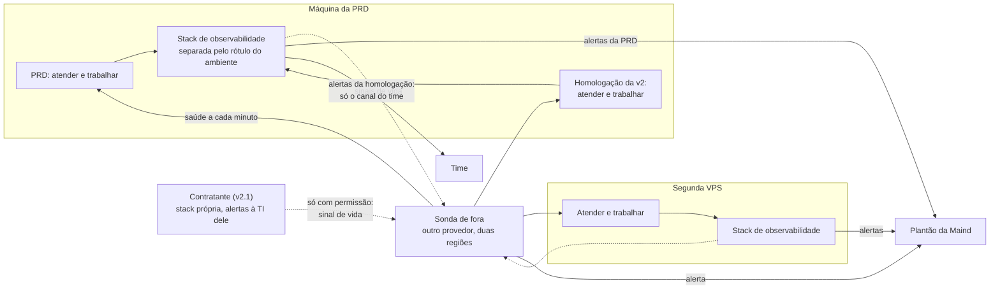

# Observabilidade do Horus v2

Situação: 🟢 escrito pelo arquiteto · seis decisões novas (`ARQ-069` a `ARQ-074`): duas 🟢, três ✅ do dono (`ARQ-069`, `ARQ-070` e `ARQ-071`, em 03/11/2026) e uma 🟡 com o dono · um item a devolver ao PO (A-22) · verificações V-12 e V-13 (seção 5).

Última atualização: 03/11/2026 (a cópia de segurança fora do Horus, `ARQ-086`: saem os sinais de vida e o alerta da cópia; o "pronto" confere o anel, `ARQ-087`; a homologação da v2 na stack da máquina da PRD, `ARQ-055`; nenhuma instância é produção real, `ARQ-056`: o plantão e a sonda de fora só com a primeira produção real; o "pronto" com um banco por organização, `ARQ-010` ✅; o envelope, `ARQ-016` ✅; uma stack por máquina, `ARQ-069` ✅; o custo também no painel do owner da instância, `ARQ-017` ✅; a meta de 99,9%, medida pela sonda de fora, `ARQ-014` ✅, com a réplica e a troca dadas pela nuvem da produção real, `ARQ-092` ✅; a saúde lida pelo Kubernetes e pela entrada do cluster, pela `ARQ-094`; a sonda de fora num serviço de monitoramento de outro provedor, pela `ARQ-070` ✅; os alertas em duas classes, com o plantão só para o que não pode esperar, pela `ARQ-071` ✅).

Este documento diz **o que o Horus v2 mede, onde a medida mora, quem é avisado e quando, e o que a telemetria nunca carrega**. Herda da rodada anterior: onde a stack roda e a sonda de fora da máquina (`ARQ-014`); a telemetria da homologação da v2 (`ARQ-055`) e a do contratante (`ARQ-060`); a fila da Meta, os envios recusados pelo teto e a nota de qualidade do número da Maind (documento 08); as falhas por provedor de IA (`ARQ-051`); a memória de cada serviço (`ARQ-056`). Como se publica e o que se faz num incidente é do [documento 10](10-publicacao-e-operacao.md); o custo, do documento 13.

- O **quê** e o **porquê** são do produto ([backlog estratégico](../produto/backlog-estrategico.md)). As decisões (`ARQ-nnn`) estão no [registro](02-registro-de-decisoes.md); as metas e os limiares internos, no [documento 03](03-metas-de-qualidade.md).
- O código da v1.xx se cita como `horus@318db52b:<caminho>`. As fontes desta rodada foram a stack (`horus@318db52b:infra/observabilidade/`: o `compose.yml`, a configuração do Alloy, as regras e os contatos dos alertas, o README), a telemetria da API (`horus@318db52b:apps/server/Horus.Api/Telemetria.cs`, `Endpoints/HealthEndpoints.cs`, `Horus.Core/Seguranca/Motor/MetricasDaSeguranca.cs`), a regra de observabilidade da v1.xx (`horus@318db52b:.claude/rules/infra/observabilidade.md`) e a análise das métricas (`horus@318db52b:docs/produto/observabilidade/analise-metricas.html`). Nada foi executado, e nenhuma máquina foi acessada.
- **Nenhum host, endereço de IP ou domínio aparece aqui**, nem o do Grafana: eles moram nas variáveis do GitHub, por regra do dono.
- ⚠️ A `D-138` vem sempre com o título curto: `D-138` ("A v1.xx fecha como MVP no HML…").

Legenda: 🟢 decidida pelo arquiteto · 🟡 proposta ao dono · 🔎 hipótese a confirmar · ♻️ vem da v1.xx · 🔧 vem e muda · 🆕 novo.

## 1. O que o tema precisa garantir

| Garantia | Objetivos | Decisões |
| --- | --- | --- |
| 📶 **Saber que a instância está no ar, medido de fora dela**, e saber logo quando ela cai | O1, O4 | `D-107` (a cobrança desde o primeiro cliente); `ARQ-014` ✅ |
| ⏱️ **Achar onde o tempo vai, sem prometer segundos** | O1, O6 | `D-125`, `D-126`, `D-132`; `ARQ-013` |
| 📥 **Nenhum trabalho parado sem alguém saber**: a fila e os envios | O2, O4 | `D-122`, `D-124`; `ARQ-005` |
| 🔐 **A volta de uma cópia se confere na subida**: o anel que voltou é o do banco | O2 | `ARQ-086` ✅, `ARQ-087` |
| 📱 **O WhatsApp dentro das regras da Meta**: o teto de mensagens, a nota de qualidade, a janela | O1, O4 | `D-097`, `D-124`; `ARQ-047` 🟡, `ARQ-048` a `ARQ-050` |
| 🧠 **A memória de cada instância e de cada serviço medida, sem teto**, e o aviso de quando trocar de máquina | O1, O3, O4 | `ARQ-016` ✅, `ARQ-056` ✅ |
| 💸 **O custo de cada organização antes da fatura** | O6, O7 | `D-062`, `D-063`, `D-097`; `ARQ-017` ✅ |
| 🔒 **A telemetria nunca carrega conteúdo, pessoa como rótulo nem valor de claim** | O2 | `D-082`, `D-090`, `D-093`; a regra da v1.xx (`horus@318db52b:.claude/rules/infra/observabilidade.md`) |
| 🏢 **O contratante decide o que sai da casa dele** | O8 | `D-010`, `D-017`, `D-040`; `ARQ-060` 🟡 |

## 2. As decisões

| Decisão | O que decide | Situação |
| --- | --- | --- |
| `ARQ-013` | O tempo da resposta medido por etapa, modo e canal, com limiares internos | 🟢 |
| `ARQ-014`, `ARQ-017` | 99,9% medidos de fora; o custo por organização, no painel do owner da instância e com aviso à Maind acima de um limiar | ✅, ✅ |
| `ARQ-009`, `ARQ-035` | O rastro e o registro de acesso fora da telemetria; a telemetria guardada 30, 14 e 7 dias | 🟢, ✅ |
| **`ARQ-069`** | **A stack de observabilidade roda em cada máquina, para as instâncias dela, como no contratante** | ✅ |
| **`ARQ-070`** | **A sonda de fora é um serviço de monitoramento de outro provedor, a cada minuto e de mais de uma região, que também recebe os sinais de vida de cada instância** | ✅ |
| **`ARQ-071`** | **O que acorda alguém a qualquer hora é o que ameaça a disponibilidade, os dados ou a segurança; o resto espera o horário comercial; a homologação nunca toca o plantão** | ✅ |
| **`ARQ-072`** | **O que se mede é um catálogo fechado, por tema, com a saúde em dois níveis e os tempos medidos até o teto real** | 🟢 |
| **`ARQ-073`** | **A telemetria da v2 herda inteira a regra da v1.xx e acrescenta o número de WhatsApp, o endereço de e-mail, o texto das mensagens e o recorte de acesso; a organização é rótulo só numa lista fechada** | 🟢 |
| **`ARQ-074`** | **A telemetria do contratante fica na casa dele: a Maind vê só com o acesso que ele conceder, e um sinal de vida sem dado sai só se o contrato permitir, nunca no "tudo dentro"** | 🟡 |

## 3. Os componentes e a responsabilidade de cada um

### 3.1 A observabilidade de hoje

| Peça | Hoje | Onde está |
| --- | --- | --- |
| **A stack** | Nove containers na máquina da PRD: o Alloy, o Prometheus (30 dias), o Loki (14), o Tempo (7), o Grafana e quatro exportadores (máquina, containers, Postgres e SQL Server); toda porta no loopback; o Grafana sai pelo Nginx, com HTTPS | `horus@318db52b:infra/observabilidade/compose.yml` |
| **Quem manda telemetria** | A PRD e o HML da v1.xx, para o mesmo Alloy, separados pelo rótulo do ambiente que o próprio código carimba; a segunda VPS **não tem observabilidade** | `horus@318db52b:apps/server/Horus.Api/Telemetria.cs`; o plano do zero (`horus@318db52b:docs/superpowers/plans/2026-10-27-deploy-do-zero-da-vps.md`) |
| **As métricas** | As do ASP.NET Core, do cliente HTTP e do runtime; o tempo até o primeiro token, com histograma que **para em 30 segundos**; seis medidas do motor da Semântica de Segurança, sem organização nem pessoa; cinco medidas do Broadcast do OpenRouter, com a organização, o ambiente e a função em conjunto fechado | `horus@318db52b:apps/server/Horus.Api/Telemetria.cs`, `Horus.Core/Seguranca/Motor/MetricasDaSeguranca.cs`, `infra/observabilidade/alloy/config.alloy` |
| **Os logs** | Os da API, por OTLP; o journald só do serviço da PRD; o log do Nginx do site da PRD em JSON, com o IP e sem o token de convite | `horus@318db52b:infra/observabilidade/alloy/config.alloy`, `nginx/log-json.conf` |
| **A sonda** | Na mesma máquina, a cada 30 segundos, contra o endereço público da PRD: não enxerga a máquina caída | `horus@318db52b:infra/observabilidade/alloy/config.alloy` |
| **A saúde** | Responde "ok" ou "degradado", **sempre com sucesso**: com o banco fora, a sonda, que só confere o sucesso, segue verde | `horus@318db52b:apps/server/Horus.Api/Endpoints/HealthEndpoints.cs` |
| **Os alertas** | Cinco regras: a API fora do ar; erros 5xx acima de 1% em 5 minutos; um endpoint lento (fora a rota das mensagens); o disco acima de 85%; as regras de segurança regrediram, cuja prova de ponta a ponta está pendente. As duas sobre métrica da API excluem o HML. Avaliadas pelo Grafana na própria máquina | `horus@318db52b:infra/observabilidade/grafana/provisioning/alerting/regras.yml` |
| **Quem é avisado** | Um grupo do Telegram, **só das 10h às 17h**, todos os dias (decisão do dono de 31/08/2026); fora disso, o alerta espera o horário | `horus@318db52b:infra/observabilidade/grafana/provisioning/alerting/contatos.yml` |
| **Os painéis** | Sete: API, chat, consultas ao SQL Server, máquina, OpenRouter, Postgres e SQL Server | `horus@318db52b:infra/observabilidade/dashboards/` |
| **O que não se mede** | A fila (não existe), o WhatsApp (não existe), as cópias (não existem), a memória de cada serviço (o painel de memória da API está praticamente vazio) e o custo por organização a partir do registro do Horus (só o painel do provedor, que mostra 60% das chamadas como "sem-org") | `horus@318db52b:docs/produto/observabilidade/analise-metricas.html` |

O que a v1.xx já acertou fica: as portas no loopback, o rótulo do ambiente, os limites explícitos de histograma, o corte do texto do SQL do banco da aplicação e o da consulta restrita que falhou, o conjunto fechado de funções conferido por teste (`horus@318db52b:infra/testes/test_funcoes_no_alloy.py`). As três armadilhas que ela pagou viram regra: o rótulo do serviço difere por ferramenta; histograma em segundos precisa de limites; uma série com identidade instável fica "eternamente em 1" (`horus@318db52b:.claude/rules/infra/observabilidade.md`).

### 3.2 Onde a stack roda (`ARQ-069` ✅)

| Instância | A stack | Para onde vão os alertas | Retenção |
| --- | --- | --- | --- |
| **PRD** | Na máquina da PRD, como hoje | O plantão e o canal do time (`ARQ-071`) | 30, 14 e 7 dias (`ARQ-035`) |
| **Homologação da v2** | Na stack da máquina da PRD, pelo rótulo do ambiente, como o HML de hoje (`ARQ-055`) | Só o canal do time, só no horário comercial | Igual |
| **Segunda VPS** | Na máquina dela, nova (hoje não há) | O plantão e o canal do time | Igual |
| **Contratante (v2.1)** | Na máquina dele | A TI do contratante (`ARQ-074`) | A que ele escolher |

- **O roteiro da stack vai junto da imagem e do chart** (`ARQ-094`), e o provisionamento do zero a instala, como o plano do zero já supunha ("Observabilidade e ingestão contínua entram no 'do zero'?", pergunta 4).
- **A memória** da stack é de uns 4 GB em cada máquina 🔎, dividida com as instâncias, sem teto (`ARQ-056`); na máquina da PRD, a mesma stack serve à PRD, ao HML da v1.xx e à homologação da v2.
- **O Broadcast do OpenRouter** continua indo só à stack da PRD, como conferência da conta do OpenRouter da Maind. Ele é configurado por conta, e a chave de cada conexão pode ser de outra conta (a limitação escrita na regra da v1.xx); a medida do custo passa a ser o registro do próprio Horus (3.5).
- **O acesso ao Grafana** de cada instância é por conta nominal, só da operação da Maind (`ARQ-066`): a telemetria leva os identificadores das pessoas no trace e no log, o texto das consultas ao banco do cliente e o IP no log do Nginx.

### 3.3 A sonda de fora e os sinais de vida (`ARQ-070` ✅)

| O que a sonda confere | A cada | "Fora" quando |
| --- | --- | --- |
| A saúde "pronto" da PRD e da segunda VPS | 1 minuto, de duas regiões | Falha dois minutos seguidos nas duas regiões; é essa conta que mede os 99,9% (documento 03, 2.1) |
| A saúde "pronto" da homologação | 1 minuto | Só para saber: a homologação não tem meta |

**Os sinais de vida** (o "homem morto": quem está vivo avisa, e o silêncio vira alerta):

| Quem manda | A cada | O que o silêncio quer dizer |
| --- | --- | --- |
| O caminho dos alertas da stack de cada instância | 1 minuto | Ninguém está vigiando aquela instância: a stack caiu, ou a máquina |
| O papel "trabalhar" | 5 minutos | A fila parou: agendamentos, agentes e envios não andam |
| A faxina diária | Por dia | Os prazos da `ARQ-035` não estão sendo aplicados |

- **O silêncio de quem vigia deixa de ser silencioso.** Hoje os alertas são avaliados pelo Grafana na própria máquina: se a máquina cai, ninguém avisa. Com a sonda de fora e os sinais de vida, o alerta não depende de nada da instância.
- **A sonda vê só a saúde**, que não expõe configuração nem dado, como a da v1.xx já não expõe.
- **O relatório mensal de disponibilidade** sai do serviço da sonda e vai ao dono; é a medida dos 99,9% num contrato.
- **A sonda de dentro da v1.xx fica**, para o painel da máquina.
- **A cópia de cada instância é da infra dela** (`ARQ-086`): o Horus não manda sinal de vida da cópia, e a infra da instância pode mandar o dela ao mesmo serviço.

### 3.4 A saúde em dois níveis (`ARQ-072` 🟢)

| Nível | Responde que sim quando | Quem usa |
| --- | --- | --- |
| **Vivo** | O processo responde | O Kubernetes, para reiniciar a réplica travada (`ARQ-094`) |
| **Pronto**, do "atender" | O banco mestre responde com o login da aplicação, ele e os bancos das organizações estão na versão de migração que o pacote espera (um banco de organização que não responde fecha só aquela organização, `ARQ-088`), e o anel de chaves abre o segredo de prova gravado no banco (`ARQ-087`) | A sonda de fora, a troca de versão e a entrada do cluster, que só manda tráfego à réplica pronta |
| **Pronto**, do "trabalhar" | O mesmo, e o sinal de vida dele no banco está em dia; só no loopback | A troca de versão; o alerta da fila parada |

O "pronto" **falha de verdade** quando não está pronto. Hoje a saúde responde sucesso com o banco fora (`horus@318db52b:apps/server/Horus.Api/Endpoints/HealthEndpoints.cs`), e a sonda, que confere só o sucesso, não vê a queda do banco.

Com o anel que não abre o segredo de prova, o motivo vai ao log e à medida do par (3.5), e nunca à resposta da saúde, que não expõe configuração; a volta de uma cópia sem o anel certo aparece na primeira subida (documento 10, 3.6).

### 3.5 O que se mede (`ARQ-072` 🟢)

Cada medida tem um dono (o componente que a produz), uma pergunta que ela responde e rótulos só de conjuntos fechados, declarados num catálogo único do componente de telemetria da Fundação (documento 04). Nenhuma medida leva pessoa, conteúdo nem valor de claim (3.7).

| Tema | O que se mede | Rótulos | A pergunta que responde |
| --- | --- | --- | --- |
| **Disponibilidade** | A sonda de fora; a saúde em dois níveis; os reinícios de cada serviço | Instância | Está no ar? Desde quando caiu? |
| **Tempo** (`ARQ-013`) | O primeiro sinal de progresso, o primeiro texto e o fim de cada resposta; o tempo de cada etapa | Modo, canal, etapa, ambiente | Onde o tempo vai: o modelo, o banco do cliente ou o Horus? |
| **Fila** | Os trabalhos pendentes, a idade do mais antigo, os concluídos, as novas tentativas e as desistências por motivo; o atraso entre o horário marcado e o começo de cada rodada | Tipo de trabalho, prioridade, motivo | Algum aviso está parado? O pico de segunda cabe? |
| **WhatsApp e a Meta** | O tempo até a confirmação; a idade do envio mais antigo; os envios por desfecho (enviado, entregue, lido, falhou) e por categoria de recusa (o teto de mensagens, a janela fechada sem modelo, o modelo não aprovado, o número sem WhatsApp, a conta bloqueada ou sem pagamento, outra); as notificações com assinatura inválida e as repetidas descartadas; a nota de qualidade e o teto de cada conta; os envios pela conta da Maind | Desfecho, categoria, tipo de mensagem; a organização só na nota, no teto e nos envios pela conta da Maind | A confirmação sai em até 10 segundos? Alguma conta está em risco? Uma organização está rebaixando a conta de todos? |
| **E-mail** | Os envios aceitos e recusados pelo servidor; o orçamento do dia usado | Uso (recuperação, aviso, convite, conector) | O e-mail está saindo? O plano cabe (V-02, documento 08)? |
| **IA** | As chamadas por desfecho (certo, limite de taxa, indisponível, tempo esgotado, credencial recusada, sem crédito, recusa de conteúdo, outra); as novas tentativas antes do primeiro texto (`ARQ-051`); o tempo até o primeiro texto | Provedor, função (as dezoito, `ARQ-031`), desfecho | Um provedor está falhando? Para todos ou para uma função? |
| **Custo** | O custo do dia de cada organização, por componente (IA, WhatsApp, e-mail), a partir do registro do próprio Horus, e não do painel do provedor | Organização, componente | Quanto cada organização custa antes da fatura (`ARQ-017`)? |
| **Memória e máquina** | A memória de cada instância e de cada serviço (atender, trabalhar, Postgres, SQL Server, a stack), sem teto (`ARQ-056`); as mortes por falta de memória; a swap; o disco; a CPU; a memória do runtime do .NET; os navegadores sem tela ao mesmo tempo e o tempo de cada PDF e imagem | Serviço | Alguma instância está tomando a máquina? Quando trocar de máquina (documento 09, 3.3)? |
| **Banco e anel** | As conexões e o tamanho; a conferência do par banco e anel na subida (`ARQ-087`) | — | O banco cabe? O anel que voltou é o do banco? |
| **Segurança** | As seis medidas do motor da v1.xx; as consultas bloqueadas por falta de organização em uso (a falha fechada da `ARQ-034`); os "pode?" negados por camada do avaliador (`ARQ-039`) | Motivo, camada | O isolamento está segurando? Alguém está tentando? |
| **Certificados** | Os dias até vencer: o HTTPS de cada domínio e o certificado do anel (`ARQ-067`) | Qual certificado | Algum vai vencer sem ninguém ver? |

- **Os limites dos histogramas de tempo vão até 300 segundos**, o teto real (os 5 minutos de espera pelo modelo e os 300 segundos do Nginx, documento 03, seção 4), e não param mais nos 30 que hoje escondem 27,6% das respostas medidas.
- **A medida de autonomia não é telemetria**: ela mora no banco, nos fatos de uso (`ARQ-029`), e a telemetria só conta.
- **Os painéis**: os sete de hoje, mais o da fila, o do WhatsApp, o dos certificados e o da capacidade, que mostra toda semana os gatilhos da troca de máquina (documento 09, 3.3).

### 3.6 Os alertas (`ARQ-071` ✅)

**Até a primeira produção real**, fica a regra de hoje: os alertas vão ao canal do time, das 10h às 17h, e ninguém é acordado; nenhuma instância de hoje é produção real (o dono, em 03/11/2026, `ARQ-056`). A tabela abaixo é a da primeira produção real.

**Os que acordam o plantão, a qualquer hora** (pelo Telegram e por e-mail):

| Alerta | Dispara quando 🔎 | Desde |
| --- | --- | --- |
| Instância fora do ar | A sonda de fora falha dois minutos seguidos, nas duas regiões | 🔧 a "API fora do ar", agora de fora |
| Um sinal de vida faltou | A stack, o "trabalhar" ou a faxina não avisaram no prazo (3.3) | 🆕 |
| A fila parada | Há trabalho pendente e nenhum concluído em 10 minutos, ou o turno do WhatsApp mais antigo passou de 5 minutos | 🆕 |
| Um serviço morto por falta de memória, ou reiniciando em laço | Uma morte, ou três reinícios em 15 minutos | 🆕 |
| O disco quase cheio | Acima de 95% | 🔧 do alerta de 85% |
| Um sinal de segurança | As regras de segurança regrediram; uma consulta bloqueada por falta de organização em uso (é sinal de defeito no isolamento) | 🔧 a regra da v1.xx, mais o isolamento |
| Um certificado vencendo | A menos de 7 dias | 🆕 |

**Os que esperam o horário comercial**, das 10h às 17h, como a decisão do dono de 31/08/2026:

| Alerta | Dispara quando 🔎 | Desde |
| --- | --- | --- |
| Erros 5xx acima do normal | Acima de 1% em 5 minutos | ♻️ |
| O tempo piorou | O p95 da semana acima de 1,5 vez a referência, por modo; a confirmação do WhatsApp acima de 10 segundos no p95; uma rodada começou mais de 10 minutos depois do horário (documento 03, 2.4) | 🔧 do "endpoint lento", que deixa de excluir a conversa |
| O WhatsApp em risco | Envios recusados pelo teto; a nota de qualidade de uma conta caiu; o teto de uma conta baixou | 🆕 |
| O e-mail recusado | Recusas acima de 5% em uma hora, ou o orçamento do dia acima de 80% | 🆕 |
| Um provedor de IA falhando | Falhas acima de 5% das chamadas em 10 minutos | 🆕 |
| O custo acima do limiar | O mês de uma organização acima do limiar dela, ou a semana acima do dobro da média das quatro anteriores (`ARQ-017`) | 🆕 |
| A memória da máquina alta | A máquina acima de 85% da memória por 15 minutos; a swap acima de 25% | 🆕 |
| O disco cheio | Acima de 85% por 15 minutos | ♻️ |
| Um certificado vencendo | A menos de 30 dias | 🆕 |
| A capacidade | Um gatilho da troca de máquina disparou na semana (documento 09, 3.3) | 🆕 |

- **A homologação** manda só ao canal do time, só no horário, e nunca ao plantão; a segunda VPS é produção e segue as duas classes.
- **Quem está no plantão** é uma escala da Maind; o responsável de cada incidente sai dela (`ARQ-068`).
- **Cada alerta que acorda se prova na homologação**, provocado e visto chegando, antes de valer: a regra de regressão da segurança da v1.xx nunca foi vista disparar (`horus@318db52b:.claude/rules/infra/observabilidade.md`).
- **Os limiares são hipótese** 🔎 e se calibram com a primeira medição da `P-002` (documento 03) e com o primeiro mês da homologação.

### 3.7 O que a telemetria nunca carrega (`ARQ-073` 🟢)

| O que nunca vai à telemetria | Por quê | Como se garante | Desde |
| --- | --- | --- | --- |
| **O conteúdo da conversa**: a pergunta, a prosa, os blocos, as chaves | A regra da v1.xx | Nenhuma medida, log ou trace o leva | ♻️ |
| **Pessoa e conversa como rótulo de métrica** | Cardinalidade; elas vão só ao trace e ao log | O catálogo das medidas | ♻️ |
| **O valor de claim**, no texto do SQL, no log, no trace e na métrica | A segurança por pessoa | Os dois cortes da v1.xx: o trace da consulta restrita que falhou sai antes da exportação, e o log das análises de segurança fica no banco | ♻️ |
| **O texto do SQL do banco da aplicação** | A regra da v1.xx | Os dois mecanismos de hoje, um no trace e outro no log | ♻️ |
| **O número de WhatsApp** | É credencial (documento 07, 3.1) e dado pessoal | Só o identificador interno da ligação; o diagnóstico de um número se faz no banco | 🆕 |
| **O endereço de e-mail** | Dado pessoal | Só o domínio, como o enviador de hoje já faz (`horus@318db52b:apps/server/Horus.Core/Email/EnviadorSmtp.cs`) | 🔧 |
| **O texto das mensagens da Meta, o conteúdo dos artefatos, as instruções e o JSON dos agentes** | Conteúdo | Só tipos, tamanhos e desfechos | 🆕 |
| **O recorte de acesso de uma liberação** | Ele vai só ao rastro (`ARQ-042`) | O catálogo e o teste | 🆕 |
| **O rastro e o registro de acesso** | Moram no banco, com o prazo do owner e o de 6 meses (`ARQ-009`, `ARQ-035`) | Nenhum componente os exporta | 🆕 |
| **Os segredos**: os tokens da Meta, a assinatura das notificações, as chaves | Segurança | Nenhum log os escreve; o teste de vazamento os procura | 🔧 |

**O que fica, de propósito:** o texto do SQL do banco do cliente no trace (decisão do dono de 31/08/2026, para diagnosticar o Planejador); o IP no log do Nginx por 14 dias, para investigar abuso e erro (`horus@318db52b:infra/observabilidade/nginx/log-json.conf`); os identificadores da organização, da pessoa e da conversa no trace e no log.

**A organização como rótulo de métrica**, só nesta lista fechada: o custo por organização e componente; a nota, o teto e os envios recusados da conta de WhatsApp de cada organização; os envios pela conta da Maind, por organização; o painel do Broadcast do OpenRouter, como hoje. Organizações são dezenas, e o número não cresce com o uso (a exceção que a regra da v1.xx já abre para o custo).

**Como se garante:**
- O catálogo único das medidas e dos rótulos, com os conjuntos fechados (o canal, o modo, a etapa, as dezoito funções, o provedor, a categoria de falha, o tipo de trabalho, a prioridade, o ambiente); um teste de arquitetura reprova a medida com rótulo fora do catálogo, como o teste das funções no Alloy faz hoje.
- Um teste de vazamento roda um turno do WhatsApp e uma entrega por conector com um número e um e-mail de prova, no coletor em memória, e confere que nenhum dos dois aparece em log, trace ou métrica (o molde é o teste da ordem dos processadores, que no código é o `TelemetriaDoMotorTests`, `Os_processadores_que_tiram_do_export_vem_antes_do_exportador`; a citação foi corrigida em 02/11/2026, documento 12, 3.6).
- Afrouxar qualquer linha desta regra é decisão do dono.

### 3.8 A homologação e o contratante (`ARQ-069` ✅, `ARQ-074` 🟡)

- **A homologação da v2** fica na stack da máquina da PRD, como o HML de hoje (`ARQ-055`, `ARQ-069`). O clone da PRD mantém os mesmos identificadores de organização (`horus@318db52b:infra/observabilidade/README.md`, "O ambiente no painel do OpenRouter"): o que separa a telemetria da homologação da PRD é o rótulo do ambiente, presente no recurso de toda medida, log e trace, e cada painel e cada alerta filtra por ele; o teste do catálogo reprova a telemetria sem o rótulo (documento 12).
- **O contratante** (`ARQ-074`), na v2.1: a stack é a mesma, na máquina dele, e os alertas vão à TI dele. A Maind vê a telemetria só numa sessão de suporte, com o acesso que ele conceder. No modo "com serviços externos autorizados" e se o contrato permitir, a instância manda à sonda da Maind um sinal de vida com a versão do pacote, a saúde, a idade da fila e as contagens de erro por categoria, sem organização, pessoa, conteúdo nem endereço. No "tudo dentro" (`D-010`), nada sai.

### 3.9 Os componentes

| Componente | Módulo | Responsabilidade | Situação |
| --- | --- | --- | --- |
| Telemetria e medição | Fundação | O catálogo das medidas e dos rótulos, os processadores que cortam o que não pode sair, o carimbo do ambiente | 🔧 `horus@318db52b:apps/server/Horus.Api/Telemetria.cs` |
| Saúde | Fundação | O "vivo" e o "pronto" de cada papel | 🔧 `horus@318db52b:apps/server/Horus.Api/Endpoints/HealthEndpoints.cs` |
| Sinais de vida | Fundação, no papel "trabalhar" | Avisam a sonda de fora que a fila e a faxina andam | 🆕 |
| Medidas da fila | Fundação | Os pendentes, a idade, as tentativas e as desistências por tipo e prioridade | 🆕 (`ARQ-005`, `ARQ-095`) |
| Medidas da porta da Meta | Fundação | A confirmação, os envios, as recusas, a nota e o teto de cada conta | 🆕 (`ARQ-048`) |
| Medidas do custo | Dados e IA | O custo do dia por organização e componente, a partir do registro do Horus | 🔧 do consumo por chamada (`horus@318db52b:apps/server/Horus.Api/GravadorDeConsumoDeIa.cs`) |
| Stack de observabilidade | Instância | O Alloy, o Prometheus, o Loki, o Tempo, o Grafana e os exportadores, numa máquina, com o roteiro no pacote | ♻️ `horus@318db52b:infra/observabilidade/` |
| Sonda de fora | Fora das instâncias | A saúde de cada instância a cada minuto, os sinais de vida e o relatório mensal | 🆕 (`ARQ-070`) |
| Alertas e contatos | Instância | As duas classes, os destinos e os horários | 🔧 `horus@318db52b:infra/observabilidade/grafana/provisioning/alerting/` |
| Painéis | Instância | Os sete de hoje, mais a fila, o WhatsApp, os certificados e a capacidade | 🔧 `horus@318db52b:infra/observabilidade/dashboards/` |

## 4. O que vem da v1.xx e o que não vem

| Peça da v1.xx | Destino | Por quê |
| --- | --- | --- |
| A stack inteira, as portas no loopback e as retenções de 30, 14 e 7 dias | ♻️ Ficam | `ARQ-001`, `ARQ-035` |
| A regra do que a telemetria nunca carrega, com os cortes do SQL da aplicação e da consulta restrita | ♻️ Fica inteira, e se aperta | `ARQ-073` |
| O rótulo do ambiente carimbado pelo código e o conjunto fechado das funções | ♻️ Ficam | `ARQ-072` |
| As medidas do motor de segurança e o alerta de regressão | ♻️ Ficam, com a prova de ponta a ponta antes de valer | `ARQ-071` |
| O Broadcast do OpenRouter | ♻️ Fica só na PRD, como conferência da conta | `ARQ-069` |
| A stack única para a PRD e o HML | ♻️ Fica: uma stack por máquina, com a homologação da v2 pelo rótulo do ambiente | `ARQ-069` |
| A sonda na mesma máquina | 🔧 Fica para o painel; a medida de disponibilidade vem da sonda de fora | `ARQ-070` |
| A saúde que responde sucesso com o banco fora | ❌ Sai: o "pronto" falha de verdade | `ARQ-072` |
| O histograma do primeiro token que para em 30 segundos | ❌ Sai: os limites vão até 300 segundos | `ARQ-013`, `ARQ-072` |
| O alerta de lentidão que exclui a rota das mensagens | 🔧 A conversa entra pela medida do tempo por modo, e não pela duração da requisição | `ARQ-013`, `ARQ-071` |
| Todos os alertas só das 10h às 17h | 🔧 Fica para a classe do horário comercial; os que ameaçam a disponibilidade, os dados ou a segurança acordam o plantão | `ARQ-071` |
| O painel do provedor como medida do custo por organização | 🔧 Fica como conferência; a medida é o registro do Horus | `ARQ-017`, `ARQ-072` |
| A segunda VPS sem observabilidade | ❌ Sai: ganha a stack dela | `ARQ-069` |

## 5. Os riscos e o que falta decidir

| Risco | Por quê | O que se faz |
| --- | --- | --- |
| 🧑‍🚒 **O plantão pede gente** | Um alerta a qualquer hora precisa de alguém de escala | A escala é da Maind; o custo vai ao documento 13; os alertas que acordam são poucos de propósito |
| 🔕 **Alerta demais cansa** | Os limiares são hipótese | Calibrar com a `P-002` e com o primeiro mês da homologação; cada alerta que acorda é provado antes de valer |
| 🧭 **Uma stack por máquina** | A Maind olha mais de um Grafana | A sonda de fora é a visão única de "está no ar"; reabrir a `ARQ-069` se as instâncias passarem de três |
| 🗃️ **A perda da máquina leva a telemetria dela** | O estudo de uma pane total fica com a sonda e com os alertas já enviados | Aceito; a opção 2 da `ARQ-069` resolve, com uma máquina a mais |
| 🏷️ **A homologação se mistura à PRD no painel** | As duas dividem a stack da máquina, e o clone mantém os mesmos identificadores de organização | O rótulo do ambiente em toda telemetria, conferido pelo teste do catálogo; os alertas da homologação só ao canal do time (`ARQ-071`) |
| 📉 **A conta da Maind é de todos** | O teto e a nota de qualidade se dividem entre as organizações que a autorizam (documento 08) | A nota, o teto e os envios por organização são medidos, e a queda da nota avisa a Maind |
| 🏷️ **A lista das medidas com organização cresce sem ninguém ver** | Cada exceção abre cardinalidade | A lista é fechada no catálogo e no teste; acrescentar é decisão do arquiteto, registrada |
| 🧪 **Um alerta que nunca disparou** | A regra de regressão da segurança foi escrita e nunca vista disparar | A prova de cada alerta que acorda na homologação, no M0 |
| 📡 **O Broadcast só vê a conta da Maind** | A chave de cada conexão pode ser de outra conta | A medida do custo é o registro do Horus (3.5) |

**Verificações pendentes** (nada disso foi rodado nesta rodada):

| Nº | O que conferir | Quem | Antes de |
| --- | --- | --- | --- |
| **V-12** | O serviço da sonda de fora: um plano com conferência a cada minuto, de mais de uma região, com os sinais de vida e o relatório mensal, e o preço | O dono | A primeira produção real (M7) |
| **V-13** | Por quanto tempo a Meta reenvia uma notificação sem resposta, e como ela avisa a mudança da nota de qualidade e do teto de cada número | O arquiteto, na documentação pública da Meta | M4 |

(As verificações V-01 a V-11 são dos documentos 08, 09 e 10.)

**O que falta decidir:**
- 🟡 Com o dono: `ARQ-074` (a telemetria do contratante).
- Ao PO (documento 01, seção 9): **A-22** (quem fica sabendo quando um serviço da organização para).
- Documento 12: o teste do catálogo das medidas, o teste de vazamento e a prova de cada alerta que acorda na homologação.
- Documento 13: o custo da sonda de fora, da stack em cada máquina e do plantão.
