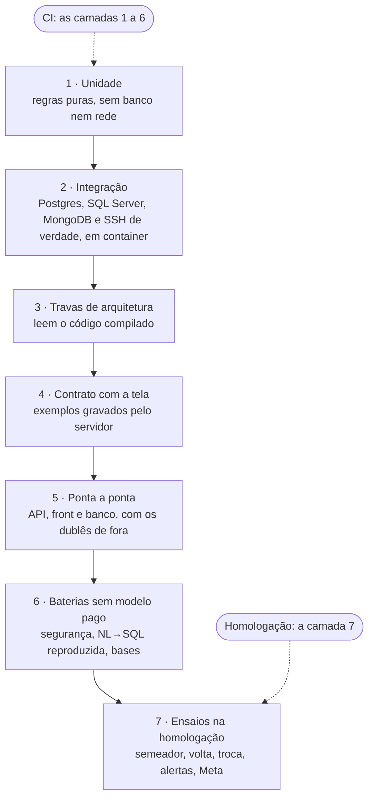
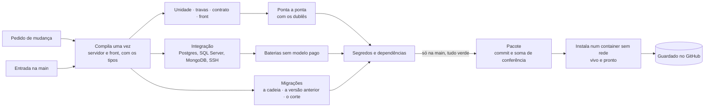

# Qualidade e testes do Horus v2

Situação: 🟢 escrito pelo arquiteto · oito decisões novas (`ARQ-075` a `ARQ-082`): seis 🟢 e duas ✅ do dono (`ARQ-081`, a bateria com modelo real, e `ARQ-082`, onde o CI roda, em 03/11/2026) · uma verificação nova (V-16, no [documento 14](14-conferencia-do-produto.md)).

Última atualização: 03/11/2026 (a conferência da volta, `ARQ-087`, no lugar do ensaio trimestral; sai o alerta da cópia, pela `ARQ-086`; o rótulo do ambiente no teste do catálogo e o provisionamento do zero numa máquina por hora, pela `ARQ-055`; a prova da falta de memória num serviço de prova, pela `ARQ-056`; o isolamento por banco e as migrações por organização, pela `ARQ-010` ✅ e pela `ARQ-088`; o CI num executor próprio na VPS de hoje até a primeira produção real, pela `ARQ-082` ✅; a conferência do semeador no lugar da da conversão, pela `ARQ-011` ✅ e pela `ARQ-089`; a bateria da segurança e a falha fechada dos canais novos para a v2.1, pela `ARQ-090` ✅; a bateria com modelo real, pela `ARQ-081` ✅; a imagem e o chart, pela `ARQ-094`, e os papéis em várias réplicas, pela `ARQ-095`; os alertas que acordam, pela `ARQ-071` ✅; o teste da saída da nuvem, pela `ARQ-096` ✅).

Este documento diz **como o Horus v2 se prova antes de cada publicação, sem chamar modelo de IA pago**: as camadas de teste, o que cada uma prova e onde roda, os dublês que tomam o lugar do que é de fora, as travas de arquitetura, o contrato entre a tela e o servidor, o CI que gera o pacote e as provas que as rodadas anteriores pediram. Como se publica e se volta uma versão é do [documento 10](10-publicacao-e-operacao.md); o que se mede e quem é avisado, do [documento 11](11-observabilidade.md); quanto custam o CI e a bateria com modelo real, do [documento 13](13-custo-de-operacao.md).

- O **quê** e o **porquê** são do produto ([backlog estratégico](../produto/backlog-estrategico.md)). As decisões (`ARQ-nnn`) estão no [registro](02-registro-de-decisoes.md).
- O código da v1.xx se cita como `horus@318db52b:<caminho>`. As fontes desta rodada foram os testes do servidor (`horus@318db52b:apps/server/Horus.Core.Tests/`), do front (`apps/web/`), de ponta a ponta (`e2e/`), da infraestrutura (`infra/testes/`) e das bases (`data/`), o `Horus.Evals`, o workflow de publicação e o `CLAUDE.md`. Nada foi executado, e nenhum modelo foi chamado.
- O nível de detalhe para na camada, na prova e na ferramenta que já está na stack (`ARQ-001`). O nome de cada teste, o código e a configuração do CI ficam para o desenvolvimento.
- ⚠️ A `D-138` vem sempre com o título curto: `D-138` ("A v1.xx fecha como MVP no HML…").

Legenda: 🟢 decidida pelo arquiteto · 🟡 proposta ao dono · 🔎 hipótese a confirmar · ♻️ vem da v1.xx · 🔧 vem e muda · 🆕 novo.

## 1. O que o tema precisa garantir

| Garantia | Objetivos | Decisões |
| --- | --- | --- |
| 🧪 **Nenhum teste chama modelo de IA pago**, nem no CI nem na máquina de quem desenvolve; o modelo real só roda com a autorização e o custo declarados pelo dono | O1, O7 | Pedido do dono de 02/11/2026; a prática da v1.xx (o provedor `mock` e a bateria com `--modelo-falso`, `horus@318db52b:CLAUDE.md`) |
| 🔢 **Os invariantes da resposta se provam a cada mudança**: os números vêm do banco, o parser é tolerante, há no máximo dois blocos, e toda resposta fecha com o `meta` | O1, O2 | `D-001`; os invariantes da v1.xx |
| 🛡️ **A segurança por pessoa e o isolamento entre organizações se provam, e não se lembram** | O2, O7 | `D-008`, `D-026`, `D-028`, `D-053`, `D-054`; `ARQ-010` ✅, `ARQ-032`, `ARQ-034`, `ARQ-088` |
| 🎯 **A mesma regra em todo canal**: a conversa, o popup, o WhatsApp, o board e o agente | O1, O4 | `D-088`, `D-095`, `D-098`; `ARQ-006`, `ARQ-023` |
| 📦 **O que vai à produção é o que o CI provou e a homologação aprovou**, byte a byte | O2, O8 | `D-017`; `ARQ-094`, `ARQ-061` |
| ⏯️ **Publicar não perde trabalho nem deixa a volta sem banco que ela leia** | O1, O4 | `D-122`, `D-124`; `ARQ-062`, `ARQ-063` |
| 🔒 **A telemetria nunca carrega conteúdo, pessoa como rótulo nem valor de claim** | O2 | `D-082`, `D-090`; `ARQ-072`, `ARQ-073` |
| 🔔 **O alerta que acorda alguém funciona de verdade**, provado antes de valer | O1, O4 | `D-107`; `ARQ-071` ✅ |
| 🧱 **As fronteiras dos módulos se sustentam** com catorze mfs sendo redesenhadas no mesmo código | Todos | `ARQ-003`, `ARQ-018`, `ARQ-019` |
| 🎪 **As bases de demonstração são o banco de prova de cada marco** | O6 | `D-021`; `MF-118:Bases de demonstração`; `ARQ-012` |

## 2. As decisões

| Decisão | O que decide | Situação |
| --- | --- | --- |
| `ARQ-018`, `ARQ-034`, `ARQ-037`, `ARQ-045`, `ARQ-073` | As regras estruturais que se provam por trava de arquitetura: a dependência entre módulos, o filtro por organização, o apagador de cada tabela, o inventário dos dados, o catálogo das medidas | 🟢 |
| `ARQ-094`, `ARQ-061` | O CI compila uma vez e gera a imagem e o chart; a produção só aceita a imagem que a homologação registrou | 🟢 |
| `ARQ-062`, `ARQ-063`, `ARQ-067` | As migrações compatíveis com a versão no ar; a troca que drena o trabalho em curso; a recifragem do cofre | 🟢, 🟢, ✅ |
| `ARQ-071`, `ARQ-072` | Os alertas que acordam o plantão, cada um provado na homologação; o catálogo do que se mede | ✅, 🟢 |
| **`ARQ-075`** | **Os testes da v2 têm seis camadas automáticas e uma de ensaios na homologação, e nenhuma chama modelo de IA pago** | 🟢 |
| **`ARQ-076`** | **O CI roda em todo pedido de mudança e em toda entrada na `main`, compila uma vez, roda as camadas sem segredo de produção e só gera o pacote com tudo verde** | 🟢 |
| **`ARQ-077`** | **Toda regra estrutural tem uma trava que lê o código compilado, com um caso plantado que ela precisa reprovar e uma lista de exceções que só encolhe** | 🟢 |
| **`ARQ-078`** | **O contrato entre a tela e o servidor se prova por exemplos que o servidor grava e os testes da tela usam** | 🟢 |
| **`ARQ-079`** | **Toda prova que uma decisão pede entra num catálogo de provas, com a decisão de origem e o marco, e o marco só fecha com as provas dele verdes** | 🟢 |
| **`ARQ-080`** | **Cada alerta que acorda o plantão se prova em três partes: a expressão, no CI; a regra, provocada na homologação; e o caminho, por uma mensagem de prova na produção** | 🟢 |
| **`ARQ-081`** | **A bateria com modelo real roda só fora do CI, antes do marco que muda o que vai ao modelo, com o custo declarado e a autorização do dono a cada rodada, e as respostas ficam gravadas para o CI reproduzir** |✅ |
| **`ARQ-082`** | **O CI roda num executor próprio na VPS de hoje durante a construção da v2 e passa aos executores hospedados do GitHub com a primeira produção real; o pacote fica nas versões publicadas do repositório** | ✅ |

## 3. Os componentes e a responsabilidade de cada um

### 3.1 Como a v1.xx se prova hoje

| Peça | Hoje | Onde está |
| --- | --- | --- |
| **Testes do servidor** | 440 arquivos e cerca de 6.100 testes declarados (5.180 fatos e 820 teorias, com 3.667 linhas de dados), em xUnit | `horus@318db52b:apps/server/Horus.Core.Tests/` |
| **O banco nos testes** | O Postgres 17 de verdade, em container descartável (Testcontainers), em 45 arquivos e em toda fábrica da API, que aplica a cadeia de 89 migrações; o **SQLite em memória**, criado sem as migrações, em 90 arquivos; o MongoDB e um túnel SSH em container; o SQL Server real em 11 arquivos, que **se pulam** quando não há SQL Server na máquina | `PostgresTestDb`, `TestDbFactory`, `SqlServerFactAttribute.cs` |
| **Testes do front** | 388 arquivos e cerca de 6.300 casos, em Vitest com jsdom; o `vue-tsc` confere os tipos no build | `horus@318db52b:apps/web/` |
| **Ponta a ponta** | 12 cenários em Playwright, com a API, o front e um Postgres próprios, em portas próprias, e as réguas de leiaute, que interceptam a rede | `horus@318db52b:e2e/`, `e2e/playwright.config.ts` |
| **As travas que leem o IL** | Provam que só o ponto único executa no banco do cliente, que só os conectores abrem conexão, que só os executores do motor chamam o ponto único, que um só componente lê cada bandeira; cada exceção envelhece, e um caso plantado prova que a trava reprova | `horus@318db52b:apps/server/Horus.Core.Tests/ArquiteturaDoMotorTests.cs`, `LeitoresDoCodigo.cs`, `PlantadosDaArquitetura.cs` |
| **A telemetria** | As métricas do motor só com rótulos de conjunto fechado; os processadores que tiram do export vêm antes do exportador; o SQL do banco da aplicação, o token do convite e a consulta restrita que falhou não saem | `TelemetriaDoMotorTests`, `TelemetriaTests` |
| **Os prompts** | O texto do reescritor e do verificador, a parte estável da instrução protegida e o plano do workflow presos a um hash por versão | `VersoesDosPromptsDoMotorTests`, `InstrucaoProtegidaTests`, `WorkflowNoEnvelopeTests` |
| **O contrato da API** | Nenhum pedido aceita campo de SQL, bloco, prosa ou claim; toda fábrica de teste deriva de uma só, e nenhuma manda e-mail; um vetor de exemplos é lido pelo teste do servidor e pelo do front | `ContratosDaApiTests`, `FabricasDaApiTests`, `Fixtures/cercas-da-tela.json` |
| **As migrações** | A cadeia inteira aplicada num banco vazio; a conferência de que o modelo não tem mudança pendente em 8 arquivos; 15 testes de migração específicos | `ApiTests`, `Migracao*Tests.cs` |
| **A IA nos testes** | O provedor `mock`, com texto fixo, registrado em todo ambiente e usado no ponta a ponta; 43 dublês próprios por teste | `horus@318db52b:apps/server/Horus.Core/Llm/MockLlmProvider.cs` |
| **A bateria da segurança** | O `Horus.Evals --modelo-falso`: 38 casos sobre uma base de referência que nasce e morre no `tempdb`, com códigos de saída de 0 a 4; o relatório com o modelo falso nunca vale como homologação | `horus@318db52b:apps/server/Horus.Evals/`, `data/seguranca/bateria.json` |
| **A bateria NL→SQL** | 106 casos, que chamam o Planejador **de verdade**, pelo OpenRouter, com a chave e uma variável de ambiente; não há modo com modelo falso | `horus@318db52b:tools/medicao-planejador/` |
| **A infraestrutura** | 12 arquivos de teste das decisões dos roteiros de publicação, de acesso e de provisionamento, e 4 baterias de shell com comandos falsos, sem máquina | `horus@318db52b:infra/testes/` |
| **As bases de demonstração** | Os verificadores do dado de cada vertical, a conferência da impressão digital e 13 arquivos de teste do kit comum | `horus@318db52b:data/` |
| **O CI** | **Não existe.** O único workflow publica, à mão, e não roda teste nenhum; o roteiro de troca só compila | `horus@318db52b:.github/workflows/deploy.yml`, `infra/redeploy.sh` |

O que a v1.xx já acertou vira regra da v2: o banco de verdade em container, a trava que lê o código compilado com o caso plantado, o hash dos prompts, a fábrica de teste única que proíbe e-mail, o vetor de exemplos lido pelos dois lados e a bateria da segurança sem modelo pago. O que falta é o que roda sozinho: hoje os cerca de 12.000 testes dependem de alguém rodá-los.

### 3.2 As camadas (`ARQ-075` 🟢)

| Camada | O que prova | Onde roda | Ferramenta (da stack) | Da v1.xx |
| --- | --- | --- | --- | --- |
| **1 · Unidade** | As regras puras: o avaliador combinação a combinação, o cálculo do nível efetivo, o parser tolerante, a regra das janelas da Meta, o rateio do custo | Em todo pedido de mudança | xUnit; Vitest | ♻️ |
| **2 · Integração** | O que depende de banco: o filtro por organização, a fila e a caixa de saída (trava por linha, repetição sem efeito em dobro, desistência), o rastro na mesma transação, as migrações, o cofre; as fontes de verdade (SQL Server, PostgreSQL, MongoDB, o túnel SSH) | Em todo pedido de mudança | xUnit com Testcontainers; o SQL Server Developer em container, licenciado para teste | 🔧 o SQL Server deixa de ser pulado: no CI, ele sobe em container |
| **3 · Travas de arquitetura** | As regras estruturais (3.4) | Em todo pedido de mudança | A leitura do IL e do PDB da v1.xx | 🔧 de quatro famílias para todas as da v2 |
| **4 · Contrato com a tela** | Que a tela e o servidor falam do mesmo jeito, rota a rota (3.5) | Em todo pedido de mudança | xUnit e Vitest, sobre os mesmos arquivos | 🔧 do vetor das cercas para todas as rotas |
| **5 · Ponta a ponta** | Os caminhos de ouro de cada mf, com o navegador de verdade, também na largura de celular (a linha 10 do inventário de lacunas); a imagem e o PDF pela mesma montagem | Na `main`, e no pedido de mudança que toca o front ou o motor | Playwright com Chromium; a API, o front e o Postgres próprios; os dublês de fora (3.3) | ♻️ os 12 cenários, mais um por mf da v2.0 |
| **6 · Baterias sem modelo pago** | A segurança por pessoa de ponta a ponta (o `Horus.Evals --modelo-falso`), na v2.1 (`ARQ-090`); a bateria NL→SQL reproduzida com as respostas gravadas (`ARQ-081`); a conferência das bases de demonstração sobre um recorte pequeno | Na `main`, e no pedido de mudança que toca o motor, a segurança ou as bases | O `Horus.Evals`; os verificadores de `data/` | 🔧 a NL→SQL ganha o modo reproduzido |
| **7 · Ensaios na homologação** | O que só uma máquina de verdade prova: o semeador das organizações de exemplo numa instância nova, a volta numa máquina nova, a troca de versão com trabalho em curso, os alertas que acordam, a regra de saída da máquina, a conta de ensaio da Meta (3.8) | Na homologação, no ritmo de cada ensaio | Os roteiros da operação | 🔧 o provisionamento de hoje |

- **Todo teste novo que toca o banco roda no Postgres**, nunca no SQLite: a fila usa trava por linha, o filtro por organização e as migrações são do Postgres, e o SQLite de hoje nem aplica a cadeia de migrações. Os 90 arquivos que usam o SQLite ficam como estão, numa lista que só encolhe, e saem quando o módulo deles se reorganizar.
- **Nenhuma camada sai para a internet.** A fábrica de teste única recusa qualquer chamada de rede para fora dos containers, como hoje ela já recusa o e-mail (`FabricasDaApiTests`): o teste que tentar chamar um provedor de IA, a Meta ou um servidor de e-mail falha. Assim, "sem modelo pago" deixa de ser cuidado e vira trava.
- **As bases de demonstração completas** (oito bases, cerca de 13,8 GB) não sobem no CI: lá vale um recorte pequeno, gerado pelos mesmos geradores determinísticos, e a base de referência do `Horus.Evals`. As completas são o banco de prova da homologação e da medida por etapa (`ARQ-013`).

### 3.3 Os dublês: o que toma o lugar de quem é de fora

| De fora | O dublê | O que ele permite provar | Desde |
| --- | --- | --- | --- |
| **Os provedores de IA** | O provedor `mock` e os dublês por teste; e o **modelo gravado**: a resposta de um modelo real, gravada uma vez, por caso, e reproduzida enquanto o texto do que vai ao modelo não mudar (`ARQ-081`) | O caminho inteiro da pergunta (o Planejador, a consulta, o reparo, o materializador, a leitura, o retorno e o fecho), sem custo e sem a variação do modelo | ♻️ o `mock`; 🆕 o modelo gravado |
| **A pesquisa na web** | Uma pesquisa falsa que devolve citações de prova, com link e data | A lista de fatos, a data "não identificada", a conferência que tira da prosa o link fora da lista (`ARQ-026`) | 🆕 |
| **A Meta** | A porta falsa da `ARQ-048`: notificações assinadas de prova, a notificação repetida, os status, as recusas por categoria, a janela fechada | O canal e o conector de WhatsApp de ponta a ponta, sem conta e sem custo | 🆕 |
| **O servidor de e-mail** | O enviador que só guarda na memória, e a fábrica de teste que proíbe o envio real | Os avisos, os convites e o conector de e-mail, com o desfecho | ♻️ |
| **O relógio** | O relógio substituível de hoje | As rodadas da agenda, a reserva do assento, os prazos da faxina, a janela de 24 horas | ♻️ |
| **As fontes dos clientes** | O SQL Server, o PostgreSQL, o MongoDB e o túnel SSH de verdade, em container | Os conectores, a guarda de rede, a consulta protegida e a "mais restritiva" de cada tecnologia, quando ela vier (v2.1) | ♻️ |
| **O navegador** | O Chromium do Playwright, de verdade | A imagem do WhatsApp e o PDF do board e do agente pela mesma montagem da tela (`ARQ-007`) | ♻️ |
| **A sonda de fora** | Um receptor falso dos sinais de vida | Que cada sinal de vida sai no prazo e cala quando o que ele vigia para (`ARQ-070`) | 🆕 |

**O que o dublê não prova:** a qualidade da resposta do modelo, as mudanças da Meta e o comportamento real de um provedor. Isso é da bateria com modelo real (`ARQ-081`), da conta de ensaio da Meta no M4 e da prova do Bedrock na AWS real no M2 (`ARQ-051`), todas com o custo declarado ao dono antes.

### 3.4 As travas de arquitetura (`ARQ-077` 🟢)

Cada trava lê o código compilado (o IL e, quando é preciso o caminho do arquivo, o PDB), como as do motor de segurança de hoje. **Toda trava tem um caso plantado**, uma violação de propósito, que ela precisa reprovar: a trava que nunca reprova nada não prova nada. E **toda trava tem uma lista de exceções que só encolhe**, com o porquê de cada uma, e a exceção que ninguém usa mais reprova o teste.

| Trava | O que ela reprova | Decisão | Desde |
| --- | --- | --- | --- |
| A dependência entre os módulos | Um módulo que chama outro acima dele, ou que não passa pela fachada | `ARQ-018`, `ARQ-019` | 🆕, sobre os leitores de hoje |
| A tabela do dono | Um módulo que lê ou escreve a tabela de outro | `ARQ-018` | 🆕 |
| O roteamento e o filtro por organização | A consulta de dado de organização que não abre o banco pelo roteamento, ou que pula o filtro | `ARQ-034`, `ARQ-088` | 🆕 |
| O apagador de cada tabela | A tabela com a marca da organização sem quem a apague | `ARQ-037` | 🆕 |
| O inventário dos dados | A entidade sem dono, categoria, finalidade e prazo declarados, ou com um prazo que contradiz a faxina | `ARQ-045` | 🆕 |
| O catálogo das medidas | A medida, ou o rótulo, fora do catálogo; a organização como rótulo fora da lista fechada | `ARQ-072`, `ARQ-073` | 🔧 do teste dos rótulos do motor |
| O papel de cada componente | O componente que guarda estado em memória sem declarar em que papel vive e se o estado é de todas as réplicas ou só da dele | `ARQ-095` | 🆕 |
| A saída da nuvem | O chart com um recurso fora da lista padrão do Kubernetes, ou o código com uma biblioteca própria de uma nuvem | `ARQ-096` | 🆕 |
| O avaliador | A rota ou o trabalho que decide permissão sem perguntar ao avaliador; a ação sem botão registrado | `ARQ-008`, `ARQ-039` | 🔧 do "toda ação tem linha na matriz" |
| A execução no banco do cliente | Executar ou abrir conexão fora do ponto único e dos conectores; chamar o preparo protegido fora das duas operações do motor; um pedido ao motor sem uma das cinco formas de "em nome de quem" | `ARQ-023`, `ARQ-032`, `ARQ-041` | 🔧 as travas de hoje, de quatro executores para duas operações |
| Os prompts | O texto que vai ao modelo mudou sem a versão e o hash mudarem | `ARQ-023`, `ARQ-081` | ♻️ |
| As funções de IA | A função que não está no roteador, no Alloy e no painel ao mesmo tempo | `ARQ-031` | ♻️ `horus@318db52b:infra/testes/test_funcoes_no_alloy.py` |

Como na v1.xx, a regra entra **reprovando só o que é novo**: o que o código de hoje já viola vai à lista de exceções, que só encolhe à medida que cada módulo se reorganiza (documento 04, seção 5).

### 3.5 O contrato com a tela (`ARQ-078` 🟢)

Hoje os tipos do front são escritos à mão, e só um vetor de exemplos (o das cercas da tela) é lido pelos dois lados. Na v2:

- **O servidor grava os exemplos.** Para cada rota, um teste do servidor grava num arquivo do repositório o pedido e a resposta de exemplo, serializados pelo próprio código de produção, inclusive os eventos da transmissão da resposta.
- **A tela os usa.** Os testes da tela e o cliente da API leem esses arquivos como dados de teste: um campo que o servidor renomeia muda o arquivo no mesmo pedido de mudança, e os testes da tela que dependem dele reprovam.
- **O arquivo desatualizado reprova.** Se o exemplo gravado não bate com o que o servidor serializa agora, o teste do servidor reprova até alguém regravar, à vista, no pedido de mudança.
- **O contrato de segurança continua**: nenhum pedido aceita SQL, bloco, prosa ou claim vindos da tela (`ContratosDaApiTests`), e a resposta não leva o que a tela não pode mostrar.

Assim a stack não ganha um gerador de código nem um formato de especificação novo: o contrato são os exemplos, que os dois lados leem.

### 3.6 O catálogo de provas (`ARQ-079` 🟢)

Cada decisão que pediu uma prova a tem aqui, com a camada e o marco em que ela passa a valer. **O marco só fecha com as provas dele verdes.** Uma prova nova entra no catálogo junto com a decisão que a pede.

| Prova | O que ela prova | Decisão | Camada | Marco |
| --- | --- | --- | --- | --- |
| **Isolamento por banco e por tabela** | Com duas organizações, o login da A não abre o banco da B nem o mestre; com o contexto da A apontado de propósito para o banco da B, o filtro não devolve nada, em toda tabela, nos dois papéis | `ARQ-010`, `ARQ-034`, `ARQ-088` | 2 | M0 |
| **As migrações por organização** | O passo migra o mestre e várias organizações; interrompido no meio e retomado, termina sem migrar nada duas vezes; a troca recusa enquanto um banco estiver atrás; a organização nova nasce na versão do pacote | `ARQ-062`, `ARQ-088` | 2 | M0 |
| **A falha fechada** | Sem organização em uso, a consulta não roda; a fonte do arquivo sem organização declarada não aparece em nenhuma | `ARQ-034` | 2 | M0 |
| **A fila** | Pega uma vez, com trava por linha; repete sem efeito em dobro; desiste com o motivo; reparte por organização; dá a vez a quem espera | `ARQ-005`, `ARQ-095` | 2 | M0 |
| **A compatibilidade das migrações** | Ver abaixo | `ARQ-062` | 2 e CI | M0 |
| **A troca com trabalho em curso** | Ver abaixo | `ARQ-063` | 2 e 7 | M0 |
| **O catálogo das medidas e o vazamento** | Ver abaixo | `ARQ-072`, `ARQ-073` | 3 e 2 | M0, crescendo até o M6 |
| **A saúde em dois níveis** | O "pronto" falha com o banco fora, com o login errado e com uma migração de corte posterior; aceita a versão do pacote e as posteriores compatíveis | `ARQ-072` | 2 | M0 |
| **O inventário dos dados** | A entidade sem declaração reprova | `ARQ-045` | 3 | M0 |
| **A exclusão da organização** | Uma organização completa, apagada, não deixa nada para trás | `ARQ-037` | 2 | M1 |
| **O avaliador** | Uma prova por leitura e por combinação: o estado, o tipo de assento, o papel, a carteira, as roles somadas e o escopo | `ARQ-039` | 1 e 2 | M1 |
| **O rastro na mesma transação** | A entrega e a abertura que falham não deixam rastro, e a que acontece sempre deixa | `ARQ-009` | 2 | M1 |
| **A conferência do semeador** | Num banco vazio, o semeador cria o McDonald's e a Global Fleet; as fontes abrem, os modelos semânticos passam pelos verificadores das bases, as regras compilam (na v2.1) e cada board recalcula com o modelo falso; rodado de novo, não duplica nada | `ARQ-089` | 2 | M1 a M7 |
| **O escopo único em cada superfície** | O bloco de outro escopo nunca aparece num board; a liberação grava o recorte no rastro | `ARQ-041`, `ARQ-042` | 2 | M2 e M5 |
| **A falha fechada nos canais novos** | O popup, o WhatsApp e o agente fecham como a conversa, com as mesmas frases | `ARQ-032` | 2 e 5 | v2.1 (`ARQ-090`) |
| **A bateria da segurança** | Os 38 casos, com o modelo falso, sobre a base de referência | `ARQ-032` | 6 | Todo marco da v2.1 (`ARQ-090`) |
| **A web com link e data** | A lista de fatos, a data não identificada, a prosa sem link de fora da lista | `ARQ-026` | 2 e 6 | M3 |
| **O componente de conversa** | O mesmo componente na tela de análise e no popup; fechar o popup não corta a resposta | `ARQ-020` | 4 e 5 | M4 |
| **A porta da Meta** | A notificação repetida não roda o turno duas vezes; a assinatura inválida é recusada; a confirmação passa à frente da fila; a janela fechada só envia por modelo | `ARQ-048`, `ARQ-049` | 2 e 5 | M4 |
| **O artefato e o conector** | O conector só transporta; cada destino deixa um registro; o que não cabe no canal não é entregue | `ARQ-022` | 2 | M6 |
| **A recifragem do cofre** | Ver abaixo | `ARQ-067` | 2 e 7 | Antes do M7 |
| **A regra de saída da máquina** | O serviço da API não alcança loopback, redes privadas, link-local nem CGNAT fora da lista | `ARQ-058` | 7 | M0 |
| **A volta conferida** | O Horus sobe sobre um banco restaurado: com o anel do mesmo par, fica "pronto"; com o anel de outro par, ou sem anel, o "pronto" falha com o motivo e nenhum segredo novo se grava; o comando que aceita um anel novo marca cada segredo como perdido e grava o segredo de prova novo | `ARQ-087` | 2 | M0 |
| **Os alertas que acordam** | Ver abaixo | `ARQ-071`, `ARQ-080` | CI, 7 e PRD | M0 |
| **O pacote sem saída** | A imagem sobe e responde num container limpo e sem rede, no CI, e num Kubernetes sem saída antes do M10 | `ARQ-094`, `ARQ-060` | CI e 7 | M0 (container) e M10 (máquina) |

**A compatibilidade das migrações** (`ARQ-062`), em quatro partes:
1. **A cadeia inteira** aplica num banco vazio, e o modelo não tem mudança pendente, como a v1.xx já confere.
2. **A prova da versão anterior:** o CI aplica as migrações novas sobre um banco preparado pela versão que está no ar (o último pacote aprovado na homologação) e roda contra ele os testes de integração e a saúde "pronto" daquela versão. Se a versão anterior não lê o banco novo, a migração não é compatível, e o pacote não sai. É a prova de que a volta de código continua possível.
3. **A regra de expandir e contrair:** uma trava lê as operações de cada migração e reprova a que apaga, renomeia ou estreita algo que a versão anterior ainda usa, salvo a migração de limpeza, que declara a versão que deixou de usar.
4. **A recusa do corte:** a migração de corte se declara no pacote, e um teste das decisões do roteiro prova que ele a recusa fora de uma janela, como os testes de hoje provam as decisões do roteiro de publicação (`horus@318db52b:infra/testes/test_subir_versao.py`).

A saúde "pronto" (`ARQ-072`) aceita a versão de banco que o pacote espera **e as posteriores compatíveis**, e falha numa anterior ou numa de corte posterior: é o que deixa a versão anterior no ar durante o passo das migrações.

**A troca com trabalho em curso** (`ARQ-063`):
- **No CI**, dois processos de verdade do papel "trabalhar" sobre o mesmo Postgres: um trabalho lento começa no primeiro, a drenagem é pedida, e a prova confere que o trabalho termina dentro do prazo ou volta à fila e roda **uma vez** no segundo, com o efeito (o e-mail capturado, o envio da porta falsa) acontecendo uma vez só; o agente com voltas gravadas continua da última; a resposta em transmissão que passa do prazo do "atender" fica gravada como interrompida; a notificação da Meta sem resposta é reenviada pela porta falsa e descartada como repetida.
- **Na homologação**, toda publicação acontece com um agente e um turno do WhatsApp em curso (pela porta falsa e, do M4 em diante, pela conta de ensaio), e o ensaio confere que nada se perdeu nem saiu duas vezes.

**A recifragem do cofre e o anel com dois certificados** (`ARQ-067`), no CI, com um anel de chaves de verdade em disco:
1. O anel cifrado pelo certificado A abre os segredos de prova de várias organizações.
2. O certificado B entra; as chaves novas nascem cifradas por B, e as antigas continuam abrindo com A.
3. A recifragem regrava cada segredo com a chave em uso, numa rodada da fila; interrompida no meio e retomada, termina sem segredo duplicado nem perdido; rodada de novo, não muda nada.
4. A conferência abre todo segredo sem o certificado A; só então A pode sair. Sem a recifragem, a conferência reprova, e a aposentadoria de A é recusada.
5. As chaves que a v1.xx gravou sem cifra abrem até a recifragem e deixam de ser necessárias depois dela.
6. A conferência da volta (`ARQ-087`) abre o segredo de prova com o anel e o certificado a cada subida, e é a prova de que a chave das chaves não se perdeu.

**O catálogo das medidas e o vazamento de telemetria** (`ARQ-072`, `ARQ-073`):
- **O catálogo** (trava, camada 3): toda medida criada no servidor está no catálogo, com rótulos só de conjuntos fechados; o recurso de toda telemetria leva o ambiente, que separa a homologação da v2 da PRD na mesma stack (`ARQ-069`); a organização só aparece como rótulo na lista fechada; os histogramas de tempo vão até os 300 segundos; a configuração do Alloy e os painéis só usam medidas do catálogo, como o teste das funções de hoje.
- **O vazamento** (integração, camada 2): com os exportadores de log, trace e métrica na memória, o teste roda o que leva dado pessoal ou de conteúdo — um convite, uma pergunta com claim restrita, uma consulta que falha, uma liberação com o recorte e, do M4 e do M6 em diante, um turno do WhatsApp e uma entrega por conector — com valores-sentinela (um número de telefone, um e-mail, um valor de claim, o texto da pergunta, o SQL do banco da aplicação, um token da Meta), e confere que **nenhum** aparece em nada que sai. A ordem dos processadores, que corta antes de exportar, continua presa por teste. ⚠️ Errata: o teste que a `ARQ-073` e o documento 11 chamam de `OrdemDosProcessadoresTests` é, no código, o `TelemetriaDoMotorTests` (`Os_processadores_que_tiram_do_export_vem_antes_do_exportador`).

### 3.7 O CI (`ARQ-076` 🟢)

| Ponto | Como é |
| --- | --- |
| **Quando roda** | Em todo pedido de mudança para a `main` e em toda entrada nela. O pedido de mudança roda tudo, menos o pacote; o ponta a ponta completo e as baterias rodam no pedido que toca o front, o motor, a segurança ou as bases, e sempre na `main` |
| **Compila uma vez** | O servidor e o front, com a conferência dos tipos, como o build de hoje; todas as etapas usam os mesmos binários, e o pacote é feito deles |
| **Sem segredo de produção** | O CI não tem chave de IA, nem da Meta, nem do SMTP, nem acesso às máquinas: o disparo da publicação continua noutro workflow, manual (`ARQ-061`). A fábrica de teste recusa a rede de fora (3.2). No executor da VPS de hoje (`ARQ-082`), o trabalho não recebe segredo nenhum, mas, com o Docker, alcança a máquina das instâncias de teste; vale até a primeira produção real |
| **Segredos e dependências** | Uma varredura que reprova segredo escrito no repositório (documento 07, 3.7), por uma ferramenta de código aberto rodada só no CI 🔎, e a lista das dependências com falha de segurança conhecida, pelas ferramentas do próprio .NET e do npm |
| **O pacote** | Só na `main` e só com tudo verde: montado com a identidade (o commit e a soma de conferência), instalado num container limpo e sem rede, conferido pelo "vivo" e pelo "pronto", e guardado (`ARQ-094`, `ARQ-061`) |
| **O tempo** 🔎 | Até 25 minutos no pedido de mudança e até 40 na `main`, com as etapas em paralelo e o cache das dependências; passar disso é sinal para dividir a etapa, e não para pular testes |
| **O teste instável** | Vai a uma quarentena, com dono e prazo; continua rodando e é relatado, sem travar o pacote; nunca se apaga nem se ignora calado, e a lista da quarentena só encolhe. O teste lento que só falha com a máquina ocupada roda com o número de processos fixado, como a v1.xx já aprendeu |
| **O marco** | O marco fecha quando o catálogo de provas dele (3.6) está verde na `main` e os ensaios dele (3.8) estão registrados |

### 3.8 Os ensaios na homologação (a camada 7)

| Ensaio | O que prova | Quando | Decisão |
| --- | --- | --- | --- |
| O provisionamento do zero e a regra de saída | A máquina nasce endurecida; o serviço da API não alcança o que a guarda de rede não fecha | A cada máquina nova; na construção, numa máquina por hora antes do M7 (`ARQ-055`) | `ARQ-058` |
| O semeador numa instância nova | As duas organizações de exemplo nascem inteiras na homologação, e a Maind as confere | A cada marco que mexe no que o semeador grava, e o último antes da abertura | `ARQ-089`, `ARQ-065` |
| O contrato da cópia na prática | Seguindo só o contrato, o banco e o anel copiados de uma instância de prova voltam numa máquina nova, e a conferência da volta fica verde | No M0 e a cada mudança do contrato | `ARQ-087` |
| A troca com trabalho em curso | Nada se perde nem sai duas vezes | A cada publicação na homologação | `ARQ-063` |
| Os alertas que acordam | Abaixo | No M0, a cada mudança de regra e a cada semestre 🔎 | `ARQ-071`, `ARQ-080` |
| A medida por etapa | O tempo do próprio Horus, sobre as bases de demonstração, com o modelo falso | No M0 | `ARQ-013` |
| A conta de ensaio da Meta | A ligação do número, as janelas, os modelos, os status e a notificação repetida, com a Meta de verdade | Do M4 em diante, com o custo das mensagens iniciadas declarado | `ARQ-047` a `ARQ-050` |
| O Bedrock na AWS real | A transmissão, o cache e o custo pelo Cost Explorer | No M2, com a autorização do dono | `ARQ-051` |
| A imagem num Kubernetes sem saída | O Chromium, as fontes e o runtime vêm na imagem | Antes do M10 | `ARQ-094`, `ARQ-060` |

**A prova de cada alerta que acorda** (`ARQ-080` 🟢), em três partes:
1. **A expressão, no CI:** cada regra roda contra séries sintéticas num Prometheus em container — a série ruim dispara, a boa não —, para os limiares que não se provocam numa tarde (o certificado a menos de 7 dias).
2. **A regra, na homologação:** a regra é a mesma do pacote, e a condição se provoca de verdade, vista chegando ao canal do time, como a homologação manda (`ARQ-071`).
3. **O caminho, na produção:** uma mensagem de prova pelo destino do plantão (o Telegram e o e-mail), no horário comercial, confirmada por quem está na escala; a sonda de fora se prova pelo aviso de teste do próprio serviço.

| Alerta que acorda | Como se provoca na homologação |
| --- | --- |
| Instância fora do ar | Parar o papel "atender"; a sonda de fora falha dois minutos seguidos nas duas regiões |
| Um sinal de vida faltou | Parar o papel "trabalhar", ou a stack, e esperar o prazo do sinal |
| A fila parada | Pôr trabalho na fila com o "trabalhar" parado por 10 minutos |
| Um serviço morto por falta de memória | Um processo de prova, num serviço de prova com um teto só dele, que passa desse teto: as instâncias não têm teto (`ARQ-056`), e o ensaio não pode esgotar a máquina |
| O disco quase cheio | Encher um volume de prova acima de 95% |
| Um sinal de segurança | Uma consulta de prova sem organização em uso, que a falha fechada bloqueia; a regressão das regras, por um par de prova |
| Um certificado vencendo | Um certificado de prova, de vida curta |

A regra de regressão da segurança da v1.xx foi escrita e nunca vista disparar (`horus@318db52b:.claude/rules/infra/observabilidade.md`): com esta decisão, nenhum alerta que acorda vale antes de ter sido visto chegando.

### 3.9 O modelo real fora do CI (`ARQ-081` ✅)

| | **A. Só fora do CI, antes do marco que muda o que vai ao modelo, com autorização a cada rodada** (recomendada) | B. Uma rodada automática por semana, com orçamento fixo | C. Nunca com modelo real, só as respostas gravadas |
| --- | --- | --- | --- |
| Como é | A bateria NL→SQL (106 casos) e a homologação de um par de modelos da segurança rodam com o modelo real só quando um marco muda um prompt, a ordem do system ou o modelo recomendado; cada rodada tem o custo declarado antes e a autorização do dono; as respostas ficam gravadas, e o CI as reproduz até o texto mudar | O CI roda a bateria real toda semana, dentro de um teto de gasto | O CI só reproduz respostas gravadas uma vez |
| ✅ | Nenhum gasto sem decisão; a medida de qualidade acontece onde ela muda (a separação do fato e da causa, letra aa da `P-008`, só se mede assim); o CI continua de graça | Pega a mudança de comportamento do provedor, mesmo sem mudança no Horus | Nenhum gasto, nunca |
| ⚠️ | A mudança silenciosa do modelo no provedor só aparece na próxima rodada | Gasto recorrente, e o CI passa a depender da chave e do provedor no ar | A qualidade da resposta nunca é medida de novo, e a gravação envelhece com o modelo |

O custo de uma rodada, medido na v1.xx, foi de US$ 5,49 a cerca de US$ 7 por rodada de 106 casos com o Claude Sonnet (de 17/09 a 03/10/2026), e de US$ 24,69 numa bateria completa de 30/08 (documento 13, 3.2). A regra da v1.xx de medir três vezes de cada lado põe uma comparação entre US$ 33 e US$ 45 🔎.

### 3.10 Onde o CI roda (`ARQ-082` ✅)

| | A. Os executores hospedados do GitHub, num plano pago por minuto (a recomendação do arquiteto; a escolha do dono a partir da primeira produção real) | **B. Um executor próprio na VPS de hoje** (a escolha do dono para a construção da v2) | C. Um executor próprio numa máquina só dele |
| --- | --- | --- | --- |
| ✅ | Nada para operar; cada execução numa máquina limpa, com o Docker que o Testcontainers pede; o GitHub já é onde o código e a publicação moram (`ARQ-001`) | Sem custo por minuto; usa a CPU parada da máquina; nenhuma instância é produção real (`ARQ-056`) | Custo fixo, previsível, e a máquina sob controle |
| ⚠️ | Custo por minuto acima do que o plano inclui (documento 13, 3.9); o plano de hoje não oferece a aprovação de outra pessoa nos ambientes (documento 10, 5) | A execução tem o Docker, com o poder do root na máquina, e alcança os segredos das instâncias; divide a máquina com elas; sai da máquina com a primeira produção real | Mais uma máquina para endurecer, atualizar e vigiar |

**A escolha do dono** (03/11/2026): os testes são da Maind, e não do dono de cada instância. Durante a construção da v2, o executor fica na VPS de hoje, com um usuário próprio, registrado só no repositório da v2, e uma execução descartável por trabalho 🔎; com a primeira produção real, o CI passa aos executores hospedados do GitHub. O tempo do CI se mede no M0, no executor da VPS.

O pacote fica nas versões publicadas do próprio repositório, como a `ARQ-061` já pede ("guardado com a identidade no próprio GitHub"), com os que estão no ar e os dez últimos. Cada arquivo de uma versão publicada vai até 2 GiB, sem teto total e sem cobrança de armazenamento (documento 13, 3.9); o tamanho do pacote (o servidor com o runtime, o front e o Chromium) se confere no M0, e o plano da conta da Maind é a verificação **V-16**.

### 3.11 Os componentes

| Componente | Responsabilidade | Situação |
| --- | --- | --- |
| Fábrica de teste única | Sobe o servidor de teste, com o banco em container, os dublês e a recusa da rede de fora | 🔧 `FabricaDeTesteDaApi` |
| Banco de teste | O Postgres 17 em container, uma base por conjunto de testes, com a cadeia de migrações | ♻️ `PostgresTestDb` |
| Fontes de teste | O SQL Server, o MongoDB e o SSH em container, com a base de referência e o recorte das bases de demonstração | 🔧 o SQL Server sai do "pula sem servidor" |
| Dublês | O `mock` e o modelo gravado, a pesquisa falsa, a porta falsa da Meta, o e-mail na memória, o relógio, o receptor dos sinais de vida | 🔧 e 🆕 |
| Travas de arquitetura | As regras estruturais, com o caso plantado e as exceções que só encolhem | 🔧 `ArquiteturaDoMotorTests.cs`, `LeitoresDoCodigo.cs`, `PlantadosDaArquitetura.cs` |
| Exemplos do contrato | Os pedidos e as respostas de cada rota, gravados pelo servidor e lidos pela tela | 🔧 do vetor das cercas |
| Catálogo de provas | A prova de cada decisão, a camada e o marco | 🆕 |
| Baterias | A da segurança com o modelo falso; a NL→SQL reproduzida; a conferência das bases | 🔧 `Horus.Evals`, `tools/medicao-planejador/`, `data/` |
| CI | Compila uma vez, roda as camadas, varre segredos, gera, instala sem rede e guarda o pacote | 🆕 |
| Ensaios da homologação | Os roteiros que provocam e registram cada ensaio | 🔧 o provisionamento de hoje |

## 4. O que vem da v1.xx e o que não vem

| Peça da v1.xx | Destino | Por quê |
| --- | --- | --- |
| Os cerca de 6.100 testes do servidor, os 388 arquivos do front, os 12 cenários de ponta a ponta e os testes da infraestrutura e das bases | ♻️ Vêm com o código (`ARQ-002`) e passam a rodar sozinhos | `ARQ-076` |
| O Postgres de verdade em container | ♻️ Vira a regra para todo teste que toca o banco | `ARQ-075` |
| O SQLite em memória sem as migrações | 🔧 Fica nos 90 arquivos de hoje, numa lista que só encolhe; nenhum teste novo o usa | `ARQ-075` |
| Os testes de SQL Server pulados sem servidor | 🔧 Rodam no CI, com o SQL Server em container | `ARQ-075`, `ARQ-076` |
| As travas que leem o IL, com o caso plantado e as exceções que envelhecem | 🔧 Viram a base de todas as travas da v2 | `ARQ-077` |
| O hash dos prompts | ♻️ Fica, e passa a invalidar as respostas gravadas | `ARQ-077`, `ARQ-081` |
| O vetor de exemplos lido pelos dois lados | 🔧 Vira o contrato de todas as rotas | `ARQ-078` |
| O `Horus.Evals --modelo-falso` | ♻️ Roda no CI, em todo marco | `ARQ-079` |
| A bateria NL→SQL só com modelo real | 🔧 Ganha a reprodução das respostas gravadas; o modelo real só com autorização | `ARQ-081` ✅ |
| A falta de CI e o build só na máquina de produção | ❌ Saem: o CI compila, testa e gera a imagem e o chart | `ARQ-094`, `ARQ-076` |
| A falta de varredura de segredos | ❌ Sai | `ARQ-076` |
| A regra de segurança nunca vista disparar | ❌ Sai: todo alerta que acorda se prova antes de valer | `ARQ-080` |

## 5. Os riscos e o que falta decidir

| Risco | Por quê | O que se faz |
| --- | --- | --- |
| ⏱️ **O CI demora** | Mais de 12.000 testes, containers e um navegador | As etapas em paralelo, o cache das dependências e o tempo-alvo de 3.7; o ponta a ponta completo só onde ele importa |
| 🎲 **O teste instável cansa** | Um teste que falha às vezes ensina a ignorar o vermelho | A quarentena com dono e prazo; o número de processos fixado nos testes lentos |
| 🗃️ **O SQLite diverge do Postgres** | Os 90 arquivos de hoje não aplicam as migrações nem a trava por linha | Nenhum teste novo nele; a lista só encolhe |
| 🤖 **O dublê não é o modelo** | O modelo gravado prova o caminho, e não a qualidade da resposta | A bateria com modelo real antes de cada marco que muda o que vai ao modelo (`ARQ-081`) |
| 📱 **A porta falsa diverge da Meta** | A Meta muda os formatos e as regras | A conta de ensaio da Meta na homologação do M4 em diante; a V-04 e a V-13 reconferidas no M4 |
| 🔔 **Provocar alertas perturba a homologação** | Parar serviços e encher disco atrapalha quem está provando outra coisa | Os ensaios numa janela anunciada ao time, e a cópia de 26 horas só pela expressão no CI |
| 💸 **Os minutos do CI custam** | O plano gratuito inclui cerca de 2.000 minutos por mês em repositório privado, e o uso estimado é de 15.000 a 40.000 🔎 | De US$ 75 a 225 por mês (documento 13, 3.9); a V-16; a `ARQ-082` ✅ (os minutos só a partir da primeira produção real; até lá, o executor na VPS de hoje) |
| 🧪 **A prova que nunca falha** | Uma trava mal escrita passa sempre | O caso plantado em toda trava (`ARQ-077`) |
| 🐳 **O Testcontainers exige o Docker** | Na máquina de quem desenvolve e no CI | Os executores hospedados já o têm; na máquina de cada pessoa, como hoje |

**O que falta decidir:**
- 🟡 Com o dono: nenhuma decisão deste documento.
- A verificação **V-16** (o plano do GitHub da conta da Maind), antes do M0.
- Os limiares dos alertas (`ARQ-071`) e da regressão de tempo (`ARQ-013`), calibrados pela medida da `P-002` (a V-14 e o ensaio do M0).
- O tamanho do recorte das bases de demonstração no CI, no M0.
