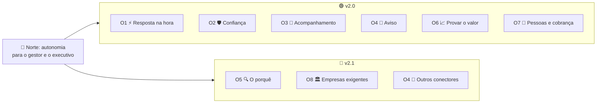

# Mapa de objetivos e funcionalidades do Horus v2

Situação: ✅ objetivos confirmados pelo dono (`D-136`) · ✅ funcionalidades e entregas decididas (`D-105` a `D-135`).

Última atualização: 03/11/2026 (a `D-145`: a segurança dos dados por pessoa inteira na v2.1).

É o mapa para **iniciar o desenvolvimento de forma estruturada** (`D-134`). Para cada objetivo do produto, mostra as funcionalidades que o cumprem, a entrega em que cada uma sai e onde está a definição. **Ele não decide nada novo:** resume e aponta para o [backlog estratégico](backlog-estrategico.md). Se houver divergência, vale o backlog.

Legenda: ✅ decidido pelo dono · 🆕 proposto pelo PO, aguardando o dono · 🔎 leitura do PO, a confirmar. A **v2.0** é a primeira entrega do Horus v2, e a **v2.1**, a segunda (`D-135`). A **v1.xx** é o Horus de hoje, ponto de partida e fonte de reaproveitamento (`D-134`). **Macro funcionalidade (mf)** é cada peça do [mapa das mfs](04-macro-funcionalidades-de-hoje.md), citada como `MF-nnn:Nome`.

## 1. O objetivo do produto ✅

| Campo | O que diz | Decisão |
| --- | --- | --- |
| 🧭 **Norte** | Autonomia: o gestor e o executivo decidem com dados sem depender do time de dados | `D-001` |
| 💬 **Promessa** | "Informação na palma da mão" (nome de trabalho; a frase final mora na comunicação da Maind) | `D-012` |
| ⚡ **"Em segundos"** | Rápido em comparação com o pedido ao time de dados, que às vezes leva dias; não é um tempo cronometrado | `D-125` |
| 📈 **Como se mede** | No produto, as perguntas de análise respondidas e a qualidade das respostas. Fora dele, com cada cliente, o saving | `D-004`, `D-132` |
| 🚫 **Limite** | O Horus só lê: nunca altera dados nem age nos sistemas da empresa | `D-001`, `D-022` |
| 👥 **Para quem** | O gestor de área, o executivo e o comprador, numa empresa que usa o Horus por dentro, em SaaS primeiro | `D-009`, `D-016` |

## 2. Os objetivos das entregas ✅

| Entrega | Objetivo | De onde vem |
| --- | --- | --- |
| 🟢 **v2.0** | O gestor e o executivo **perguntam e têm a resposta na hora**, **acompanham o negócio** em boards e **são avisados** quando algo muda. A resposta é confiável, com a fonte à vista, e cada organização vê só os próprios dados (`D-145`). A empresa mede a adoção e paga por assento. | O objetivo confirmado na `D-106` (o problema nº 1), ampliado pela `D-119` (o acompanhamento) e pela `D-122` (o aviso) |
| 🔵 **v2.1** | A pessoa **descobre o porquê** de uma mudança, passo a passo, e o Horus **chega a empresas mais exigentes**: com login e segurança corporativos, com a própria marca ou com os dados dentro de casa. | As quatro candidatas da `D-121` |

Os dois objetivos foram propostos pelo PO e confirmados pelo dono em 02/11/2026 (`D-136`). O da v2.0 atualiza o texto da `D-106`, que falava só do problema nº 1, com a ampliação da `D-119` e da `D-122`.

## 3. Os objetivos e as funcionalidades

As funcionalidades estão agrupadas em **oito objetivos**, propostos pelo PO e confirmados pelo dono (`D-136`). Cada funcionalidade é uma candidata da pontuação (nº) ou uma parte da base herdada da v1.xx.

| Objetivo | Problema do norte | Entregas |
| --- | --- | --- |
| **O1** ⚡ Perguntar e ter a resposta na hora | nº 1, a pergunta de análise na hora | v2.0 |
| **O2** 🛡️ Confiar no que vê | nº 1, a confiança | v2.0, com a auditoria; a segurança por pessoa o completa na v2.1 (`D-145`) |
| **O3** 📌 Acompanhar o negócio | o acompanhamento recorrente | v2.0 |
| **O4** 🔔 Ser avisado sem perguntar | nº 3, o aviso | v2.0, com parte na v2.1 |
| **O5** 🔍 Descobrir o porquê | nº 2, a investigação | v2.1 |
| **O6** 📈 Provar o valor e vender | a medida do norte | v2.0 |
| **O7** 🏢 Organizar as pessoas e cobrar | as condições da organização e do negócio | v2.0 |
| **O8** 🏛️ Atender empresas com exigências próprias | a expansão para clientes maiores | v2.1 |

| Objetivo | Mf | Funcionalidade | Nº | Entrega | Definição |
| --- | --- | --- | --- | --- | --- |
| O1 | `MF-107:Perguntar aos dados em português` | A conversa de análise, com os três modos, os cinco níveis de inferência e a Análise avançada | base | v2.0 | `D-021` |
| O1 | `MF-107:Perguntar aos dados em português` | Resposta em segundos na reunião | 1 | v2.0 | `D-126` |
| O1 | `MF-107:Perguntar aos dados em português` | Retorno do usuário: 👍🏻, 👎🏻 e 🚫, com o reporte ao owner | 2 | v2.0 | `D-129` |
| O1 | `MF-108:Respostas visuais` | Gráficos, tabelas, KPIs, mapa de calor, chaveamento e fluxo | base | v2.0 | `D-021` |
| O1 | `MF-110:Pergunta rápida` | Perguntar de qualquer tela, num botão flutuante | 14 | v2.0 | `D-089` |
| O1 | `MF-111:Chat pelo WhatsApp` | Conversar com o Horus pelo WhatsApp | 18 | v2.0 | `D-099` |
| O1 | `MF-104:Conectar as fontes vivas` | Os bancos e as fontes da empresa, com o modelo semântico | base | v2.0 | `D-021` |
| O1 | `MF-109:A web como fonte` | A web como fonte viva completa, com link e data, em qualquer nível | 3 | v2.0 | `D-131` |
| O1 | `MF-105:IA sob controle da organização` | As conexões de IA, o modelo por função, o consumo e o custo | base | v2.0 | `D-021` |
| O2 | `MF-106:Segurança dos dados por pessoa` | Acesso configurado dentro do Horus (etapa 1) | 10 | v2.1 | `D-028`, `D-145` |
| O2 | `MF-116:Auditoria` | O rastro de quem entregou o quê e de quem abriu | 17 | v2.0 | `D-093` |
| O3 | `MF-112:Boards e Relatórios` | Boards e relatórios como uma coisa só: o board vivo e em PDF e a publicação; a liberação de dados do gestor, na v2.1 | 8 | v2.0 | `D-058`, `D-145` |
| O4 | `MF-115:Agentes ativos` | O trabalhador de IA que extrai, analisa e avisa | 7 | v2.0 | `D-062` |
| O4 | `MF-114:Módulo de Agendamentos de Agentes` | O relógio: quando gerar e enviar | 13 | v2.0 | `D-060` |
| O4 | `MF-113:Conectores de Saída` | O carteiro, com o e-mail e o WhatsApp | 12 | v2.0 | `D-041`, `D-124` |
| O4 | `MF-113:Conectores de Saída` | Os demais conectores, como Teams e Google Chat 🔎 | parte da 12 | v2.1 | `D-121`, `D-124` |
| O5 | `MF-119:Investigação guiada` | Descobrir o porquê de uma mudança, passo a passo | 16 | v2.1 | `D-081` (definição pendente, `P-018`) |
| O6 | `MF-117:Home da organização` | A medida de autonomia e a qualidade das respostas, na Home | 4 | v2.0 | `D-133` |
| O6 | `MF-118:Bases de demonstração` | As bases de uma rede fictícia, para demonstrar e vender | base | v2.0 | `D-021` |
| O7 | `MF-102:Organizações, pessoas e papéis` | A gestão de pessoas inteira: gestor, quarentena, grupos e roles | 9 | v2.0 | `D-056`, `D-114` |
| O7 | `MF-101:Administração da instância` | A administração da instância, com o painel dos assentos | base | v2.0 | `D-021`, `D-080` |
| O7 | `MF-103:Licenças e planos` | A cobrança por assento, num plano só, com um owner grátis por organização | 15 | v2.0 | `D-080`, `D-117`, `D-123` |
| O8 | `MF-106:Segurança dos dados por pessoa` | A segurança corporativa integrada, com o login corporativo (etapa 2) | 11 | v2.1 | `D-028`, `D-118` |
| O8 | `MF-101:Administração da instância` | A marca completa do contratante | 6 | v2.1 | `D-011`, `D-121` |
| O8 | `MF-104`, `MF-105` e `MF-103` | O Horus dentro da infraestrutura do contratante (on-premises) | 5 | v2.1 | `D-016`, `D-121` (ativação dos assentos: `P-016`) |

## 4. As entregas num relance

| Entrega | Objetivos | Candidatas | Base herdada da v1.xx |
| --- | --- | --- | --- |
| 🟢 v2.0 | O1, O2, O3, O4, O6 e O7 | 13: as nº 1, 2, 3, 4, 7, 8, 9, 12, 13, 14, 15, 17 e 18 | As oito mfs da `D-021` |
| 🔵 v2.1 | O5 e O8, o resto do O4 e o resto do O2 | 5: as nº 5, 6, 10, 11 e 16 (a nº 10 veio da v2.0, `D-145`) | — |

O detalhe da v2.0 (as regras de cada funcionalidade, os riscos e as dependências) está em [A v2.0 consolidada](05-v2.0-consolidada.md). A tabela por entrega, mf a mf, está em [As versões](06-versoes.md).

## 5. O que a v2 pode reaproveitar da v1.xx 🔎

A v1.xx já entrega boa parte da base. O que se reaproveita, e quanto, quem confere é o arquiteto (`P-003`, `P-008`).

| O que a v1.xx tem | Serve de partida para |
| --- | --- |
| A conversa de análise, os blocos visuais, as fontes vivas, a web, a IA por função, a Home e as bases de demonstração | O1, O6 e a base herdada (`D-021`) |
| A segurança por pessoa (claims, reescrita e verificação da consulta) | O2 e O8, as duas etapas da `MF-106:Segurança dos dados por pessoa`, na v2.1 (`P-008`, c; `D-145`) |
| Owner, gestor, membro, convites e várias organizações | O7, a `MF-102:Organizações, pessoas e papéis` (`P-008`, j, k, l) |
| Os boards e os relatórios em PDF | O3, a `MF-112:Boards e Relatórios` (`P-008`, a, n) |
| A agenda e o envio por e-mail dos relatórios | O4, a `MF-114:Módulo de Agendamentos de Agentes` e a `MF-113:Conectores de Saída` (`P-008`, f, g) |

## 6. O que falta para começar o desenvolvimento

| Item | Quem | Trava |
| --- | --- | --- |
| `P-002`: confirmar o inventário de lacunas e medir o tempo de resposta | O arquiteto | A v2.0 |
| `P-003`: conferir o que da v1.xx se reaproveita | O arquiteto | A v2.0 |
| `P-008`: confirmar as 27 hipóteses técnicas, 25 delas sobre a v2.0 | O arquiteto | A v2.0 |
| `P-018`: a definição macro da investigação guiada | O dono | A v2.1 |
| `P-016`: ativar os assentos no on-premises | O dono, com o arquiteto | A v2.1 |
| `P-022`: o preço em reais | O dono e o comercial da Maind | Não trava |

⚠️ A skill do arquiteto de soluções ainda não existe. Enquanto não existir, a `P-002`, a `P-003` e a `P-008` não têm quem as conduza.

## 7. Como manter

- O mapa **resume e aponta**. Quando uma decisão mudar, o backlog muda primeiro, e este mapa o acompanha.
- Funcionalidade nova entra numa linha da seção 3, com o objetivo, a mf, a entrega e a decisão que a sustenta.
- Os objetivos (O1 a O8) estão confirmados (`D-136`). Mudar um objetivo pede uma decisão nova no backlog.
